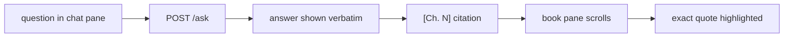

# book-companion-ui

UI work in NekoHon. Read `docs/GOAL.md` first — only the constitution there can
block work — then the hard rules in `AGENTS.md`. This skill is a tactic; the goal
it serves is one line of `docs/GOAL.md`: **the reader is the judge**. A UI that
reads as broken (a refusal that looks like an error, a miss that looks like a
citation) is a failure even when every mechanism is green.

## What exists today

- `web/` is a Next.js app: library start menu, a three-column reader, margin
  cards, a selection lens and a bottom composer. File map and conventions:
  `web/README.md`; architecture: `docs/ENGINEERING.md`; current reader and
  margin behavior: `artifacts/plans/pane-now.md`; condensed design research:
  `references/gloss-and-craft.md`. `npm run dev` serves :3100 against the
  engine on :8000; `npm run build` writes `web/out`, which the engine serves at
  `GET /`.
- `window/index.html` is the no-build fallback page for `GET /` when `web/out`
  does not exist. It is the reference for the honesty labels ("nearest misses:",
  "nearby, not an answer", "Show the key").
- The UI posts to `POST /ask` and reads `answer`, `refused`,
  `citations[{chunk_id, chapter, quote, doc}]`, `figures[{id, chapter, caption,
  src}]`, `error`. `chapter` is what `[Ch. N]` is built from.
- Layout: `.reader-grid` has a left minimap (`components/reader/Rail.tsx`), the
  book prose (`components/reader/Reader.tsx`, blocks carry `data-chunk-id`), and
  a right margin (`components/margin/Margin.tsx`, `MarginCard.tsx`) with a
  collision solver, crowded cards collapsing to pills, and an SVG leader curve.
- Selection lens (`components/reader/Lens.tsx`): Explain, Ask, Copy, four
  highlighter colors. Composer (`Composer.tsx`) and TopBar (`TopBar.tsx`): the
  whole-book question box, chapter menu, library button, and the appearance menu
  (5 themes, 4 pens, text size) in `lib/appearance.ts`.
- Streaming: `lib/stream.ts` reads NDJSON frames; `lib/store.ts` keeps cards,
  turns (up to two sent as `history`), highlights and per-book persistence
  (`lib/persist.ts`). `components/reader/AnswerView.tsx` renders gloss first,
  then the italic quote with its chapter chip, `Read as:` and refusals.

## The look: quiet, book-like, reading-first

- The UI should read like a well-set margin note in a book, not like a chat
  product. When in doubt, remove an element rather than style it.
- Offline serif (`Iowan Old Style`, `Palatino Linotype`, `Georgia`) is the text
  face; system UI sans for controls. No webfonts — the app is offline.
- Body 15–26px (`19px` default), leading 1.78, measure `--m: min(calc(var(--read-size, 19px) * 34), 46rem)`.
  Answers and quotes use the text face, never monospace (`tests/test_frontend_rules.py`).
- All colours, shadows, sizes, spacing, and durations live as CSS custom
  properties in `web/app/tokens.css`; zero hex or `rgb()`/`rgba()` literals
  anywhere else (`tests/test_frontend_rules.py`).
- Every motion has a `prefers-reduced-motion: reduce` path in `web/app/globals.css`.

## Reader + margin: the three-column layout

- At `>= 1260px`: `48px` left minimap rail, center prose column (`--m`), and
  `320px` right margin column (`28px` column gap). At `1080px–1259px`: prose +
  `320px` right margin. Below `1080px`: single prose column, with the active
  margin card rendered in a slide-up bottom sheet (`.gloss-sheet`).
- Margin cards (`Margin.tsx` + `MarginCard.tsx`) sit in the right margin beside
  the passage they came from, positioned by a two-way collision solver (`GAP=16`,
  `GAP_MINI=6`, `CROWD=88`). When another note's anchor is within `88px`,
  inactive notes collapse into a compact single-line `.is-mini` pill. Active or
  hovered notes draw an SVG cubic Bezier leader curve across the gutter.
- An answer renders reader-first (owner decision 2026-10-15): the gloss —
  what the model says in plain words — first, then its evidence quote in
  italics with the `Ch. N` chip (from `citations[].chapter`) beside it; the
  quote and the chip are both clickable and jump to the passage, marking it.
  The words stay verbatim — only their order and styling change. When a
  citation's quote cannot be found in the answer text, fall back to the
  verbatim `answer` plus the chips row; a citation is never lost. `chunk_id`
  is not a reader-facing citation.
- The book's words keep their quotation marks (the quote span renders with
  `“…”`), so the model's gloss and the book's text can never be confused. With
  two or more citations each chip carries its index in the engine's order
  (`1 · Ch. 4`) so the reader can trace how the answer was built. A citation
  jump is instant and corrected over the next frames — `content-visibility`
  estimates off-screen chunk heights, so a single scroll can land off-target.
- Citation click → jump + highlight: scroll the book pane to the cited passage
  and highlight exactly the `quote` string from that citation — never a
  re-typed, reformatted, or trimmed variant. If the passage is not in the
  pane's loaded content, say so with the chapter number instead of scrolling
  somewhere approximate.
- The highlight is visible, dismissible (Escape or a click elsewhere), and
  announced once to assistive tech; it never persists silently into the next
  question. **Dismiss on `pointerdown`, never on `click`**: a mouse
  drag-selection fires `pointerup` (which opens the lens and drops the native
  selection) and then a native `click` on the paragraph — a `click` handler
  that clears the highlight kills the lens on the same frame (the selection
  already reads as collapsed). Guard the press handler with
  `closest("mark, .margin-card, .lens")` so the pill, the card, and the
  highlighted words are never treated as "elsewhere".
- Keep the existing honesty labels in spirit: "nearest misses:" when a refusal
  still lists them, "nearby, not an answer" on figures during a refusal, "Show
  the key" for quiz. A miss must never look like a citation.

## States — build all of them

- **loading** — an honest wait state ("Looking…" today), input disabled, no fake
  progress. The first ask after a cold start can take ~25 s (model load). Real
  streaming is shipped (`stream=1` NDJSON, phase 1) — show tokens as they
  arrive; never fake token-by-token on a frozen response.
- **refusal** — exactly `Not in this book.`, period included, styled as an
  answer, not an error: no red, no icon, no emoji, no apology copy, no invented
  elaboration. Nearest-miss citations (if any) and "nearby, not an answer"
  figures stay visually subordinate.
- **error** — transport, server, or Ollama failure: show `body.error` plainly,
  say what failed and what to do (start the engine), never dress it as a
  refusal, never invent an answer to fill the pane.
- **empty** — before the first question: the input ready, the modes
  plain-labelled (Answer / Quote first), and at most a few suggestions that are real questions this book can
  answer. Never fake Q&A pairs, never sample facts.
- **figure** — reserve the image's aspect so text does not jump (the engine
  sends each figure's real width/height); if the bytes fail, keep the caption
  and alt text.
- **long answer** — several citations and figures scroll as one readable column;
  preserve line breaks without monospace.
- **reset / the hold** — the engine discards provisional drafts itself: it
  streams tokens only for the generation whose text becomes the answer, so the
  pane shows one continuous stream and the `reset` frame usually arrives
  before anything was shown (no-op it). A rejected retry is the one case that
  swaps — at the end, when `final` replaces the text with `final.body.answer`
  verbatim.

## Anti-slop checklist (run before showing anyone)

- Spacing: one scale (4px base) used everywhere; the gap between sections larger
  than any gap inside one; no 13px/17px one-offs.
- Hierarchy: two or three sizes, no more; if everything is emphasised, nothing
  is. No eyebrow labels above headings, no 01/02/03 numbering, no tiny uppercase
  tracked labels.
- Contrast: check each ink against the actual paper ground at 4.5:1 for body
  text and 3:1 for large text and marks — with a calculator, not the eye. `#666`
  secondary and the ochre accent are the ones to check first on a tinted ground.
- Banned: gradients; shadows on things at rest; glass/backdrop blur; chat
  bubbles, avatars, typing dots; icon-topped feature cards; a styled accent word
  inside a heading; emoji anywhere, including empty states; monospace outside
  the key/code view.
- Content: real content in every mockup and screenshot — real questions, real
  chapter names, real quotes from the book. Never Lorem Ipsum, "John Doe",
  "Acme", invented facts, or invented statistics. Plain words: no "Elevate",
  "Seamless", "Unleash".
- Keyboard and reading order: sensible tab order, visible focus rings, the new
  answer announced to a live region.

## Self-review loop (screenshot, judge, fix)

1. Serve (`python3 -m engine.server`, then `cd web && npm run dev` →
   `http://localhost:3100`) and capture the
   states that matter — idle, answer, refusal, error, citation-highlight — at
   1440 / 768 / 390 px in a real browser or headless Chrome.
2. Judge only the pictures. Write the top three problems in the order a reader
   would hit them; fix those three; re-shoot. Three rounds maximum, then stop
   and report what is still wrong.
3. If no screenshot path exists at all, say so explicitly and critique from the
   source — do not claim a look-check you did not run, and do not round a fail
   into a pass.
4. Screenshots land in `artifacts/runs/` (gitignored).

## Repo bindings (these override taste)

- **Toolchain boundary:** the engine is stdlib Python; Node, npm and a build
  step live under `web/` only. The built UI is a static export the engine
  serves, so production is one URL and one process; development runs `next dev`
  (port 3100) against the engine (port 8000). The UI calls the engine directly
  (CORS allows the dev origins only) with a hand-rolled NDJSON reader
  (`web/lib/stream.ts`): no AI SDK, no Next proxy route, no component library
  without a recorded owner decision. A vendored library needs a `vendor/` copy,
  its license, and a recorded megabyte count before the download (AGENTS.md).
- **Local only:** the UI makes no external requests: no webfonts, no
  analytics, no CDNs. Test: wifi off, the UI looks and works the same.
- **Contract:** only the routes listed in AGENTS.md (`POST /ask` with
  `stream=1`, `GET /chunks`, `GET /health`, `GET /figures/{id}`, `GET /`); the
  `POST /ask` request/response shape is frozen, and additive fields ship only
  with a recorded owner decision.
  Render the fields the engine returns and show `answer` verbatim — never
  paraphrase, silently truncate, or "clean up" it; `Asked as:` / `Read as:`
  disclosures are part of the answer and stay visible.
- **The reader is the judge:** a true answer, an honest refusal, a citation
  they can check. A polished pane that blurs the miss/answer distinction or
  prettifies a refusal has failed, whatever the code says.
- **Tests stay green:** `python3 -m unittest discover -s tests` must stay green.
  UI work should not touch `*.py`; if it does (`engine/server.py`), re-run the suite
  and restart the engine per AGENTS.md before judging the result.
- **Book-agnostic:** do not hardcode `book_id` in more places and do not name
  this book in UI copy; the UI reads what the engine already gives it.
- Reports and diagrams follow the repo: real mermaid, never ASCII; measured
  claims with their command and numbers, not impressions.

Adapted from taste-skill (MIT, Leonxlnx) — design-taste-frontend, minimalist-ui,
high-end-visual-design; the house rules, anti-slop bans, and the look-and-fix
loop are theirs, re-aimed at this repo's constitution.
