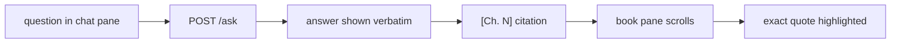

# book-companion-ui

UI work in `ask-this-book`. Read `GOAL.md` first — only the constitution there can
block work — then the hard rules in `AGENTS.md`. This skill is a tactic; the goal
it serves is one line of `GOAL.md`: **the reader is the judge**. A window that
reads as broken (a refusal that looks like an error, a miss that looks like a
citation) is a failure even when every mechanism is green.

## What exists today

- `window/index.html` is the entire frontend: one file, inline `<style>` and
  `<script>`, no build step, no npm, served at `GET /`.
- Georgia serif, `max-width: 42rem`; paper-white ground; the only accent is the
  ochre `#8a6d00` on `.nearby`; `#refs` prints bare `chunk_id`s and `#answer` is
  a `<pre>`.
- Modes come from the form: `answer` (default), `ask`, `explain`, `quiz`; the
  quiz key hides behind "Show the key".
- It posts to `POST /ask` and reads `answer`, `refused`,
  `citations[{chunk_id, chapter, quote, doc}]`,
  `figures[{id, chapter, caption, src}]`, `error`. `chapter` is what `[Ch. N]`
  is built from; `doc` is the book file the citation lives in.
- The reader + chat window is **approved** (user, 2026-10-15). The build order,
  the references, and the open decisions live in
  `artifacts/plans/frontend-build-plan-2026-10-15.md`; the older direction doc
  (locator strategy, foliate-js) is `artifacts/plans/frontend-navigation-plan.md`.
  Follow the build plan's phase order; do not skip ahead to the margin layout.

## The look: quiet, book-like, reading-first

- The window should read like a well-set margin note in a book, not like a chat
  product. When in doubt, remove an element rather than style it.
- Georgia is the text face and stays the default; at most one system UI sans for
  controls. No webfonts — the app is offline.
- Body 16–20px, leading 1.45–1.6, measure 45–75 characters. Answers and quotes
  are prose and use the text face, not `<pre>` monospace.
- Two or three sizes do the work: one large (chapter/title), one body, one small
  (citations, meta). Left-aligned, ragged right.
- Colour is scarce: one paper ground, one ink (off-black, never `#000`), one
  muted ink, one accent on actions and marks only.
- All colours, sizes, spacing, and durations live as CSS custom properties in
  `:root`; nothing downstream hardcodes a hex or a px one-off. Reference values:
  `references/tokens.css` in this skill — copy from there, do not invent a
  second palette.
- Surfaces separate by a tone step or space, not by decorative 1px rules or
  shadows. No gradients, no glass/backdrop blur, no emoji.
- Motion is restrained: `transform`/`opacity` only, 120–240ms, ease-out. Nothing
  moves that the reader did not cause — except one quiet fade for a new answer
  and the highlight. Every motion has a `prefers-reduced-motion: reduce` path
  that shows everything at rest.

## Reader + chat: the two-pane layout

- On a wide window: book pane at the reading measure (45–75 characters), chat
  pane narrower with a fixed upper bound. The pane split is one structural
  divider or a tone step, not a card.
- Panes scroll independently; never nest a scroll trap. On narrow widths,
  collapse to one column — book first, chat below, or a plain switcher; never
  two squeezed columns.
- Margin answer (the Gloss pattern, phase 2): where width allows, an answer may
  sit in the margin beside the paragraph it came from, aligned to it. It takes
  its own column — it never covers, overlaps, or reflows the book text. Below
  ~900px it falls back into the chat pane.
- An answer is prose: the `answer` string shown verbatim, quoted passages set as
  quotes, `[Ch. N]` (from `citations[].chapter`) as a small link after the
  passage. `chunk_id` is not a reader-facing citation.
- Citation click → jump + highlight: scroll the book pane to the cited passage
  and highlight exactly the `quote` string from that citation — never a
  re-typed, reformatted, or trimmed variant. If the passage is not in the
  pane's loaded content, say so with the chapter number instead of scrolling
  somewhere approximate.
- The highlight is visible, dismissible (Escape or a click elsewhere), and
  announced once to assistive tech; it never persists silently into the next
  question.
- Keep the existing honesty labels in spirit: "nearest misses:" when a refusal
  still lists them, "nearby, not an answer" on figures during a refusal, "Show
  the key" for quiz. A miss must never look like a citation.

## States — build all of them

- **loading** — an honest wait state ("Looking…" today), input disabled, no fake
  progress. The first ask after a cold start can take ~25 s (model load). If the
  contract returns one JSON body, do not fake token-by-token streaming; a
  typewriter effect on a frozen response lies about latency. Real streaming is
  an approved phase-3 addition (`stream=1` NDJSON) — check the build plan.
- **refusal** — exactly `Not in this book.`, period included, styled as an
  answer, not an error: no red, no icon, no emoji, no apology copy, no invented
  elaboration. Nearest-miss citations (if any) and "nearby, not an answer"
  figures stay visually subordinate.
- **error** — transport, server, or Ollama failure: show `body.error` plainly,
  say what failed and what to do (start the engine), never dress it as a
  refusal, never invent an answer to fill the pane.
- **empty** — before the first question: the input ready, the four modes
  plain-labelled, and at most a few suggestions that are real questions this
  book can answer. Never fake Q&A pairs, never sample facts.
- **figure** — reserve the image's aspect so text does not jump; if the bytes
  fail, keep the caption and alt text.
- **long answer** — several citations and figures scroll as one readable column;
  preserve line breaks without monospace.

## Anti-slop checklist (run before showing anyone)

- Spacing: one scale (4px base) used everywhere; the gap between sections larger
  than any gap inside one; no 13px/17px one-offs.
- Hierarchy: two or three sizes, no more; if everything is emphasised, nothing
  is. No eyebrow labels above headings, no 01/02/03 numbering, no tiny uppercase
  tracked labels.
- Contrast: check each ink against the actual paper ground at 4.5:1 for body
  text and 3:1 for large text and marks — with a calculator, not the eye. `#666`
  secondary and the ochre accent are the ones to check first on a tinted ground.
- Banned: gradients; shadows on things at rest; glass/backdrop blur; chat
  bubbles, avatars, typing dots; icon-topped feature cards; a styled accent word
  inside a heading; emoji anywhere, including empty states; monospace outside
  the key/code view.
- Content: real content in every mockup and screenshot — real questions, real
  chapter names, real quotes from the book. Never Lorem Ipsum, "John Doe",
  "Acme", invented facts, or invented statistics. Plain words: no "Elevate",
  "Seamless", "Unleash".
- Keyboard and reading order: sensible tab order, visible focus rings, the new
  answer announced to a live region.

## Self-review loop (screenshot, judge, fix)

1. Serve (`python server.py`, then `http://127.0.0.1:8000/`) and capture the
   states that matter — idle, answer, refusal, error, citation-highlight — at
   1440 / 768 / 390 px. `agent-browser` does not start on this box (daemon bind
   fails, os error 10013, measured 2026-10-12); use a real browser, or another
   working headless Chrome on the machine.
2. Judge only the pictures. Write the top three problems in the order a reader
   would hit them; fix those three; re-shoot. Three rounds maximum, then stop
   and report what is still wrong.
3. If no screenshot path exists at all, say so explicitly and critique from the
   source — do not claim a look-check you did not run, and do not round a fail
   into a pass.
4. Screenshots land in `artifacts/runs/` (gitignored); promote into
   `artifacts/evidence/<family>/` only when a doc names them, dated per
   `artifacts/README.md`. One live twin.

## Repo bindings (these override taste)

- **Stdlib, no build:** plain HTML/CSS/JS in `window/`. Splitting into
  `window/app.css` + `window/app.js` with `<link>`/`<script>` is fine; a
  bundler, framework, `package.json`, or CDN import is not. A vendored library
  (foliate-js, etc.) needs a `vendor/` copy, its license, and a recorded
  megabyte count before the download (AGENTS.md).
- **Local only:** the window makes no external requests — no webfonts, no
  analytics, no CDNs. Test: wifi off, the window looks and works the same.
- **Contract:** the four original routes plus the reader routes the build plan
  lists as approved (e.g. `GET /book/<path>`); the `POST /ask`
  request/response shape is frozen, and additive fields (e.g. `doc` on
  citations) ship only with a recorded yes in the build plan or a verdict doc.
  Render the fields the engine returns and show `answer` verbatim — never
  paraphrase, silently truncate, or "clean up" it; `Asked as:` / `Read as:`
  disclosures are part of the answer and stay visible.
- **The reader is the judge:** a true answer, an honest refusal, a citation
  they can check. A polished pane that blurs the miss/answer distinction or
  prettifies a refusal has failed, whatever the code says.
- **Tests stay green:** `python -m unittest discover -s tests` must stay green.
  UI work should not touch `*.py`; if it does (`server.py`), re-run the suite
  and restart the engine per AGENTS.md before judging the result.
- **Book-agnostic:** do not hardcode `book_id` in more places and do not name
  this book in UI copy; the window reads what the engine already gives it.
- Reports and diagrams follow the repo: real mermaid, never ASCII; measured
  claims with their command and numbers, not impressions.

Adapted from taste-skill (MIT, Leonxlnx) — design-taste-frontend, minimalist-ui,
high-end-visual-design; the house rules, anti-slop bans, and the look-and-fix
loop are theirs, re-aimed at this repo's constitution.
