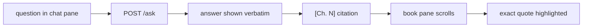

# book-companion-ui

UI work in `ask-this-book`. Read `docs/GOAL.md` first — only the constitution there can
block work — then the hard rules in `AGENTS.md`. This skill is a tactic; the goal
it serves is one line of `docs/GOAL.md`: **the reader is the judge**. A window that
reads as broken (a refusal that looks like an error, a miss that looks like a
citation) is a failure even when every mechanism is green.

## What exists today

- `window/index.html` is the v1 window: one file, inline `<style>` and
  `<script>`, no build step, no npm, served at `GET /` — still the reference
  for the quiz/explain modes and the honesty labels.
- Georgia serif, `max-width: 42rem`; paper-white ground; the only accent is the
  ochre `#8a6d00` on `.nearby`; `#refs` prints bare `chunk_id`s and `#answer` is
  a `<pre>`.
- Modes come from the form: `answer` (default), `ask`, `explain`, `quiz`; the
  quiz key hides behind "Show the key".
- It posts to `POST /ask` and reads `answer`, `refused`,
  `citations[{chunk_id, chapter, quote, doc}]`,
  `figures[{id, chapter, caption, src}]`, `error`. `chapter` is what `[Ch. N]`
  is built from; `doc` is the book file the citation lives in.
- The reader + chat frontend is **approved** (user, 2026-10-15) and the
  stack is decided: a **Next.js app under `web/`** (the frontend exception in
  AGENTS.md hard rules — Node + npm live there and nowhere else). The build
  order, the references, and the resolved decisions live in
  `artifacts/plans/frontend-build-plan-2026-10-15.md`; the older direction doc
  (locator strategy, foliate-js) is `artifacts/plans/frontend-navigation-plan.md`.
  Follow the build plan's phase order; do not skip ahead to the margin layout.
- `window/index.html` (the vanilla window) stays working until the Next app
  covers all four modes; it is the reference for the honesty labels
  ("nearest misses:", "nearby, not an answer", "Show the key").
- **`web/` — the Next.js reader + margin companion (Phase 1 landed 2026-10-15; full Gloss port landed 2026-10-16).** Runs
  `npm run dev` on :3100 against the engine on :8000; `npm run build` writes
  the static export (`web/out/`, not yet served by the engine). File map and
  conventions: `web/README.md` and `artifacts/plans/pane-now.md`; condensed
  design research: `references/gloss-and-craft.md`. What the implementation
  does:
  - **3-column Gloss layout** (`.reader-grid`): left proportional minimap
    (`Rail.tsx` with chapter ticks, yellow highlight bars, vermilion gloss dots,
    and scrub thumb), center book prose (`Reader.tsx` with `data-chunk-id`
    blocks, chapter-opening drop caps, inline figures, and multi-layer
    `splitParagraphSegments` marks), and right margin column (`Margin.tsx` +
    `MarginCard.tsx` with two-way collision solver, crowd `.is-mini` collapse,
    and SVG cubic Bezier leader curve `.gloss-leader`).
  - **Selection pill (`Lens.tsx`)**: select text → floating pill with
    hover-expanding 4-color highlighter drawer (`yellow`, `green`, `blue`,
    `pink`), `Explain` (`mode: "explain"`), `Ask` (`mode: "ask"` with instant
    printable-key morph into input), and `Copy`.
  - **Bottom composer (`Composer.tsx`)** and **TopBar (`TopBar.tsx`)**: sticky
    whole-book composer (`/` to focus, suggestion pills, `Answer` /
    `Quote first` toggle, `Quiz` trigger) and scroll-tucking top bar with TOC
    dropdown and `Aa` appearance menu (5 themes: `night` default, `paper`,
    `sepia`, `snow`, `ink` with circular `startViewTransition` reveal; 4 rubric
    pens; text size 15–26px).
  - **Engine contracts**: `requestAnimationFrame`-batched NDJSON streaming,
    per-card `turns[]` with last-2-turns `history` follow-ups, `AnswerView.tsx`
    reader-first gloss + italic quote + `Ch. N` / `Preface` chips, `Read as:`,
    exact `Not in this book.` refusal + `nearest misses:`, `nearby, not an
    answer` on refusal figures, and `Show the key` on quiz cards.

## The look: quiet, book-like, reading-first

- The window should read like a well-set margin note in a book, not like a chat
  product. When in doubt, remove an element rather than style it.
- Offline serif (`Iowan Old Style`, `Palatino Linotype`, `Georgia`) is the text
  face; system UI sans for controls. No webfonts — the app is offline.
- Body 15–26px (`19px` default), leading 1.78, measure `--m: min(calc(var(--read-size, 19px) * 34), 46rem)`.
  Answers and quotes use the text face, never monospace (`tests/test_frontend_rules.py`).
- All colours, shadows, sizes, spacing, and durations live as CSS custom
  properties in `web/app/tokens.css`; zero hex or `rgb()`/`rgba()` literals
  anywhere else (`tests/test_frontend_rules.py`).
- Every motion has a `prefers-reduced-motion: reduce` path in `web/app/globals.css`.

## Reader + margin: the three-column layout

- At `>= 1260px`: `48px` left minimap rail, center prose column (`--m`), and
  `320px` right margin column (`28px` column gap). At `1080px–1259px`: prose +
  `320px` right margin. Below `1080px`: single prose column, with the active
  margin card rendered in a slide-up bottom sheet (`.gloss-sheet`).
- Margin cards (`Margin.tsx` + `MarginCard.tsx`) sit in the right margin beside
  the passage they came from, positioned by a two-way collision solver (`GAP=16`,
  `GAP_MINI=6`, `CROWD=88`). When another note's anchor is within `88px`,
  inactive notes collapse into a compact single-line `.is-mini` pill. Active or
  hovered notes draw an SVG cubic Bezier leader curve across the gutter.
- An answer renders reader-first (owner decision 2026-10-15): the gloss —
  what the model says in plain words — first, then its evidence quote in
  italics with the `Ch. N` chip (from `citations[].chapter`) beside it; the
  quote and the chip are both clickable and jump to the passage, marking it.
  The words stay verbatim — only their order and styling change. When a
  citation's quote cannot be found in the answer text, fall back to the
  verbatim `answer` plus the chips row; a citation is never lost. `chunk_id`
  is not a reader-facing citation.
- The book's words keep their quotation marks (the quote span renders with
  `“…”`), so the model's gloss and the book's text can never be confused. With
  two or more citations each chip carries its index in the engine's order
  (`1 · Ch. 4`) so the reader can trace how the answer was built. A citation
  jump is instant and corrected over the next frames — `content-visibility`
  estimates off-screen chunk heights, so a single scroll can land off-target.
- Citation click → jump + highlight: scroll the book pane to the cited passage
  and highlight exactly the `quote` string from that citation — never a
  re-typed, reformatted, or trimmed variant. If the passage is not in the
  pane's loaded content, say so with the chapter number instead of scrolling
  somewhere approximate.
- The highlight is visible, dismissible (Escape or a click elsewhere), and
  announced once to assistive tech; it never persists silently into the next
  question. **Dismiss on `pointerdown`, never on `click`**: a mouse
  drag-selection fires `pointerup` (which opens the lens and drops the native
  selection) and then a native `click` on the paragraph — a `click` handler
  that clears the highlight kills the lens on the same frame (the selection
  already reads as collapsed). Guard the press handler with
  `closest("mark, .margin-card, .lens")` so the pill, the card, and the
  highlighted words are never treated as "elsewhere".
- Keep the existing honesty labels in spirit: "nearest misses:" when a refusal
  still lists them, "nearby, not an answer" on figures during a refusal, "Show
  the key" for quiz. A miss must never look like a citation.

## States — build all of them

- **loading** — an honest wait state ("Looking…" today), input disabled, no fake
  progress. The first ask after a cold start can take ~25 s (model load). Real
  streaming is shipped (`stream=1` NDJSON, phase 1) — show tokens as they
  arrive; never fake token-by-token on a frozen response.
- **refusal** — exactly `Not in this book.`, period included, styled as an
  answer, not an error: no red, no icon, no emoji, no apology copy, no invented
  elaboration. Nearest-miss citations (if any) and "nearby, not an answer"
  figures stay visually subordinate.
- **error** — transport, server, or Ollama failure: show `body.error` plainly,
  say what failed and what to do (start the engine), never dress it as a
  refusal, never invent an answer to fill the pane.
- **empty** — before the first question: the input ready, the modes
  plain-labelled (the Next app: Answer / Quote first; the window keeps all
  four), and at most a few suggestions that are real questions this book can
  answer. Never fake Q&A pairs, never sample facts.
- **figure** — reserve the image's aspect so text does not jump (the engine
  sends each figure's real width/height); if the bytes fail, keep the caption
  and alt text.
- **long answer** — several citations and figures scroll as one readable column;
  preserve line breaks without monospace.
- **reset / the hold** — the engine discards provisional drafts itself: it
  streams tokens only for the generation whose text becomes the answer, so the
  pane shows one continuous stream and the `reset` frame usually arrives
  before anything was shown (no-op it). A rejected retry is the one case that
  swaps — at the end, when `final` replaces the text with `final.body.answer`
  verbatim.

## Anti-slop checklist (run before showing anyone)

- Spacing: one scale (4px base) used everywhere; the gap between sections larger
  than any gap inside one; no 13px/17px one-offs.
- Hierarchy: two or three sizes, no more; if everything is emphasised, nothing
  is. No eyebrow labels above headings, no 01/02/03 numbering, no tiny uppercase
  tracked labels.
- Contrast: check each ink against the actual paper ground at 4.5:1 for body
  text and 3:1 for large text and marks — with a calculator, not the eye. `#666`
  secondary and the ochre accent are the ones to check first on a tinted ground.
- Banned: gradients; shadows on things at rest; glass/backdrop blur; chat
  bubbles, avatars, typing dots; icon-topped feature cards; a styled accent word
  inside a heading; emoji anywhere, including empty states; monospace outside
  the key/code view.
- Content: real content in every mockup and screenshot — real questions, real
  chapter names, real quotes from the book. Never Lorem Ipsum, "John Doe",
  "Acme", invented facts, or invented statistics. Plain words: no "Elevate",
  "Seamless", "Unleash".
- Keyboard and reading order: sensible tab order, visible focus rings, the new
  answer announced to a live region.

## Self-review loop (screenshot, judge, fix)

1. Serve (`python server.py`; the Next app: `npm run dev` →
   `http://localhost:3100`) and capture the
   states that matter — idle, answer, refusal, error, citation-highlight — at
   1440 / 768 / 390 px. `agent-browser` does not start on this box (daemon bind
   fails, os error 10013, measured 2026-10-12); use a real browser, or another
   working headless Chrome on the machine.
2. Judge only the pictures. Write the top three problems in the order a reader
   would hit them; fix those three; re-shoot. Three rounds maximum, then stop
   and report what is still wrong.
3. If no screenshot path exists at all, say so explicitly and critique from the
   source — do not claim a look-check you did not run, and do not round a fail
   into a pass.
4. Screenshots land in `artifacts/runs/` (gitignored); promote into
   `artifacts/evidence/<family>/` only when a doc names them, dated per
   `artifacts/README.md`. One live twin.

## Repo bindings (these override taste)

- **Two toolchains, one product:** the engine is stdlib Python and stays that
  way; the frontend is Next.js under `web/` (the 2026-10-15 exception). Plain
  HTML/CSS/JS is still the rule for anything served by the engine itself.
  The built UI is a static export the engine serves, so production is one URL
  and one process; development runs `next dev` (port 3100) against the engine
  (port 8000). The engine's API is called directly — one CORS header for
  localhost, no proxy layer; the client is a hand-rolled NDJSON reader
  (`web/lib/engine.ts`) — no AI SDK, no Next proxy route, no component library
  without a recorded owner yes. A vendored library still needs a `vendor/` copy,
  its license, and a recorded megabyte count before the download (AGENTS.md).
- **Local only:** the window makes no external requests — no webfonts, no
  analytics, no CDNs. Test: wifi off, the window looks and works the same.
- **Contract:** the four original routes plus the reader routes the build plan
  approved (`GET /chunks`, `stream=1` on `POST /ask`); the `POST /ask`
  request/response shape is frozen, and additive fields (e.g. `doc` on
  citations) ship only with a recorded yes in the build plan or a verdict doc.
  Render the fields the engine returns and show `answer` verbatim — never
  paraphrase, silently truncate, or "clean up" it; `Asked as:` / `Read as:`
  disclosures are part of the answer and stay visible.
- **The reader is the judge:** a true answer, an honest refusal, a citation
  they can check. A polished pane that blurs the miss/answer distinction or
  prettifies a refusal has failed, whatever the code says.
- **Tests stay green:** `python -m unittest discover -s tests` must stay green.
  UI work should not touch `*.py`; if it does (`server.py`), re-run the suite
  and restart the engine per AGENTS.md before judging the result.
- **Book-agnostic:** do not hardcode `book_id` in more places and do not name
  this book in UI copy; the window reads what the engine already gives it.
- Reports and diagrams follow the repo: real mermaid, never ASCII; measured
  claims with their command and numbers, not impressions.

Adapted from taste-skill (MIT, Leonxlnx) — design-taste-frontend, minimalist-ui,
high-end-visual-design; the house rules, anti-slop bans, and the look-and-fix
loop are theirs, re-aimed at this repo's constitution.
