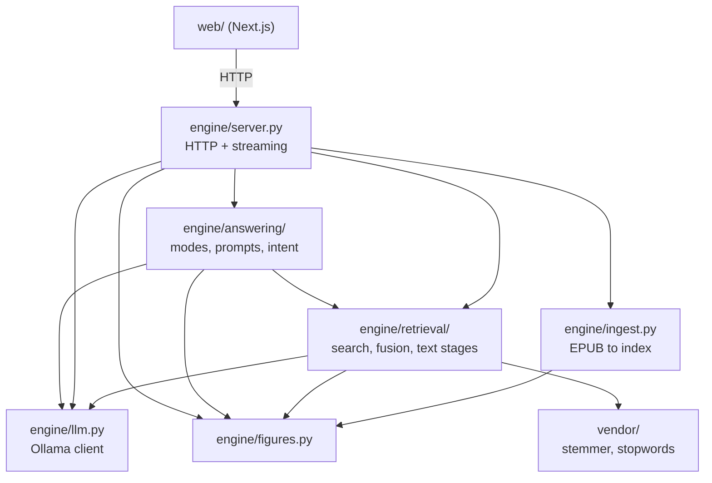

# AGENTS.md — NekoHon (ask-this-book)

Rules-and-state authority for agents and contributors. Read `docs/GOAL.md`
first (the goal and the constitution; only they can block work), then this
file. `README.md` is the human front page.

## Docs

- `docs/GOAL.md` — goal and constitution.
- `docs/ENGINEERING.md` — how the system works, module by module.
- `docs/DECISIONS.md` — why it is built this way; measured reasons and negative results.
- `docs/GLOSSARY.md` — vocabulary.
- `web/README.md` — frontend file map and conventions.
- `artifacts/README.md` — index of harnesses, datasets and plans.

## What this is

An offline book companion. EPUBs are ingested into JSON indexes; passages are
retrieved with a local embedder plus a lexical channel; a small local model
answers from those passages and cites them; figures the cited passages name are
shown. All inference is local Ollama on `127.0.0.1:11434`. No cloud API, no
database server.

## Repo map

- `engine/` — stdlib Python. `server.py` (routes, streaming, import, static
  files), `ingest.py` (EPUB to chunks and figures), `figures.py` (figure
  resolution from the filesystem), `llm.py` (Ollama chat and embed calls),
  `retrieval/` (index search, rank fusion, keyword gate, caption seeding, typo
  readings, text preprocessing), `answering/` (the four modes, prompts, query
  canonicalization, highlight intent; `answer.py` re-exports only the public API,
  module roles are in `docs/ENGINEERING.md`).
- `scripts/` — `launch.py` (start Ollama and engine, optional browser),
  `setup_models.py` (install and verify the models), `preflight.py` (readiness),
  `verify_index.py` (index hygiene), `measure_warmup.py`.
- `tests/` — `python3 -m unittest discover -s tests`; `fixtures/` holds the
  contract fixture.
- `web/` — the Next.js frontend. `app/` (page, tokens), `components/` with
  `reader/`, `margin/`, `library/`, and `lib/` (`store.ts`, `stream.ts`,
  `persist.ts`, `turns.ts`, `anchor.ts`, `engine.ts`). File map and
  conventions: `web/README.md`; agent notes: `web/AGENTS.md`.
- `artifacts/` — `harnesses/` (batteries, sweeps, judge, secret scan),
  `datasets/` (eval sets, question lists), `plans/` (forward-looking plans),
  `prune.py`, `README.md` (index).
- `archive/` — read-only history. Never edited, tested, or imported.
- `models/` — Ollama Modelfiles for the two student models.
- `vendor/` — vendored text-preprocessing tools with their licenses.
- `window/` — legacy no-build page.
- `docs/` — `GOAL.md`, `GLOSSARY.md`, `ENGINEERING.md`, `DECISIONS.md`.
- `.agents/skills/` — `book-companion-ui/` (load it for any UI work) and
  `verify/` (the gate, see Verify).
- Gitignored, machine-local: `books/` (EPUBs), `data/` (indexes, figures,
  catalog, model files, verify cassette), `artifacts/runs/`.

## Hard rules

Constitution (copy of `docs/GOAL.md`; keep in sync):

- Local only: Ollama on localhost. One eval-only exception, the cloud judge.
- Stdlib only. One exception: vendored preprocessing tools.
- Grounded: quotes come from the book; repairs never invent text.
- Refusal is exactly `Not in this book.`
- Measured, not asserted.

Rules that follow:

- Python stdlib by default (`zipfile`, `json`, `html.parser`, `urllib`,
  `http.server`, `pathlib`, `re`). No `requirements.txt`, no numpy. Text
  preprocessing may use standard tools vendored under `vendor/` with their
  license (stemmer, stopwords). If a non-preprocessing task seems to need a
  package, redesign the task.
- `urllib` talks only to this machine: Ollama at `127.0.0.1:11434` and the
  engine. Eval exception: the judge artifacts under `artifacts/harnesses/` call
  the configured judge (`JUDGE_BACKEND`, default the cloud judge; `ollama`
  restores the offline judge). The key comes from the environment or
  `JUDGE_API_KEY_FILE` (`.judge-key`, gitignored) and is never committed. The
  engine, server, and batteries never take this path.
- Frontend exception (owner decision 2026-10-15): Node + npm + a build step are
  allowed under `web/` only. The built UI makes no external requests (no
  webfonts, CDNs, analytics). The engine serves `web/out` at `GET /`.
- No pickle, marshal, shelve, or sqlite. Records are JSON. Pictures stay files
  under `data/figures/`. Never base64 images into an index.
- Only the documented routes (HTTP contract below).
- Logic modules stay book-agnostic: no chunk ids, figure ids, chapter numbers,
  query strings, or book ids in the logic modules that
  `tests/test_generalization.py` lists (with `tests/test_query_understanding.py`
  for query understanding). Pins and ids belong in tests and datasets. A constant is fitted if its
  only reason is which known test it keeps green; say so when you see one.
- Do not add code comments or docstrings to our code (`vendor/` and `archive/`
  excepted). Decisions and reasons live in `docs/`.
- Downloads need an explicit megabyte number first, except model pulls through
  `scripts/setup_models.py`.
- A server keeps the code and model it loaded at start. After any `engine/`
  edit or a change of `ANSWER_MODEL`, restart the engine and check
  `curl -s 127.0.0.1:11434/api/ps` before measuring. Keep exactly one listener
  on :8000.
- Report measured results: files changed, exact command, real output. A
  difference that cannot be told from luck is not a result. Temperature is 0,
  but local models are not bit-exact; treat one red probe as suspect until it
  repeats.
- Diagrams are real mermaid, never ASCII.
- Docs are engineering records for a public repo: measurements and decisions,
  no chat quotes. Attribute a decision as "owner decision YYYY-MM-DD".
- Do not commit unless the human asks. Never commit `data`, `books`, or
  `web/node_modules` symlinks.
- `tests/__init__.py` stays (a user-site `tests` package would shadow the
  directory).

## HTTP contract (frozen)

Routes, and only these: `POST /ask`, `GET /health`, `GET /figures/{id}`,
`GET /chunks`, `GET /` (serves `web/out/index.html` and its static assets; the
legacy `window/index.html` page is the fallback). Verified in
`engine/server.py`.

`POST /ask` request: `mode` (required), `book_id` (optional, default book),
`question`, `selection`, `heading`, `chunk_id`, `end_chunk_id`, `history`,
`stream`.

- `ask` — `question` required. A quote plus a one-line gloss. A reply that does
  not start with `[Ch.` is retried once with that prefix; a quote that is not
  verbatim passage text fails the check.
- `answer` — `question` required. The window default. Served the same trained
  prompt as `ask`; `[Ch. N]` tags in the reply become citations matched back to
  the shown passages; quotation marks the passages cannot back are stripped.
- `explain` — `selection` required; the selection is the question and its
  chapter neighborhood is the evidence.
- `quiz` — one question plus one key sentence from one chunk. No score.
- `import` — registers an EPUB (`data_base64` + `filename`, or `epub_path`),
  ingests and embeds it, updates the catalog.

200 body: `{"answer": str, "citations": [{"chunk_id", "chapter", "quote"}],
"figures": [{"id", "chapter", "caption", "src"}], "refused": bool}`. The shape
is pinned by `tests/fixtures/ask_response.json` and `tests/test_contract.py`.

- `refused: true` means `answer` is exactly `Not in this book.`, nothing else.
  Citations may list nearest misses; figures are empty unless a miss is itself
  a figure cite. In `answer` mode the refusal is the model's exact first line;
  in `ask` mode a line that starts that way and keeps talking is not a refusal.
- Errors: `400` bad mode or missing field (an import `epub_path` outside
  `books/` is a `400`), `404` unknown book, `413` body over 64 MiB, `400` invalid Content-Length, `500` model or
  index failure; body `{"error": "short reason"}`, no stack traces.
- `stream=1` returns NDJSON frames: `token`, `reset`, `final` (the full body),
  `error`.
- `GET /health` returns `ok`, `book_id`, `ollama`, `books` (the catalog) and
  `warm`. `GET /chunks?book_id=` returns the reader payload (gzip when
  accepted). `GET /figures/{id}` returns image bytes. CORS is open to the dev
  server on :3100 and :3200.

## Pipeline rules

Ingest (`engine/ingest.py`): read `META-INF/container.xml`, then the OPF spine,
one record per spine document. Chunks pack whole sentences to
`CHUNK_MAX_CHARS` (1400) with a sentence-aligned overlap of at most
`CHUNK_OVERLAP_CHARS` (180); headings start each section's chunk. A chunk
stores `chunk_id`, `chapter`, `heading`, `text`, plus metadata (`doc`,
`section`, `anchor`, `figures`) that never enters the embedded text. Figures
store `id`, `chapter`, `caption`, `referencing_paragraph`, `file`; the caption
is the caption element, else the alt text, else empty, never invented. Index
files are `data/index.<book_id>.json` and figures live under
`data/figures/<book_id>/`, except the default book `fde`, which uses
`data/index.json` and `data/figures/`; the catalog is `data/books.json`.

Retrieval (`engine/retrieval/`): embed `heading + text` with the embedder via
Ollama; search is a dot product over pre-normalized vectors; top 10, and the
answer layer shows 5 passages. A rare question word (gate in `keywords.py`)
triggers a lexical candidate that reciprocal rank fusion (`RRF_K = 60`) may
place among the dense results, admitted only inside a dense-rank band so it
cannot rescue an out-of-book question. A figure caption that outscores the best
chunk seeds the best chunk naming that figure. A question word absent from the
book may be read as its closest book word, kept only when it strictly improves
the best score, and disclosed with a `Read as:` line. A structurally bare
phrase is asked in question form and disclosed with an `Asked as:` line. Do not
raise top-k to hide a bad question.

Generation (`engine/answering/`): temperature 0, `num_predict` 512. Citations
are always passage text. The same retrieval feeds every mode. Quoted text may
differ from the passage only by figure references, typography, and whitespace.

Figure honesty: a figure is attached only when a passage the answer cited names
its number and the file exists. The answer may quote the caption and the citing
paragraph; it never claims to have read pixels.

## How to run

1. Install Ollama and start it. `python3 scripts/setup_models.py --status`
   then `--install` fetches the answer models and the embedder.
2. Add a book: drop an `.epub` on the library page, or
   `python3 -m engine.ingest --epub books/<name>.epub --book-id <id>` then
   `python3 -m engine.retrieval.retrieve` to embed (see `--help`).
3. Serve: `python3 -m engine.server` (port 8000, `--port N` or `$PORT`), or
   `python3 scripts/launch.py --open` (starts Ollama with tuned env, the engine,
   and the browser).
4. UI development: `cd web && npm run dev` (http://localhost:3100 against the
   engine on :8000). Production: `cd web && npm run build`; the engine serves
   `web/out` at `GET /`.
5. Readiness: `python3 scripts/preflight.py`; index hygiene:
   `python3 scripts/verify_index.py`.

## Verify

The gate is the `verify` skill, `.agents/skills/verify/SKILL.md`. Run it after
every change and before every commit:

- `python3 -m unittest discover -s tests`
- `python3 -m unittest tests.test_generalization tests.test_query_understanding`
- `python3 .agents/skills/verify/cassette.py replay` (byte-identical engine
  behavior against the recorded cassette; no Ollama needed)
- `python3 scripts/verify_index.py`
- `cd web && npx tsc --noEmit && npm run build`
- `python3 artifacts/harnesses/secret-scan.py`
- Live gate (engine and Ollama up): `python3 artifacts/harnesses/step2-battery.py`
  and `BATTERY_MODE=answer python3 artifacts/harnesses/step2-battery.py`.

Other harnesses: `hard-bench.py`, `qa-sweep.py`, `groundedness.py`, `eval.py`
and `judge*.py` (judge calls follow the eval exception), `adrian-eval.py`,
`crossbook-evil-eval.py`, `eval-plain.py`. Read a harness before running it:
some start live runs at once and have no `--help`.
Run output goes to `artifacts/runs/` (gitignored).

## Current state

- Default answer model: `nekohon_x3` (3B student; `nekohon_x3_mobile` is the
  1.5B companion). `ANSWER_MODEL=<tag>` overrides it; `ANSWER_MODEL=qwen2.5:7b`
  is the fallback. Embedder: `nomic-embed-text`. Both set in
  `engine/answering/prompt.py` and `engine/retrieval/retrieve.py`.
- Books are machine-local: `data/books.json` lists what this machine has
  ingested; the library shows only books the engine has indexed.
- Live: all four modes, streaming, the reader with margin cards, selection
  explain, follow-up chips, multi-book library, EPUB import.
- Not wired: the agentic retrieval prototype (archived).

## Artifacts policy

- `artifacts/` holds `harnesses/` (reusable runners), `datasets/` (eval sets),
  `plans/` (forward-looking, one file per track). `artifacts/runs/` and
  `artifacts/scratch/` are gitignored. `archive/` is read-only history.
- New reports and benchmark outputs carry their date in the name:
  `family-YYYY-MM-DD[-label].ext`. Promote a run out of `runs/` only when a doc
  names it, and index it in `artifacts/README.md`.
- A benchmark dated two or more days ago is stale: re-run it before building on
  it. Rot check: `python3 artifacts/prune.py --plan`.
- Docs record measurements and decisions, not chat.

## Open items

Forward-looking work and the backlog live in `artifacts/plans/` (`backlog.md`).

## Owner decisions that still constrain work

- 2026-10-13: Python stdlib only; vendored preprocessing tools are the one
  exception.
- 2026-10-13: diagrams are real mermaid.
- 2026-10-15: the frontend is Next.js under `web/`, with a build step there and
  nowhere else; the runtime stays local-only.
- 2026-10-15: the eval judge may use a cloud model; the engine never does.
- 2026-10-15: a refusal means only that the book does not cover the thing,
  never "I did not understand you"; conversational clarify turns stay parked.
- 2026-10-17: the models ship under the `nekohon_*` names.
- 2026-10-23: engine files are grouped in packages; code carries no comments.
