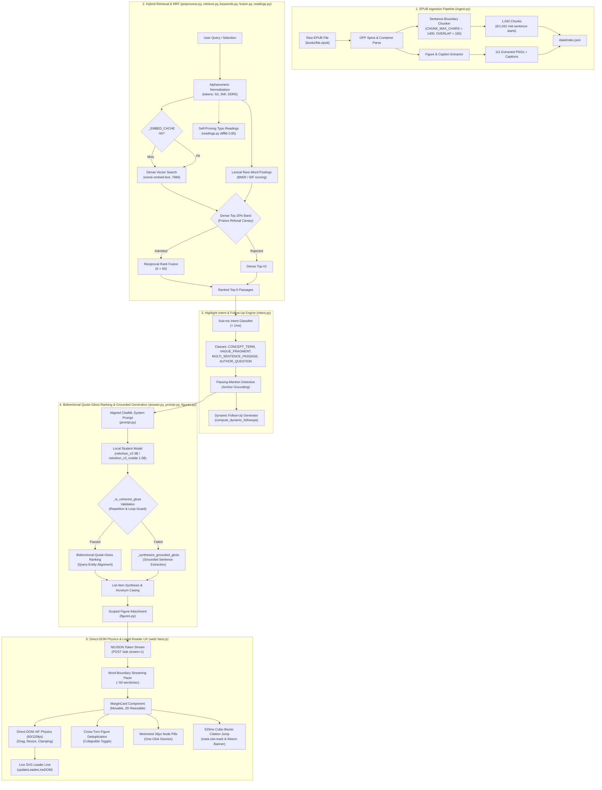
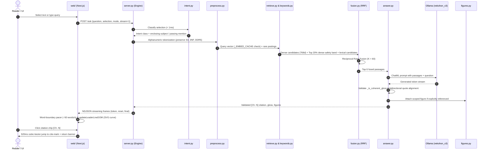

# Ask This Book — Build Plan

> **Status (2026-10-17): living plan.** This started as the locked v1 build
> plan (written 2026-10-09). v1 shipped — Phases 0–8 passed 2026-10-12 — and
> the plan now tracks the post-v1 path. Treat it as a sequence to the goal,
> not a contract: when this file and a dated report or the code disagree, the
> code wins — fix the plan. Two or more days old means re-check the numbers
> (artifacts staleness gate).

> **File note:** this plan lived at `README.md` until the repo was prepped for
> `nekolabs-studio/epub-local`; the self-references below to "the README" mean
> this file. The human-facing front page is now `README.md`.

> **For Hermes:** Use subagent-driven-development skill to implement this plan task-by-task.

**Goal:** An offline book companion that answers from the open book, cites the passages it used, and shows the figure those passages point at. Nothing leaves the machine.

**Architecture:** A stdlib Python engine ingests one EPUB into a JSON index, retrieves with the Phase 3b winning embedder (`nomic-embed-text` default), and answers with on-disk `nekohon_x3` (a Qwen2.5-3B wide-LoRA distilled student, renamed from `smallbook_x3` 2026-10-17; `nekohon_x3_mobile` 1.5B for mobile/edge; `ANSWER_MODEL=qwen2.5:7b` reverts). The frontend is a Next.js app under `web/` (reader + ask panes; see `web/README.md`); `window/index.html` is the legacy no-build window.

**Tech Stack:** Python 3 stdlib (one exception for vendored text-preprocessing tools; see `AGENTS.md`). Ollama on `127.0.0.1:11434`. No pip installs. No database server.

---

## End-to-End Subsystem Architecture

The system operates across five modular subsystems, keeping inference, vector indexing, and physics-driven UI local:





---

## Status

The product bet: local inference, cited answers, figures on screen, wifi off.

**Current (2026-10-17):** post-v1. `nekohon_x3` (3.1B, Q4_K_M, 1.93 GB (1,840.5 MiB); renamed from `smallbook_x3` 2026-10-17, same weights) is adopted as the primary desktop answer model (`prompt.ANSWER_MODEL = "nekohon_x3"`), succeeding `smallbook_x2g` and `smallbook_x2d`. `nekohon_x3_mobile` (1.5B, Q4_K_M, 986 MB (940.4 MiB)) serves edge and resource-constrained environments. All edge cases (alphanumeric acronyms, coreference follow-ups, natural comparison grammar, highlight intent) are resolved. Benchmark status: **60/60** Hard Benchmark, **24/24** Highlight Golden, **22/22** HTTP Battery, **370** unit tests. Report: `artifacts/reports/architecture-and-x3-2026-10-17.md`.

Two older drafts in `~/.hermes/cache/scratch/hackathon-plan.md` and `hackathon-plan-full.md` disagree with each other. This file replaces both.

**Machine note (2026-10-12):** Mac and Windows are both full runners. Windows has Ollama installed and the models on disk (`nomic-embed-text`, `qwen2.5:7b`); phases 0-7 were measured there, including the wifi-off gate. `books/` is gitignored, so Phase 0 runs once per machine. On Windows, `python3` in the verify commands means the Python 3 binary (`python` or `py -3` if `python3` is missing).

**Download budget (2026-10-11):** unlimited approved for embedder pulls and Windows runner setup. Every other download (book, Readest clone, anything else) still needs an explicit megabyte approval before transfer.

## What v1 is

One local EPUB. Ask a question. In `answer` mode (the window default) the model writes a direct answer from the retrieved passages with `[Ch. N]` citations; in `ask` mode you get a checked quote with a chapter tag, then one line of gloss. If a cited passage points at a figure, show that image with its caption. Highlighted text can be explained. Quiz is one question whose answer is a quote in the retrieved chunk.

The engine is the product. The HTML page exists so a person can see the answer, the citations, and the image. Polish is not the work.

## What v1 is not (v1 scope — revisit anytime)

These are scope choices for v1, not properties of the product. Any of them can
be reopened when the goal calls for it.

- The model looking at image bytes.
- Fusing anything retrieval did not surface: the `answer` mode may combine only the passages it was shown.
- Sparring, "argue the other side," or any mode not in the contract.
- A Readest fork on the critical path.
- A new embedding model (except the Phase 3b bake-off contenders), an embedder finetune, Laya, Bonsai, or `deepseek-r1:7b` (Mac only so far; wrong job: it rambles past the quote).
- A database, a package install (one exception: vendored text-preprocessing tools, see `AGENTS.md`), or a cloud API.
- Multi-turn conversation, clarifying questions, or any stateful dialogue
  (direction recorded 2026-10-15, not approved): the companion should
  eventually hold a conversation, which turns degenerate input (bare
  fragments like `how do`) into a *conversational* turn instead of the binary
  answer-or-refuse. Revisit as a post-v1 feature.
- Cross-chapter tracing.

## Stack (v1 baseline locked 2026-10-09; updated 2026-10-17)

| Job | Model | On disk | Use |
| --- | --- | --- | --- |
| Embed | `nomic-embed-text:latest` (274 MB) | yes | retrieval |
| Answer (desktop default) | `nekohon_x3` (1.93 GB (1,840.5 MiB), Q4_K_M) | yes | desktop default since 2026-10-17 (renamed from `smallbook_x3`); 3.1B quote-or-refuse Wide-LoRA student |
| Answer (mobile default) | `nekohon_x3_mobile` (986 MB (940.4 MiB), Q4_K_M) | yes | mobile/edge default since 2026-10-17 (renamed from `smallbook_x3_mobile`); 1.5B quote-or-refuse Wide-LoRA student |
| Teacher / revert | `qwen2.5:7b` (4.7 GB, Q4_K_M) | yes | teacher baseline; `ANSWER_MODEL=qwen2.5:7b` reverts |
| Weak-machine note | `llama3.2:3b` (2.0 GB) | yes | README fallback only. Not the dev model. |
| Do not use | `deepseek-r1:7b` | yes | leave it |

On the Windows runner (measured 2026-10-17): `nekohon_x3`, `nekohon_x3_mobile` (renamed from `smallbook_x3*`; the old tags stay registered as aliases), `qwen2.5:7b`, `nomic-embed-text:latest`, `granite4.1:8b`, and `embeddinggemma-2:270m-bf16-text` are registered in Ollama.

`nekohon_x3` is the current answer model (adopted 2026-10-17 as `smallbook_x3`, renamed 2026-10-17; `nekohon_x3_mobile` and the 7B stay one env flag away) — a Qwen2.5-3B quote-or-refuse finetune distilled from an 844-row 7-layer corpus via Wide-LoRA on Colab A100. Any answer-model swap — the 7B back, mobile, or a new finetune — has to pass the battery in both modes: ask — quote is a substring, answer starts with `[Ch.`, refusal is exactly `Not in this book.`; answer — citations only from the shown passages and the coherence probes pass. Measure it; do not swap quietly on a hunch.

Changes that invalidate measurements — re-run, don't quietly swap:

- A different nomic quant. This index is from the F16 tag. Q4 or Q8 makes different numbers. Rebuild, rerun the 10 questions. Do not reuse this file.
- An embedder finetune. New file, new bake-off. Do not overwrite `data/index.json` until it wins.
- An answer-model swap (the 7B back, or a new finetune). Re-run the battery in both modes and the trial-pattern probes; either direction moves pins.
- A Gemma picture index. Separate file. It cannot mix with nomic numbers.

Ollama is already the server on the Mac; on this Windows box v0.40.3 is installed (see `AGENTS.md`). Restart it only if `ollama list` fails. Setup utility: `python scripts/setup_models.py --install`.

Run the engine with system `python3`, not the Hermes venv. If imports look insane, the shell leaked `PYTHONPATH` from a Python 3.14 env. Run `env -u PYTHONPATH -u PYTHONHOME python3`. (macOS note — on Windows just use `python`; see `AGENTS.md`.)

## Repo

Create: `~/workspace/github.com/Skufu/ask-this-book`

```
ask-this-book/
  README.md          # human front page, quickstart, lineup table
  BUILD_PLAN.md      # this living plan
  AGENTS.md          # entry point, hard rules, dated current state
  server.py          # stdlib HTTP; routes: POST /ask, GET /chunks, /figures, /health, /
  intent.py          # sub-millisecond Highlight Intent Engine (CONCEPT, FRAGMENT, MULTI, QUESTION)
  ingest.py          # epub zip → sentence-boundary chunks (+ provenance) and figure records
  preprocess.py      # the one text seam: alphanumeric tokens/words, NFKC normalization
  retrieve.py        # ollama embed + pure-python cosine
  keywords.py        # rare-word postings, the dense band, anchor words
  fusion.py          # RRF (K=60) of the lexical candidate into the dense set
  canonical.py       # bare-phrase canonicalizer (bare topic -> "What is X?")
  captions.py        # seed the chunk that names a matched figure
  readings.py        # self-proving second reading for out-of-book words
  answer.py          # prompt wiring, generation, quote check, citations, coherence guard
  prompt.py          # system prompts (ask + answer + gloss) and ANSWER_MODEL
  figures.py         # attach a figure when a cited passage names it
  models/            # committed portable Modelfiles (nekohon_x3, nekohon_x3_mobile)
  scripts/           # setup_models.py (one-command install, verify, release package)
  docs/              # ENGINEERING_AND_BENCHMARKS.md (in-depth contributor guide)
  tests/             # 370 unit tests + fixtures
    test_contract.py  test_ingest.py  test_retrieve.py  test_answer.py
    test_figures.py   test_keywords.py  test_captions.py  test_readings.py
    test_preprocess.py  test_chunking.py  test_generalization.py
    fixtures/ask_response.json
    fixtures/questions.json
  window/index.html  # legacy v1 window (no build step)
  web/               # Next.js frontend (reader + margin cards + lens); see web/README.md
  artifacts/         # evidence, harnesses (hard-bench, step2-battery), reports, datasets
  data/              # gitignored: index.json, models/, extracted figures/
  books/             # gitignored: the epub (books/SOURCE.txt records origin)
  .gitignore         # data/, books/, __pycache__/, per-model indexes
```

`.gitignore`: `data/`, `books/`, `__pycache__/`. Also gitignore per-model bake-off indexes (`data/index.*.json`, see Phase 3b) unless the winning index is worth keeping.

No `requirements.txt`. If a task seems to need a package, the task is wrong.

## Reference template

`rag-template` (Boot.dev backend-course scaffold) lives at `~/workspace/github.com/Skufu/rag-template` (GitHub: `Skufu/rag-template`). It is **reference only** — never a dependency. This repo is stdlib-only and `rag-template` needs numpy/nltk, so none of its code drops in here. Steal patterns, not code.

| Phase | Template module | Takeaway |
| --- | --- | --- |
| 2 | `chunking/` (SentenceBoundaryChunker) | section splits, overlap, keep headings |
| 3 / 3b | `retrieval/` (BM25, RRF) + `evaluation/` | smoke-test-as-golden-dataset, hit@k discipline |
| 4 | `generation/prompts.py`, `context_builder.py` | strict grounding, bounded numbered context, citations |
| 5 | `multimodal/` | what NOT to do in v1 (no image bytes) |

Its agent protocol (`AGENT_INSTRUCTIONS.md`, `AGENTS.md`, `CLAUDE.md`) is the same consult-then-code discipline this plan expects. Any agent working here should read those before proposing architecture.

## Contract

This is the only meeting between engine and window. Check the fixture in before the live server exists. The window builds against the fixture.

`POST /ask`

```json
{
  "book_id": "fde",
  "question": "What is change data capture used for?",
  "selection": null,
  "mode": "ask"
}
```

`mode` is `ask`, `answer`, `explain`, or `quiz`.

- `ask`: `question` required. `selection` optional. Quote-checked; the reply must start with `[Ch.` or it refuses.
- `answer`: `question` required. Free generation from the same passages; the window's default. `[Ch. N]` tags become citations; quotation marks the shown passages cannot back are stripped.
- `explain`: `selection` required. `question` may be empty.
- `quiz`: `question` empty on the first call. Response `answer` is one question. v1 quiz is: server returns one question and the chunk quote that is the key. The page shows the key after the person answers. No model-assigned score. (A graded second call — user reply as `question` plus `"grade": true` — is out of scope.)

`200` response:

```json
{
  "answer": "[Ch. 7] \"...exact quote...\"\nChange data capture streams row-level database changes so downstream systems stay in sync.",
  "citations": [
    {"chunk_id": "c7-014", "chapter": "7", "quote": "exact quote"}
  ],
  "figures": [
    {
      "id": "fig-7-3",
      "chapter": "7",
      "caption": "Figure 7-3. Batch and streaming ingestion.",
      "src": "/figures/fig-7-3"
    }
  ],
  "refused": false
}
```

`refused: true` means the passages do not contain the answer. `answer` is then exactly `Not in this book.` Citations may still list the nearest misses. Figures empty unless a miss is itself a figure cite. Do not gloss a refusal. In `answer` mode the refusal is the model's own exact first line — prompted and tested, never fabricated from a failed check.

`GET /figures/{id}` returns the extracted image bytes. `GET /health` returns `{"ok": true, "ollama": true}` after a localhost probe to Ollama. `GET /` serves the window. Those three plus `POST /ask` are the only routes.

Errors: `400` for a bad mode or missing field. Body: `{"error": "short reason"}`. No stack traces.

## Ingest rules

EPUB is a zip. Read `META-INF/container.xml`, then the OPF spine. One record per spine document.

Text chunks:

- Split on headings first. Do not split a table. If a table is longer than the chunk cap, it is still one chunk.
- Target ~300 tokens. Overlap ~40 tokens only when a section is longer than the cap.
- Keep the heading text at the start of each chunk from that section.
- Store `{chunk_id, chapter, heading, text}`.

Figures:

- Extract every image the chapter file references.
- Store `{id, chapter, caption, referencing_paragraph, file}`.
- Caption is the caption element if present, else the alt text, else empty string. Do not invent a caption.
- Referencing paragraph is the nearest paragraph that mentions the figure id, "Fig.", or "Figure". If none, store empty string.

Write `data/index.json` and images under `data/figures/`. The index must be reloadable with `json` from the stdlib. No pickle, marshal, shelve, or sqlite. Do not base64 images into the index. Bake-off indexes are `data/index.<model>.json`.

## Retrieval rules

Embed each chunk's `heading + text` with `nomic-embed-text` via Ollama. Embed each figure's `caption + referencing_paragraph` the same way. Store the vectors in the JSON index. 300 chunks fit in memory. Pure-Python cosine. Top 10 text chunks.

During the Phase 3b bake-off each contender embeds the same frozen chunks into its own index file (`data/index.<model>.json`). After the bake-off, `data/index.json` means the winning embedder's index.

Attach a figure when either:

- a top-5 chunk's text cites that figure's id, or
- the figure's own embedding is in the top 5 figure hits and its score clears a floor set after the smoke test, not before.

Wide net is the mitigation for a small general embedder. Do not raise top-k past 10 to hide a bad question. Change the question.

## Generation rules

Two generation modes share one retrieval. Both see the same passages; what differs is what the answer layer does with the model's reply.

`ask` — the model is a literate parrot with the book open. It quotes, then it glosses in one line. System prompt, verbatim, in `prompt.py` (`SYSTEM`):

```
You answer only from the passages below. If the passages do not contain the answer, reply with exactly this sentence and nothing else: Not in this book.
Quote first. Start the quote with [Ch. N] using the chapter on that passage. After the quote, one line of gloss in simple words. Definition first if the passage defines a term.
Do not use a passage from a different chapter to fill a gap. If more than one passage applies, list one quote per passage. Do not fuse them.
Do not describe an image. You cannot see images. If a passage names a figure, quote that passage. The app will show the image.
```

A good `ask` answer must start with `[Ch.`. A refusal must be exactly `Not in this book.` — that sentence, period included, and nothing else. A failed quote check is a refusal.

`answer` — the window default (user decision 2026-10-13; prompt alignment 2026-10-15). The model answers from the retrieved passages, and it is served the **ask-shaped prompt** — `SYSTEM` ("Quote first...") plus the "Copy one sentence from a passage" reminder — because that is the exact prompt every training row carries. The 2026-10-15 finding: the old `SYSTEM_ANSWER` ("...in your own words") made a less-memorized student paraphrase and lose its citations (x2e 40/160; x2d only survived it by over-memorizing at loss 0.006). Aligning the served prompt lifted the shipped x2d 111 -> 160/160. `SYSTEM_ANSWER` + `answer_user_message` remain for the plain-register draft path.

The reply is kept as written, minus quotation marks the shown passages cannot back. Citations come from the model's `[Ch. N]` tags: each tagged sentence is matched to the shown passage of that chapter with the most word overlap, and each citation's quote is passage text; a zero-overlap claim gets no citation. A refusal is the exact sentence on the first line; other prose is never discarded. Groundedness is measured (`artifacts/harnesses/groundedness.py`: share of answer-sentence 4-grams found in the shown passages), not enforced.

User message is the question, then the top passages as plain text blocks with chapter and chunk id. For `explain`, the selection is the question and the retrieved neighborhood is the passages. For `quiz`, the prompt addition is: write one question a person could answer with a quote from the single best passage. Do not include the quote in that question.

Temperature 0. Do not sample a creative answer.

## Figure honesty

Showing the image is a window job. Discussing it is a text job. The answer may quote the caption and the citing paragraph. It may not claim it read the chart.

Before any figure is used in a rehearsal, open that figure's stored caption and referencing paragraph. If both are empty or the caption is only "Figure N", do not demo that figure. Pick another one that has a paragraph. Do not OCR a way out in v1. macOS Vision exists on the Mac and costs no download, and it still cannot read a chart. Leave it out.

## Window

`window/index.html`. No build step. No npm.

- Question box, mode select (`answer`, `ask`, `explain`, `quiz`; `answer` is the default), optional selection box.
- `fetch` `POST /ask` on the engine origin.
- Render `answer`, each citation quote, and each figure as an `img` whose `src` is the returned path.
- No theater controls: nothing whose job is looking local in DevTools. The proof is wifi off, documented in the README.

Serve the file from `server.py` at `GET /` so the page and the API share an origin. No second server.

## Proof it is local

Wifi off. Then `POST /ask`. A cited answer still returns.

Confirm the engine process has no established TCP connection except localhost. DevTools on the page only shows that the page is quiet. Ollama is a different process. Do not call a quiet network panel the proof.

README states: embeddings and answers are Ollama on localhost; models are the Phase 3b winning embedder (`nomic-embed-text`) and the default answerer `nekohon_x3` (alias `smallbook_x3`, a Qwen2.5-3B distilled student with `nekohon_x3_mobile` 1.5B edge companion); no cloud model API. The 7B (`qwen2.5:7b`) is kept as reference teacher and revert.

## Roles

- Engine (Adrian): ingest, index, retrieve, answer, the HTTP contract.
- Window (teammate): `window/index.html` against `tests/fixtures/ask_response.json` first, then against the live `POST /ask`.
- Readest is nobody's job until the wifi-off gate passes, and only on unmetered wifi.

## Phase 0 — Book file, no download

**Done when:** `books/SOURCE.txt` contains one absolute path to an EPUB that is already on disk, and `unzip -t` on that path exits 0 (`tar -tf` works on Windows).

Look for the Fundamentals of Data Engineering EPUB (Joe Reis, Matt Housley — O'Reilly, 1st ed, 2022 — ISBN13 9781098108250) already on disk. Do not search by walking the whole home directory. Check known project folders and ask only if it is not in the working set. If that file is not on disk, use another EPUB that is already local. Do not download a book. Do not buy one. Record the path and the title in `books/SOURCE.txt`.

If no local EPUB exists, stop. A download is a separate approval.

## Phase 1 — Fixture and empty server

**Done when:** `python3 -m unittest tests.test_contract -v` passes, and `GET /health` returns `ollama: true` with wifi on (Ollama is local; this check is the server, not the product proof).

Files:

- Create `tests/fixtures/ask_response.json` with the sample object in the contract section.
- Create `tests/test_contract.py`. It loads the fixture and asserts the keys `answer`, `citations`, `figures`, `refused`.
- Create `server.py` with `GET /health` and `POST /ask` returning the fixture unchanged. Real retrieval comes later. The route shape does not change later.

Verify:

```bash
cd ~/workspace/github.com/Skufu/ask-this-book
env -u PYTHONPATH -u PYTHONHOME python3 -m unittest tests.test_contract -v
```

Expected: pass.

## Phase 2 — Ingest

**Done when:** ingest writes `data/index.json`, chunk count is greater than 0, every figure record has `id`, `chapter`, `caption`, `referencing_paragraph`, `file`, and a sample chapter's text contains a heading you can see in the EPUB.

Test: `tests/test_ingest.py` uses a tiny fake EPUB built in the test with `zipfile` (one chapter, one heading, one table, one image, one caption). Assert the table is one chunk. Assert the image record has the caption and the citing paragraph. Do not use the real book as the unit fixture.

Then run ingest on the real book and print chunk count, figure count, and three captions. Read those captions. That printout is the evidence, not a feeling that ingest worked.

## Phase 3 — Retrieval smoke test, before any demo question is locked

**Done when:** 10 questions with known chapter answers are written in `tests/fixtures/questions.json` as `{"q", "chapter", "must_contain"}`, and a script prints hit or miss at top-10. At least 8 of 10 hit. Misses get a new question or a chunking fix. They do not get a higher top-k.

Include at least three kinds:

- A definition that lives in one section.
- A named technique whose description and its "when to use" sentence are in the same section. If they are not in the same section, that question is illegal in v1. Do not ask the model to fuse.
- A figure question whose citing paragraph is non-empty. If that figure's citing paragraph is empty, the figure is not a test question.

`tests/test_retrieve.py` can stay on the tiny fixture (one embedded vector mocked, or a fake embed function). The 10-question run is a manual script against Ollama, `python retrieve.py --smoke tests/fixtures/questions.json`. Save the printed hit/miss list in the README. Do not invent a hit.

**Nomic smoke, 2026-10-11, after the figure-id recut.** Index: 1065 chunks, 111 figures, `nomic-embed-text`, 768 dims. Command: `python retrieve.py --smoke tests/fixtures/questions.json`. Result: 10/10 top-10, 5.9 seconds. Gate is 8/10. Two hits landed late (rank 7, rank 8); they still count. Do not raise top-k to make those look better.

```
hit rank 1 ch 5 What does CRUD stand for?
hit rank 1 ch 7 What is data ingestion?
hit rank 1 ch 8 What is a watermark?
hit rank 2 ch 5 When is an insert-only table useful?
hit rank 1 ch 6 Where does storage sit in the data engineering lifecycle?
hit rank 7 ch 5 What do source systems provide to the rest of the lifecycle?
hit rank 8 ch 3 How does data architecture relate to enterprise architecture?
hit rank 1 ch 2 What is the difference between batch and streaming?
hit rank 1 ch 7 What happens to data after it is extracted in ETL?
hit rank 3 ch 8 What do transformations do in the data engineering lifecycle?
hits 10/10 top-10 seconds 5.9
```

**Bake-off, 2026-10-11.** Same 10 questions, same frozen chunks. Gemma index is `data/index.embeddinggemma-2.json`. Text tag only: `embeddinggemma-2:270m-bf16-text`. Prefixes from the Hugging Face card, not guessed: documents are `title: {heading} | text: {body}`, queries are `task: search result | query: {question}`. Figure-attachment rate is not in this table. The floor is not set. Figure questions are 5, 6, 7, and 10.

| Model | hit@10 | hit@5 | figure questions inside top-10 | embed seconds | index bytes |
| --- | --- | --- | --- | --- | --- |
| nomic-embed-text | 10/10 | 8/10 | 4/4 | 15.6 | 10609296 |
| embeddinggemma-2:270m-bf16-text | 9/10 | 8/10 | 3/4 | 86.9 | 10599865 |

Gemma's miss at top-10: "How does data architecture relate to enterprise architecture?" Top chunk was chapter 3, the right chapter, but the required sentence was not in it. That is still a miss. It is also a figure-question regression. Gemma does not win hit@10 by 2. Nomic stays. Gemma stays on disk as the fallback. Do not start Phase 4 on Gemma.

Gemma top-10 printout:

```
hit rank 1 ch 5 What does CRUD stand for?
hit rank 1 ch 7 What is data ingestion?
hit rank 1 ch 8 What is a watermark?
hit rank 2 ch 5 When is an insert-only table useful?
hit rank 2 ch 6 Where does storage sit in the data engineering lifecycle?
hit rank 2 ch 5 What do source systems provide to the rest of the lifecycle?
miss top ch 3 wanted 3 How does data architecture relate to enterprise architecture?
hit rank 1 ch 2 What is the difference between batch and streaming?
hit rank 1 ch 7 What happens to data after it is extracted in ETL?
hit rank 7 ch 8 What do transformations do in the data engineering lifecycle?
hits 9/10 top-10 seconds 1.3
```

## Phase 3b — Embedding bake-off (nomic vs EmbeddingGemma v1/v2)

**Done when:** the same 10 Phase-3 questions run against three indexes and the hit/miss table is saved in the README. Retrieval-only; no LLM involved. Do not start Phase 4 until the table exists, whichever model wins.

Contenders:

| Model | Status |
| --- | --- |
| `nomic-embed-text` | baseline, locked default |
| `embeddinggemma` (v1) | challenger |
| `embeddinggemma-2` | challenger, text path only (its multimodal ability is out of scope for v1) |

Freeze the Phase-2 chunks first. Each contender embeds the same frozen chunks into its own index (`data/index.<model>.json`). Same questions, same top-10. Harness: `python3 retrieve.py --smoke tests/fixtures/questions.json --embedder <name>`. Report per model: hit@10, hit@5, figure-attachment rate, total embed time, index bytes.

Decision rule (agreed 2026-10-11): a challenger replaces nomic as the v1 embedder only if it wins hit@10 by ≥2 **and** causes zero figure-question regressions. Otherwise nomic stays. The losing checkpoint stays on disk as a documented fallback, not deleted — the question stays open, it just stops blocking Phase 4.

## Phase 4 — Quote-first answers

**Done when:** for 3 smoke-test hits, `POST /ask` returns a quote that is a substring of the cited chunk, the answer starts with `[Ch.`, and a question whose answer is not in the book returns exactly `Not in this book.` — that sentence only, not a prefix.

Wire `retrieve.py` and `answer.py` into `POST /ask`. Delete the fixture return from that route. Keep the fixture file for the window.

Reject completions that do not start with `[Ch.`, and reject refusals that are not exactly `Not in this book.`

## Phase 5 — Figures on the page

**Done when:** a question whose top passage cites a figure returns that figure in `figures`, `GET /figures/{id}` returns image bytes, and the HTML page shows the image under the quote. The answer text still does not describe the pixels.

## Phase 6 — Explain and quiz

**Done when:** `explain` with a selection returns a quote from the neighborhood of that selection, and `quiz` returns one question plus the key quote from a single chunk. No score. No sparring.

Do not start this phase if phase 3 is under 8/10.

## Phase 7 — Wifi-off gate

**Done when:** wifi is off, `POST /ask` still returns a cited answer, and the engine's established TCP sockets are localhost only.

Write the command and the result in the README. That note is the disclosure.

**Passed 2026-10-12.** Wired machine: the Ethernet cable was unplugged for the
run (restored afterwards). An attempt with the link still up was caught by the
guard (`https://example.com` returned `200` -> abort; nothing measured). Engine
and Ollama were not restarted: same PIDs online and offline (26996, 18996).

Command, identical online and offline:

    curl -s -X POST http://127.0.0.1:8000/ask -H 'Content-Type: application/json' -d '{"book_id": "fde", "question": "What is a watermark?", "selection": null, "mode": "ask"}'

- Offline proof: `curl -s -m 3 -o /dev/null -w "%{http_code}" https://example.com` -> `000`.
- The same ask while offline: `refused: false`; first line `[Ch. 8] "A watermark (Figure 8-8) is a threshold used by a window to determine whether data in a window is within the established time interval or whether it’s considered late"`; citation `ch08-040`; figure `figure-8-8`.
- Sockets while offline: `netstat -ano | findstr :8000` -> engine PID 26996; that PID's lines -> `127.0.0.1` only. `netstat -ano | findstr :11434` -> Ollama PID 18996, `127.0.0.1` only. No foreign address.
- Raw log: `artifacts/evidence/phase7-offline/phase7-offline.log` and `artifacts/evidence/phase7-offline/phase7-offline-ask.json`.

Disclosure at the gate (2026-10-12): embeddings and answers are Ollama on
localhost; models were `nomic-embed-text` and `qwen2.5:7b`; no cloud model
API; base models, no training. Current live disclosure: the default answerer
is the local distilled student `nekohon_x3` (alias `smallbook_x3`) with edge
companion `nekohon_x3_mobile` — see "Proof it is local".

## Phase 8 — Readest, only after phase 7

Not scheduled until the gate passes.

**Direction update 2026-10-13 (pending the user's explicit approval; the
clone path below is superseded by this direction):** the recorded direction
is an own frontend with the reader inside the app — Readest/ReadAny are
pattern references, not a fork, and citations navigate into that reader.
Open decision: vanilla window + vendored foliate-js (fits the no-build-step
rule) vs a React/Vite stack. Full plan:
`artifacts/plans/frontend-navigation-plan.md`.

Clone Readest on unmetered wifi only. Side panel calls the same `POST /ask`. The engine stays a separate process. AGPL stays on the fork. The engine repo does not become AGPL by being imported into the Tauri app.

If `cargo tauri` is missing, stop. The HTML window remains the product shell. Do not spend a day on the toolchain.

## Post-v1 — finetuned answerer (2026-10-13 →)

v1 answers with the 7B; this track replaces the answerer with a small local
finetune so the product runs on weaker machines and refuses on-form. It is the
section that moves — update it as checkpoints land.

- **`smallbook_x3` is adopted as desktop default** (2026-10-17; report
  `artifacts/reports/architecture-and-x3-2026-10-17.md`): a Qwen2.5-3B Wide-LoRA
  (r=32, alpha=64) student trained on an 844-row 7-layer distillation corpus
  (707 cited, 137 refusals = 16.23% refusal share) on Colab A100 (loss
  1.0937 → 0.0403 in 393.8s); 1.93 GB (1,840.5 MiB) Q4_K_M GGUF (SHA-256 `92fb94df...`).
  Delivers **60/60 (100%)** on the 60-Item Hard Benchmark, **24/24 (100%)** on
  Held-Out Highlights, and **22/22 (100%)** on the HTTP Battery at 0.77s mean
  latency.
- **`smallbook_x3_mobile` is adopted as mobile/edge default** (2026-10-17):
  a Qwen2.5-1.5B companion student trained on the same 844-row corpus
  (loss 1.0937 → 0.0499 in 292.6s); 986 MB (940.4 MiB) Q4_K_M GGUF (SHA-256 `c3d8492f...`).
  Achieves 100% parity across all verification gates (**60/60** Hard Bench,
  **24/24** Highlights, **22/22** Battery) at 0.58s mean latency.
- **`smallbook_x2d` historical note:** adopted 2026-10-14, succeeded by `x3` on
  2026-10-17. Prior benchmarks preserved in `artifacts/reports/retry-safety-net-2026-10-14.md`.
- **x2c closed (2026-10-14):** not adopted — gate 2 failed both quants vs
  the 7B on the sealed suite; `smallbook_x2` stays the default. Recorded
  wins: user warts (Location, DE Lifecycle, ddr4-flip) answered; loops
  0/210; Codd fixed data-attributably; the q4→q8 quant effect is large.
  Seed control diverged (run-variance caveat). Non-adopted models deleted
  after the record; LoRAs kept (`data/models/*_lora.zip`). Verdict:
  `x2-trial-2026-10-14.md`.
- **Next:** `x2d` — systematic augmentation targeting the measured weak
  classes (uncited bare topics, source-systems/ETL pin misses, insert-only),
  ~3 forms per topic, pre-registered gate before training.
- **Teacher upgrade in flight (2026-10-15, build-time only):** the next
  student distills from a Qwen3.8-27B-class teacher captured on Colab. State:
  capture file rebuilt to **515 rows** (328 re-captures + 187 v2-rebalanced
  forms; 396 cited / 119 refusal; `data/finetune/teacher-capture-2026-10-15.jsonl`,
  gitignored); kit v3 (`reports/teacher-capture-colab-2026-10-15.ipynb`:
  Q4_K_XL teacher default, 4-slot serving, behavioral pre-gate, 4-worker
  capture, resume-by-id, max 250 tokens); finetune notebook derives epochs
  from the row count (hold ~1968 presentations). External review answered in
  `reports/coach-review-response-2026-10-15.md`; owner decision 2026-10-15:
  half-covered comparisons (e.g. `ddr4 vs ddr5`) answer the covered side
  with a boundary gloss — the 3 ddr4 capture rows carry the rule in their
  note. **Done 2026-10-15:** trained (A100, loss 0.84 -> 0.035) and gated —
  the gate exposed an engine prompt mismatch (answer mode served a prompt the
  student was never trained on; fixed the same day: x2d 160/160, x2e 150/160
  under the aligned prompt); **x2e not adopted** (ask battery 7/10; false
  refusals on the visible-ten) — verdict + backlog in
  `reports/x2e-verdict-2026-10-15.md`.
- **Highlight trial x2f (2026-10-16):** the first student trained on the
  highlight class — 417 rows (x2d + 72 golden highlight rows + refusal
  oversample), Colab A100, loss 0.010, stop-checks sane; imported as
  `smallbook_x2f`. Measured: highlight held-out 13/24 full pass vs x2d 7/24;
  ask battery PASS both; answer battery **FAIL** — `Codd introduced the idea
  of what` refused 5/5 where x2d answers (mechanism not isolated). **Not
  adopted** — x2d stays; x2f + LoRA + run log kept under
  `data/models/smallbook_x2f/`. Verdict + next-build notes:
  `reports/highlight-finetune-2026-10-16.md`.
- **Recipe / provenance:** `smallbook_x2-rebuild-2026-10-14.md`,
  `smallbook_x2-provenance-2026-10-14.md`, `smallbook_x2-model-card.md`.
- **Rule kept:** the engine contract does not change — swap the answerer, keep
  the battery and the pins.

## Risks

| Risk | What to do |
| --- | --- |
| Small embedder misses a technical phrase | Top-10, small chunks, section splits. Then change the question. |
| The answer model writes an essay instead of a quote | Discard the completion. Temperature 0. The format check is the product. |
| Equations or tables split mid-row | Split on sections. Tables stay whole. |
| Figure demo is an empty caption | Read the stored caption first. Pick a different figure. |
| Readest eats the week | It is phase 8. The HTML page is the shell. |
| Someone pulls a vision model "just to try" | No. Metered data. Out of scope for v1. |
| Metered-data download of the book or the clone | Stop. Approval is a number of megabytes, before the transfer. |

## Done

v1 is done when phases 0 through 7 pass on the book in `books/SOURCE.txt`, the README has the smoke-test hit list and the wifi-off note, and the page can ask, explain a selection, show a figure that has a real citing paragraph, and quiz from one chunk.

**v1 passed 2026-10-12** (see Phase 7). The plan's job now is the post-v1
track above; v1 is the floor, not the ceiling.

Phase 8 (Readest / own reader) is a sequel. It is not required for the product
to be real.
