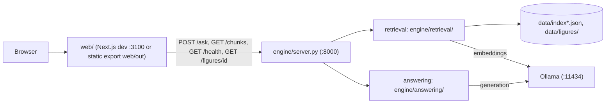

# NekoHon

NekoHon is an offline, local-first reading companion for EPUB books. You read
in the browser, select text or type a question, and get answers quoted from the
book with `[Ch. N]` citations. The engine is Python standard library only. The
reader is a Next.js app in `web/`. All inference runs on local Ollama
(`127.0.0.1:11434`): no cloud APIs, no database server, no telemetry.



## Requirements

- Python 3.9+ (no pip packages).
- Node 22 + npm (only for `web/`).
- [Ollama](https://ollama.com/download), run natively.
- macOS: if Python is from python.org, run
  `"/Applications/Python 3.x/Install Certificates.command"` once. Without it,
  HTTPS downloads (model setup) fail with `CERTIFICATE_VERIFY_FAILED`.

## Quickstart

Start Ollama first (the Ollama app, or `ollama serve` in its own terminal).

```sh
ollama pull nomic-embed-text                 # embedder (about 274 MB)
python3 scripts/setup_models.py --install    # answer models from Hugging Face Skufu1/nekohon-x3
python3 scripts/setup_models.py --status     # check files, hashes, Ollama
```

`nekohon_x3` is 1.93 GB (desktop); `nekohon_x3_mobile` is 986 MB. Use
`--model nekohon_x3_mobile` to install one only.

Add a book. A fresh clone has no books, so the Library is empty until you
import one. Books are local to your machine (`books/` and `data/` are
gitignored).

- UI: drag an `.epub` onto the Library (`POST /ask` with `mode: "import"`).
- CLI:
  `python3 -m engine.ingest --epub books/<id>.epub --book-id <id>`, then
  `python3 -m engine.retrieval.retrieve --book-id <id>` to embed it.
  Short file names give short book ids.

Run it, in one of two ways.

Dev, with hot reload, at http://localhost:3100 (two terminals):

```sh
python3 -m engine.server                 # terminal 1, keeps running
cd web && npm install && npm run dev     # terminal 2
```

One URL, at http://127.0.0.1:8000:

```sh
(cd web && npm install && npm run build)
python3 scripts/launch.py --open         # or: python3 -m engine.server
```

Readiness: `python3 scripts/preflight.py` (exit 0 when ready) and
`python3 scripts/verify_index.py` (index hygiene, exit 1 when dirty).

## Tests

- Engine: `python3 -m unittest discover -s tests`
- Frontend: `cd web && npx tsc --noEmit && npm run build`
- Full gate: the `verify` skill, [`.agents/skills/verify/SKILL.md`](.agents/skills/verify/SKILL.md)

## HTTP contract

| Route | Purpose |
| --- | --- |
| `POST /ask` | Body has `mode`: `ask`, `answer`, `explain`, `quiz`, or `import` (add an EPUB). |
| `POST /ask` with `stream: 1` | NDJSON frames: `token`, `reset`, `final`, `error`. |
| `GET /chunks` | Reader blocks for a book (`?book_id=`), no vectors. |
| `GET /figures/{id}` | Figure image. |
| `GET /health` | Readiness. |
| `GET /` | Built UI from `web/out` (and `/_next/static/*`); falls back to `window/index.html` when no build exists. |

A refusal is `refused: true` with `answer` exactly `Not in this book.`

## Gotchas

- One server per port. Check with `lsof -nP -iTCP:8000 -sTCP:LISTEN`.
- Restart the engine after any code or model change. A running server keeps
  what it loaded at start.
- The first ask after idle loads the model into memory and is slow.
- On an 8 GB machine, use `ANSWER_MODEL=nekohon_x3_mobile python3 -m engine.server`.
- Run Ollama natively, not in Docker: containers on macOS have no Metal GPU.

## Docs

- [Goal and constitution](docs/GOAL.md)
- [Engineering: how it works](docs/ENGINEERING.md)
- [Decisions: why it is built this way](docs/DECISIONS.md)
- [Glossary](docs/GLOSSARY.md)
- [Agent rules](AGENTS.md)
- [Frontend](web/README.md)
- [Artifacts index](artifacts/README.md)
- [License](LICENSE)
