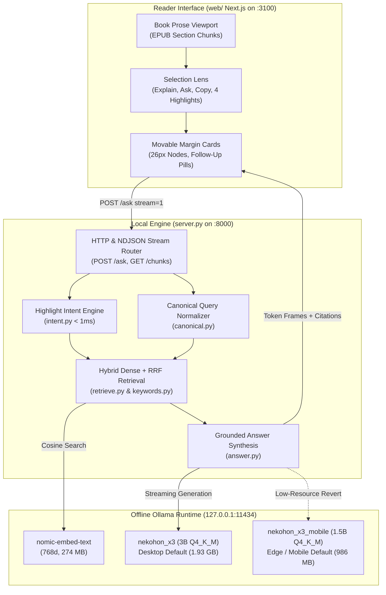

# Ask This Book (`ask-this-book`)

An offline, local-first book companion pairing a Gloss-inspired marginalia reader ([`web/`](file:///c:/Users/ADRIAN/workspace/github.com/Skufu/ask-this-book/web), Next.js) with a zero-dependency Python stdlib RAG & Highlight Intent Engine ([`server.py`](file:///c:/Users/ADRIAN/workspace/github.com/Skufu/ask-this-book/server.py), [`answer.py`](file:///c:/Users/ADRIAN/workspace/github.com/Skufu/ask-this-book/answer.py), [`intent.py`](file:///c:/Users/ADRIAN/workspace/github.com/Skufu/ask-this-book/intent.py), [`retrieve.py`](file:///c:/Users/ADRIAN/workspace/github.com/Skufu/ask-this-book/retrieve.py)) and purpose-distilled local models (`nekohon_x3` 3B for desktop, `nekohon_x3_mobile` 1.5B for mobile/edge).

Retrieval, intent resolution, and answer generation run strictly on local Ollama on `127.0.0.1:11434` — no cloud APIs, no database servers, no pip dependencies, and zero telemetry.



---

## Key Capabilities

1. **Inline Text & Heading Selection Lens**:
   - Immediate floating action lens upon selecting text or structural headings.
   - Quick actions: `Explain` (contextual gloss), `Ask` (focused inquiry), `Copy`, and 4 highlighter swatches (yellow, green, blue, pink).
   - Negative-offset encoding allows clean selection of section headings (`<h2>Cloud</h2>`) without confusing them with body text.

2. **Gloss Marginalia & Movable Margin Cards**:
   - Margin cards position themselves adjacent to the active passage with 26px numbered lane node indicators.
   - Draggable, resizable, and minimizable to keep the reading column clear.
   - Collapsible source quote popover with chapter citations and referencing book figures.
   - Dynamic, passage-derived follow-up suggestion chips synthesized from chapter context.

3. **Fluid 60fps Streaming & Animated Citations**:
   - Per-word token streaming paced at ~16ms ticks to eliminate visual bursting and stutter.
   - Clicking a quote citation snippet triggers a 520ms cubic-bezier smooth scroll that centers the cited text and animates the rubric underline on `mark.cite-mark`.

4. **Sub-millisecond Offline Highlight Intent Engine ([`intent.py`](file:///c:/Users/ADRIAN/workspace/github.com/Skufu/ask-this-book/intent.py))**:
   - Classifies reader selections in `< 1ms` into `CONCEPT_TERM`, `VAGUE_FRAGMENT`, `MULTI_SENTENCE_PASSAGE`, or `AUTHOR_QUESTION`.
   - Resolves vague predicate fragments (e.g., `"is a perfectly reasonable strategy"`) to their enclosing grammatical subject (`"simple lift and shift"`), eliminating hallucinated definitions.

5. **Robust Retrieval & Coreference Resolution**:
   - Alphanumeric tokenization preserves technical identifiers (`S3`, `3NF`, `DDR4`, `DDR5`).
   - Reciprocal Rank Fusion (RRF, K = 60) combines dense embeddings with rare-word lexical postings inside a dense 20% safety band.
   - Multi-turn conversation threads resolve pronominal coreferences (`"What are its downsides?"`) across margin card turns.

---

## Model Lineup & Download Table

All `nekohon` models (renamed from the `smallbook_x3` line on 2026-10-17; identical weights and hashes) are purpose-distilled quote-or-refuse students trained on an 844-row 7-layer corpus using Wide-LoRA ($r=32, \alpha=64$) on an A100 GPU and exported directly to 4-bit GGUFs.

| Model | Parameters | Quantization | Disk Size | SHA-256 Digest | Role & Hardware | Benchmark Scores |
| --- | :---: | :---: | :---: | --- | --- | :---: |
| **`nekohon_x3`** | **3.1B** | **Q4_K_M** | **1.93 GB (1,840.5 MiB)** | `92fb94df741b2117b20b8ba8347c4143...` | **Primary Desktop Default**<br/>(8GB+ RAM / 4GB+ VRAM) | **60/60** Hard Bench<br/>**24/24** Highlights<br/>**22/22** HTTP Battery |
| **`nekohon_x3_mobile`** | **1.5B** | **Q4_K_M** | **986 MB (940.4 MiB)** | `c3d8492fe73114a0c3e7249da6a1646a...` | **Mobile / Edge Default**<br/>(4GB RAM / 2GB VRAM) | **60/60** Hard Bench<br/>**24/24** Highlights<br/>**22/22** HTTP Battery |
| `qwen2.5:7b` | 7.6B | Q4_K_M | 4.7 GB | `845dbda0ea48ed749caafd9e6037047a...` | Reference Base Teacher<br/>(`ANSWER_MODEL=qwen2.5:7b`) | Baseline comparison |
| `nomic-embed-text` | 137M | F16 | 274 MB | `0a109f422b47e3a30ba2b10eca18548e...` | Local 768-dim Embedder<br/>(`ollama pull nomic-embed-text`) | 10/10 retrieval smoke |

Portable, committed Modelfiles are tracked under [`models/nekohon_x3/Modelfile`](file:///c:/Users/ADRIAN/workspace/github.com/Skufu/ask-this-book/models/nekohon_x3/Modelfile) and [`models/nekohon_x3_mobile/Modelfile`](file:///c:/Users/ADRIAN/workspace/github.com/Skufu/ask-this-book/models/nekohon_x3_mobile/Modelfile).

---

## Quickstart (1-Command Model & App Setup)

### 1. Prerequisites
- **Python 3.9+** (tested on 3.12; stdlib only, no pip packages).
- **Node.js 22+** & npm (for the Next.js reader frontend).
- **Ollama** running locally on `http://127.0.0.1:11434`.

### 2. Model Setup
Install the distilled models and embedder in one command:
```sh
# 1. Pull the embedder
ollama pull nomic-embed-text

# 2. Automatically verify, download, and register nekohon_x3 into Ollama
python scripts/setup_models.py --install

# 3. Check model and runtime health
python scripts/setup_models.py --status
```

*Note on fresh clones:* If you prefer using base Qwen weights instead of the custom distilled models, run `ollama pull qwen2.5:7b` and launch the engine with `ANSWER_MODEL=qwen2.5:7b python server.py`.

### 3. Book Ingestion & Verification
```sh
# Default FDE run (or customize with --epub, --book-id, --index)
python ingest.py      # EPUB -> sentence-boundary chunks in data/index.json + extracted figures
python retrieve.py    # Embeds chunks & figures into local vector index (~14 s)
python verify_index.py # Audits index vector hygiene and dimension alignment
python preflight.py   # Verifies Python, EPUB, index hygiene, models, and Ollama connectivity
```

### 4. Launch Application
In terminal 1 (Engine):
```sh
python server.py
# Engine runs on http://127.0.0.1:8000
```

In terminal 2 (Reader UI):
```sh
cd web
npm install
npm run dev
# Reader interface runs on http://localhost:3100
```

Open <http://localhost:3100> in your browser to start reading.

---

## HTTP Contract (Frozen API)

The engine exposes a strictly typed, frozen HTTP contract:

| Route | Method | Description | Payload / Response |
| --- | :---: | --- | --- |
| `/ask` | `POST` | Core RAG & Intent endpoint. Supports `stream=1` (NDJSON frames). | Request: `{"question": "...", "mode": "answer", "selection": null, "chunk_id": null, "end_chunk_id": null, "heading": "", "history": [], "stream": false}` (extra keys like `"book_id"` are accepted for contract compatibility).<br/>Response: `{"answer": "...", "citations": [...], "figures": [...], "refused": false, "followups": [...]}` |
| `/chunks` | `GET` | Reader payload: chunks in reading sequence with inline headings and figures. | Response: `{"book_id": "fde", "chunks": [{"chunk_id", "chapter", "heading", "section", "source", "text", "figures": [...]}]}` (heading, section, and figures are attached directly on each chunk object). |
| `/health` | `GET` | Healthcheck probing engine and local Ollama daemon. | Response: `{"ok": true, "ollama": true}` |
| `/figures/{id}` | `GET` | Serves extracted book figure image bytes. | Raw PNG/JPEG image bytes |
| `/` | `GET` | Serves legacy no-build HTML companion window ([`window/index.html`](file:///c:/Users/ADRIAN/workspace/github.com/Skufu/ask-this-book/window/index.html)). | Static HTML |

### Supported Modes
- `answer` (default): Grounded generation with `[Ch. N]` chapter tags matched back to shown passages.
- `ask`: Checked quote with chapter citation, followed by a concise 1–2 sentence gloss.
- `explain`: Contextual selection explanation powered by [`intent.py`](file:///c:/Users/ADRIAN/workspace/github.com/Skufu/ask-this-book/intent.py).
- `quiz`: Returns a question and key sentence from the active chunk.

*Refusal Contract & Canary:* When a refusal occurs (either retrieval returns no evidence or the model's first line is Not in this book.), the contract guarantees `refused: true` and `answer: "Not in this book."` (with nearest-miss citations retained). Out-of-book refusal behavior is verified against the "What is the capital of France?" canary in the HTTP battery and the 10 adversarial traps in hard-bench.py.

---

## Testing & Quality Gates

Run all checks from the repo root:

```sh
# 1. Fast Unit Suite (356 unit tests, 0 network, ~1.5s)
python -m unittest discover -s tests

# 2. Read-Only Index Vector Hygiene Audit
python verify_index.py

# 3. 60-Item Hard Benchmark (Stress tests coreference, acronyms, comparisons, traps)
python artifacts/harnesses/hard-bench.py nekohon_x3

# 4. 24-Item Held-Out Highlight Evaluation
python artifacts/probes/probe-highlight-2026-10-16.py nekohon_x3

# 5. End-to-End HTTP Battery (22 live queries against running engine)
python artifacts/harnesses/step2-battery.py

# 6. TypeScript Validation in web/
cd web && npx tsc --noEmit
```

---

## Offline Proof

On 2026-10-12, the system passed the Phase 7 physical offline gate:
- Ethernet cable unplugged; probe to `https://example.com` returned `000`.
- Identical `POST /ask` queries executed successfully over HTTP.
- Sockets inspected via `netstat -ano`: engine (`:8000`) and Ollama (`:11434`) bound exclusively to `127.0.0.1`, with zero external TCP connections.
- Raw log preserved at [`artifacts/evidence/phase7-offline/phase7-offline.log`](file:///c:/Users/ADRIAN/workspace/github.com/Skufu/ask-this-book/artifacts/evidence/phase7-offline/phase7-offline.log).

---

## Contributing & Deep Dives

For contributors looking to ingest custom EPUBs, understand the hybrid retrieval pipeline, run the evaluation harnesses, or fine-tune new student models on Colab:

👉 **Read the comprehensive guide: [`docs/ENGINEERING_AND_BENCHMARKS.md`](file:///c:/Users/ADRIAN/workspace/github.com/Skufu/ask-this-book/docs/ENGINEERING_AND_BENCHMARKS.md)**

It covers:
- EPUB ingestion and sentence-boundary packing (`CHUNK_MAX_CHARS = 1400`, 1,042 total chunks with `0 / 1,042` (`0.0%`) mid-sentence starts, `983 / 1,042` (`94.34%`) terminal punctuation).
- Alphanumeric tokenization and RRF fusion mathematics (K = 60).
- Semantic intent taxonomy (`CONCEPT_TERM`, `VAGUE_FRAGMENT`, `MULTI_SENTENCE_PASSAGE`, `AUTHOR_QUESTION`).
- Distillation mechanics of the 844-row 7-layer dataset and Unsloth Wide-LoRA recipes.

---

## License

GPL-3.0 — see [`LICENSE`](file:///c:/Users/ADRIAN/workspace/github.com/Skufu/ask-this-book/LICENSE).
Vendored text-preprocessing tools retain their respective licenses: Snowball Porter2 stemmer is BSD-3 in [`vendor/snowballstemmer/COPYING`](file:///c:/Users/ADRIAN/workspace/github.com/Skufu/ask-this-book/vendor/snowballstemmer/COPYING).
