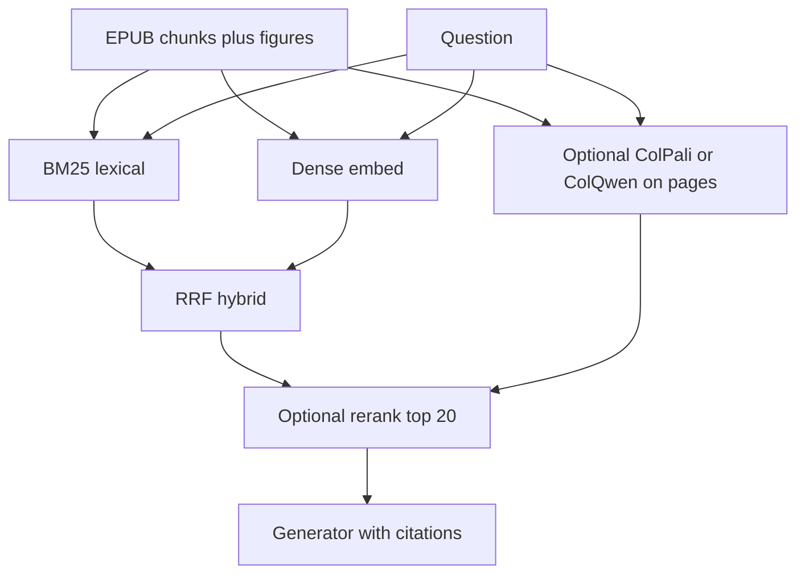

# Fine-tuned and domain-adapted models for a local book-QA RAG app

Date: 2026-10-15.
Corpus: one EPUB, frozen chunks, hybrid retrieval, citations, optional figures.
This file is a literature note, not a measured bake-off. Numbers that are not on a fetched page are marked **Not measured**.

## What this repo already does

`ask-this-book/retrieve.py` talks to Ollama `POST /api/embed`. Default embedder is `nomic-embed-text`. Alternate is `embeddinggemma-2:270m-bf16-text`. Vectors sit in JSON; ranking is Python cosine. Task prefixes are hardcoded and fail closed for unknown models.

`ask-this-book/ingest.py` is stdlib EPUB ingest. No vectors.

`rag-template/retrieval/` is BM25 + dense + RRF hybrid. Embedder is injected. Keyword and semantic preprocess are split.

A single-book app does not need a new embedding architecture. It needs a dense model whose prefixes match the current seam, BM25 for exact terms, and a generator that quotes retrieved text.

---

## 1. Embedding models: fine-tune vs buy

Rule for this app: do not fine-tune the embedder on a few dozen Q&A pairs. Contrastive embedders need large, hard-negative pair sets. A single book plus 50 questions will overfit prefixes and destroy generalization. Buy or download an off-the-shelf model. Fine-tune only if you later have thousands of query–passage pairs mined from real misses.

VRAM below is **Not measured** unless a card states a memory figure.

### Qwen3-Embedding (local; worth downloading, not fine-tuning first)

Fetched: https://huggingface.co/Qwen/Qwen3-Embedding-0.6B and https://qwenlm.github.io/blog/qwen3-embedding/ (redirected to the Qwen3 Embedding blog on qwen.ai).

| Size | Params | Max length | Dim | MRL | Multilingual | License |
| --- | --- | --- | --- | --- | --- | --- |
| 0.6B | 0.6B, 28 layers | 32k | 1024, custom 32–1024 | yes | 100+ | Apache-2.0 |
| 4B | 4B, 36 layers | 32k | 2560 | yes | 100+ | Apache-2.0 |
| 8B | 8B, 36 layers | 32k | 4096 | yes | 100+ | Apache-2.0 |

Last-token pooling. Query-side instruction. Card reports MTEB multilingual (as of May 24 / June 5, 2025): 0.6B mean-task 64.33, 4B 69.45, 8B 70.58. Instruction gains 1–5% on their evals. 0.6B is the local default for a consumer GPU. 8B is overkill for one book.

Fine-tune vs buy: download 0.6B. Fine-tune only with a real pair set. Typical VRAM: **Not measured**.

### BGE-M3 (local; good hybrid primitive)

Fetched: https://huggingface.co/BAAI/bge-m3

Dim 1024, max 8192, MIT, 100+ languages. One encode can emit dense, sparse lexical weights, and ColBERT multi-vectors. FlagEmbedding unified fine-tune exists. Queries do **not** need instructions.

For this repo, dense-only already exists. Sparse weights could substitute for a second lexical channel; they do not replace BM25 until measured.

Fine-tune vs buy: use off-the-shelf. Fine-tune all three heads only with FlagEmbedding-scale data. Typical VRAM: **Not measured**.

### E5 (local; aging but still usable)

Fetched: https://huggingface.co/intfloat/multilingual-e5-large and https://huggingface.co/intfloat/e5-mistral-7b-instruct

- `multilingual-e5-large`: xlm-roberta-large, 24 layers, dim 1024, max **512**, MIT, ~100 languages. Required prefixes `query:` / `passage:`. Truncates long book chunks.
- `e5-mistral-7b-instruct`: 7B, dim 4096, max 4096, MIT. English-first. Query instructions required. Too large for a single-book dense index.

Fine-tune vs buy: skip E5-Mistral. multilingual-e5-large is a fallback if you already have it. 512 tokens is worse than Nomic / Qwen3 / BGE-M3 for 1400-char chunks. Typical VRAM: **Not measured**.

### GTE (local; encoder vs decoder)

Fetched: https://huggingface.co/Alibaba-NLP/gte-multilingual-base and https://huggingface.co/Alibaba-NLP/gte-Qwen2-1.5B-instruct

- `gte-multilingual-base`: 305M, dim 768 (elastic 128–768), max 8192, 70+ languages, Apache-2.0. Dense + sparse. Card lists fp32 memory  (encoder family table) smaller than the 1.5B decoder.
- `gte-Qwen2-1.5B-instruct`: 1.5B, dim 1536, max 32k, Apache-2.0. Card: fp32 memory **6.62 GB**. Query-side instruction. SWIFT LoRA recipe is on the card.

For one book, the 305M encoder is the rational GTE pick. The 1.5B decoder is a quality-at-VRAM trade. Fine-tune vs buy: buy/download. Fine-tune only with SWIFT-scale data.

### Jina embeddings v3 / v4

Fetched: https://huggingface.co/jinaai/jina-embeddings-v3 and https://huggingface.co/jinaai/jina-embeddings-v4

**v3:** ~0.6B, max 8192, dim 1024 with Matryoshka 32…1024, task LoRAs (`retrieval.query`, `retrieval.passage`, …). License **CC-BY-NC-4.0** (commercial needs a Jina license). 30 languages tuned.

**v4:** Qwen2.5-VL-3B, ~4B params BF16, max 32768, dense 2048 (truncate to 128), late-interaction 128-d multi-vector, images + visual documents. Matryoshka 128/256/512/1024/2048. License: Qwen Research License (card says an early CC-BY-NC label was a mistake).

v4 is the figure-aware option if you refuse a separate ColPali index. It is not a drop-in for the current Ollama `nomic-embed-text` seam: different prefixes, multimodal inputs, non-Apache license.

Fine-tune vs buy: v3 has an explicit SentenceTransformerTrainer path for task LoRA. Still needs real pair volume. Typical VRAM: **Not measured**. v4 will not be cheap.

### Nomic (already in this repo)

Fetched: https://huggingface.co/nomic-ai/nomic-embed-text-v1.5 and https://ollama.com/library/nomic-embed-text

Apache-2.0, English, dim 768 with Matryoshka 768/512/256/128/64. Max 8192 (Ollama listing shows **2K context** for the shipped tag — treat HF 8192 and Ollama 2K as a real mismatch). Required prefixes `search_document:` / `search_query:` — already wired.

Ollama size: **274 MB**. HF card: 0.1B params F32. MTEB table on the card (seq 8192): 768d 62.28, 512d 61.96, 256d 61.04, 128d 59.34, 64d 56.10.

Fine-tune vs buy: keep it. Do not fine-tune it on 50 pairs. Prefix mistakes will hurt more than a newer model.

### mxbai (local English workhorse)

Fetched: https://huggingface.co/mixedbread-ai/mxbai-embed-large-v1

BERT-large class, ~0.3B, Apache-2.0, English. Query prompt: `Represent this sentence for searching relevant passages:`. Matryoshka + binary quantization. Card MTEB avg 64.68 (56 datasets, March 2024 vintage). Max length: **Not on the fetched card as a single number**; BERT-large default is usually 512 — confirm before using on 1400-char chunks.

Fine-tune vs buy: download if English-only and you leave Ollama. Not worth a custom fine-tune for one book. Typical VRAM: **Not measured**.

### EmbeddingGemma / EmbeddingGemma 2 (already partly wired)

Fetched: https://huggingface.co/google/embeddinggemma-300m and https://huggingface.co/google/embeddinggemma-2

**300M (v1):** Gemma license (gated). Max 2048 tokens. Dim 768, MRL 512/256/128. 100+ languages. Card MTEB multilingual v2 mean-task: 768d 61.15, 512d 60.71, 256d 59.68, 128d 58.23. **Do not use float16**; bf16 or fp32. Query default `task: search result | query:`. Document `title: {title} | text:`. QA prefix exists: `task: question answering | query:`. Current code uses web-search, not QA.

**Gemma 2:** Apache-2.0. 270M text backbone, optional vision 170M / audio 300M, total 740M. Dim 768, MRL 128/256/512. Context **8192**. Text-only load: 270M. Card MTEB multilingual v2 61.36 (768d). Same float16 ban. Code already names `embeddinggemma-2:270m-bf16-text`.

Fine-tune vs buy: switch to Gemma 2 text-only if you want a newer local default under Apache-2.0. Fine-tune: the Hub lists many community finetunes; still not justified at 50 pairs.

### Voyage (API; optional open nano)

Fetched: https://docs.voyageai.com/docs/embeddings

Current: `voyage-4-large` / `voyage-4` / `voyage-4-lite`, context 32k, dim 1024 default (256/512/2048). `input_type` query/document. Domain: `voyage-law-2`, `voyage-finance-2`, `voyage-code-4`. Open-weight: `voyage-4-nano` on Hugging Face (that model card was **not fetched**; details from this docs page only).

Fine-tune vs buy: buy the API if the book may leave the machine and you want their retrieval quality. Do not fine-tune. You cannot domain-adapt Voyage weights unless you use the open nano. Typical VRAM: n/a (API). `voyage-4-nano` VRAM: **Not measured**.

### Cohere embed (API)

Fetched: https://docs.cohere.com/docs/cohere-embed

Latest on that page: `embed-v5.0-pro` and `embed-v5.0-fast`. Text + images + mixed PDFs. Dim one of 256/512/768/1024/1536/**2048 default**. Context **128k**. Older v3 English/multilingual still listed (dim 1024 or 384, max 512).

Fine-tune vs buy: API only. Useful if figures are image pages and you accept a vendor. Cannot fine-tune.

### OpenAI text-embedding-3 (API)

Fetched: https://platform.openai.com/docs/guides/embeddings

`text-embedding-3-small`: dim 1536 default, max 8191, MTEB 62.3% on that table. `text-embedding-3-large`: dim 3072, MTEB 64.6%. `dimensions` shortens (Matryoshka-style). Knowledge cutoff on the page: events after September 2021.

Fine-tune vs buy: buy if the app is allowed to send book text off-box. OpenAI embeddings are not locally fine-tunable.

### Fine-tune vs API, compressed

| Situation | Move |
| --- | --- |
| One English book, local, Ollama already running | Keep `nomic-embed-text` or swap `embeddinggemma-2` text-only. Add BM25. |
| Need 8k+ context and Apache-2.0 | Qwen3-Embedding-0.6B or gte-multilingual-base. |
| Need figures as images, local | Do not stretch a text embedder. Use ColQwen/ColPali or Jina v4. |
| Need figures, no GPU, can call APIs | Cohere embed-v5 or Voyage. |
| You have 50 gold Q&A | Improve chunks, prefixes, and BM25. Do **not** fine-tune the embedder. |
| You have ≥10k hard query–passage pairs from real misses | Then consider LoRA on Qwen3-Embedding-0.6B or BGE-M3 dense head. |

---

## 2. Late-interaction

Late interaction stores one vector per token (or patch) and scores with MaxSim. Better at matching rare book phrases. Cost: index size and search code. This repo stores one vector per chunk in JSON. ColBERT does not drop in without a new index type.

### ColBERT v2

Fetched: https://huggingface.co/colbert-ir/colbertv2.0

BERT English, MIT, ~0.1B. MS MARCO trained. GPU required for training and indexing (card). Search uses PLAID. Token-level matrices, not one vector. Fine-tunes exist.

For one book: viable as a **second index** if you accept PLAID/RAGatouille, not as a replacement for the JSON cosine path.

### answerai-colbert-small-v1

First fetch of https://huggingface.co/answerai-colbert-small-v1 **failed (404)**. Fetched https://huggingface.co/answerdotai/answerai-colbert-small-v1.

33.4M params, Apache-2.0, English, output 96-d per token. Trained with the JaColBERTv2.5 recipe. Card BEIR avg **53.79** vs ColBERTv2.0 **50.02** (their table). Usable as retriever or reranker via `rerankers`. Fits a consumer GPU easily. Typical VRAM: **Not measured**.

Best late-interaction default if you add a ColBERT path.

### JaColBERTv2.5

Fetch of https://huggingface.co/lightonai/JaColBERTv2.5 **failed (404 / 401 page)**. Not fetched.

From the fetched answerai-colbert card and arXiv 2407.20750 citation on that card: it is a training recipe (Japanese multi-vector, constrained compute), not a drop-in English book model. Use answerai-colbert-small unless the book is Japanese.

### GTE-ModernColBERT-v1 (extra, fetched while hunting JaColBERT)

Fetched: https://huggingface.co/lightonai/GTE-ModernColBERT-v1

Apache-2.0, English, 128-d tokens, trained doc length 300, query 32. Card claims it is the first to beat ColBERT-small on BEIR in their rerun (avg **54.67** vs ColBERT-small reported 53.79). LongEmbed numbers on the card are high with 32k doc length — those are long-doc benches, not this book.

Reasonable English ColBERT alternative to answerai-small. Index still multi-vector.

### ColPali / ColQwen (figures and PDF pages)

Fetched: https://huggingface.co/vidore/colpali and https://huggingface.co/vidore/colqwen2-v1.0

Both are page-as-image retrievers: query tokens × image patches, MaxSim. English train set 127,460 query–page pairs. Multi-vector. Do **not** compare these vectors to Nomic text vectors.

- **ColPali** (original card; they recommend v1.3): PaliGemma-3B mix-448 backbone (Gemma license) + MIT adapter. Query embedding example shape (23, 128); document (1030, 128). Inference stack is picky about prefixes/`colpali-engine` versions.
- **ColQwen2-v1.0**: Qwen2-VL-2B, Apache-2.0 backbone, MIT adapters. Dynamic resolution, cap 768 patches. Example shapes (25, 128) / (755, 128). Needs `colpali-engine` and transformers > 4.46.1.

This app extracts figure files plus captions. Text captions should stay in the dense/BM25 index. ColQwen is justified only if users ask about charts that the caption misses. VRAM: **Not measured**; a 2B–3B VLM is a different GPU budget than Nomic.

---

## 3. Rerankers

Rerankers score `(query, passage)` pairs on a shortlist. They are the highest-ROI “fine-tune-shaped” component after hybrid retrieval, because you can train or swap them without rebuilding the book index.

### bge-reranker-v2-m3

Fetched: https://huggingface.co/BAAI/bge-reranker-v2-m3

Cross-encoder on BGE-M3, multilingual, Apache-2.0, ~0.6B. Max 512 in the transformers example. Fast, easy, FlagEmbedding `FlagReranker`. Fine-tune data shape on the card: `{"query", "pos": [...], "neg": [...], "prompt"}`.

Good local default for this app. 512-token cap may truncate long chunks — prepend heading + first 400 tokens, or split.

### Qwen3-Reranker

Fetched: https://huggingface.co/Qwen/Qwen3-Reranker-0.6B and the Qwen3 Embedding blog.

0.6B / 4B / 8B, 32k context, Apache-2.0, 100+ languages, instruction-aware. LLM-style yes/no scoring, not a classic classification head. Blog table (their run, top-100 from Qwen3-Embedding-0.6B):

| Model | MTEB-R | MLDR |
| --- | --- | --- |
| Qwen3-Reranker-0.6B | 65.80 | 67.28 |
| BGE-reranker-v2-m3 | 57.03 | 59.51 |
| Jina-multilingual-reranker-v2-base | 58.22 | 39.66 |

Those scores are **their** runs, not a third-party leaderboard freeze. 0.6B is the local pick. 4B/8B are slower LLM reranks.

### mxbai-rerank

Fetched: https://huggingface.co/mixedbread-ai/mxbai-rerank-large-v1

English DeBERTa-v2, Apache-2.0, ~0.4B. Family: xsmall / base / large. Card aggregate over 11 BEIR sets (Pyserini): large NDCG@10 **48.8**, Accuracy@3 **74.9**; bge-reranker-large 45.2 / 70.6; Lucene 38.0 / 66.4.

Solid English rerank if you leave multilingual behind.

### Jina reranker

Fetched: https://huggingface.co/jinaai/jina-reranker-v2-base-multilingual

278M, max 1024 with sliding window, **CC-BY-NC-4.0**. Card table (their numbers): MKQA nDCG@10 54.83, BEIR 53.17, MLDR recall@10 68.95 vs bge-reranker-v2-m3 54.17 / 53.65 / 59.73.

License is the blocker for a productized book app unless you use Jina’s API.

### Cohere Rerank (API)

Fetched: https://docs.cohere.com/docs/rerank-2

Current: `rerank-v4.0-pro` and `rerank-v4.0-fast` (multilingual, JSON-aware). v3.5 / v3.0 still listed, context 4096.

Buy if latency and quality beat a local 0.6B on your eval set. You cannot fine-tune it. Cost per query: **Not measured**.

### Cross-encoder vs LLM rerank cost

| Kind | Examples | Cost shape | When |
| --- | --- | --- | --- |
| Cross-encoder | bge-reranker-v2-m3, mxbai-rerank, jina-reranker-v2 | One forward pass per pair, short seq | Default. Rerank 20–50 hits. |
| LLM reranker | Qwen3-Reranker, bge-reranker-v2-gemma | Full causal LM logits (`yes`/`no`) | Use 0.6B. 4B/8B only if 0.6B fails on your questions. |
| Generative listwise | “rank these 10 passages” via Qwen3-4B | Tokens × list size, slow, unstable order | Skip for a single-book app. |

Latency and dollars: **Not measured**. LLM rerank of 50 hits at 4B is the first thing that will make the UI feel broken.

Fine-tune a reranker before an embedder if you ever fine-tune retrieval. Labels are pairwise and the index stays frozen.

---

## 4. Small generators people actually LoRA for grounded QA

The generator should quote, cite chunk ids, and refuse when the passage is silent. That is instruction + format, not a new world model.

Fetched generator facts: https://huggingface.co/Qwen/Qwen3-4B (4.0B, 32k, Apache-2.0, thinking switch), https://qwen.readthedocs.io/en/latest/getting_started/quickstart.html.

Not fetched this session (training knowledge, labeled): Gemma 3/4 instruct GGUFs in Ollama; Llama 3.1/3.2 8B/3B; Mistral 7B / Ministral. Check current licenses before shipping.

### Who to LoRA

| Family | Why | Local size |
| --- | --- | --- |
| Qwen3 1.7B / 4B | Apache-2.0, 32k, good tool/citation following. Thinking **off** for extractive QA. | 4B QLoRA fits many 8–12 GB cards. VRAM **Not measured**. |
| Gemma instruct 2B–9B | Strong instruction. License is Gemma, not Apache. | Common Ollama path. |
| Llama 8B | Fine-tune ecosystem (Axolotl, Unsloth). Meta license. | Standard QLoRA target. |
| Mistral 7B | Older, still lots of RAG LoRAs. | Avoid unless you already have adapters. |

Do not LoRA a 70B for one book.

### Data shape (high-level only)

Each row:

- `query`: the user question
- `gold_passages`: the chunks that actually answer it (ids + text)
- `distractors`: retrieved-but-wrong chunks (teach ignore)
- `answer`: short grounded answer
- `citations`: chunk ids / figure ids the answer must name
- optional `unanswerable`: question whose gold is empty; target is a refusal

Train SFT (or DPO against hallucinated answers) with the **same** prompt template used at serve time: passages in, answer + citations out. Keep `enable_thinking=False` for Qwen3 on this task.

### What not to fine-tune

- The embedder on 50 Q&A pairs.
- The reranker on the same 50 pairs without held-out questions (it will memorize wording).
- The generator to “sound like the book” without gold passages in context (it will invent).
- A vision embedder on a handful of figures.

If you only have 50 gold items, spend them on evaluation, not gradient steps.

---

## 5. When fine-tuning loses to a better off-the-shelf model plus hybrid BM25

This will be the common outcome on a single book.

BM25 already wins on names, headings, figure numbers, equations, and rare technical tokens. `rag-template/retrieval` already has BM25 + RRF. Nomic or Gemma-2 dense then covers paraphrase. A reranker cleans the top 20.

Fine-tuning loses when:

- Pair count is small. Contrastive models need hard negatives at corpus scale, not 50 positives.
- The failure is **chunking** (table split, figure caption dropped). Gradients cannot unsplit a table.
- The failure is **prefix** (this repo already encodes that lesson for Nomic vs Gemma).
- The failure is **generation** (model ignores the passage). Fix the prompt or LoRA the generator, not the embedder.
- The new model is bigger but English-book MTEB gains are unrelated to your 2k chunks.

BGE-M3’s own card still treats BM25 as a competitive baseline on long documents. mxbai-rerank’s card shows Lucene plus their reranker beating a pure semantic baseline on their mix.

Do the cheap order: prefixes → BM25 hybrid → rerank 20 → prompt/citations → only then consider LoRA on the generator.

---

## 6. Recommended stacks

Uncertainty: no bake-off was run on `fde.epub`. Claims below are stack-fit, not accuracy.

### Consumer GPU (local, one book)

1. Ingest as now (stdlib chunks + figure files).
2. Dense: keep Ollama `nomic-embed-text` **or** `embeddinggemma-2:270m-bf16-text` (already prefixed). If you leave Ollama: `Qwen3-Embedding-0.6B` at 768–1024d MRL.
3. Lexical: BM25 from `rag-template/retrieval` on the same frozen chunks.
4. Fuse with RRF. k ≈ 20.
5. Rerank: `Qwen3-Reranker-0.6B` or `bge-reranker-v2-m3`.
6. Generate: Qwen3-4B (thinking off) or a small Ollama instruct. Prompt: answer only from passages; emit chunk/figure ids.
7. Figures: caption + referencing paragraph in the text index first. Add ColQwen2 only if citation audits show missed charts.
8. Skip embedder fine-tunes. Optional generator LoRA after you have a few hundred (query, gold passage, answer, citation) rows.

VRAM: **Not measured**. This mix is one small embedder + optional 0.6B reranker + 4B generator. Do not load ColQwen and Qwen3-4B at once on an 8 GB card.

### Zero GPU

1. Same BM25 index on CPU. This is the backbone.
2. Dense: Ollama CPU `nomic-embed-text` (274 MB) **or** an API (`text-embedding-3-small`, `voyage-4-lite`, Cohere `embed-v5.0-fast`) if sending the book off-box is allowed.
3. Rerank: skip, or Cohere `rerank-v4.0-fast`, or a tiny cross-encoder on CPU (`mxbai-rerank-xsmall` — card fetched only for large; xsmall details **not fetched**).
4. Generate: Ollama tiny instruct on CPU, or a hosted LLM with the same citation prompt.
5. No ColPali. Figures stay caption-only.

If the book cannot leave the machine, stay on Ollama CPU + BM25 and accept slower embeds.

---

## Fetch log

Succeeded: Qwen3-Embedding-0.6B; Qwen3 Embedding blog (after redirect); BGE-M3; Jina embeddings v3; Jina embeddings v4; nomic-embed-text-v1.5; mxbai-embed-large-v1; embeddinggemma-300m; embeddinggemma-2; multilingual-e5-large; e5-mistral-7b-instruct; gte-Qwen2-1.5B-instruct; gte-multilingual-base; Voyage embeddings docs; Cohere embed docs; OpenAI embeddings docs; colbert-ir/colbertv2.0; answerdotai/answerai-colbert-small-v1; lightonai/GTE-ModernColBERT-v1; vidore/colpali; vidore/colqwen2-v1.0; BAAI/bge-reranker-v2-m3; Qwen/Qwen3-Reranker-0.6B; jina-reranker-v2-base-multilingual; mxbai-rerank-large-v1; Cohere rerank docs; Qwen3-4B; Qwen quickstart docs; ollama.com/library/nomic-embed-text.

Failed: `huggingface.co/answerai-colbert-small-v1` (404; org is `answerdotai`). `huggingface.co/lightonai/JaColBERTv2.5` (404). Voyage-4-nano model card not fetched (only mentioned on Voyage docs). Gemma 2/Llama/Mistral generator cards not fetched this session.

Not measured: all local latencies, VRAM, token cost, and retrieval scores on this book.
