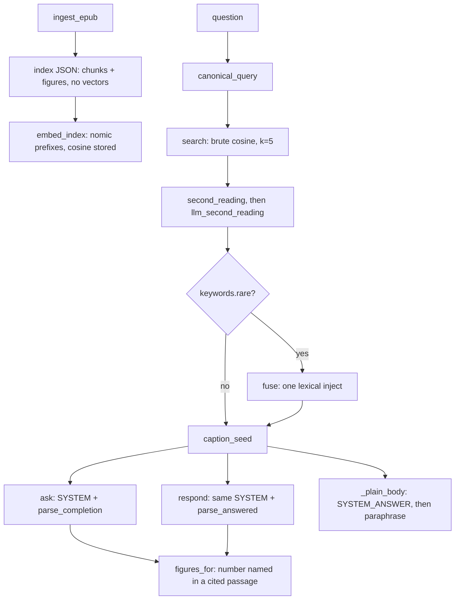

# Pipeline audit

Read from the Python modules named in the request, plus test names where a behavior is pinned. Index JSON, live EPUB, and Ollama were not opened. Numbers in comments (`1042` chunks, measured scores, bake-off counts) are not remeasured here.

## What it actually does

1. **Ingest** (`ingest.ingest_epub`). EPUB spine HTML to JSON. Skips a hard-coded non-teaching id set. Section chunks: heading prepended as line 1, body cut at sentence ends, cap `CHUNK_MAX_CHARS = 1400`, tables never split. Overlap is a sentence tail of at most `CHUNK_OVERLAP_CHARS = 180`, and only when a section did not fit one chunk. Figures get caption, nearest earlier citing paragraph, and a written image file. Chunks store figure ids whose numbers appear in the text. `book_id` is hard-coded `"fde"`. No vectors.

2. **Embed** (`retrieve.embed_index`). Default model `nomic-embed-text`. Task prefixes are required; an unknown model exits. Vectors rounded to 6 decimals. Empty bodies are dropped, not stored as zero vectors. Non-finite, all-zero, or wrong-width responses abort the write. A non-default model is refused on `data/index.json`.

3. **Query rewrite** (`canonical.canonical_query`), before retrieval, for ask and answer. A bare phrase with no `?`, no wh-word, no leading auxiliary/opener, no pronoun becomes `What is {text}?`. Explain turns this off. A kept rewrite is appended as `Asked as:`.

4. **Dense search** (`retrieve.search` / `rank_chunks`). One query embed. Cosine against every chunk vector in pure Python. `answer.PASSAGE_LIMIT` is 5. No vector means the chunk is skipped. No embedder on the index means `dense_rank` returns empty and later fusion drops unranked ids.

5. **Spelling readings** (`readings.second_reading`, then `llm_second_reading`). An out-of-book token (letters only) is swapped for the closest book word if difflib ratio is at least `CUTOFF = 0.85` and the runner-up is strictly worse. Kept only when the new top cosine strictly beats the literal top. Else one chat call under `SPELL_SYSTEM`, same score gate, plus same token count and a real word change. A kept reading replaces the question the model sees and may inject its top chunk, dropping the last of the five. Disclosed as `Read as:`. A failed chat call leaves the literal question.

6. **Lexical join** (`keywords.rare` then `fusion.fuse`). Fires only if some question token lives in 1..`RARE_DF` (8) chunks. Not a hybrid search. It scores idf overlap inside the dense top `RANK_BAND` (0.20 of the corpus) and injects **one** chunk if that chunk is not already in the five. RRF (`RRF_K = 60`) only places that inject. If the best lexical chunk is already present, the list is returned unchanged (`test_a_present_chunk_is_not_duplicated_or_reordered`).

7. **Caption seed** (`captions.caption_seed`), after fusion. Re-embeds the question, scores every figure vector, and if the best caption beats the best chunk score in the set, prepends the naming chunk (the chunk whose text cites that figure number) and drops the last passage. A naming chunk already present is left alone. There is no cross-encoder.

8. **Generate.** Ask, answer, and explain all call `ollama_generate` with `prompt.SYSTEM` and `user_message` (quote-first, `temperature` 0, `num_predict` 512). Default chat model is `ANSWER_MODEL`, env override, default `smallbook_x2d`. Ask parses with `parse_completion`: verbatim quote or a copied span of at least `SPAN_MIN_CHARS` (40), else exact `Not in this book.` Answer parses with `parse_answered`: the model's prose is kept; `[Ch. N]` sentences are matched by word overlap to a shown passage; the citation quote is a passage sentence, not the model's claim. Uncited, non-refusal answers get one `[Ch. ` prefill retry, kept only if a quote validates. Plain-register cues go through `_plain_body`: `SYSTEM_ANSWER`, then up to `PARAPHRASE_LIMIT` (5) one-sentence rewrites. Quiz (`answer.quiz`) picks a random teaching chunk and asks the model to write a question that does not contain that chunk's first long sentence.

9. **Figures.** Answer-side attach (`figures.figures_for`) is by regex `Figure` / `Fig.` number in a cited passage, file must exist, no score floor. Reader cards (`figure_cards`) attach every id the chunk already carries. Server loads the index once and serves `POST /ask` modes `ask|answer|explain|quiz`, plus `/chunks` and `/figures/`. `agentic.py` is not imported by the server.

10. **Checks.** `verify_index.audit` lists non-finite, zero, width drift, and missing vectors. `preflight` requires Python 3.9+, the EPUB, the index, Ollama, both model names, and a clean audit.

## Retrieval design

**Strong.** Quote gate on ask is real: invented prose refuses; a wrong chapter tag can still match the quote (`parse_completion`). Chunking cuts at sentence ends and refuses to split tables. Dense and lexical views share one tokenizer (`preprocess.words`), so the two sides cannot drift by a local `.lower()`. Task prefixes are explicit and unknown models fail closed. Caption seeding is a measured special case for short figure names, not a second ranker pretending to be general. Figure attach does not use cosine. Spelling repair is disclosed and must beat the literal score. Fusion's tail band is a real veto, not a comment.

**Fake or unused on the live path.**

- No reranker. `fuse` is not RRF over both full rankings. The keyword channel contributes one candidate, and only then.
- `agentic.py` (semantic / keyword / regex loop, `MAX_STEPS = 3`) is a prototype. `server.MODES` has no agentic mode. Its keyword math matches fusion's idf formula minus the band (`test_keyword_scores_pin_to_fusion_lexical_scores`). Scores are not comparable across tools; merge is first-seen order, so a later better hit cannot replace an earlier one.
- `preprocess.stem`, `stemmed_words`, `fold`, and `STOPWORDS` are views. Stemming is used by an artifacts harness (`qa-sweep.py`), not by `postings`, `rare`, `fuse`, or `anchor_words`. `words()` still drops digits, so `S3` is `s` and `1/17` is nothing. That is tested, not accidental.
- `GEMMA_EMBEDDER` is write-path only. `search`, `fuse`, `caption_seed`, and both readings default to nomic. Serving a gemma index exits in `rank_chunks` on embedder mismatch.
- `SYSTEM_ANSWER` and `ANSWER_REMINDER` are not the default answer prompt. `respond` sends `SYSTEM` + `FORMAT_REMINDER`. `SYSTEM_ANSWER` is only the plain-register draft. Tests pin this (`test_answer_mode_uses_the_free_prompt_and_cites`). Harnesses `eval.py` and `groundedness.py` still generate against `SYSTEM_ANSWER`.
- `readings` returns `swaps`. `ask` / `respond` never read that dict. The `Read as:` line is the rewritten question string.
- Figure embeddings are not searched except inside `caption_seed`.

## Bugs, dead paths, contradictions

Ordered by how much a later agent can trust the defect from the code alone.

1. **Ask-shaped completion yields zero citations in answer mode.** `respond` tells the model to start with `[Ch. N]` (`prompt.SYSTEM`). `parse_answered` → `_sentence_claims` only emits a claim for text **before** a tag. A reply that is only `[Ch. 5] "quote"\n gloss` never produces a claim, so citations stay empty and the prose is kept (`test_free_prose_without_tags_is_still_answered` pins the empty-citation shape; it does not pin a tag-first completion). The `[Ch. ` retry exists because of this (`_retry_uncited` comment). If the retry's quote fails `_quote_in_passage`, the tag-first draft stands uncited (`test_the_retry_is_kept_only_when_a_quote_validates`). Behavior-change to fix, and the tests currently expect the ask-shaped prompt.

2. **Same quote-first draft is mis-parsed if any gloss precedes the tag.** `parse_completion` treats any completion that does not start with `[Ch.` as tagless and cites the whole string or refuses. `SYSTEM` asks for a quote line and then "one line of gloss". A gloss-first line refuses a quote that would have passed. Not asserted. Behavior-change.

3. **Gloss is never checked.** A verified quote line plus an invented second line is kept (`test_the_gloss_line_rides_beside_the_quote`). Ask's contract is "unchecked prose is a refusal" (`parse_completion` docstring). The gloss path contradicts that. Behavior-change; the test pins the current behavior.

4. **Answer mode does not refuse ungrounded prose.** `parse_answered` returns `refused: False` with empty citations for zero-overlap sentences (`test_zero_overlap_sentence_is_uncited`, `test_the_retry_is_kept_only_when_a_quote_validates`). Server docstring says the quote check is a meter, not a gate. Not a bug relative to that docstring. Do not "fix" it without a product decision.

5. **`verify_index.main` ignores missing vectors.** `audit` fills `missing`, and the CLI prints the count, but `dirty` is only `AXES` plus missing `embedding_dims`. An index with zero stored vectors exits 0 (`no_declared_dims` is false when there are no vectors). `preflight.audit_clean` does treat `missing` as dirty. The test name `test_a_missing_vector_is_listed_not_an_error` matches the CLI. Safe-hygiene if the intended contract is the module docstring ("missing vectors"); behavior-change relative to that test.

6. **Letter-prefixed figure numbers never attach.** `figures.cited_numbers` keeps the letter (`a1-2` after `.lower()`). `_number_from_id` returns only `(\d+-\d+)`, so `figure-a1-2` becomes `1-2`. The sets cannot intersect. Ingest ids keep the letter (`_figure_id`). Tables are parsed into figure-like ids (`Table 7-1` → `table-7-1`) but `cited_numbers` only matches `Figure` / `Fig.`, so tables never attach. Not asserted. Whether this book has letter-prefixed figures was not measured. Safe-hygiene to make the two number extractors one function; attaching tables would be behavior-change.

7. **Figure files collide on basename.** `ingest_epub` writes `Path(src).name` into one directory and stores that name. Two chapters with `images/fig.png` overwrite. `figures_for` / `figure_file` then serve the last write for both ids. Not asserted. Collision rate on this EPUB was not measured. Safe-hygiene to key the filename by figure id.

8. **Duplicate figure numbers keep the last record.** `by_number` is a dict keyed by `(\d+-\d+)`. Two figures sharing a number: the earlier id is dropped from every chunk's `figures` list. Not measured on this book.

9. **`caption_seed` can disagree with the index embedder without a check of its own.** It calls `embed_texts` and `cosine` directly. On the live path `search` already exited if `index["embedder"] != model`, so this is latent. A caller that injects passages and a mismatched index embeds with nomic against stored vectors and compares. Silent: a width mismatch returns cosine 0 and the seed does not fire. Safe-hygiene to refuse the same way `rank_chunks` does.

10. **`rank_chunks` accepts an all-zero query.** `_vector_problem` rejects all-zero stored vectors. A zero query is finite and non-empty, so every chunk scores 0 and sort order is original chunk order. `SystemExit` on embedder mismatch is also uncaught by `server.do_POST` (it catches `URLError`, `TimeoutError`, `RuntimeError`, and `ValueError` only). The stream path catches `Exception`, so `SystemExit` kills the handler thread. Safe-hygiene.

11. **Quiz leak check is one sentence.** `quiz` uses `sentences[0]` as the key and only rejects if that sentence is inside the question. Later sentences of the same chunk can be copied into the question. `SYSTEM` also tells the model to quote first, which fights `QUIZ_INSTRUCTION`. Behavior-change.

12. **HTML parser drops structure.** `br` is not a break (`handle_data` concatenates). Nested `p` inside `li` reuses `_capture` and does not emit the outer block on the inner end. `h5` is a block, not a heading, so it never starts a section. Second-book impact not measured. Behavior-change; needs a fixture.

13. **`_attach_paragraphs` is not "nearest".** It keeps the earliest matching paragraph index, and breaks only on an xref hit. A later, closer xref loses to an earlier "Figure" mention. Docstring says nearest. Behavior-change.

14. **Contradictory constants, live values first.** `retrieve.TOP_K = 10` is the search default and the agentic tool width. The server path passes `k=5`. `KEY_MIN_CHARS` and `SPAN_MIN_CHARS` are 40; `MIN_QUOTE_CHARS` is 20. `rare` does not apply `STOPWORDS`; `anchor_words` does. A stopword with df 1..8 triggers fusion, then `lexical_scores` drops it if it lives in more than half the corpus, so the trigger can be a no-op. `fusion` docstring says it replaces the old last-slot boost with RRF; the present-candidate early return means RRF never reorders a set that already contains the lexical winner. That early return is tested.

15. **Dead comments, not dead code.** `prompt.py` repeats the "reverted the same day" sentence. `preprocess.py` still says stemming "waits for a battery" while `stem` is implemented and tested as a view. `answer.py` module docstring matches `respond` (ask-shaped prompt). Harness comments that still say answer mode sends `SYSTEM_ANSWER` do not.

## Latency traps

Measured from the call graph, not timed.

- Every ask embeds the question at least once (`search`). A kept difflib or LLM reading embeds again (`rank_chunks`). If `rare` fires, `fuse` calls `dense_rank` → `rank_chunks` and embeds **again**, full cosine over every chunk, even though `search` just did that. Then `caption_seed` embeds a fourth time and walks every figure vector, plus every naming chunk's vector.
- `postings(index)` rebuilds the full word map on every `retrieval_context` call. Not cached on the server.
- Plain register: 1 draft + up to 5 paraphrase calls, all `timeout=120`, all held from the token stream (`test_plain_register_draft_and_rewrites_are_held`).
- Answer stream holds the first generation because a retry may discard it. Users wait for retrieval + draft + optional retry before tokens (`test_stream_frames`).
- `llm_second_reading` is a chat call on the critical path whenever any token is absent from the book and difflib did not keep a swap. Failure is swallowed; success still costs the call.
- Cosine is pure Python over the whole corpus, four times in the worst path above. Chunk count was not measured in this audit.
- `num_predict` 512 truncates; a truncated quote fails the ask gate and becomes a refusal. Fail-closed, but it looks like "not in the book".

## Ranked fixes

Only items that do not need a product-goal doc. "Safe-hygiene" means callers and asserted answers stay the same. "Behavior-change" means a user-visible or test-pinned change.

1. **Safe-hygiene.** Make `verify_index.main` exit 1 when `missing` is non-empty, matching `preflight.audit_clean` and the module's own docstring. Update `test_a_missing_vector_is_listed_not_an_error` if it is read as "exit 0".

2. **Safe-hygiene.** One figure-number function used by `cited_numbers`, `_number_from_id`, and `_figure_number`. Keep the current attach rule (Figure/Fig. only). Add a fixture for a letter prefix so `A1-2` either attaches or is documented as unmatched in one place.

3. **Safe-hygiene.** Write figure files as `{id}{suffix}` (or hash the zip path). Stop using basename alone.

4. **Safe-hygiene.** In `caption_seed` and `rank_chunks`, reject a zero query the same way stored zeros are rejected. Catch `SystemExit` from retrieval in `do_POST` / `_stream_ask` and return the same "answer model unavailable" or a distinct index error. Do not change ranking of finite non-zero queries.

5. **Safe-hygiene.** Cache `postings` on the loaded index. Cache the query vector for the string actually embedded and pass it into `dense_rank` and `caption_seed` so the same question is not embedded twice after spell-check. Must not change rank order.

6. **Safe-hygiene.** Point `eval.py` and `groundedness.py` at the prompt `respond` actually sends (`SYSTEM` + `user_message`), or stop claiming they measure the server path. Harness-only.

7. **Behavior-change.** Teach `parse_answered` to accept a tag-first completion the way `parse_completion` does, so the ask-shaped prompt `respond` sends can produce citations without the prefill retry. Existing tests that return end-tagged sentences should still pass; add a tag-first case. This is the one retrieval-adjacent fix that removes a known retry.

8. **Behavior-change.** In `parse_completion`, if the first line is not a tag, still scan later lines for `[Ch.` quotes before taking the tagless path. A leading gloss would stop refusing a verified quote. Add a test; do not loosen the verbatim check.

9. **Behavior-change, narrow.** Quiz: reject the question if any sentence from the source chunk appears in it, not only `sentences[0]`. Leave the prompt fight alone unless a test is added for refusals caused by `SYSTEM`.

Do not wire `agentic.py`, stemming, or gemma into the server as a "fix". Each changes which passage is shown. Do not make answer mode refuse ungrounded prose; that is the documented meter.
