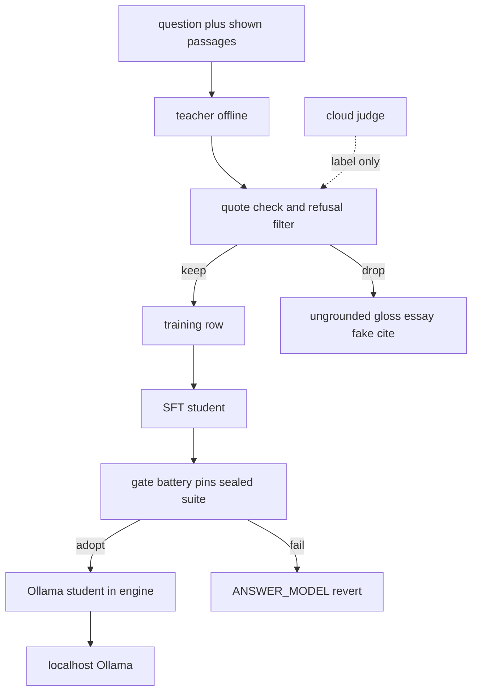

# Distill a small local answerer

Status: **draft 2026-10-15** — a tactic, not a gate. Revert the whole track with `ANSWER_MODEL=smallbook_x2d` (or `ANSWER_MODEL=qwen2.5:7b`). Do not train from this file.

The ENGINE stays local Ollama. Embeddings and answers run on `127.0.0.1:11434`; `server.py` never calls a cloud model. A stronger cloud model is allowed only as an **offline** judge or data labeler (testing / row keep-or-drop). `JUDGE_BACKEND=ollama` restores the offline granite judge. That path does not exist inside the engine, the server, or the batteries.

Teacher = a stronger model used **off the serve path** to write candidate answers. Student = the small Ollama tag `POST /ask` actually loads. On this box the shipped student is `smallbook_x2d` (Qwen2.5-3B-class, 1.9 GB q4). The on-disk teacher is `qwen2.5:7b` (4.7 GB). A Qwen3.8-27B-class teacher was used for Colab capture only; it is not an engine model. Wifi off is still the proof for serve.

Literature note (do not re-read as a bake-off): `artifacts/finetuned-models-2026.md`.

---

## What "answers the way a user wants" means here

The reader is the judge (`GOAL.md`). Good is what they see: a true answer, an honest refusal, a citation they can check. Map each want to a training-row field. Serve-time shape is `prompt.SYSTEM` (quote first, one gloss line) — both `ask` and `answer` send that now. `SYSTEM_ANSWER` is not the student target.

| User want | What the row must hold |
| --- | --- |
| A quote they can check | `citation_span`: a contiguous string copied from a **shown** passage. `gold_answer` starts `[Ch. N] "…that span…"` with N from that passage. |
| A short gloss in plain words | `gloss`: one line after the quote. Simple words. Definition first if the passage defines a term. No extra fact. |
| Honest refusal | `expect: refuse`. `gold_answer` is exactly `Not in this book.` — that sentence, period included, nothing else. Empty citations. |
| Figure when the passage names one | `gold_answer` quotes the passage that **names** the figure. No pixel description. The app attaches the file. Optional `figure_id` is metadata, not generated prose. |
| No essay | `gold_answer` is quote + one gloss line (or the refusal sentence). Long teacher completions are not gold. |
| No fake citation | `citations` only name chapters / chunk ids that were in `passages_shown` and that actually contain `citation_span`. Invented `[Ch. N]` is a drop. |

Do not fuse two passages into one quote. One quote per used passage.

---

## Data shape

One row:

- `question` — the asked form (the string the model will see).
- `passages_shown` — the retrieval window (gold chunks **and** distractors). Same kind of window `answer.py` sends.
- `gold_answer` — refusal sentence, or quote-first block (`[Ch. N]` + span + gloss).
- `citation_span` — the verbatim quote, empty on refusals.
- `citations` — chapter / chunk ids for kept quotes.
- `expect` — `answer` or `refuse`.
- optional `gloss`, `figure_id`, `note` (why this row exists; not trained).

**Refusal rows** teach the exact sentence. Under-sample answers relative to refusals and the model quotes a CIO passage for "capital of France" (already measured on early smallbook builds). Over-sample refusals and it refuses in-book asks (Qwen3-4B v3). Ratio is a tactic; the next build's ratio is **Not measured**.

**Bad rows to exclude**

- Ungrounded gloss: the gloss adds a comparison, number, or name the span does not contain.
- Tag-first failures that cannot cite: a gold that is only `[Ch. N] "quote"` plus gloss currently yields **zero** answer-mode citations, because `parse_answered` / `_sentence_claims` emit a claim only for text *before* a tag (`artifacts/pipeline-audit.md`). Do not treat that parser miss as a generation win. Do not "fix" it by training tag-at-end essays that fight `SYSTEM`.
- Unfiltered teacher essays: paraphrase with no span, or a short paragraph "in your own words" (`SYSTEM_ANSWER` shape).
- Out-of-book answered from a passing mention (x2e dropped eight preface-disclaimer quotes).
- Sealed-suite prompts (`datasets/sealed-forms.json`) — never trained. Near-matches abort a build.

**Where rows could come from vs what must be written**

`artifacts/datasets/` has **no subdirectories**. Files at the top (listed, **not opened** this session):

- `demo-questions.md`
- `eval-set.json`
- `eval-set-plain.json`
- `owner-rated-2026-10-15.jsonl`
- `qa-questions-overnight.json`
- `qa-sweep-default.json`
- `sealed-forms.json`
- `training-list-2026-10-14.md`

From AGENTS index / current state, not from opening those files: eval and sweep lists can **seed questions**; `training-list-2026-10-14.md` names deficit classes; `owner-rated-2026-10-15.jsonl` is a judge sample and is not a train set; `sealed-forms.json` is hold-out. Existing gitignored traces live under `data/finetune/` (x2d / x2e capture and train jsonl). Probes already emit capture rows (`probes/build-teacher-capture-*.py`, `gen-new-forms-v2-2026-10-15.py`).

Must still be **written or re-checked**, not trusted from a teacher dump:

- `citation_span` verified against `passages_shown`.
- Gloss lines (the 7B historically skipped the gloss on most answers).
- Distractors in the window, so the student learns to ignore a wrong chunk.
- Refusal forms that are not twins of the sealed controls.
- Figure-naming questions whose gold is the naming sentence.

If you only have a handful of gold items, spend them on evaluation, not gradient steps (`artifacts/finetuned-models-2026.md`).

---

## What not to fine-tune

- The **embedder** on a handful of Q&A pairs. Retrieval failure is chunking, prefixes, or lexical miss — not a 50-row LoRA.
- The **student** on unfiltered teacher essays. Distillation copies format and honesty only after the quote check and the exact-refusal check keep the row.
- A reranker on the same tiny pair set (memorizes wording).
- A vision model at answer time. Figures attach from the passage name.

---

## Size target

The goal is a model that fits a weak machine the way `smallbook_x2d` already does (1.9 GB q4 on this box). Do not LoRA a 70B for one book.

Candidate student families (from `artifacts/finetuned-models-2026.md` §4; pick one later, after a measured gate):

- **Qwen3 1.7B / 4B** — Apache-2.0, 32k, thinking **off** for this task. Qwen3-4B card was fetched. 4B QLoRA "fits many 8–12 GB cards"; VRAM **Not measured**.
- **Gemma instruct 2B–9B** — common Ollama path. License is Gemma. Cards **not fetched** that session.
- **Llama 3.2 3B / 3.1 8B** — training knowledge, **not fetched**. Meta license. Check before shipping.

Stay on a 1.7B–4B-class Q4 GGUF unless a gate says otherwise. Export to an Ollama tag. The engine loads that tag; it does not grow a pip stack.

**Distillation method names only** (no commands, no invented scores):

- SFT on filtered teacher traces, **same prompt template as serve** (`SYSTEM` + user message with passages).
- Rejection sampling against the quote check (keep only verbatim span + legal `[Ch. N]`; refusals must match `Not in this book.` exactly).

Next student vs `smallbook_x2d`: battery, sealed suite, loops, visible-ten — **Not measured**. Do not copy stale suite fractions into this plan. AGENTS.md numbers older than two days are stale until re-run.

---

## Five steps

Every step is a tactic. One-line revert each.

1. **Lock rows to the served contract.** Write or filter jsonl so every kept row is question + passages shown + gold quote-first answer (or the exact refusal) + citation span. Drop ungrounded gloss, essays, fake tags, sealed prompts. Cloud judge may label offline. **Revert:** delete the new jsonl; do not touch `prompt.ANSWER_MODEL`.

2. **Capture teacher traces offline.** Run the stronger model through the shipped ask seam (passages in, quote-first out). Local `qwen2.5:7b` on this box, or a Colab 27B-class capture as before — not `server.py`. Rejection-sample with the quote check. **Revert:** discard the capture file; teacher on disk stays `qwen2.5:7b`.

3. **SFT a small student.** One family from the size list. Responses-only, thinking off, same `SYSTEM`. Train off-box if needed; import GGUF → Ollama tag. Do not `pip install` anything into the engine. **Revert:** `ANSWER_MODEL=smallbook_x2d` (no file edit). Do not point the default at the new tag yet.

4. **Rejection-sample the student, not only the teacher.** Draw, keep completions that pass the quote check / exact refusal, drop the rest, optional second SFT on the kept set. **Revert:** throw away the filtered set; the SFT-only tag stays unused; default remains `smallbook_x2d`.

5. **Gate, then maybe adopt.** Restart `artifacts/runs/start-engine.bat`, confirm `/api/ps`. Run battery both modes, pins, sealed suite, contamination vs seal, loop probe, one streamed `POST /ask?stream=1` (answer mode). Adopt only if the reader-visible bar holds. **Revert:** `ANSWER_MODEL=smallbook_x2d` or `ANSWER_MODEL=qwen2.5:7b`. Restart the engine after the env change.

Do not ask permission to replace a means. Do not replace one without re-running the gates.

---

## Risks

**Tag-first citation bug.** `SYSTEM` asks for `[Ch. N]` then the quote. Answer-mode `parse_answered` cites text **before** a tag, so a correct quote-first completion looks uncited. `_retry_uncited` prefills `[Ch. ` and validates through the ask parser. Training quote-first without a parser fix makes the retry the real citation path. Training end-tagged prose to please `parse_answered` fights the served prompt (that mismatch is why x2e failed before the 2026-10-15 alignment). Fix the parser **or** keep the retry; do not silently change gold shape.

**Held answer-mode stream.** `_stream_ask` holds tokens until the kept generation. On uncited answer-mode replies the pane waits, then the `[Ch. ` retry **leads** the stream. A student that needs the retry on common asks will hitch. Distillation should aim for Turn-1 tags so the hold is idle. Stream behavior of a new tag: **Not measured**.

**Stdlib-only engine.** No new pip deps in the server. Training stacks stay off the serve path (Colab, a separate machine, vendored nothing in `server.py`). The student arrives as an Ollama tag. `urllib` talks only to localhost Ollama.

**Memorization vs other books.** Improvements must hold for a later EPUB. No chunk ids in logic modules. Sealed forms stay sealed. A second-book probe is part of "holds", not a train set.

**Teacher lies.** The 7B has fabricated a `[Ch. 4]` pin on a calibration sentence that contained "capital of France". Filter that class; do not distill it.

---

## Out of scope

No training commands in this file. No adoption. No `GOAL.md` or engine edits. Conversational clarify-turns stay parked.
