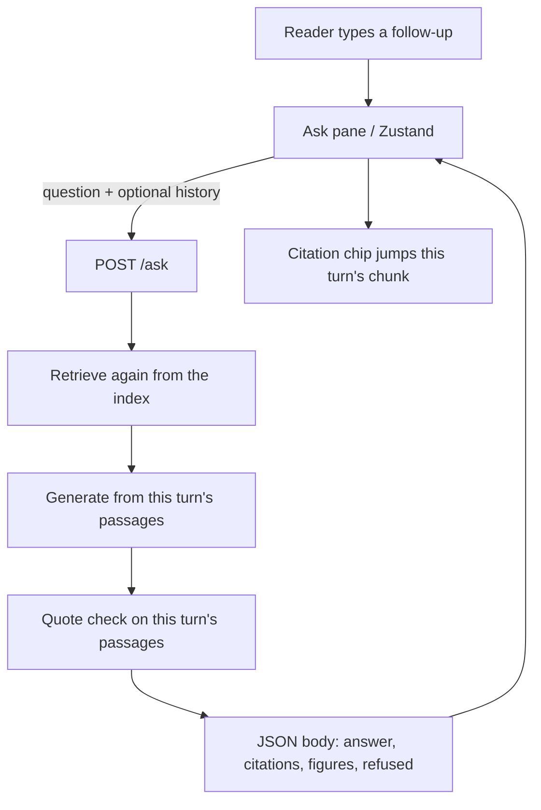

# Follow-up history — same-book thread (2026-10-15)

Status: draft — design only. Not approved. Do not implement from this file.

This is **not** the parked conversational companion (AGENTS.md post-v1 backlog). That track wants a third response type (clarify), conversation state, and a re-think of the sealed fragment class. This track is narrower: the reader asks again about the **same book** and the thread of what they already asked is not wiped. Refusal stays exactly `Not in this book.` The book is still the source. Chat is not.

---

## What the code does today (measured)

Each ask is one shot. The engine forgets it the instant the response is written.

- `server.py` `Handler.do_POST` reads a JSON dict. Required fields: `mode`; `question` for `ask`/`answer`; `selection` for `explain`. Extra keys are ignored. There is no `history` field. Unknown routes stay 404. No new route is allowed without a contract change.
- `web/lib/engine.ts` `askStream` sends `{ mode, question?, selection?, stream: 1 }`. Nothing else.
- `web/lib/store.ts` holds **one** `question`, one `body`, one `streamText`. `begin()` wipes `body`, `streamText`, `error`, and the highlight note. If an `AbortController` is live, a second `begin()` is a no-op.
- `web/components/AskPane.tsx` renders that one body (or the margin card owns it when `cardVisible && anchor`). Composer: Ask, or Stop while busy. No thread list. No "New question".
- `answer.py` `ask` / `respond`: `(index, question, …)`. No history parameter. Retrieval is `retrieval_context(index, asked_form, …)` on **this** question only (`PASSAGE_LIMIT = 5`). The Ollama call is two messages: `system` + one `user` (`Question:` + `Passages:` + reminder). Confirmed from the call graph, not from a comment.

Wifi off, stdlib engine, one book, records are JSON, no sqlite. Those constraints still hold.

---

## Where history lives

**Recommend: browser only. Server stays stateless. No database.**

The engine is stdlib and one-book. AGENTS.md forbids pickle, marshal, shelve, sqlite. Adding a sessions table would be a new store the constitution does not allow. A server-side dict of threads would die on the required engine restart (`*.py` edit or `ANSWER_MODEL` swap) and would still be a second source of truth.

Put the thread in Zustand, in memory, on this page. A reload starts a new thread. That is honest: the book is on disk; the chat is not.

Later, optional: `sessionStorage` still counts as browser-only and still sends the same payload. Do not do that in the first slice. Do not write chat logs under `artifacts/` or `data/`.

The server may **accept** a `history` array on `POST /ask` in a later slice so retrieval can see the last question. It must not **keep** it after the handler returns.



---

## What a follow-up is allowed to see

Allowed on the wire, and in the prompt, as **context for the question**, not as a source:

| Field | Why |
| --- | --- |
| Previous question | Resolves "that", "chapter 7", "simpler". |
| Previous answer | Short. Lets "say that simpler" know *what* to simplify. Truncate. |
| Cited `chunk_id`s | UI can keep chips honest per turn. Retrieval may *prefer* them; it may not paste their text. |
| Selection | Only if the last turn was `explain` (the highlight *was* the question). |

Not allowed:

- The whole book, or any passage text, pasted again. Passages come from **this** retrieval.
- Prior passage bodies stored on the client and resent as evidence.
- Figures as pixels or captions used as quotes. Figures still attach only when **this** turn cited a passage that names them.
- Earlier answers used as a quote source. If the model copies last turn's gloss, and that gloss is not in this turn's shown passages, the quote check must fail (ask mode) or the marks must strip (answer mode) the same way they do today.

The reader is the judge: they click a chip and land on a sentence in the open book. A chip that points at a sentence the current answer did not use is a failure, even if the id existed two turns ago.

---

## Retrieval on a follow-up

**Retrieve again. Do not trust the model's memory as a source.** Quotes still must be in the passages shown **this turn**.

Three shapes the reader will type, and what the engine must do:

**"What about chapter 7?"**

Anaphora. Today's `search()` embeds the literal question; there is no chapter filter (`retrieve.py`). Sending the raw follow-up will miss. The search string for this turn has to name the *topic* from the last question **and** the new constraint ("chapter 7"). Whether the embedder then ranks chapter-7 chunks is **not measured**. Do not hard-code chapter numbers in logic modules (generalization rule). A generic "the question named a chapter" bias, driven by the user's words, is allowed later; it is not the first slice.

**"Say that simpler"**

Register, not a new topic. `simple_words()` is a cue scan on the **current** question string (`in simple words`, `eli5`, …). If the follow-up is sent raw, those cues miss and `_plain_body` never runs. Fold the last question into this one and add a simple-words cue so answer mode still takes the plain register. Citations stay the original book sentences (today's plain-register contract). Retrieve again on the folded question; do not reuse last turn's passage list as a frozen set — a different ranking can surface a better sentence to simplify.

**"And the figure?"**

Still not vision. SYSTEM already says the model cannot see images. Retrieval is the last topic plus a figure cue. The figure **card** still attaches only from this turn's cited passages. If the new passages do not name a figure, there is no card, and a quote about pixels is a refusal or a strip — same as a first ask.

In all three: last turn's answer may help write the **query**. It must not appear in `Passages:`. `parse_completion` / `parse_answered` keep matching quotes against `passages` from this `retrieval_context` call.

---

## Contract sketch — optional `history` on `POST /ask`

Today (README "HTTP contract", `tests/test_contract.py`):

```
{"book_id": "fde", "question": "...", "selection": null, "mode": "answer"}
```

Optional today: `stream: 1`.

**If `history` is missing or empty: today's behavior, unchanged.** `do_POST` already ignores unknown keys, so a client that never sends `history` keeps the current path even before server code learns the field. `ask()` / `respond()` stay one-argument questions until the full slice.

Proposed optional field (full slice; needs owner yes — AGENTS.md: `POST /ask` request shape is frozen):

```
history: [
  {
    "question": string,
    "answer": string,
    "cited_chunk_ids": [string],
    "selection": string | null
  }
]
```

Caps (assumed until measured against a generation that drops a quote):

| Cap | Value | Why |
| --- | --- | --- |
| Max prior turns | 3 | Small model; five passages must stay the bulk of the prompt. |
| Max chars across all `question`+`answer`+`selection` in `history` | 1200 | Last-turn p90 answers were targeted at 622 chars (`answer.py` comment). Three full answers would crowd the passages. Truncate oldest first, keep `cited_chunk_ids`. |
| Max chars per `answer` in a history item | 400 | Enough to resolve "that"; not enough to re-serve the book. |

If the array is longer, drop from the front (oldest). If a field is the wrong type, `400` with a short error (`bad history`) — same family as `bad mode` / `missing question`. Do not invent a new route.

`book_id` stays advisory; the engine still has one loaded book. `quiz` ignores `history` (it ignores the question box today). `explain` may send `selection` as now; history is extra.

Response shape does **not** change: `answer`, `citations`, `figures`, `refused`. When `refused: true`, `answer` is exactly `Not in this book.` — that sentence, period included, nothing else. Turn number is not a reason to soften it. No `clarify` type in this track.

Missing `history` is the compatibility seam: battery, pins, curl fixtures, and `window/index.html` keep working.

---

## UI

**Thread in the ask pane. Not a margin thread.**

The margin card is for a passage-anchored ask (selection / citation click). It already owns that one answer so the pane stays quiet (`cardVisible && anchor`). Stacking *chat turns* in the margin would fight the book. The book stays the book. The pane holds the log.

First slice can be one previous turn above the current answer, then the composer. Full thread is a short scroll of finished turns, current stream at the bottom, composer pinned.

**Stop**

Stop aborts the in-flight generation (`AbortController`), as today. Status `stopped`. The partial is **not** committed to history (it was not quote-checked). Earlier finished turns stay. The composer becomes Ask again. The reader can edit and resend the follow-up, or hit New question.

While busy, a second Ask is still a no-op (one controller). Do not queue.

**New question**

Today every Ask is a new question because there is no thread. With a thread, Ask after a finished turn is a **follow-up**. Add an explicit **New question** control that clears `turns`, `body`, highlight, and the composer. Escape can keep clearing the highlight (today) without wiping the thread.

A follow-up keeps the current mode unless the reader changes it. An `explain` selection that finishes can be followed by a typed question in the pane; that typed question is an `ask`/`answer` with history, not a second explain, unless they select again.

**Refusal on turn 3**

The pane shows the exact sentence, same as turn 1. No apology, no "based on our conversation". Chips on a refusal stay "nearest misses" for **this** retrieval, not souvenirs from turn 1. The live region already announces `Not in this book.` on `status === "refused"` — keep that.

Do not duplicate a margin card's answer into the thread while `beside` is true; commit it to the pane log when the card closes, or show a one-line pointer ("Answered beside the passage") as today.

---

## Failure modes

**The model answers from the chat instead of the book.**

If last turn's answer sits in the prompt next to passages, a 3B quote-or-refuse student can copy the gloss. Mitigation: label history as not a source (one line, not a new personality). Quote check still only sees this turn's passages. Ask mode refuses when the copied span is not in those passages. Do not feed prior passage text. Do not skip retrieval.

**Citation chips point at the wrong turn.**

Today `showCitation` writes one global `highlight`. A thread with two `AnswerView`s would both call the same setter — fine for jumping the book, wrong if a chip from turn 1 is read as belonging to turn 2's prose. Mitigation: each turn keeps its own `citations[]`. A click still jumps the book (the book is one place). Do not reuse `chunk_id` from turn 1 as the evidence list for turn 2.

**History grows until the small model drops the passage.**

Five ~300-token chunks are the evidence. Unbounded chat will push them out of a small context, and the quote check will refuse honest answers or the model will ignore `Passages:`. Caps above are the brake. First slice is one prior turn. If a measured run shows quote-check pass rate falling when history is present, cut chars, do not raise `PASSAGE_LIMIT`.

**Anaphora sent raw.**

"And the figure?" as the whole `question` embeds poorly. First slice must rewrite on the client or this class fails before the server learns `history`.

**Stopped partial becomes "previous answer".**

Then the next turn cites unchecked text. Do not commit `stopped` or `error` turns.

**Refusal as content.**

If turn 1 was `Not in this book.`, turn 2 should not treat that sentence as a source. Either start a new question, or retrieve on the new words only.

This track does **not** turn bare fragments (`how do`) into clarifying questions. That is the parked companion. Until that lands, a fragment is still answer-or-refuse.

---

## Smallest first slice vs full thread

### First slice — one follow-up, client-held, server still stateless

Ship nothing on the wire that today's engine does not already accept.

Client rewrite (assumed sufficient for a demo; **not measured**):

- After a `done` or `refused` turn, the next Ask is a follow-up.
- Outgoing `question` is a standalone sentence built from last question + this text (so "what about chapter 7?" becomes last topic + "chapter 7"; "say that simpler" becomes last question + "in simple words").
- Server sees one `question`, no `history`. Retrieval, quote check, refusal sentence: unchanged.
- UI shows last Q/A above the new answer. New question clears. Stop does not commit.

Files that would change (do not implement):

- `web/lib/store.ts` — `turns` (one finished item), `newQuestion()`, follow-up rewrite in `submit`, do not wipe the previous turn on `begin` (wipe only the live `body`/`streamText`), skip commit on `stopped`/`error`.
- `web/components/AskPane.tsx` — render the prior turn; New question; Ask means follow-up when a turn exists.
- `web/lib/engine.ts` — **no** payload change.
- `server.py`, `answer.py`, `prompt.py` — **no** change.

Files that probably stay: `AnswerView.tsx` (already takes one `body` + `onChip`); wrap it once per turn. `MarginCard.tsx` / `Lens.tsx` stay one-shot beside the passage.

Risks accepted in this slice: rewrite quality is heuristic; "and the figure?" may still miss; no `history` means the model does not see the previous answer, only the folded question.

### Full thread — optional `history`, still no database

After the first slice is judged by the reader (true answer, honest refusal, checkable citation):

- `server.py` — validate optional `history` (type, max turns, max chars); pass through; missing = today.
- `answer.py` — `ask`/`respond`/`retrieval_context` take history; fold last question(s) into the **search string**; put a short "Earlier (not a source)" block in `user_message` / `answer_user_message`; quote check unchanged (this turn's passages only).
- `prompt.py` — at most one extra SYSTEM line: earlier turns are not passages. Refusal sentence stays the only refusal.
- `web/lib/engine.ts` — payload may include `history`.
- `web/lib/store.ts` — up to three finished turns; send them; still no server session.
- `web/components/AskPane.tsx` — scrollable thread.
- `tests/test_contract.py` plus a new unit test: missing `history` is today's path; oversized `history` is 400; refusal on turn 3 is the exact sentence.
- README / AGENTS.md contract bullets — only when the owner unfreezes the optional field.

Do not change `retrieve.py` to paste old chunk ids as fake hits. A later retrieval *bias* toward last-turn ids is a tactic; it needs a measured before/after, and it must not replace cosine with "whatever we cited last time".

`canonical.py` stays single-turn. The rewriter plan (`artifacts/plans/query-rewriter-plan-2026-10-15.md`) is a different seam (messy first asks). Do not couple them.

---

## Measured vs assumed

**Measured (from this tree, 2026-10-15):** stateless `ask`/`respond`; two-message Ollama call; `PASSAGE_LIMIT = 5`; no `history` in server, store, or engine; `begin()` wipes the one body; one AbortController; Stop does not quote-check; margin vs pane split; exact refusal in `prompt.REFUSAL`; `simple_words()` is a cue scan; `search()` has no chapter filter; sqlite forbidden; `POST /ask` frozen; conversational companion parked separately.

**Assumed (not run):** 1200-char / 3-turn caps; whether folding "chapter 7" into the last topic retrieves chapter 7; whether one SYSTEM line stops chat-from-memory; latency of a follow-up vs a first ask; any battery number with history present. A claim that follow-up "works" ships with a command, an evidence path, and before/after numbers — constitution, not this draft.

---

Next check (when implementing is allowed): owner yes on (1) browser-only history, (2) first slice with no wire change, (3) later optional `history` as a contract thaw. Then a failing test for "missing history = today's body" before any parser change.
