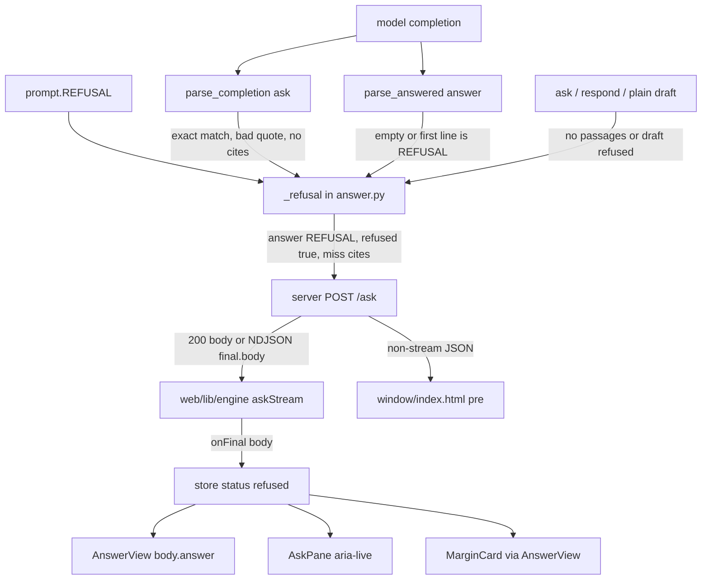

# Refusal surface — how `Not in this book.` reaches the screen

Measured from source only. No redesign. Wrap means UI/copy around the contract
string; the JSON field `answer` stays exactly `Not in this book.` so tests keep
passing.

Contract sentence (engine, frozen): **`Not in this book.`**  
Source of truth: `prompt.py` → `REFUSAL = "Not in this book."`  
Constitution: `GOAL.md` — refusal is exactly that sentence.

---

## Path (engine → screen)



### 1. Constant

- `prompt.py` line `REFUSAL = "Not in this book."`
- Embedded in `SYSTEM` and `SYSTEM_ANSWER` as the only allowed refuse reply.
- `answer.py` imports `REFUSAL` from `prompt`.

### 2. Body assembly (`answer.py`)

`_refusal(passages, figures)` always returns:

- `answer`: `REFUSAL` (the contract string, nothing else)
- `citations`: up to 3 nearest-miss snippets (160-char clips of retrieved text)
- `figures`: figures named by those top-3 passages
- `refused`: `True`

Call sites that return `_refusal` (measured):

| Path | When |
| --- | --- |
| `parse_completion` | completion text is exactly `REFUSAL` |
| `parse_completion` | no `[Ch.` and tagless prose fails the quote check |
| `parse_completion` | a tagged line fails match / short span / empty citations |
| `parse_answered` | empty text, or first line equals `REFUSAL` (`_free_refusal`) |
| `ask` / `respond` | retrieval returned no passages |
| `_plain_body` | draft is already refused — returned unchanged (no paraphrase) |
| `quiz` | key leak / bad parse (same `_refusal` / `REFUSAL` answer) |

Mode notes (measured):

- **ask**: full-text must equal `REFUSAL`, or failed quote check → refuse. A line that *starts* with the sentence and keeps talking is rewritten to bare `REFUSAL` via the exact-match branch only when the whole text is the sentence; essay / invention refuse via quote failure.
- **answer**: first line must be exactly `REFUSAL`; trailing lines are dropped; still `answer: REFUSAL`. Hallucinated free prose without a refuse first line is **not** forced to refuse (groundedness is a meter).

Nothing after refuse appends `Asked as:` / `Read as:` — those gates are `not body["refused"]`.

### 3. HTTP (`server.py`)

Success path does not rewrite the string:

- non-stream: `_send_json(200, body)`
- stream: final NDJSON frame `{"type":"final","body": body}`

Server **error** strings are not the contract refusal. They go on `error`, never as a refused `answer`:

| String | Kind | HTTP / frame |
| --- | --- | --- |
| `not found` | route | 404 |
| `invalid json` | bad request | 400 |
| `bad mode` | bad request | 400 |
| `missing question` | bad request | 400 |
| `missing selection` | bad request | 400 |
| `missing index` | engine down / no index | 500 |
| `answer model unavailable` | Ollama down | 500 |
| `index error: …` | bad index / zero query | 500 |
| `engine error: …` | stream uncaught | error frame |

### 4. Client transport (`web/lib/engine.ts` + `web/lib/store.ts`)

- `askStream` posts `{ …payload, stream: 1 }`.
- `final` → `onFinal(body)`; store sets `status: body.refused ? "refused" : "done"`, keeps full `body`.
- HTTP / NDJSON errors → `status: "error"`, `error: message` (not refused).
- Catch of failed fetch → hardcoded `Engine unreachable — start it on :8000, then ask again.`
- EOF with no terminal frame → `The connection dropped before the answer finished — ask again.`
- Fallback when frame has no text: `engine error` or `engine returned ${status}` or server `data.error` passthrough.

`AnswerBody` shape: `{ answer, citations, figures, refused, error? }`.

### 5. Render

**AnswerView** (`web/components/AnswerView.tsx`) — shared by ask pane and margin card:

- `splitAnswer(body)` returns `{ ok: false }` when `body.refused` (`web/lib/answer.ts`).
- Fallback branch: `<p className="answer">{body.answer}</p>` → user sees exactly `Not in this book.`
- If citations exist: label `nearest misses:` + chapter chips (title = miss quote snippet).
- If refused + figures: meta line `nearby, not an answer`, then figures.

**AskPane** (`web/components/AskPane.tsx`):

- When not "beside" the margin card: mounts `AnswerView` for any finished `body` (refused or not).
- `aria-live` announce when `status === "refused"`: hardcoded `"Not in this book."` (same words; not read from `body.answer`).
- Idle helper (not a live refusal):  
  `Answers come only from this book's pages. If it is not in the book, the answer is “Not in this book.”`
- Errors: `<p className="answer">{error}</p>` — separate from refusal.

**MarginCard** (`web/components/MarginCard.tsx`):

- Same `AnswerView` for `body`.
- Errors: `{error}` in the card text class — not refusal.

**Legacy window** (`window/index.html`):

- `answer.textContent = body.answer || body.error || ""` → contract string in the `<pre>`.
- Refs line: `nearest misses: ` + chunk ids when `body.refused`.
- Figure note: `nearby, not an answer`.
- Reachability errors (not refusal): `Could not reach the engine.`, `The engine returned a body that was not JSON.`, `The engine returned ${status}.`

**Reader load** (`web/app/page.tsx`, not ask):  
`Could not load the book: ${detail} — is the engine running on :8000?` — missing chunks / engine, never the refuse sentence.

---

## Surfaces today (user-visible strings)

| # | Surface | Exact user-visible string(s) | Kind | Already wraps? |
| --- | --- | --- | --- | --- |
| 1 | AnswerView main line | `Not in this book.` (`body.answer`) | **contract** | no — bare sentence |
| 2 | AnswerView chips label | `nearest misses: ` + `Ch. N` chips | contract adjacent | yes — label only |
| 3 | AnswerView figure note | `nearby, not an answer` | contract adjacent | yes — meta only |
| 4 | AskPane aria-live | `Not in this book.` | **contract** (hardcoded twin) | no |
| 5 | AskPane idle blurb | book-only copy naming the sentence in quotes | education, not live refuse | n/a |
| 6 | MarginCard | same as AnswerView (1–3) | **contract** | same as 1 |
| 7 | window/index.html pre | `Not in this book.` | **contract** | no |
| 8 | window refs | `nearest misses: ` + ids | contract adjacent | yes |
| 9 | window figure note | `nearby, not an answer` | contract adjacent | yes |
| 10 | AskPane / MarginCard error | server/client error text (table above) | **not contract** | n/a |
| 11 | Reader loadError | `Could not load the book: …` | **not contract** | n/a |
| 12 | Streaming partial | live tokens may flash the sentence before `final` | pre-final; final still contract body | n/a |

Assumed (not re-verified in a browser this turn): CSS classes `answer` / `meta` / `chips` do not rewrite text; skill `book-companion-ui` says style refusal as an answer (no red, no apology). That skill text is guidance, not the running app.

---

## Friendlier wrap opportunities (JSON unchanged)

Rule for every wrap: keep `body.answer === "Not in this book."` and `refused: true` in the wire JSON. Tests assert that field. UI may add headings, labels, chips, helper lines **around** it.

Shape of a safe wrap (example, not a redesign):

```
Not in this book.          ← body.answer, still the heading / lead line
Closest passage:           ← new UI-only label (or keep "nearest misses:")
  [Ch. 5] [Ch. 8] …        ← existing chips from body.citations
nearby, not an answer      ← keep if figures present
```

| Surface | One-line wrap (UI only) |
| --- | --- |
| **AnswerView** (primary) | Keep `body.answer` as the lead line; optionally restyle as a calm heading; keep or rename the chips line to `Closest passage:` while chips still bind `body.citations`. |
| **MarginCard** | Same as AnswerView (shared component — one change covers pane + card). |
| **AskPane aria-live** | Prefer announcing `body.answer` (or the same contract string plus “nearest misses listed”) so the live region cannot drift from JSON. |
| **AskPane idle blurb** | Already friendly; leave or shorten — does not touch live refuse. |
| **window/index.html** | Same pattern under the `<pre>`: leave `body.answer` as-is; keep `nearest misses:` on `#refs`. |
| **Error paths** | Do **not** map engine errors to the contract sentence. Friendlier error copy is separate product text (`missing index`, Ollama down, unreachable). |
| **Streaming** | Optional: suppress painting tokens when the cumulative draft equals `REFUSAL`, or wait for `final` on refuse-looking drafts — still no change to final JSON. |

What must not change:

- `prompt.REFUSAL`
- `_refusal()["answer"]`
- test assertions on `body["answer"] == REFUSAL`
- server success body shape

---

## Tests that pin the exact sentence

Grep under `tests/` for asserts that the answer (or the constant) is exactly `Not in this book.` / `REFUSAL`.

**Count: 16 test methods.**

| File | Test method | What it pins |
| --- | --- | --- |
| `tests/test_answer.py` | `test_a_short_overlap_is_still_a_refusal` | `answer == REFUSAL` |
| `tests/test_answer.py` | `test_invented_quote_is_a_refusal` | `answer == REFUSAL` |
| `tests/test_answer.py` | `test_essay_is_a_refusal` | `answer == REFUSAL` |
| `tests/test_answer.py` | `test_refusal_must_be_exact` | refuse-prefix + exact → `answer == REFUSAL` (two asserts) |
| `tests/test_answer.py` | `test_a_wrong_chapter_tag_on_an_unattached_quote_still_refuses` | `answer == REFUSAL` |
| `tests/test_answer.py` | `test_a_refusal_can_still_carry_the_nearby_figure` | `answer == REFUSAL` + figure rides along |
| `tests/test_answer.py` | `test_a_refusal_stays_a_refusal_with_anchors` | `answer == REFUSAL` |
| `tests/test_answer.py` | `test_tagless_junk_is_still_refused` | `answer == REFUSAL` |
| `tests/test_answer.py` | `test_a_short_fragment_quote_still_refuses` | `answer == REFUSAL` |
| `tests/test_answer.py` | `test_quiz_leaking_the_key_is_a_refusal` | `answer == REFUSAL` |
| `tests/test_answer.py` | `test_a_fabricated_quote_is_still_a_refusal_next_to_a_figure` | `answer == REFUSAL` |
| `tests/test_canonical.py` | `test_refusal_keeps_the_exact_sentence` | `answer == "Not in this book."`, no `Asked as:` |
| `tests/test_contract.py` | `test_the_refusal_sentence_is_exact` | `prompt.REFUSAL` and both system prompts contain the sentence |
| `tests/test_free_answer.py` | `test_refusal_exact` | free parse → `answer == REFUSAL` |
| `tests/test_free_answer.py` | `test_refusal_first_line_then_more_is_still_a_refusal` | first-line rule → bare `REFUSAL` |
| `tests/test_plain_register.py` | `test_refusal_draft_is_not_rewritten` | plain register does not paraphrase a refuse |

Not counted: fixtures, harness copies of the string under `artifacts/`, skill docs, owner-rated JSONL rows. Those mention the sentence but are not the `tests/` pin suite above.

---

## Measured vs assumed

**Measured (read in-repo):**

- `prompt.REFUSAL` text
- every `_refusal` return shape and call path listed
- server error string table
- store status branch on `body.refused`
- AnswerView fallback for `refused` + chip / figure labels
- AskPane announce + idle copy + error branch
- MarginCard reuse of AnswerView
- window/index.html assignment and nearest-miss / nearby labels
- 16 test methods that pin the sentence

**Assumed:**

- runtime CSS does not alter the characters of `body.answer`
- no second web shell beyond `web/` and `window/index.html` shows refuse copy
- skill doc refusal styling is intended policy, not enforced by a test in this pass

---

## Next check

If implementing a wrap: change only `AnswerView` (and optionally AskPane announce source), leave `answer.py` / `prompt.py` / server body alone, re-run the 16 pins above (`python -m unittest tests.test_answer tests.test_free_answer tests.test_canonical tests.test_contract tests.test_plain_register` or the repo’s usual battery entry).
