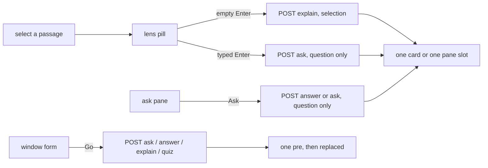
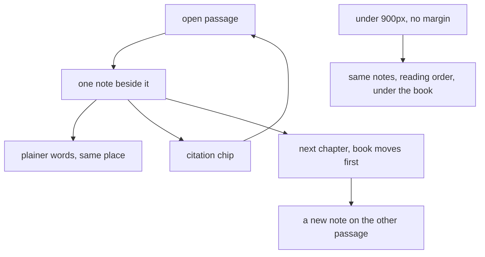

# UX moments — ask-this-book

Date: 2026-10-15. Design only. No source edited.

The aim is a small local model that answers the way a reader of a book companion would want. This file lists the moments, not a redesign.

**Measured** means the file was read. **Assumed** is labelled. No screenshots. Contrast, real timings, and on-screen layout were not measured. The "~25 s" cold-load line in the UI is a comment in `web/components/AskPane.tsx`, not a number captured for this note.

## What exists today

Two surfaces. Neither was run for this note.

| Surface | What the user can do | Source |
| --- | --- | --- |
| Next app, `web/` | Read the book, ask, select-then-ask, jump a citation | `web/app/page.tsx`, components below |
| Engine `GET /` | One form, four modes, one answer | `window/index.html` |

`GET /` serves `window/index.html`. The Next app is a second page (`npm run dev` on :3100; preview on :3200). Production does not yet serve `web/out` from the engine. That is in `web/README.md` "Not built yet" and matches the earlier review in `artifacts/ui-review.md`.

### Reader (`web/components/Reader.tsx`)

- Mount loads `GET /chunks`. Payload is reading order, no vectors, heading stripped into its own field, figures as cards with PNG width/height (`retrieve.py` `chunks_payload`). `web/README.md` says 1042 chunks. The CSS comment in `web/app/globals.css` repeats that number. Not re-counted here.
- Headings render only when they change. Figures sit in the chunk that carries them. `section` and `source` are on the payload and never shown.
- A citation sets `highlight`. The chunk scrolls into view if the mark is off-screen. Search is whitespace-insensitive over the rendered paragraphs. Not found: the ask pane shows `The quoted sentence was not found in Ch. {n}'s text.` Missing chunk: `Ch. {n} is not in the loaded book.`
- `content-visibility: auto` estimates off-screen height at 320px. The jump retries once on the next frame and once at 160ms. A miss can still land off the mark. Whether it does in a browser was not measured.
- One margin card, only when the pane leaves 300px + 24px beside the text column. Below that, the card does not mount and the ask pane shows the same answer. Under 900px the shell is one column, book then ask (`globals.css`). The resize handle hides (`pane.css`).
- Pointer down outside the mark, the card, and the lens clears the highlight and the anchor. A press on those three does not.

### Ask pane (`web/components/AskPane.tsx`, `web/lib/store.ts`)

- Modes in the select: `answer` labelled "Answer", `ask` labelled "Quote first". Default `answer`.
- Textarea placeholder `Ask the book…`. Enter submits. Shift+Enter is a newline. Height caps at 240px. Empty question cannot submit.
- One in-flight request. A second `begin` returns and says nothing.
- Submit sends `{ question, mode, stream: 1 }`. It does not send the current highlight or selection.
- While the margin card is on screen, the pane hides the answer text and says "Answering beside the passage…" or "Answered beside the passage." Stop stays in the pane.
- Closing the sidebar unmounts the pane. Stop goes with it. The request keeps running (`store.ts` module `controller`).
- The question string stays in the box after Ask. The pane does not reprint "you asked".
- Latency line after a finish: `first words after {n} s · answered in {n} s`. Not shown while busy.

### Lens (`web/components/Lens.tsx`)

- A finished drag, double-click, or keyboard selection inside the reader opens a pill at the selection. It does not open while a request is in flight.
- The selected words are marked before the native selection is dropped (pointer path).
- Placeholder `Ask about this…`. First printable key, while focus is in the reader, lands in the pill. Enter with an empty field runs `explain` and sends the selection. A typed field runs `ask` and sends only the typed question. The passage is the visual anchor, not a request field.
- The pill anchors on the start of the selection's `[data-chunk-id]`. A selection that crosses chunks is one chunk: the first.

### Margin card (`web/components/MarginCard.tsx`)

- Header is `Ch. {anchor.chapter}` and a close control. Body starts with `anchor.question` if the lens was typed, otherwise the selected quote.
- Streams the model's own order. Reader-first layout arrives only with `final`.
- Copy writes `body.answer` or the partial stream. Failure sets the button text to "Copy failed".

### Answer layout (`web/components/AnswerView.tsx`, `web/lib/answer.ts`)

- On `final`, if every citation quote is found in the answer text: gloss first, then the quote as a button in quotation marks, then a `Ch. N` chip. Two or more citations number the chips in engine order (`1 · Ch. 4` style).
- Refusal, or a quote the parser cannot find: verbatim `answer` plus a chips row. Refused chips are prefixed `nearest misses:`.
- `Asked as:` and `Read as:` lines are pulled out and shown as disclosures. They are not dropped.
- Figures from the answer body render under the text. If `refused`, the line `nearby, not an answer` sits above them.
- Answer figures have no width/height. `figures.py` `figures_for` does not send them. Reader figures do (`figure_cards`). An answer image can shift the column when it loads. Not measured on screen.

### Window form (`window/index.html`)

- One column, Georgia, `max-width: 42rem`. Modes: `answer` (selected), `ask`, `explain`, `quiz`.
- Fields: Question, Selection. Button: Go. POST is JSON, no `stream`. Quiz sends an empty question.
- Answer is a `<pre>`. Citations print `chunk_id` only, not chapter. On `refused` the refs line is prefixed `nearest misses:`.
- Quiz with citations shows "Show the key". The key is the citation quotes, hidden until the click.
- Figures render with caption. On refusal a note `nearby, not an answer` is inserted first.
- Wait copy is `Looking...` with no timer. A network failure becomes `Could not reach the engine.` A non-JSON body becomes `The engine returned a body that was not JSON.`

### Modes, from the engine (`server.py`, `answer.py`, `prompt.py`)

| Mode | Who calls it | What the engine does |
| --- | --- | --- |
| `answer` | Next composer, window | Retrieves on the question. Answers in its own words, cites with `[Ch. N]`, strips quotes the passages cannot back. A question that contains a plain-register cue goes through a rewrite of evidence sentences. An uncited answer is retried once with a `[Ch. ` prefill. Tokens for the draft are held; the pane stays on "Looking…" until `final` unless that retry streams. |
| `ask` | Next "Quote first", typed lens, window | Quote first, then one gloss line. Tokens stream for the main generation. The typed lens does not pass the selection; `ask()` only reads the question. |
| `explain` | Empty lens, window Selection field | The selection is the question (`canonical=False`). It is a search over those words, not a commentary that is bound to that span. |
| `quiz` | Window only | Ignores question and selection. Picks one teaching chunk at random. One question, one key sentence in `citations[].quote`, no score. A leak or a `[Ch.` tag becomes a refusal. Tokens are held until `final`. |

`MODES` is `("ask", "answer", "explain", "quiz")`. A bad mode is `{"error": "bad mode"}`. Ask and answer without a question are `missing question`. Explain without a selection is `missing selection`. No index is `missing index`. Ollama down is `answer model unavailable`.

There is no conversation. Each call is one question, up to five passages (`PASSAGE_LIMIT = 5` in `answer.py`), one body. A later question does not see the earlier one, the earlier answer, or the open page.

A bare topic with no `?`, no wh-word, no pronoun, and a first word that is not an opener gets prefixed to `What is {text}?` (`canonical.py`). The rewrite is appended as `Asked as:`. Out-of-book spellings can be swapped for a book word; a kept swap is `Read as:`. Neither is a choice the reader picks.

Figures attach only when a kept passage names `Figure N-N` or `Fig. N-N` (`figures.py`). The prompt forbids describing the image.

Refusal string in `prompt.py`: `REFUSAL = "Not in this book."` A refusal body is that sentence, up to three nearest-miss citations (quote clipped to 160 characters), and any figures those miss-passages name, with `refused: true`.

## Every follow-up the user will try

Each line is what they will type or do, then what happens if they do it on today's surfaces, then the moment that would make it a companion.

### "Say that simpler"

`answer.py` `SIMPLE_CUES` is a closed list: "in simple words", "in simple terms", "in plain words", "for a beginner", "for beginners", "simply explain", "explain simply", "like i'm five", "eli5", "keep it simple".

"Say that simpler" does not match. Neither does "simpler" alone. The next Ask is a new retrieval. The previous gloss is not an input. The plain register, when a cue does match, rewrites evidence sentences from a fresh draft. It does not shorten the answer just shown.

Companion moment: a control on the finished gloss, beside that card or that pane answer, that means "same passage, plainer words". Typing the phrase into the box is the wrong place. The box starts a new search.

### "What about the next chapter"

Chunks are in reading order and each has `chapter`. The client can find the next distinct chapter and scroll to its first heading. Nothing in the UI does that.

A typed question is retrieved as text. "Next" is not resolved against the open passage, the card's chapter, or the last citation. `canonical.py` will not turn it into a chapter question. The first word is not a bare topic in that sense, and a `?` passes the string through unchanged.

Companion moment: from a card or a marked passage, "next chapter" moves the book. A second control asks about that chapter only after the reader is there. Do not send the pronoun to the model and hope.

### "Show me the figure"

If the passage on screen names a figure, the image is already in that chunk. There is no control to bring it into view, and clicking the image does nothing.

On an answer, a figure appears only when a cited passage names its number. The model is told not to describe pixels. "Show me the figure" as a question is another retrieval. It does not scroll to the image in the chunk, and it does not attach a figure the passages do not name.

Companion moment: if the marked chunk, or a cited chunk, has a figure, a line on the card or under the quote jumps the reader to that image. If none does, the honest line is that this passage does not name a figure — not a new answer that describes one.

### "I meant the other CDC"

No disambiguation list. `readings.py` swaps an out-of-book spelling for the closest book word when one candidate wins and there is no tie. A tie is not offered. A kept swap is disclosed as `Read as:`. The reader cannot pick the other sense.

A follow-up that says "the other" has no previous entity. The engine searches those words. Two passages that both say CDC are not shown as a choice.

Companion moment: when the book uses the same token in two chapters, or a reading has a runner-up, show the two chapters as chips before answering. The reader picks. Do not guess. This is not "CDC is in this book" — that was not checked.

### "Quote that again"

The last answer stays in the pane or the card until the next ask replaces `body` (`store.ts` `begin` sets `body: null`). Copy exists only on the margin card, and it copies the engine string, citation tags included. The ask pane has no copy. There is no "show the quote again" that re-marks the passage after the highlight was dismissed.

A citation chip does jump and mark, but only while that answer is still on screen. After the next ask, the quote is gone. Nothing is stored.

Companion moment: the quote the reader just checked stays attached to the passage, so "again" is a jump to the mark, not a second generation.

### "Quiz me on this page"

Window quiz ignores the question and the selection. It draws one random teaching chunk (`pick_quiz_chunk`: numeric chapter, at least one sentence of 40+ characters). The key is hidden behind "Show the key". No score. Next has no quiz control at all.

"This page" is not a field. An empty lens explains the selection; it does not quiz it.

Companion moment: quiz the passage in front of the reader, key hidden, jump-to-key the same way a citation jumps. A quiz from a random chapter is a different product. Say which one is happening.

### Other follow-ups that will happen

These are the same gap, with different words.

| They try | Today |
| --- | --- |
| "Why?" / "and?" / "go on" | New retrieval on those words. No prior answer in the prompt. `user_message` is `Question:` plus `Passages:`. |
| "No, the other chapter" | Same. Chapter filter does not exist. `prompt.py` tells the model not to fill a gap from another chapter. It does not let the reader exclude one. |
| Repeat the question | The box still holds the last question (measured: `submit` does not clear `question`). Ask again replaces the pane. There is no "same question" affordance. |
| Ask while one answer is streaming | Second `begin` returns. No queue, no line that says the book is still answering. |
| Select across two chunks and ask | Lens uses the start chunk as the anchor. Empty-lens explain searches the full selected string, which may not match one passage. |
| Close the card, look for the answer | `clearHighlight` drops the anchor. The pane then shows `body` again, unless the sidebar was closed. If the sidebar is closed, the answer is in memory and not on screen. |
| "What does this word mean" with nothing selected | Composer search. The word they are pointing at is not sent. |
| Correct a bad citation | They can click the chip and see the miss note. They cannot mark it wrong, and the next question does not know. |
| "Stop, that's enough" | Stop aborts. Copy is `Stopped — this is a partial answer.` The card omits "Ask again to retry." The partial is labelled. It is not a finished gloss. |
| Window: paste a highlight, then Go on explain | Works if Selection is non-empty. The book itself is not on that page, so they cannot check the quote by jumping. |
| Window: quiz, then "easier" | Next Go draws a new random chunk. The previous question is gone. |

## How a thread should look

Not a chat log. The book is the page. A thread is the notes that survived, each tied to a place in the book.

Today the thread is one slot. A new ask clears `streamText` and `body`. The card key is `chunkId|quote`, so a second question on the same selection remounts the card and the first note is gone. The composer question is the only leftover, and it is not shown next to the answer.

What the reader needs instead:

- One note per ask, sitting with the passage it came from. A lens ask already has an anchor. A composer ask has none until a citation comes back. When `final` has a citation, that note should be able to move to the first cited passage. Until then it lives in the pane, labelled as not yet placed. Do not pin an uncited answer beside a random paragraph.
- The note shows the question in the reader's words, then the gloss, then the quote. The margin card already prints `anchor.question || anchor.quote`. The pane does not print the question at all. That is why the pane feels like a search result and the card feels closer to a margin note.
- Older notes stay as short lines — the question, or the first line of the gloss — stacked in the margin only when a later note would cover them. One open card. The rest are one line, same chapter, jump on click. Several open cards are not built (`web/README.md` lists collision stacking as not built). Do not invent a second column of chat bubbles to fake the stack.
- A follow-up is indented under the note it answers, still beside that passage, not a new row in a transcript. "Say that simpler" is a child of that note. "What about the next chapter" is a new note on a different passage, after the book has moved.
- The pane, when the margin does not fit, is the same list in reading order, not newest-chat-at-the-bottom. Newest-at-the-bottom is the search-box habit. Reading order matches the book.
- Under 900px the book is above the ask pane and the pane does not float. A note in the margin is impossible there. The same list goes under the book, with a jump back to the passage. Do not keep two squeezed columns.
- Dismissal is per note. Escape and a press elsewhere already clear the one highlight. With more than one note, Escape closes the open one. It does not delete the list.
- The reader is the judge of the list. A note they did not ask for does not appear. No suggested threads. No sample questions. The empty pane already says answers come only from this book's pages. That line is enough.

## States

The constitution: refusal is exactly `Not in this book.` Local only. The reader is the judge. A miss must not look like a citation. An error must not look like a refusal.

| State | Next, measured | Window, measured | What the reader should see |
| --- | --- | --- | --- |
| Empty, book | `Loading the book…` then the chunks. Load failure is one line: `Could not load the book: {detail} — is the engine running on :8000?` No retry button. `/health` is not called. | The form is the page. No book. | The book, and the ask box ready. No sample Q&A. No invented facts. |
| Empty, ask | One paragraph: answers come only from this book's pages; otherwise the sentence is "Not in this book." | Blank `<pre>` until Go. | That honesty line. Nothing else. |
| Model is thinking | `Looking… {n} s`. After 8 s, an extra clause that the first ask after a restart loads the model (~25 s). No spinner. `answer` and `quiz` often stay on this line until `final` because the engine holds those tokens. | `Looking...` with no timer, until the JSON returns. A thrown fetch used to stick there; the current file catches it. | The cause, and the seconds. Do not invent a percent. Do not say "thinking" as if a person were typing. If tokens are held until the quote is checked, say that — the current line does not. |
| Streaming | Tokens in the engine's order, caret at the end. `reset` after text was shown: `Re-checking the quote…` and the text clears. `reset` before any text is a no-op in the store (`resetting` is set only if `streamText` was non-empty). | No stream. | One continuous stream. Do not flash a skeleton for the first token. Do not reorder until `final`. |
| Refusal | `status === "refused"` still renders `AnswerView`. Live region says `Not in this book.` Nearest-miss chips are labelled. Nearby figures are labelled. The sentence is not red and has no icon. | The sentence in the `<pre>`. Refs prefixed `nearest misses:`. Figures prefixed `nearby, not an answer`. | The sentence, as an answer. Misses stay smaller and labelled. Do not add "sorry" or a second sentence. |
| Error | Engine message in the same `.answer` class as a gloss. Reachability failure: `Engine unreachable — start it on :8000, then ask again.` Stream error clears `streamText` before showing the message (`store.ts` `onError`). | `body.answer` or `body.error`. Specific lines for network, non-JSON, and a status with neither. | Plain failure, what to start, then stop. Never the refusal sentence. Never a filled-in answer. |
| Stopped | Pane: `Stopped — this is a partial answer. Ask again to retry.` Card: `Stopped — this is a partial answer.` | No Stop control. | The partial, labelled partial. Not a gloss. |
| Wrong citation | Chip still scrolls to the chunk. If the quote is not in that chunk's text, the pane shows the not-found line. The mark is absent. The card does not open for a chip click (`showCitation` sets `highlight` only). | No jump. `chunk_id` is not a place the reader can check. | The not-found line next to the quote they clicked, not only in a pane they may have scrolled past. Do not highlight a nearby sentence to be helpful. |
| Busy again | Second ask is dropped. The in-flight text keeps going. No line. | Second Go replaces the wait text with `Looking...` and starts another fetch. Two responses can race. Not measured which one wins the DOM. | One ask at a time is fine. Say so. Do not silently drop the click. |
| Sidebar closed mid-ask | Pane unmounts. No Stop. If a card is up, the card still shows the stream. If not, the stream is invisible. Escape-to-clear lives in the pane, so it goes away too. The reader's own press-outside still clears a highlight. | No sidebar. | Stop stays reachable, or the close aborts. Pick one. An invisible request is a broken window. |

Wrong-citation versus refusal: a refusal is the book saying the answer is not there. A wrong citation is the window saying "I cannot show you the sentence I named." Those two sentences must not share a style. Today the not-found line is `.meta`, the same class as the idle honesty line and the latency line. Assumed from the class name, not from a screenshot: they look like asides. The not-found line should be next to the chip that failed, in words, without the refusal sentence.

## Eight moves

Ranked by how much they change "companion" versus "search box". Not by ease.

1. **Keep the note beside the passage, and keep the last one.**
   Already-built for a single lens ask while the margin fits (`MarginCard`, `cardVisible`). Not built for a second note, for a composer ask, or after the card is closed.
   Safe-to-add for a client list of notes already returned: the pane and the card can keep what `final` already gave them, in reading order, without a new route. The open card is built. The stack of closed one-line notes is not.
   Needs a server contract change only if a follow-up must be generated from the previous answer. Saving the note does not.

2. **"Same words, plainer" on the note, not in the search box.**
   Not built. The plain register exists, but only when the new question contains a `SIMPLE_CUES` phrase, and it retrieves again.
   Safe-to-add as a button that resubmits the last question plus a cue that is already in the list (for example `in simple words`). That is a new ask. It can land on different passages. Say that on the button, or do not ship it.
   Needs a server contract change to simplify the gloss just shown, using the citations already returned, without a new search. That is the companion version. The frozen `POST /ask` body has `question`, `mode`, `selection`, `stream`. It has no previous answer.

3. **A follow-up stays on the passage. The typed lens already pretends to.**
   Not built. Empty lens sends `selection` as `explain`. Typed lens sends `mode: "ask"` and the typed question only (`store.ts` `askSelection`). The engine's `ask()` never reads `selection`. The pill copy is `Ask about this…`.
   Needs a server contract change to bind a question to a span: either `ask` starts using `selection`, or a new mode does. Doing it only in the client by concatenating the quote onto the question would change retrieval and can manufacture a match. That is not a safe-to-add. Do not smuggle the passage in by rewriting the question.
   Until that contract exists, the honest UI is to stop implying the passage is the query. Empty Enter can keep meaning explain. A typed pill should say it searches the book, not the selection.

4. **Chapter and figure are places, not questions.**
   Not built. Next chapter and the figure image are both in the loaded chunks (`chapter`, `figures[]` on each chunk).
   Safe-to-add: from the open passage or the open note, jump to the next chapter's first block, and jump to the figure already in that chunk. No new route. No model call. If the chunk has no figure, say so.
   Needs a server contract change to answer "what does the next chapter say about this" with a chapter filter. Scrolling is the companion move. A filtered ask is a later one. Do not block the jump on the filter.

5. **"The other one" is a choice of passages.**
   Not built. Readings either swap or they do not. Ties are dropped (`readings.py` `_fixes`: a swap needs no tie at the top). Two chunks that share a token are not listed.
   Needs a server contract change to return the alternatives instead of one `Read as:` line. The client cannot invent the other CDC. It can, today, show `Read as:` more clearly than a disclosure paragraph — that part is safe-to-add, and it is the smaller move. The choice itself is the contract change.
   Do not add a cloud search to resolve the acronym. Local only.

6. **Quiz the page in front of them, key hidden, jump to the key.**
   Window-only, and it ignores the page. "Show the key" is the right honesty pattern. It reveals `citations[].quote`.
   Needs a server contract change to quiz a selection or a chunk id. `quiz()` takes no selection. Sending the page text as the question would hit `ask` or `explain`, which answer; they do not hide a key.
   Safe-to-add, and smaller: put the window's quiz, including "Show the key", into the Next pane, and label it as a random passage from the book. That is honest. It is not "quiz me on this page". Do not relabel a random chunk as this page.

7. **The not-found citation and the refusal must not share a voice.**
   Partially built. Refusal copy is the exact sentence. Misses are labelled `nearest misses:`. Nearby figures are labelled. The not-found quote is a `.meta` line in the pane, easy to miss, and it does not say the answer might be wrong — it says the sentence was not in that chapter's text.
   Safe-to-add: render that line on the chip that failed, and do not scroll to a guessed paragraph. The reader is the judge; they cannot judge a sentence the pane cannot show.
   Needs a server contract change only if the client must send "this citation was wrong" back. Showing the failure does not.

8. **One ask at a time, visibly, including while the pane is closed.**
   Partially built. Stop exists in the pane and aborts. A second begin is a silent return. Closing the sidebar removes Stop.
   Safe-to-add: keep Stop mounted while `controller` is set, and when a click is dropped, one line: the book is still answering. Do not queue. A queue is how a search box becomes a chat.
   No contract change. Abort already ends the stream.

## What not to add

- Cloud chat, a model picker, accounts, or any request that leaves the machine. The engine stays on localhost. Wifi off is the proof.
- A transcript beside the book. Bubbles, avatars, typing dots, "the companion is thinking". The wait state is seconds and a cause.
- Unbounded agent loops, "go research the rest of the book", or a route that calls `agentic.py`. That file is a prototype and is not wired (`AGENTS.md`). A follow-up is one more grounded ask, or a jump. Not a loop.
- Suggested questions, sample facts, or a tour. The empty state stays one honesty sentence.
- Decoration. No second palette, no webfonts, no gradients, no glass, no emoji, no shadow on resting notes. Motion stays the list already named in the UI skill: card rise, pill scale-in, mark flash, answer settle, sidebar column. Nothing new that the reader did not cause.
- A chapter summary button, a notebook, listen-aloud, or a share card. Those are other products.
- Rewriting the answer to sound warmer. The words stay the engine's words. Reader-first order is already the exception, and it falls back to verbatim when the quote cannot be found.
- Using the selection by quietly appending it to the question. That changes what is retrieved and can fake a grounding. Wait for a contract that means "ask about this span".
- Serving two homepages as if they were one. Until `GET /` serves the reader, the window form is what the engine shows. Do not add quiz chrome to the window and call the Next app done, or the reverse.

## Measured vs assumed

**Measured by reading:** `GOAL.md`, `AGENTS.md` "What this is", `artifacts/ui-review.md`, `web/README.md`, `.agents/skills/book-companion-ui/SKILL.md`, `.agents/skills/book-companion-ui/references/gloss-and-craft.md`, `window/index.html`, `web/app/page.tsx`, `web/app/globals.css` (layout and the 900px stack), `web/app/pane.css` (handle hidden under 900px), `web/components/Reader.tsx`, `AskPane.tsx`, `Lens.tsx`, `MarginCard.tsx`, `AnswerView.tsx`, `web/lib/store.ts`, `web/lib/engine.ts`, `web/lib/answer.ts`, `server.py` `do_POST` / `_stream_ask`, `answer.py` modes and `SIMPLE_CUES`, `prompt.py` `SYSTEM` and `REFUSAL`, `canonical.py`, `readings.py` swap rule, `figures.py` `figures_for`, `retrieve.py` `chunks_payload`.

**Not measured:** a running UI, screenshots, contrast, whether a citation jump lands on the mark, cold-load seconds, which of two window fetches wins, whether "CDC" occurs in this book.

**Assumed, and marked above where it matters:** that a `.meta` not-found line is easy to miss beside the latency line; that a reader will type those six follow-ups in those words (the gap is measured, the exact phrasing is the brief); that one open note plus one-line older notes will feel more like a margin than a list of cards (that layout is not on screen).
