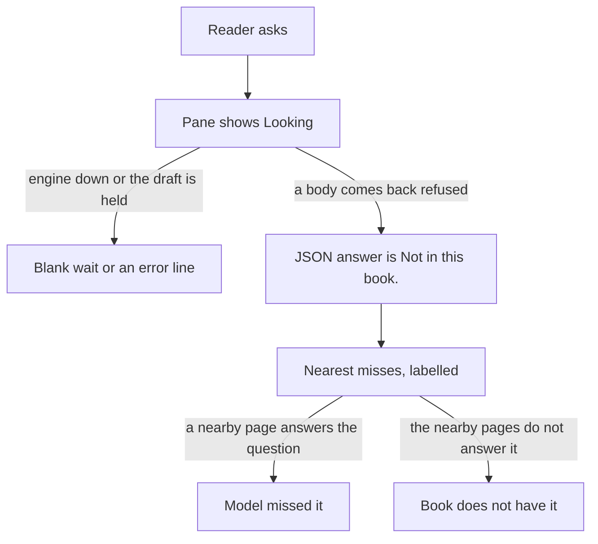

# What to do

Date: 2026-10-15. Decision page. No source edited. The app was not run.

Wrap the refusal in the UI. Leave the JSON string alone until a reader has tried that wrap.

Do these four steps in order. Stop when a done-when fails.

Keep `answer` exactly `Not in this book.` Tests, the quote check, and the student all match that sentence.

A softer sentence in the body would hide a miss inside a true gap, or the reverse. The JSON has no field that says which.

The reader now gets three failures in one voice. Split them on screen first.

Then fix gates that refuse a quote the page already holds. Do not lower the verbatim rule.

Then one follow-up that still re-retrieves. Then distill rows. Train only after a separate yes.

Do not rewrite the goal sentence, wire `agentic.py`, or send the engine to a cloud model.

`artifacts/plans/refusal-ux.md` and `artifacts/plans/all-frictions.md` were not in the plans folder. This page does not wait on them.

## Three feelings

One sentence is doing three jobs. The reader cannot tell them apart.

| Feeling | What they should learn | What the JSON does today |
| --- | --- | --- |
| Book does not have it | The check kept no quote, and the nearby pages do not answer it | `refused: true`, `answer` exactly `Not in this book.`, up to three miss citations |
| Model missed it | The book has it. The same sentence fired because a quote did not pass | Same body. No reason field. The right chunk is often already in the misses |
| Engine is down or slow | Nothing was judged. Start the engine, or wait for a held draft | A different string, or no body yet. The pane can still feel like the same wall |

The wrap must not say "this book does not cover this." That sentence is sometimes a lie. Say what the check did, and let the reader open the misses. The reader is the judge.

## 1. Presentation wrap

Frame the contract sentence. Do not edit it.

On a refused body, keep the sentence as the answer. Around it, not inside `answer`: one line that the check kept no quote, and that the chips are nearby pages, not the answer. Chips stay clickable. No sorry, no second answer, no red error styling. The screen-reader line in the ask pane must not be the only words.

On an error, keep the engine's own words (`Engine unreachable…`, `answer model unavailable`, dropped connection). Do not announce `Not in this book.` Do not use the same look as a gloss. Today the error sits in the same answer class as a gloss.

On a wait, keep the seconds. If the mode is answer, say the first draft is held until a quote is checked. Do not invent a percent. A second click while busy gets one line that the book is still answering. Do not drop it in silence.

Done-when: a saved refused JSON still has `answer` exactly `Not in this book.` and `refused: true`. On the Next pane, a person can point at three different looks: refused-with-misses, engine error, and a wait that names the hold or the cold load. The engine window, if included, shows the same frame around the same string, not a new string. A contract test that asserts the exact sentence still passes. A human confirms the three looks. No `GOAL.md` edit.

Files: `web/components/AnswerView.tsx`, `web/components/AskPane.tsx`, `web/components/MarginCard.tsx`, `web/lib/store.ts`, `window/index.html`. Do not edit `prompt.py` `REFUSAL`, `answer.py` `_refusal`, or `GOAL.md`.

Revert: remove the frame and the wait/error lines in those UI files. The engine contract is unchanged, so there is no model revert.

## 2. False-refusal fixes

Only after the wrap is on screen.

A false refusal is the same JSON as a true one, but a shown passage already holds the answer. Known cases, from code and from recorded probes:

- The model wrote the book's sentence and forgot `[Ch.`. Unverified prose becomes the refusal (`answer.py` `parse_completion`).
- A short overlap or a cut quote fails the span check. `num_predict` 512 can cut a completion. How often that cuts a real quote was not re-measured here.
- `Location` and `DE Lifecycle` refused while the expected chunk sat in the misses (`artifacts/evidence/user-query-probes-2026-10-14.md`).
- Causal and contracted "why" forms are a shared teacher/student ceiling (named in `reader-failure-moments.md`). A parser tweak will not fix a ceiling. If a re-run still refuses, leave it for distill.

Accept a sentence the shown passage already contains, including when the tag is missing. Do not accept a paraphrase. Do not lower the verbatim rule to chase a friendlier sentence. An invented quote that ships is worse than a blunt refusal.

Done-when: re-run the `Location` probe and one recorded "why" probe. Write the command, the evidence path, and before/after. `Location` either quotes a sentence that is in the shown passage, or still refuses with the exact sentence if that quote is not there. The "why" probe is recorded the same way. If it is still a ceiling, say so and do not force it. Battery and pins stay green. `answer` on a refusal is still exactly `Not in this book.`

Files: `answer.py` (`parse_completion`, the tagless path, the span floor, `num_predict` only if a saved completion shows a cut quote), `tests/test_answer.py`.

Revert: restore those functions and tests. If `num_predict` moved, put it back to 512. If a model swap was tried with this step, `ANSWER_MODEL=qwen2.5:7b` and restart the engine.

## 3. One follow-up

Only after step 2's done-when is written down.

The browser keeps one finished turn. The next Ask is still one `question` on `POST /ask`. The engine re-retrieves. It does not keep a session. The model does not receive the previous answer in this slice. No `history` field.

A follow-up that sits on an empty chip is not done. Tag-first answers can come back with `citations == []` and `refused` false (`reader-failure-moments.md` ranks 1 and 2). Fix that bind before calling the second turn a companion. That fix is not a new refusal sentence.

Done-when: after one finished answer, a person asks again, sees the prior turn, and the new body cites a passage from this turn's retrieval. The chip jumps to that chunk. An absent second turn still matches today's one-shot body. A refusal on either turn is still exactly `Not in this book.` in the JSON, with the step-1 frame around it.

Files: `web/lib/store.ts`, `web/components/AskPane.tsx`, and `answer.py` only for the tag-first bind (`parse_answered` / `_sentence_claims`). Detail: `follow-up-history.md` first slice. Do not add a route.

Revert: remove the client turn. Restore the parser if the bind changed. `ANSWER_MODEL=qwen2.5:7b` if a model swap was tried.

## 4. Distill

Only after the follow-up done-when. Rows first. No train until the owner says yes in a later note.

Row types stay the ones in `distill-rows.md`. `exact_refusal` completions stay exactly `Not in this book.` Do not train a warmer refusal.

Done-when for rows: a jsonl of those types exists, sealed prompts are absent, and every kept completion is quote-first or exactly `Not in this book.` Done-when for train: a later yes, a new Ollama tag, and the sealed suite plus two follow-ups in the reader, with command, evidence path, and before/after. Until that yes, stop after the rows.

Files: new jsonl only, then the train steps in `distill-small-model.md`. Do not point the default model at a student in this slice.

Revert: delete the new jsonl. Leave `prompt.ANSWER_MODEL` on `smallbook_x2d`. After any tag trial: `ANSWER_MODEL=qwen2.5:7b`.

## Other frictions

Found. Not a fifth step. Do not block the wrap on them.

| What they feel | Where it is named | Why it waits |
| --- | --- | --- |
| Quote-shaped answer, no chips, or a silent redo | `reader-failure-moments.md` ranks 2–3 | Step 3 done-when. Not this sentence |
| Fluent answer that invents a line | rank 5 | Looks grounded. Do not turn it into the refusal sentence without a measured trial |
| Whitespace or `what is` gets a real-looking quote | rank 9. `what is` measured WRONG | A different bug. Refusing it with this sentence would teach the wrong meaning |
| Window stays on `Looking...` until one JSON body | rank 7 | Step 1 copies the frame. Streaming that page is a later contract |
| Plain-words cue holds several rewrites | rank 8 | After the wait line is honest |
| Closing the pane hides Stop | rank 10 | Small. Do it with the busy line in step 1 if it fits. Do not delay the wrap for it |
| Highlight ask ignores the passage | rank 11 | Needs a contract. Do not append the selection onto the question |
| Chip quote is not the words on screen | rank 12 | Reader cannot judge a sentence the pane cannot show |

`companion-track.md` put follow-up first. This page does not. The complaint is the refusal voice. Wrap and false refusals come before a second turn.

## What not to do

- Do not rewrite the `GOAL.md` refusal before a measured UI trial. The trial is step 1, with the string unchanged.
- Do not put a warmer sentence in `answer`, `prompt.REFUSAL`, or the distill rows. That breaks the tests and mixes the three feelings in the body.
- Do not wire `agentic.py`. It is a prototype. A follow-up is one more grounded ask, or a jump.
- Do not send the engine, the server, or the batteries to a cloud model. The judge-backend exception stays evaluation-only.
- Do not add sorry, a chat bubble, or a queued second ask.
- Do not treat "I did not understand you" as `Not in this book.` The glossary already forbids that. The wrap must not sneak it back in.

## Owner decisions

Answer yes or no.

1. Wrap both the reader app and the engine window, and leave the JSON sentence as it is?
2. After that trial, fix false refusals in the quote gate without lowering the verbatim check?
3. Then one follow-up kept in the browser, engine still stateless, no history field?
4. Distill rows only, and no training, until a later yes?

## Measured vs assumed

**Read, not run.** `GOAL.md`: a later turn may follow the last one, and a refusal is still only `Not in this book.` `prompt.py`: `REFUSAL = "Not in this book."` `answer.py` `_refusal`: that string, misses, figures, `refused: true`. No reason field. `parse_completion`: a failed quote check returns that same body. `parse_answered`: a first line equal to that sentence is a refusal. Tag-first empty citations are described in `reader-failure-moments.md` from `parse_answered` / `_sentence_claims`. Engine-down copy differs from the refusal sentence (`ux-possibilities.md` states table; `store.ts` status `refused` vs `error`). `AskPane.tsx` announces `Not in this book.` when status is refused. Error text uses the answer class (same file's states table). `Location` and `DE Lifecycle` false refusals are in `artifacts/evidence/user-query-probes-2026-10-14.md`.

**Not measured.** A running UI. Whether the three looks are distinguishable on screen. How often `num_predict` 512 cuts a quote. Whether a wrap changes what a reader does next. Latency.

**Assumed.** A reader treats a long `Looking…` and the refusal sentence as one dead end. The error class looks like a gloss because it shares the class name. A frame that points at the misses is enough for the reader to separate a gap from a miss. Those three are why step 1 is a trial, not a goal edit.
