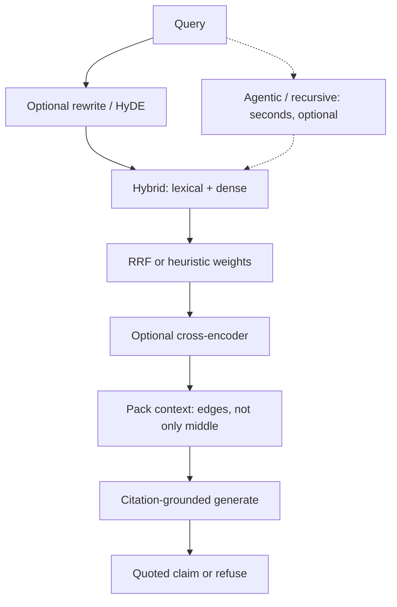

# RAG methods brief — 15 October 2026

Single-book grounded QA (`ask-this-book`) vs a teaching template (`rag-template`).
Code status is measured only from the named modules. Latency is a class, not a benchmark.
Unfetched numbers: **Not measured**.

## What the two codebases already do

**ask-this-book (named files only)**

| Module | What is there | What is not |
|---|---|---|
| `retrieve.py` | Frozen-chunk dense cosine (`nomic-embed-text`, `TOP_K=10`). Query and document share one `normalize()` seam. | BM25, ColBERT, CLIP |
| `fusion.py` | Reciprocal rank fusion, `RRF_K=60`, one lexical candidate, dense-band veto `RANK_BAND=0.20`, rare-word trigger | Learned fusion, BM25 |
| `keywords.py` | Rare-word gate (`RARE_DF=8`); paragraph *anchors* (`COVER_DF=80`). Explicitly no longer swaps passages | Parent-child expansion |
| `preprocess.py` | Dense vs lexical *views* over canonical `chunk["text"]`. Not a chunker | Fixed/semantic/late/proposition chunking |
| `agentic.py` | Prototype loop: semantic / keyword / regex. **Not wired into the server** | Production agentic RAG |
| `figures.py` | Attach a PNG when a kept passage names `Figure`/`Fig.` | Vision OCR, CLIP |

Chunking itself is outside the named files. `fusion.py` comments mention a sentence-chunk rebuild; that is not re-measured here.

**rag-template (named packages only)**

| Package | Present | Off / absent |
|---|---|---|
| `chunking/` | Fixed-size words (150 / overlap 30); sentence-boundary (4 / overlap 1) | Late, semantic-embedding, proposition, parent-child |
| `retrieval/` | BM25 + dense + hybrid RRF *and* heuristic weighted fusion (`alpha`) | SPLADE, ColBERT, learned fusion |
| `reranking/` | Cross-encoder; LLM reranker | — |
| `query_enhancement/` | Rewrite, spellcheck, expansion; HyDE behind `do_hyde=False` | Query decomposition |
| `generation/` | Citation objects, `[1]` prompt, grounded QA with refusal | Lost-in-the-middle packing |
| `agentic/` | ReAct agent; recursive gap-driven hops | Default pipeline |

Absent from both named trees: contextual retrieval, late chunking, proposition chunking, parent-child retrieval, SPLADE, ColBERT, RAPTOR, GraphRAG, LightRAG, Self-RAG, Corrective RAG, CLIP, vision OCR.

---

## Chunking

### Fixed-size
**Definition.** Split on a token/word budget with sliding overlap.
**Wins.** Cheap, deterministic, a fair baseline.
**Wrong tool.** Clause boundaries matter (definitions, lists, “the company” after a name).
**Latency.** Index: milliseconds. Query: none.
**Code.** Template: `chunking/fixed_size.py` **yes**. Book named files: **no** (chunks are frozen).

### Semantic / sentence-boundary
**Definition.** Break on meaning units. Template implements *sentence punctuation* windows, not embedding-breakpoint “semantic chunking” (training knowledge for the embedding-breakpoint form).
**Wins.** Keeps a thought intact for a single-book paragraph.
**Wrong tool.** Dialogue, headings, “Fig. 3-2” captions that are not sentences.
**Latency.** Index: milliseconds (regex). Embedding-breakpoint form: seconds at index.
**Code.** Template sentence windows: **yes**. Embedding-breakpoint semantic: **no**. Book named files: **no**.

### Late chunking
**Definition.** Run a long-context embedder on the whole span, then mean-pool token vectors *inside* later-chosen boundaries so each chunk vector is conditioned on neighbors ([Jina, 2024](https://jina.ai/news/late-chunking-in-long-context-embedding-models)).
**Wins.** Anaphora (“the city” after “Berlin”). Jina reports the gap over naive chunking growing with document length; on SciFact, nDCG@10 64.20% naive vs 66.10% late (their table, their embedder).
**Wrong tool.** Short blurbs; models whose context is smaller than the chapter; any pipeline that cannot expose token-level embeddings.
**Latency.** Index: seconds (full-document forward pass). Query: milliseconds.
**Code.** Both: **no**.

### Proposition chunking
**Definition.** Index atomic, self-contained factoids instead of passages ([Chen et al., arXiv:2312.06648](https://arxiv.org/abs/2312.06648)).
**Wins.** Factoid QA over a textbook; denser retrieval under a tight context budget.
**Wrong tool.** Tone, argument structure, “what is this chapter doing”; LLM-extracted propositions can invent facts.
**Latency.** Index: seconds (LLM propositionizer). Query: milliseconds.
**Code.** Both: **no**.

### Parent-child / small-to-big
**Definition.** Retrieve a small unit; expand to its parent paragraph/section for generation. Training knowledge (common RAG pattern; no paper fetched).
**Wins.** Precision of a sentence plus the surrounding claim. Natural fit for one book.
**Wrong tool.** Parents so large they refill the context window; expansion without a quote check.
**Latency.** Query: milliseconds.
**Code.** Book `keywords.py` *defines* paragraph anchors and **does not expand**. Template `Chunk.doc_id` is a parent id, not a retrieve-then-expand path. **Not implemented.**

---

## First-stage retrieval and fusion

### Hybrid BM25 + dense
**Definition.** Lexical exact-match plus embedding neighbors, then fuse.
**Wins.** Error codes, proper names, rare book terms (Anthropic’s “TS-999” case in [Contextual Retrieval, 2024](https://www.anthropic.com/news/contextual-retrieval)) *and* paraphrase.
**Wrong tool.** Corpus too small to need retrieval (Anthropic: under ~200,000 tokens / ~500 pages, put the book in the prompt). Training-knowledge CLIP-style image search.
**Latency.** Query: milliseconds.
**Code.** Template: **yes** (`retrieval/bm25.py` + `vector.py` + `hybrid.py`). Book: **partial** — dense cosine plus idf-weighted overlap, not BM25.

### RRF vs learned fusion
**Definition.** RRF scores `1/(k + rank)` per list ([Cormack et al. constant `k=60` as used in both codebases]). Learned fusion trains a combiner on labeled qrels. Weighted min-max (`alpha * BM25 + (1-alpha) * dense`) is **heuristic**, not learned.
**Wins.** RRF: two incomparable score lists, no labels. Learned: you have a sealed labeled suite and score distributions that RRF mishandles.
**Wrong tool.** Learned fusion without labels. RRF when one channel is garbage at every rank (it still donates `1/(k+r)`).
**Latency.** Query: milliseconds.
**Code.** Book `fusion.py`: RRF **yes**, one lexical candidate, band veto. Template: RRF **and** weighted heuristic **yes**. Learned: both **no**.

### SPLADE
**Definition.** Learned sparse expansion into an inverted index ([Formal et al., arXiv:2107.05720](https://arxiv.org/abs/2107.05720)).
**Wins.** Vocabulary mismatch (“heart attack” / “myocardial infarction”) without a dense index.
**Wrong tool.** Tiny single-book vocab; no GPU at index time; you already have BM25 + a good dense model and no expansion errors you can measure.
**Latency.** Index: seconds. Query: milliseconds on an inverted index.
**Code.** Both: **no**.

### ColBERT late interaction
**Definition.** Encode query and document independently; score with cheap token-level MaxSim ([Khattab & Zaharia, arXiv:2004.12832](https://arxiv.org/abs/2004.12832)). Not the same as late *chunking*.
**Wins.** Fine-grained term matching without a full cross-encoder on the whole corpus.
**Wrong tool.** Memory-bound token-vector stores for one book that already fits in RAM as single vectors; no late-interaction serving stack.
**Latency.** Query: milliseconds to low hundreds of milliseconds (class). End-to-end they report orders-of-magnitude fewer FLOPs than BERT rerank — **Not measured** here.
**Code.** Both: **no**.

---

## Rerank and query rewriting

### Cross-encoder rerank
**Definition.** Joint query–document transformer score on a short candidate list.
**Wins.** After hybrid, this is the usual precision step. Anthropic reports reranked contextual embeddings+BM25 cut top-20 failure from 5.7% to 1.9% on *their* mix (67% relative).
**Wrong tool.** Reranking hundreds of chunks in a user-facing chat with no budget; using the LLM-as-judge reranker as the default (seconds, unstable).
**Latency.** Cross-encoder: milliseconds to low seconds on tens of pairs. LLM rerank: seconds.
**Code.** Template `reranking/cross_encoder.py` **yes**; `llm_reranker.py` **yes** (should stay optional). Book named files: **no**.

### HyDE
**Definition.** LLM writes a hypothetical answer passage; dense-search that embedding against real chunks ([Gao et al., arXiv:2212.10496](https://arxiv.org/abs/2212.10496)).
**Wins.** Short, underspecified questions whose wording never appears in the book.
**Wrong tool.** Grounded QA that must not invent; the hypothetical document is *false by design* and can pull the wrong neighborhood. Default-on in a citation app is a leak.
**Latency.** Seconds (one generation) then milliseconds.
**Code.** Template `query_enhancement/hyde.py` **yes**, `do_hyde=False`. Book: **no**.

### Query decomposition
**Definition.** Split a multi-hop question into sub-queries, retrieve per hop. Training knowledge (no decomposition paper fetched).
**Wins.** “Compare X in ch.2 with Y in ch.9”.
**Wrong tool.** Single-span questions; any default path (multiplies retrieval + generation).
**Latency.** Seconds.
**Code.** Template rewriter/expander emit **one** string. Both: **no**.

---

## Index-time context and structure

### Contextual retrieval
**Definition.** LLM writes 50–100 tokens of chunk-specific situation; prepend before embedding *and* BM25 ([Anthropic, 2024](https://www.anthropic.com/news/contextual-retrieval)).
**Wins.** Chunks that are locally true (“revenue grew 3%”) and globally mute (which company, which quarter). They report 49% fewer top-20 failures vs their baseline, 67% with rerank — **their** evals, not these repos.
**Wrong tool.** Knowledge base already under ~200,000 tokens: they say put the whole thing in the prompt (prompt cache). Generic *document* summaries: they tried those and saw limited gains.
**Latency.** Index: seconds (one short completion per chunk; they quote $1.02 / million document tokens with prompt cache — not re-measured). Query: milliseconds.
**Code.** Both: **no**.

### RAPTOR
**Definition.** Recursively embed, cluster, summarize into a tree of abstractions; retrieve across levels ([Sarthi et al., arXiv:2401.18059](https://arxiv.org/abs/2401.18059)).
**Wins.** Questions that need a chapter- or book-level summary (“what is this part arguing”).
**Wrong tool.** Local quote lookup; you already have headings. Tree summaries can drift from the page you must cite.
**Latency.** Index: seconds to minutes. Query: milliseconds–seconds.
**Code.** Both: **no**.

### GraphRAG and LightRAG — and why a novel is the wrong graph
**GraphRAG.** LLM entity graph + community summaries; map-reduce for *global* questions (“main themes”) ([Edge et al., arXiv:2404.16130](https://arxiv.org/abs/2404.16130)).
**LightRAG.** Dual-level graph+vector retrieval with incremental updates ([Guo et al., arXiv:2410.05779](https://arxiv.org/abs/2410.05779)).
**Wins.** Multi-document corpora, repeating named entities, “how does A relate to B across 10k filings”.
**Wrong tool for a novel (and for most single books).** Pronouns, nicknames, metaphor; few stable entities; the question is usually local (“what did X do in this chapter”), not corpus-global QFS. Extraction noise becomes the product. Index cost is an LLM pass over every page.
**Latency.** Index: seconds to minutes. Query: seconds (GraphRAG community reduce) or milliseconds–seconds (LightRAG).
**Code.** Both: **no**.

---

## Adaptive / agentic generation

### Self-RAG
**Definition.** Train an LM to emit reflection tokens: retrieve on demand, critique passages, critique itself ([Asai et al., arXiv:2310.11511](https://arxiv.org/abs/2310.11511)).
**Wins.** Mixed parametric vs. grounded workloads; citation accuracy on long-form in *their* open-domain tests.
**Wrong tool.** A frozen single-book app with a small local model you will not train. Needs the special tokens.
**Latency.** Seconds; extra generate steps.
**Code.** Both: **no**.

### Corrective RAG (CRAG)
**Definition.** A retrieval evaluator gates keep / rewrite / web-augment; decompose-then-recompose the docs ([Yan et al., arXiv:2401.15884](https://arxiv.org/abs/2401.15884)).
**Wins.** Dirty first-stage retrieval; you *want* a web escape hatch.
**Wrong tool.** A book-only product: web search is out-of-corpus contamination. Evaluator error refuses good pages or admits junk.
**Latency.** Seconds (+ web if triggered).
**Code.** Both: **no**.

### Agentic / recursive RAG — optional only
**Definition.** An LLM chooses the next retrieval tool or follow-up query from what just came back. Recursive: gap evaluator → follow-up. Agentic: ReAct over tools.
**Wins.** True multi-hop that a single query cannot name.
**Wrong tool as default.** Slow, token-expensive, non-deterministic. Class: **seconds (often 3–15)**, not the 50–400ms standard path. A single book’s local QA does not need it on every turn.
**Latency.** Seconds. Multiple model calls.
**Code.** Book `agentic.py`: prototype, **not on the server**. Template `agentic/`: **yes**, lesson code, not the default pipeline.

---

## Generation and multimodality

### Lost-in-the-middle
**Definition.** Models use the start and end of a long context more reliably than the middle ([Liu et al., arXiv:2307.03172](https://arxiv.org/abs/2307.03172)). This is a packing rule, not a retriever.
**Wins.** Any prompt with more than a handful of chunks.
**Wrong tool.** Treating it as a reason to retrieve 50 chunks and hope.
**Latency.** None (reorder).
**Code.** Neither named generation path restacks hits onto the edges. **Not implemented.**

### Citation-grounded generation
**Definition.** Every claim maps to a retrieved span; otherwise refuse.
**Wins.** The whole product: a book you can audit.
**Wrong tool.** Open-domain chat; unverified bibliography lists that never quote.
**Latency.** Seconds for the LLM; packing is milliseconds.
**Code.** Template `generation/`: **yes** (`CITATIONS_PROMPT`, `Citation`, refusal in `QUESTION_ANSWERING_PROMPT`). Book named files: quote/citation *read* `chunk["text"]` in `preprocess.py`; no generator in the named set. **Not measured as implemented.**

### Vision OCR vs CLIP on scanned pages
**Definition.** OCR extracts text, then the *text* retriever runs. CLIP-class models embed images and text in one contrastive space.
**Wins for OCR.** Scanned PDFs, invoices, figure *text*.
**Wins for CLIP.** “Find pages that *look like* this sketch”, only when **the query encoder and the document encoder are the same multimodal checkpoint**.
**Wrong tool.** Comparing CLIP image vectors to a text-only embedder (`nomic-embed-text`, etc.): the spaces are not aligned; neighbors are noise. Attaching figures by pixels when the user asked about a numbered caption.
**Latency.** OCR: seconds at index. CLIP retrieval: milliseconds if pre-embedded.
**Code.** Book `figures.py`: name-match only, **does not describe pixels**. Both: **no OCR, no CLIP**.

---

## Do this next

Rank is fit, not a scoreboard. No numbers from these repos.

### Five that fit a single book

1. **Citation-grounded generation + refuse** — the product. Template already teaches it; the named book files do not implement the generator.
2. **Cross-encoder rerank on the hybrid shortlist** — precision after the channels you already have. Milliseconds–low seconds. Book: missing. Template: present.
3. **Contextual retrieval, or skip RAG** — if the book is under ~200k tokens, Anthropic’s own first move is whole-book prompt cache. If not, prepend chunk-local situation text before the existing dense + lexical indexes.
4. **Parent-child / small-to-big** — `keywords.py` already knows covering anchors; it currently does not expand. Retrieve the tight span, generate from the paragraph, cite the canonical text.
5. **Lost-in-the-middle packing** — put the best evidence at the start and end of the prompt. Free at query time.

### Five the template should teach and leave off by default

1. **Agentic / recursive RAG** — already in `agentic/`. Warn: seconds, token-expensive, optional only.
2. **HyDE** — already behind `do_hyde=False`. Hypothetical text is ungrounded on purpose.
3. **GraphRAG / LightRAG** — teach the global-QFS case; disable for a novel and for local quote QA.
4. **Self-RAG** — teach reflection tokens; do not train a 7B critic into the default lesson path.
5. **Corrective RAG** — teach the evaluator; do not web-augment a closed book.

Late chunking, ColBERT, SPLADE, RAPTOR, proposition chunking: worth a lesson page each, still not a default switch.

---

Sources fetched: Anthropic Contextual Retrieval (2024-09-19); Jina Late Chunking (2024-08-22); ColBERT arXiv:2004.12832; RAPTOR arXiv:2401.18059; GraphRAG arXiv:2404.16130; LightRAG arXiv:2410.05779; Self-RAG arXiv:2310.11511; CRAG arXiv:2401.15884; HyDE arXiv:2212.10496; Lost in the Middle arXiv:2307.03172; SPLADE arXiv:2107.05720; Dense X Retrieval arXiv:2312.06648.

Training knowledge (no fetch): embedding-breakpoint semantic chunking; parent-child/small-to-big; query decomposition; CLIP checkpoint alignment (also a hard constraint of this brief).
