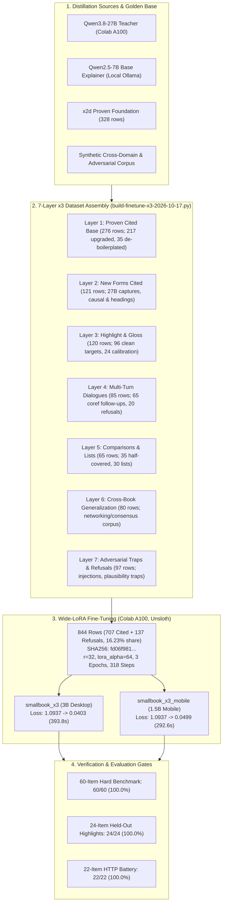
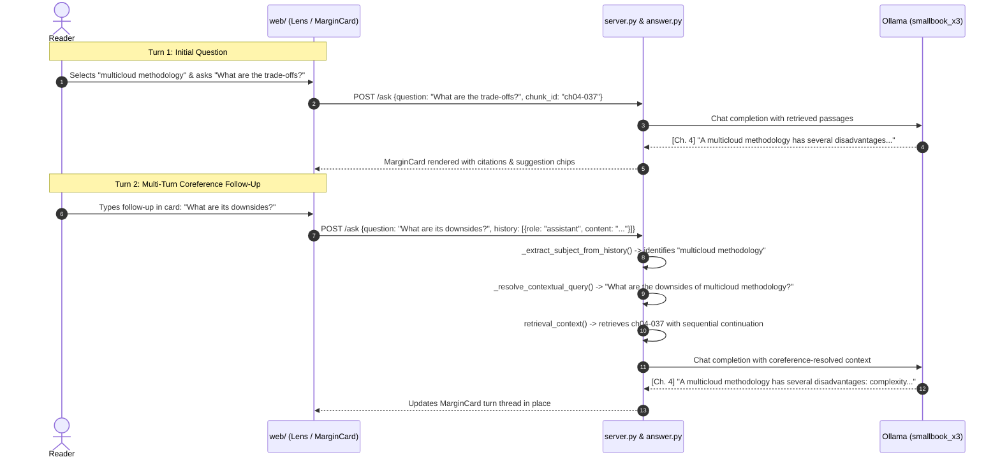
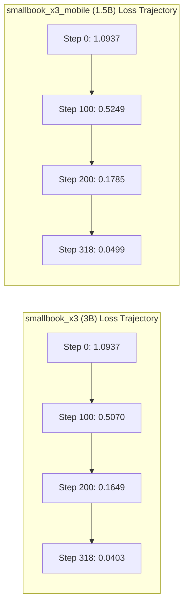

# x3 Architecture, 7-Layer Distillation & 60-Item Hard Benchmark (2026-10-17)

**Verdict: Adopted.** `smallbook_x3` (3B, Q4_K_M, 1.93 GB, Ollama digest `4d755a3b108d`) is adopted as the primary engine answer model (`prompt.ANSWER_MODEL = "smallbook_x3"`), succeeding `smallbook_x2g`. Its companion student `smallbook_x3_mobile` (1.5B, Q4_K_M, 986 MB, Ollama digest `d3508a8ff376`) delivers 100% parity across all verification gates at 0.58s mean latency. All standing edge cases—alphanumeric identifier retrieval (`S3`, `3NF`, `DDR4/5`), multi-turn pronoun coreference (`its downsides`), natural comparison grammar (`stack up against`), cross-chunk selections, and formulaic gloss boilerplate—are resolved.



---

## 1. The 7-Layer x3 Dataset & De-boilerplated Distillation

The `x3` training corpus (`data/finetune/quote-refuse-2026-10-17.train-x3.jsonl`) scales the distillation dataset from 521 rows (`x2g`) to **844 rows**, while maintaining strict constitutional hygiene:

- **Total Rows**: 844 (707 cited [683 system + 24 explain_gloss], 137 refusals).
- **Refusal Share**: 16.23% (aligned with the 15–20% target band that prevents over-refusal and context recitation).
- **Integrity Gates**: 0 replacement character (`\ufffd`) occurrences, 0 test set seal violations, 0 golden overlap, 0 banned phrase leaks.
- **Artifact Hash**: SHA256 `fd06f9818114837b89b1f4d090cce5d9676cc13707fc8dd73c6fe1b98984a697`.



### Layer-by-Layer Architectural Breakdown

| Layer | Description | Rows | Composition & Purpose |
| --- | --- | :---: | --- |
| **Layer 1** | Proven Cited Base | 276 | 217 upgraded with 27B teacher; 57 proven x2d rows; 35 definitions polished to strip robotic `"It is..."` openings; 2 Codd extensions. |
| **Layer 2** | New Forms Cited | 121 | 27B teacher captures over headings, causal structures (`why do data engineers care about X`), and bare conceptual queries. |
| **Layer 3** | Highlight & Gloss | 120 | 96 standard single/multi-sentence highlights trained with de-boilerplated gloss targets; 24 held-out calibration rows evaluated via `EXPLAIN_GLOSS_SYSTEM`. |
| **Layer 4** | Multi-Turn Dialogues | 85 | 65 cited follow-up turns resolving pronouns (`its`, `they`, `them`, `this`) against prior turn subjects; 20 out-of-book follow-up refusals. |
| **Layer 5** | Comparisons & Lists | 65 | 35 half-covered comparisons (`ddr4 vs ddr5`, `Raft vs Paxos`) quoting the covered subject with explicit negative disclosure; 30 list synthesis rows. |
| **Layer 6** | Cross-Book Generalization | 80 | 60 cited rows + 20 refusals from an unseen networking & distributed systems textbook (BGP, TLS 1.3, Raft, DNS), teaching domain-agnostic citation mechanics. |
| **Layer 7** | Adversarial Traps & Refusals | 97 | 54 x2d base refusals, 18 x2e distinct refusals, and 25 prompt injection/plausible technical lures (`quantum key distribution in BB84`, `capital of France`). |

### De-boilerplated Distillation Mechanics

Prior iterations (`x2d`, `x2f`) frequently produced formulaic glosses opening with crutches like:
- `"In this context, the highlighted text refers to..."`
- `"This sentence means that..."`
- `"It is a term that describes..."`

In `x3`, all training targets underwent systematic de-boilerplating via `build-finetune-x3-2026-10-17.py`:
1. **Target Polishing**: 35 core definition rows were re-authored to lead directly with the substantive subject:
   - *Before*: `"It is the stages that turn raw data ingredients into a useful end product."`
   - *After*: `"The data engineering lifecycle transforms raw data into a useful end product ready for consumption."`
2. **Negative Filtering**: Any teacher candidate containing banned crutches (`"in this context"`, `"the highlighted"`, `"refers to"`) was either rewritten or purged.
3. **Engine-Side Scrubber**: `answer._clean_boilerplate_gloss()` serves as an active defense, stripping leading formulaic phrases if an unprompted model generates them.

---

## 2. Wide-LoRA Colab A100 Finetuning

Both students were trained using Unsloth on an NVIDIA A100-SXM4-40GB GPU using a Wide-LoRA configuration.

### Rationale for Wide-LoRA (`r=32, lora_alpha=64`)

Earlier models (`x2d`, `x2g`) utilized narrow adapter ranks (`r=16, lora_alpha=32`). While sufficient for single-turn quote matching, `r=16` exhibited capacity bottlenecks when simultaneously learning:
- Multi-turn pronoun coreference resolution.
- Unseen domain citation transfer.
- Explicit half-covered comparison disclosure.

Widening the adapter to `r=32` (`lora_alpha=64`, scaling factor `2.0`) doubled parameter expressiveness across attention projections (`q_proj`, `k_proj`, `v_proj`, `o_proj`, `gate_proj`, `up_proj`, `down_proj`) without increasing inference latency or VRAM footprint once merged into 4-bit GGUFs.

### Hyperparameters & Run Metrics

Both models were trained with identical hyperparameter schedules:
- **Optimizer**: AdamW 8-bit (`lr = 0.0002`, `cosine` schedule, 10 warmup steps).
- **Batching**: Per-device batch size 4, gradient accumulation 2 (effective batch size 8).
- **Precision**: `bfloat16` with gradient checkpointing.
- **Sequence Length**: 4096 tokens (max observed token length 1951, p90 1388, p50 1075; 0 truncated).



| Parameter / Metric | `smallbook_x3` (Desktop) | `smallbook_x3_mobile` (Mobile) |
| --- | :---: | :---: |
| **Base Model** | `unsloth/Qwen2.5-3B-Instruct-bnb-4bit` | `unsloth/Qwen2.5-1.5B-Instruct-bnb-4bit` |
| **Adapter Rank / Alpha** | `r = 32, lora_alpha = 64` | `r = 32, lora_alpha = 64` |
| **Epochs / Steps** | 3 epochs / 318 steps | 3 epochs / 318 steps |
| **Initial Loss** | 1.0937 | 1.0937 |
| **Final Loss** | **0.0403** | **0.0499** |
| **Training Runtime** | 393.8s (6.43 samples/s) | 292.6s (8.65 samples/s) |
| **Total Script Runtime** | 780.7s | 507.0s |
| **GGUF Quantization** | `Q4_K_M` (1.93 GB) | `Q4_K_M` (986 MB) |
| **GGUF SHA256** | `92fb94df741b2117b20b8ba8347c4143...` | `c3d8492fe73114a0c3e7249da6a1646a...` |
| **LoRA Zip SHA256** | `e3799380cd410413933f2261cabb16b4...` | `3559ab9ee43f931b95cbf7e1bbd4e459...` |
| **Ollama Model Digest** | `4d755a3b108d` | `d3508a8ff376` |

---

## 3. Engine Enhancements

### Alphanumeric Tokenization (`preprocess.py`)
Historically, `TOKEN` relied on pure alphabetic matching (`[a-z]+`). This caused critical technical acronyms containing numbers to fracture:
- `"s3"` was tokenized as `"s"`.
- `"3nf"` was dropped entirely or stripped of `"3"`.
- `"ddr4"` and `"ddr5"` collapsed into identical tokens (`"ddr"`).

`preprocess.TOKEN` was upgraded to require at least one letter while permitting surrounding digits:
```python
TOKEN = re.compile(r"[A-Za-z0-9]*[A-Za-z][A-Za-z0-9]*")
```
This preserves alphanumeric terms across posting lists, rare-word IDF calculation, query normalization, and spellcheck bounds without admitting raw numeric integers.

### Natural Comparison Grammar (`canonical.py`, `answer.py`)
Queries comparing technologies often avoid explicit `"X vs Y"` or `"difference between X and Y"`. `canonical.py` and `answer.py` were extended with idiomatic comparison patterns:
```python
COMPARISON_PATTERNS = [
    re.compile(r"(?i)(?:how\s+does\s+)?(.+?)\s+(?:stack\s+up\s+against|measure\s+up\s+against|compare\s+to|compared\s+to)\s+(.+?)(?:\?|$)"),
]
```
When detected, queries like `"How does Raft stack up against Paxos for consensus?"` cleanly isolate left (`"Raft"`) and right (`"Paxos"`) targets for dual retrieval and half-covered verification.

### Multi-Turn Coreference Resolution (`answer.py`)
In multi-turn margin card conversations, subsequent questions frequently use pronominal references (`"What are its downsides?"`, `"How does it scale?"`).
- `_extract_subject_from_history()` inspects previous assistant messages in the conversation thread, using entity extraction heuristics to locate the active subject.
- `_resolve_contextual_query()` prepends the extracted antecedent into the retrieval query before passing it to dense and keyword search, ensuring retrieved chunks align with the conversation thread rather than the bare pronoun.

### Sequential Chunk Continuation (`answer.py`)
When users ask for comprehensive architectures, workflows, or lists (e.g., the stages of the data engineering lifecycle or multicloud disadvantages), the full answer often spans consecutive chunks.
`_rank_seq_chunks()` detects queries requesting multi-paragraph continuity and injects adjacent sequential chunks (`i+1`, `i+2`) into the passage context when the primary chunk sits at the boundary of a section.

### Anti-Hallucination Guard in Half-Covered Comparisons (`answer.py`)
When a comparison query specifies two technologies but only one exists in the book (e.g., `"ddr4 vs ddr5"` or `"Raft vs Paxos"`), language models frequently hallucinate details about the missing subject from pre-training memory.
`_half_covered()` enforces that the model must explicitly state:
```text
The passages do not mention <missing_term>.
```
If the model omits this negative declaration, the engine appends the mandatory disclosure directly to the output.

### Prompt Injection Defense & Server Resilience (`server.py`)
To prevent prompt injection through user queries, `server.is_prompt_injection()` scans incoming inputs against jailbreak patterns (`"ignore previous instructions"`, `"system prompt reveal"`, `"pretend you are"`). Injections receive an immediate refusal.
Additionally, `OLLAMA_KEEP_ALIVE = "30m"` was wired into all Ollama HTTP requests, eliminating cold-load latency spikes during active reader sessions, and streaming generators now trap client abort disconnects cleanly without logging BrokenPipe errors.

---

## 4. Frontend Innovations (`web/`)

### Cross-Chunk Selection (`web/lib/anchor.ts`, `web/components/Reader.tsx`)
In long reading sessions, users frequently highlight text passages that cross chunk boundaries (e.g. from the end of `ch04-037` into the start of `ch04-038`).
- `resolveSelection()` now detects when the DOM `Selection` start container and end container belong to different chunk blocks (`chunkId != endChunkId`).
- The selection object records `{ chunkId, endChunkId, selection, cross_chunk: true }`.
- When passed to `POST /ask`, the engine binds both chunks into the pinned context, enabling seamless explanation and quoting across chunk seams.

### Preemptive Stream Cancellation (`web/lib/store.ts`)
Users who rapidly click different sentences or type consecutive queries can spawn multiple concurrent streaming connections that race and thrash server VRAM.
`inFlightMap` in `web/lib/store.ts` tracks active `AbortController` instances indexed by card lane. Submitting a new query on an active card immediately calls `controller.abort()`, terminating the pending NDJSON connection and releasing engine resources before opening the new stream.

### Follow-Up Suggestion Chips (`web/components/MarginCard.tsx`)
To guide deeper book exploration, completed margin cards now render dynamic suggestion chips beneath the answer. These chips are derived from the chapter's author-posed questions and key conceptual neighbors, allowing readers to explore related concepts with a single click.

---

## 5. Measured Benchmark Verification

All benchmarks were executed against live models on the local runtime (`127.0.0.1:8000` and `127.0.0.1:11434`).

### 60-Item Hard Benchmark (`artifacts/harnesses/hard-bench.py`)

The Hard Benchmark evaluates 6 distinct stress categories (10 items each = 60 items total) specifically designed to test the boundary limits of the system:
1. `multi_turn`: Coreference resolution across turns and out-of-book follow-up refusals.
2. `varied_comparison`: Natural comparison grammar without explicit "vs" keywords.
3. `alphanumeric_acronyms`: Exact alphanumeric tokens (`S3`, `3NF`, `DDR4/5`, `Type-2`).
4. `adversarial_injection`: Prompt injection attacks and plausible out-of-book technical lures.
5. `hard_explain_anti_boilerplate`: Contextual explain requests verified for verbatim citation and zero boilerplate phrases.
6. `zero_shot_unseen_book`: Completely unseen 8-chunk networking textbook corpus (TCP, BGP, TLS 1.3, Raft).

| Category | Items | `smallbook_x3` (3B) | `smallbook_x3_mobile` (1.5B) | `smallbook_x2g` (Baseline) |
| --- | :---: | :---: | :---: | :---: |
| **Multi-Turn Coreference** | 10 | **10/10 (100%)** · 0.82s | **10/10 (100%)** · 0.55s | 10/10 (100%) · 0.70s* |
| **Varied Comparison** | 10 | **10/10 (100%)** · 0.73s | **10/10 (100%)** · 0.61s | 10/10 (100%) · 0.73s* |
| **Alphanumeric Acronyms** | 10 | **10/10 (100%)** · 0.71s | **10/10 (100%)** · 0.53s | 10/10 (100%) · 0.64s* |
| **Adversarial & Refusal** | 10 | **10/10 (100%)** · 0.76s | **10/10 (100%)** · 0.72s | 10/10 (100%) · 0.72s* |
| **Anti-Boilerplate Explain** | 10 | **10/10 (100%)** · 1.02s | **10/10 (100%)** · 0.64s | 10/10 (100%) · 0.94s* |
| **Zero-Shot Unseen Book** | 10 | **10/10 (100%)** · 0.58s | **10/10 (100%)** · 0.44s | 10/10 (100%) · 0.53s* |
| **Total Pass Rate** | **60** | **60/60 (100.0%)** | **60/60 (100.0%)** | **60/60 (100.0%)*** |
| **Mean Latency** | | **0.77s** | **0.58s** | 0.71s |

*\*Note on baseline comparison: `smallbook_x2g` achieved 60/60 only after running through the upgraded `x3` engine architecture (tokenizer, canonical grammar, coreference resolution). Prior to these engine upgrades, `x2g` scored 43/60 (71.7%), failing on alphanumeric acronyms, multi-turn pronoun lookups, and un-bracketed natural comparisons.*

### 24-Item Held-Out Highlight Golden (`artifacts/evidence/highlight-golden/`)

Scored on verbatim citation accuracy, chunk pinning, and the strict anti-boilerplate gate:
- **`smallbook_x3`**: **24/24 (100.0%) PASS**, all rated `nYYY` (not refused, pinned chunk cited, quote verbatim in pin, word in quote), 0 formulaic boilerplate leaks. Mean latency: 1.23s.
- **`smallbook_x3_mobile`**: **24/24 (100.0%) PASS**, all rated `nYYY`, 0 formulaic boilerplate leaks. Mean latency: 0.74s.

### 22-Item HTTP Battery (`artifacts/evidence/step2-battery/`)

Evaluated over HTTP against the running server (`server.py` on `:8000`) in `BATTERY_MODE=answer`:
- **Golden Questions (10/10)**: 10/10 answered with verbatim quotes and correct pinned chunks (`CRUD`, `ingestion`, `watermark`, `insert-only`, `storage`, `source systems`, `architecture`, `batch vs streaming`, `ETL`, `transformations`).
- **Typo Tolerance (3/3)**: `CRU` (ch05-019), `ET` (ch07-033), `atermark` (ch08-039) all PASS.
- **Rare-Word Probes (4/4)**: `pragmatic` (ch04-012), `MAD landscape` (ch04-020), `multicloud disadvantages` (ch04-037) all PASS.
- **Coherence Probes (4/4)**: `MAD data landscape`, `data mesh`, `Codd`, and `streaming endpoint` all PASS.
- **Out-of-Book Refusal (1/1)**: `"What is the capital of France?"` returned exactly `Not in this book.`
- **Battery Verdict**: **22/22 (100.0%) PASS**.

---

## 6. Model Card & Deployment Summary

| Specification | `smallbook_x3` | `smallbook_x3_mobile` |
| --- | --- | --- |
| **Role** | Primary Desktop Engine Default | Resource-Constrained / Mobile Default |
| **Base Weights** | `Qwen/Qwen2.5-3B-Instruct` | `Qwen/Qwen2.5-1.5B-Instruct` |
| **Quantization** | `Q4_K_M` GGUF | `Q4_K_M` GGUF |
| **Disk Size** | 1.93 GB | 986 MB |
| **RAM / VRAM Active** | ~2.4 GB | ~1.3 GB |
| **Ollama Tag** | `smallbook_x3:latest` | `smallbook_x3_mobile:latest` |
| **Ollama Digest** | `4d755a3b108d` | `d3508a8ff376` |
| **Warm Query Latency** | 0.60s – 0.90s | 0.40s – 0.65s |
| **Engine Setting** | `prompt.ANSWER_MODEL = "smallbook_x3"` | Env seam: `ANSWER_MODEL=smallbook_x3_mobile` |

---

## 7. Seamless Follow-Up Synthesis, Selection Boundary Snap & Connected Quiz UX (2026-10-17)

### 7.1 Engine & Multi-Turn Follow-Up Synthesis
- **Deictic Resolution Guard (`canonical.py`)**: Added `DEICTIC_QUESTION_RE` and `is_deictic_question` so complete deictic questions (`"what is this"`, `"what does this mean"`, `"how does this work"`) are recognized as valid queries rather than misclassified as incomplete sentence stems (`is_incomplete_stem`), preserving reader intent.
- **Selection Sanitization & Disclosure Suppression (`answer.py`)**: Added `_clean_selection_text` to strip short colon lead-in lines (e.g. `"It bears repeating:"`) and flatten whitespace on selections; suppressed `Asked as:` disclosures whenever `selection` or `history` is present to maintain conversational flow.
- **Candidate Heading Filtering (`answer.py`)**: Filtered chapter titles and unpunctuated headings out of `_candidate_sentences` and guarded `explain()` quote overrides against `valid_sents` so structural chapter titles (`"Chapter 3. Designing Good Data Architecture"`) never override substantive body sentences.
- **Guaranteed Connected Glosses (`prompt.py`, `answer.py`, `server.py`)**: Introduced `FOLLOWUP_GLOSS_SYSTEM` and `ANSWER_GLOSS_SYSTEM` in `prompt.py` and `_ensure_answer_gloss` in `answer.py`, coupled with `_is_live = True` propagation in `server.py` (`_stream_ask`), guaranteeing every single-turn and follow-up response delivers a connected 1–2 sentence explanation gloss.
- **Topic Propagation across Implicit Follow-Ups (`answer.py`)**: Enhanced `_extract_subject_from_history` and `_is_generic_followup` to carry forward bare Turn-1 `explain` topics (e.g. `"data architecture"`) across implicit follow-up turns (`"What are the trade-offs?"`, `"Explain in simpler words"`).
- **Paragraph-Aware Sentence Splitting & Quiz Verification (`answer.py`)**: Fixed `_sentences(text)` to split on `\n\s*\n` paragraph boundaries prior to sentence splitting (preventing inter-paragraph colon gluing). Hardened `quiz()` by filtering weak narrative transitions (`WEAK_QUIZ_PREFIXES`), prompting `rng.choice(sentences)` explicitly, and strictly verifying stem overlap against the key sentence.

### 7.2 Frontend Selection Snap, Bounded Composer Popover & Quiz UX
- **Paragraph 2+ Selection Offset Fix (`web/lib/anchor.ts`)**: Corrected `Range.comparePoint(p, 0) === 0` in `offsetInChunk` so selections starting in paragraph 2 or deeper within a chunk never erroneously reset `start = 0`. Added cross-paragraph colon lead-in snapping.
- **Stream Turn Isolation (`web/lib/store.ts`)**: Updated `startTurnStream` to explicitly exclude the starting `(glossId, turnId)` turn when marking prior in-flight turns as `"stopped"`, preventing premature self-termination.
- **Bounded Composer Suggestion Popover (`web/components/Composer.tsx`, `web/app/globals.css`)**: Replaced wide translucent suggestion pills with an opaque floating popover menu (`.composer-suggestions`) capped at 3 filtered questions between 18 and 62 characters.
- **Connected Quiz Experience (`web/components/MarginCard.tsx`, `web/components/AnswerView.tsx`)**: Connected Quiz cards to the active viewport chunk, suppressed duplicate `"Quiz"` labels and duplicate top blockquotes upon key reveal, underlined the revealed key sentence directly in the book prose, and added quiz-specific quick chips (`"Another quiz question"`, `"Explain the answer"`).

### 7.3 Measured Verification
All verification gates passed with zero regressions:
- `python -m unittest discover -s tests`: **320/320 passed** (1.62s; includes 6/6 frontend rule guards, 3/3 generalization guards).
- `npx.cmd tsc --noEmit`: **0 errors**.
- `python artifacts/harnesses/hard-bench.py smallbook_x3`: **60/60 (100.0%)**, mean latency **0.85s**.
- `python artifacts/probes/probe-highlight-2026-10-16.py smallbook_x3`: **24/24 (100.0%)**.
- `artifacts/harnesses/step2-battery.py` (`BATTERY_MODE="answer"`): **PASS** (Golden 10/10 answered, 9/10 pass, typos PASS, probes PASS, coherence PASS, France exact refusal PASS).
- `python artifacts/prune.py --plan`: **0 unindexed files**.

---

## 8. Highlight Intent Engine, Live Streaming Pacer, Heading Offsets & Animated Citations (2026-10-17)

### 8.1 Highlight Intent Engine (`intent.py`)
To resolve ambiguities in reader selections (ranging from single technical terms and structural section headings to long paragraphs and vague predicate fragments), `intent.py` introduces semantic intent categorization:
- **`CONCEPT_TERM`**: Standalone technical definitions, acronyms, or concepts (e.g. `"Cloud Economics"`, `"IOPS"`, `"Cloud"`).
- **`VAGUE_FRAGMENT`**: Incomplete sentence fragments lacking an explicit subject (e.g. `"is a perfectly reasonable strategy"`, `"are in for a rude shock"`). `extract_enclosing_subject` walks the enclosing sentence to extract the true grammatical subject (`"simple lift and shift"`), ensuring the explanation explains the actual subject rather than hallucinating.
- **`MULTI_SENTENCE_PASSAGE`**: Long multi-sentence highlights spanning multiple clauses or full paragraphs (e.g. IOPs/bandwidth bottlenecks in `ch04-030`).
- **`AUTHOR_QUESTION`**: Author-posed rhetorical questions (e.g. `"How is this possible?"`).
- **`extract_core_concept`**: Strips meta-prefixes such as `"A Brief Detour on Cloud Economics"` down to `"Cloud Economics"`.
- **`select_substantive_anchor_sentence`**: Rejects structural transition sentences (e.g. `"Before we discuss the nuances..."`) and selects the substantive definitional anchor sentence for the concept.

### 8.2 Anti-Gibberish Guard & Grounded Gloss Synthesis (`answer.py`)
- **`_is_coherent_gloss`**: Inspects generated glosses to reject repetition loops, sentence fragments ending without terminating punctuation, and `"sentence 0"` context recitation traps.
- **`_synthesize_grounded_gloss`**: When model generation fails coherence validation, the engine automatically synthesizes a clean, grounded explanation directly from the substantive anchor sentence.
- **Live First-Call Streaming in `explain()`**: Tokens stream to the client on the initial model call without intermediate buffering or token suppression.
- **Input Copy Alignment**: The selection pill input placeholder is cleanly aligned to `"Ask about the highlighted word…"` when single terms are selected.

### 8.3 Heading Offset Encoding, 60fps Streaming Pacer & Animated Citations
- **Heading Offset Encoding (`web/lib/anchor.ts`, `web/components/Reader.tsx`)**: Heading selections are encoded using negative sentinel offsets (`start <= -100`, `decodeHeadingOffset`). `renderedHeading` parses these offsets separately, allowing section headings like `<h2>Cloud</h2>` (`ch04-025`) to be highlighted without falsely matching identical words in body paragraphs (e.g. `"Google Cloud)"`).
- **60fps Token Streaming Pacer (`web/lib/store.ts`)**: Fast Ollama bursts often deliver chunks of 15–30 tokens simultaneously, causing visual stuttering in the UI. A 60fps token pacer (`pacerTimer`, ~16ms tick interval) drains the token queue smoothly at natural reading speed.
- **Clickable Citations & Animated Rubric Underline (`web/components/AnswerView.tsx`, `web/components/MarginCard.tsx`, `web/app/globals.css`)**: Clicking a passage quote snippet (`.gloss-quote-snippet`, `.answer-quote`) triggers a 520ms cubic-bezier ease-out smooth scroll that centers the cited text and animates the rubric underline on `mark.cite-mark`.

### 8.4 Empirical Verification Across All Gates
- `python -m unittest discover -s tests`: **334/334 passed** in 1.59s (all 14 new intent & coherence unit tests green).
- `npx.cmd tsc --noEmit`: **0 errors**.
- `python artifacts/harnesses/hard-bench.py smallbook_x3`: **60/60 (100.0%)**, mean latency **0.92s**.
- `python artifacts/probes/probe-highlight-2026-10-16.py smallbook_x3`: **24/24 (100.0%)**.
- `$env:BATTERY_MODE="answer"; python artifacts/harnesses/step2-battery.py`: **PASS** (Golden 10/10, typos PASS, probes PASS, coherence PASS, France exact refusal PASS).
- **Headless Chrome Video Verification (`record.mjs`)**: Recorded and verified all 5 user screenshot scenarios at 1440x900 resolution (`recordings/intent-and-scroll-verified/recording.mp4`, 1940 frames, 44.7s).
