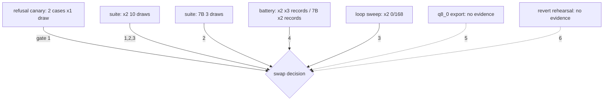

# Eval-harness audit — x2 swap gate (2026-10-14)

Read-only audit. No probes were run, no Ollama started, nothing outside this file
changed. [measured] = read from an evidence file or command output; [inferred] =
derived. The gate itself (`x2-trial-2026-10-14.md`, 6 items) is reviewed, not amended.

**Verdict up front: NOT YET complete enough to decide.** Gate mechanics are sound
where evidence exists (deterministic checks, sealed suite with a measured-clean seal,
pre-registration timestamps confirmed), but three hard gaps remain: (1) the sealed-suite
probe cannot run from its committed path [measured: ImportError]; (2) the 7B baseline
ran the suite at 3 draws vs the incumbent's 10 — the opposite of the gate's
"draws >= 10"; (3) gate items 5 (q8) and 6 (revert rehearsal) have zero evidence.
The 3-way decision (x2 / x2c / seed-control / 7B) also lacks a pre-registered
x2c-vs-7B battery bar and any x2c-vs-seed-control discrimination rule.

## Gate item status

| # | Gate item | Evidence present | Verdict |
|---|---|---|---|
| 1 | France+iops exact 2/2; no new in-book false refusals in suite beyond 7B's | both models 2/2 exact, 1 draw/case [measured]; x2 suite false-refusal items {what about, why does} ⊆ 7B's [measured] | WEAK — 2 queries, single draw; "beyond" ambiguous (set vs count); suite draws asymmetric |
| 2 | Suite per-class rate ≥ 7B | both ran; sealed check clean [measured]; x2 = 10 draws/item, 7B = 3 draws/item [measured] | WEAK — unequal draws; greeting class has no pass/fail criterion; candidate runs pending; probe currently unrunnable |
| 3 | 0 loops (battery ×5, suite ×10) | x2 battery 0/168 capped draws [measured]; 7B battery sweep not measured [measured absence]; x2 suite 10 length-stops, 7B suite 1 [measured] | WEAK — see loop-vs-truncation, below |
| 4 | Battery rate ≥ x2's 18-19/21 at equal draws | x2: 19/21, 18/21, 18/21 (3 recordings) [measured]; AGENTS.md L805 claims four passes — scoreboard note 2 could only validate three [measured conflict]; 7B: 20/21 and 21/21 records [measured via scoreboard L9] | WEAK — "not worse than 18-19" is not a single decision rule; no --draws flag; aggregation manual |
| 5 | Warts persist at q8_0 | none | MISSING |
| 6 | `ANSWER_MODEL=qwen2.5:7b` starts + passes battery once | env seam exists (`prompt.py:49`); no trial-era `step2-battery` log (latest are Oct 13 bake-off files) [measured] | MISSING (pending) |

## Measured reference numbers (all from the named evidence files)

Suite (21 items: fragment 4, greeting 3, bare-topic 5, order-flip 4, trailing-letter 3, control 2):

| class | x2 (10 draws/item) | 7B (3 draws/item) | note |
|---|---|---|---|
| fragment | 20/40 | 6/12 (+1 loop: 'explain' 1/3) | shared misses 'what about' (both: answered, 0 citations), 'why does' (both refuse) |
| greeting | answered 0/30 | answered 0/9 | RECORD only; probe calls no judge (see below) |
| bare-topic | 30/50 | 15/15 | x2 misses 'Streaming', 'Event Streams' (uncited answers); 10 length-stops on 'File Formats' |
| order-flip | 0/40 | 12/12 | x2: answered, citation=0 in every draw, all 4 items |
| trailing-letter | 10/30 | 9/9 | x2 misses 'data meshs', 'pipeliness' (uncited answers) |
| control | 20/20 | 3/6 | 7B fails 'violin strings' 0/3 exact |

- Dominant x2 failure mode on non-memorized forms is *answers with zero citations*
  (`refused=0, cited=0`), not refusals — e.g. 'batch vs streaming' returns on-topic
  prose with no `[Ch.]` tags [measured]. The trial narrative ("margin a hair from
  refusal") under-weights this mode.
- The one suite loop is 'File Formats': `done_reason=length` on every draw, but the
  stored text is coherent prose (1380 chars, no repeated head segment) — this is a
  300-token cap truncation, not a repetition loop [measured]. `loop=done_reason==length`
  conflates the two; the gate counts both.
- Battery failures x2: insert-only wrong chunk (ch08-107 vs pin ch05-020, every run),
  Codd false refusal (every run), CRU false refusal (2 of 3 runs) [measured]. 7B's
  single battery miss: 'MAD data landscape' false refusal [measured].
- Refusal canary: 2/2 exact on both models, 1 draw/case [measured].
- Seal: x2 run 02:12 → 0 violations vs 185 forms/3 train files; 7B run 02:21 → 0
  violations vs 235 forms incl. `quote-refuse-2026-10-13.train-x2c.jsonl`; visible-ten
  check 0 violations, max difflib 0.700 [measured]. Thresholds r≥0.8 / j≥0.6.
- Ordering: gate doc mtime 01:59 < probe 02:10 < x2 suite run 02:12 < train-x2c.jsonl
  02:19 < 7B suite run 02:21 [measured] — pre-registration plausible, no x2c/seed
  numbers exist yet [measured].
- Latency is recorded (x2 median 0.91 s, p90 1.58 s, n=63; 7B 1.23/1.78 s, n=21)
  [measured: scoreboard L14] but is not a gate item.

## Checklist detail

- **Sample sizes / draws.** Refusals 2×1; suite 21×(10 or 3); battery 21×(3 or 2
  records); loops: x2 only; q8: 0; rehearsal: 0. The gate's "≥10 draws" holds only
  for x2's suite run.
- **Aggregation across draws.** Suite probe computes per-class rates itself; battery
  aggregation is manual (scoreboard notes), already producing a 3-vs-4 passes
  bookkeeping conflict [measured]. No CI / variance reported anywhere.
- **Ceiling effects.** Battery: x2 is structurally capped at 19/21 by repeat failures
  (insert-only + Codd) [measured]; 7B is at 20-21/21. Suite: 7B is at ceiling on 3
  classes, so "≥ 7B" there means "≥ perfect". Assisted items: handled as required —
  4 twins named, clean subset (17) derived and reported separately [measured:
  scoreboard note 1].
- **Baseline fairness.** x2-vs-7B exposure is unequal on the suite (10 vs 3 draws)
  and on loops (7B battery sweep absent) [measured]. x2c-vs-x2 at equal draws is
  achievable only by manual reruns (no `--draws` flag; single unsuffixed output file
  per model overwritten by each run [measured source]). Seed control: no rule exists
  that distinguishes x2c from the seed-control retrain if both pass [inferred from
  gate text].
- **Failure taxonomy.** false refusal ✔ (suite + battery item-level); wrong pick
  partial (battery pin check only; suite requires *a* citation, not the right one);
  loop ✔ but conflates truncation (above); format break ✗ (no checks on citation
  format or `Asked as:`/`Read as:` output); latency recorded, not gated; errored
  draws are dropped from rate denominators after one retry, with no error-rate
  criterion [measured source].
- **Statistical power (3-way).** [inferred from measured n] 1 battery item = 4.8 pp;
  a single 21-item run has a 95% half-width of ≈ 3 items; per-class suite resolution
  is 20-33 pp (3-5 items per class). Temp-0 draws are near-replicates (identical
  texts across draws; the observed nondeterminism is run-scale: CRU flips between
  runs, 7B 'explain' looped 1/3). Adequate for the observed large suite gaps
  (0% vs 100%), inadequate for battery margins and for choosing x2c over 7B if both
  pass: gate item 4's bar is x2's 18-19, not 7B's 20-21.
- **Judge exclusion.** The gate uses deterministic checks (exact refusal sentence,
  pin cited, `done_reason`) — sound and reproducible. The *rationale* (judge
  nondeterminism at temperature 0, graded scales not transferable across judges) is
  recorded in `AGENTS.md` L568-585/L627-644 but **not** in the gate doc itself
  [measured]. The suite docstring promises greetings "get the same judge"; the code
  calls no judge — greeting rows are RECORD-only counts [measured]. Do not change
  the gate; record the rationale next time the human amends it.
- **Equal-exposure rerun.** Not done for any candidate. x2's suite run predates the
  x2c data; engine-adjacent fixes (engine-edges a/b/c) are parked and would shift
  both models' suite numbers when they land — freeze-and-rerun both baselines at
  10 draws is a precondition, not an option.
- **q8 A/B.** No evidence; only the gate text and the colab recipe (q8_0 export)
  mention it [measured]. Precedent exists (a `smallbook_q3` battery run).
- **Sealed-suite independence.** Positive: 0 violations vs both 185 and 235 training
  forms, margins recorded per item, visible-ten excluded (max r 0.700). Caveats:
  the seal check **fails open** — if the train glob finds no files it prints
  "NO TRAIN FILES" and proceeds with a vacuous 0-violation result [measured source];
  train files are identified by name, not hash; the check runs only when the probe
  runs, so any future edit of `train-x2c.jsonl` after the 02:21 check is unverified.
- **User-visible contract.** Partially measured: `probe-trial-queries-2026-10-14`
  runs the exact user queries ('Location', 'DE Lifecycle', 'what is', 'ddr5s', …)
  through `answer.respond`, answer mode, both models — but 1 draw each and in-process
  only [measured]. `engine-edges-2026-10-14.md` documents the mechanism ('hey'→'they',
  plural repair gap, degenerate 'what is') and leaves all three unfixed; its HTTP
  mapping (case d) is stubbed [measured]. No HTTP/frontend-level check of degenerate
  or bare-fragment queries exists; the visible ten are excluded from the sealed suite
  and become training patterns for x2c, so no post-swap regression gate covers them.

## Harness executability blockers [measured]

1. `probe-fragment-2026-10-14.py` sets `ROOT = HERE.parent` (= `artifacts/`), but sits
   in `artifacts/probes/`. Preamble simulation (`sys.path` = script dir + `artifacts`,
   cwd removed): `ModuleNotFoundError: No module named 'answer'`. `probe-engine-edges`
   has the same ROOT arithmetic. (Assumption: CPython puts the script directory on
   `sys.path` — documented behavior.)
2. The same probe writes its outputs to `HERE` (i.e. `artifacts/probes/`), not
   `evidence/probe-fragment/`; run instructions cite the pre-migration flat path.
3. `probe-small-ask` / `probe-small-refuse` write one unsuffixed output stem
   regardless of `--model`; the model-suffixed evidence files are manual copies
   (scoreboard note 2 documents the resulting 3-vs-4 passes confusion).
4. x2c data is built (`train-x2c.jsonl`, bench/stats/contamination/verify files on
   disk [measured]); only the models/runs are pending.

## Minimal cheap additions

1. Fix the two stale probes: `ROOT = HERE.parent.parent`; write suite output under
   `evidence/probe-fragment/`; **abort when the train glob is empty** (today it
   fails open).
2. Re-run the 7B suite at `--draws 10` (command only) so gate 2 compares equal draws.
3. Run the 7B battery loop sweep (probe-llm-loop, cap 300, ×5) — gate 3's baseline is missing.
4. A ~20-line stdlib aggregator over the probe JSONs: per-model rate across runs +
   per-question flip table (kills the manual 3-vs-4 passes bookkeeping).
5. q8_0 export (colab recipe) + suite/refuse/ask probes on it with a distinct tag — gate 5.
6. Revert rehearsal once: `ANSWER_MODEL=qwen2.5:7b python server.py` + `step2-battery`,
   log kept in `evidence/` — gate 6 (last such log is Oct 13 bake-off era).
7. Flag for the human (do not change here): battery comparator should be
   max(7B, x2), and the seed-control needs a tie rule, or the 3-way decision stays
   under-specified.

## Sources read

`AGENTS.md` (rules, state L800-835, judge bullets L568-585/L627-644);
`artifacts/reports/x2-trial-2026-10-14.md`, `smallbook_x2-scoreboard-2026-10-14.md`,
`engine-edges-2026-10-14.md`; probes: `probe-fragment-2026-10-14.py`,
`probe-small-ask-2026-10-13.py`, `probe-small-refuse-2026-10-13.py`,
`probe-llm-loop-2026-10-13.py`, `probe-engine-edges-2026-10-14.py`,
`probe-trial-queries-2026-10-14.py`; evidence: `probe-fragment/*`,
`probe-small-ask/*` (3 x2 runs + 7B), `probe-small-refuse/*`,
`probe-llm-loop/x2-battery-sweep{,5}.log`, `probe-contamination/*`,
`step2-battery/*` mtimes, `finetune-data-prep/finetune-data-prep-2026-10-13-x2c.log`;
`data/finetune/` listings (read-only); `prompt.py:48-49`.
