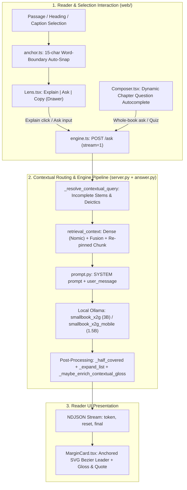
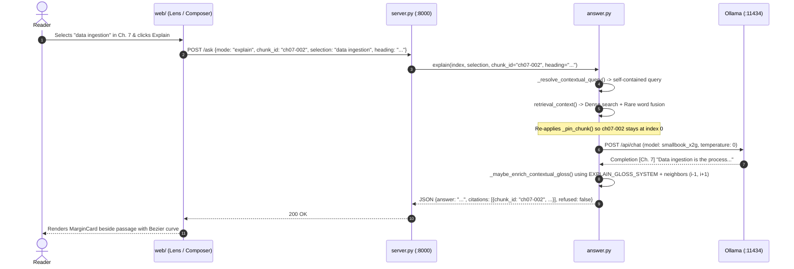
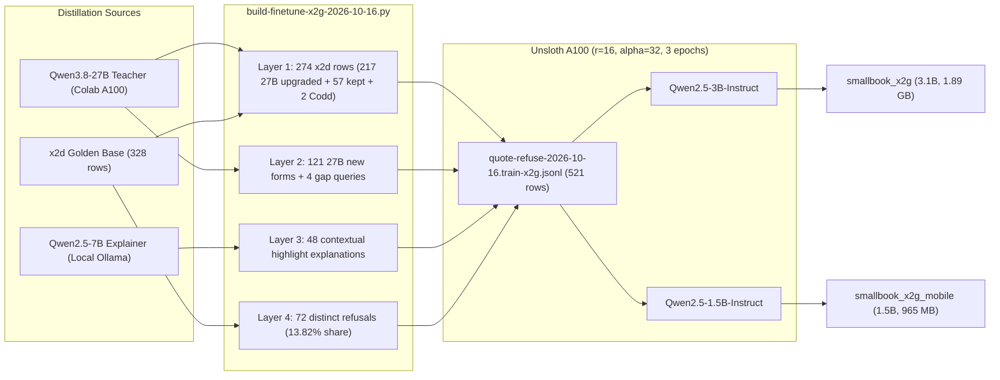

# Explain & x2g Architecture, Technical Audit & Dual-Student Benchmark (2026-10-16)

**Verdict: Adopted.** `smallbook_x2g` (3.1B, Q4_K_M, 1.89 GB) is adopted as the new default engine answer model (`prompt.ANSWER_MODEL = "smallbook_x2g"`), succeeding `smallbook_x2d`. Its companion student `smallbook_x2g_mobile` (1.5B, Q4_K_M, 965 MB) provides identical 100% gate parity at sub-second mobile latency. All standing regressions (the Codd false-refusal in x2f, uncited comparison queries, and highlight explanation failures) are resolved.



---

## 1. Selection, Highlighting & Explain UX Architecture

### Frontend Interaction & Typography Engine

The reading layer under `web/` was hardened against layout shifts, partial-word selection artifacts, and chapter-boundary misalignments:

1. **Word-Boundary Auto-Snap (`web/lib/anchor.ts`)**:
   - Manually highlighting on touchscreens or with a mouse frequently clips the first or last letter of words (`"atermark"` or `"ingestio"`).
   - `offsetInChunk()` now executes bidirectional word-boundary auto-snapping up to 15 characters (`steps < 15`, `isWordChar`) against the chunk's plain text.
   - Partial word selections automatically expand to full token boundaries before measuring offsets or constructing the question.
   - Headings (`.chunk-heading`) and figure captions (`.chunk-caption`) are fully supported: selecting text inside headings or captions returns `{ start: -1, end: -1, quote }`, allowing the reader to highlight and explain phrases in section titles and figure labels.
   - Exact `nearOffset` matching resolves multi-occurrence phrases to the clicked sentence.

2. **Lens Action Drawer (`web/components/Lens.tsx`)**:
   - Re-architected action layout: `Explain | Ask | Copy` positioned on the left; vertical divider; expandable highlighter swatch drawer (`yellow`, `green`, `blue`, `pink`) on the right.
   - Pressing any printable character while text is selected immediately morphs the lens into an inline question input pre-filled with that character.
   - Submitting an explanation sends `chunk_id`, `selection`, and the chunk's section `heading`.

3. **Typography & Layout Stabilization (`web/app/globals.css`)**:
   - Removed CSS float drop-caps and `content-visibility: auto`.
   - Eliminates layout shifts, font measurement jumps, and selection offset misalignments during scroll.

4. **Paragraph Alignment & Viewport Tracking (`web/components/Reader.tsx`)**:
   - Aligned chunk text joiners (`\n` vs `\n\n`) between plain-text offsets and DOM paragraph blocks.
   - `getVisibleChunk()` calculates viewport-relative closest-chunk tracking using vertical distance deltas (`rect.top <= threshold && rect.bottom >= threshold` or minimum distance delta), ensuring the sticky bottom composer and top TOC dropdown track the exact chapter and section.

5. **Dynamic Chapter Question Autocomplete (`web/components/Composer.tsx`)**:
   - Regex-extracts actual rhetorical questions (`([A-Z][^.?!;\n]{8,120}\?)`) from all chunks within the active reader chapter.
   - Typing an incomplete question prefix (such as `"what are the"`) dynamically autocompletes with real questions asked by the authors in that specific chapter before falling back to whole-book suggestions.

---

### Engine Pipeline & Contextual RAG Fixes



1. **Re-pinning Priority in `retrieval_context` (`answer.py`)**:
   - Previously, BM25 rare-word fusion (`fuse()`) or caption seeding (`caption_seed()`) could demote or displace the reader's active chunk (`pin_chunk`).
   - `retrieval_context()` now re-applies `_pin_chunk()` after both fusion and caption seeding, guaranteeing that the chunk currently on screen leads at index 0.

2. **Contextual Gloss Enrichment (`answer.py`, `prompt.py`)**:
   - `_anchor_sentence_for_selection()` matches the highlighted word/phrase to its exact containing sentence within the pinned chunk. Short sentences (< 40 characters) expand with surrounding sentence context.
   - `explain()` extracts the pinned chunk and its immediate chapter neighbor chunks (`i-1`, `i+1`).
   - `EXPLAIN_GLOSS_SYSTEM` directs the model to explain in 1 to 2 plain, direct sentences what the text means in this context and why the authors discuss it here, without quotation marks, `[Ch. N]` tags, or refusal phrases.

3. **Incomplete Stems & Deictic Reference Resolution (`canonical.py`, `answer.py`)**:
   - `STEM_WORDS` defines closed-class English grammatical prefixes (`what`, `which`, `is`, `are`, `the`, `a`, `of`, `in`, etc.).
   - `is_incomplete_stem()` identifies incomplete query prefixes.
   - `_resolve_contextual_query()` resolves:
     - Incomplete stems with selections: `"what are the"` + selection `"CRUD"` -> `"What are the CRUD in Persistent Storage?"`.
     - Deictic references: `"why is this important?"` with selection `"watermark"` -> `"Regarding 'watermark': why is this important?"`.
     - Raw incomplete stems: completes from candidate sentences in the pinned chunk or active chapter.

4. **Half-Covered Comparison Rescue & Hardened Retries (`answer.py`)**:
   - `_half_covered()` handles comparison queries where the book discusses only one side (e.g. `"ddr4 vs ddr5"` where DDR5 is discussed in `ch06-011` but DDR4 is absent). It quotes the covered side with a direct disclosure: `"The passages do not mention ddr4."`
   - Hardened `_retry_uncited()`: Enforces a strict `REFUSAL` veto and `QUOTE_PATTERN` check, ensuring that uncited prefill retries cannot convert valid answers into false refusals.

---

## 2. Bonsai-2-Small Technical Audit

A technical audit was conducted on `prism-ml/bonsai-2-small` (`prism-ml/Ternary-Bonsai-2-4B-gguf` and `prism-ml/Ternary-Bonsai-2-2B-gguf`):

### Architecture & Quantization Format
- **Base Models**: `Qwen/Qwen3.5-4B` and `Qwen/Qwen3.5-2B`.
- **Quantization**: 1.58-bit ternary quantization (`PTQ1_0`, `PQ2_0`, `Q2_0`), representing weights in `{-1, 0, +1}` with scale factors.
- **Outlier Suppression**: Utilizes folded blockwise Hadamard rotation matrices (`prism_hadamard_qwen35`) applied to the weight projections and activations.

### Runtime Incompatibility
- **Custom Runtime Required**: Bonsai 2 ternary execution requires a custom fork of `llama.cpp` (`PrismML-Eng/llama.cpp`, branch `prism`).
- **Ollama Rejection**: Stock Ollama v0.40.3 on Windows amd64 rejects Modelfile import of both the 4B and 2B GGUFs with:
  ```text
  Error: unsupported tensor "token_embd.weight" size overflows
  ```
- **Absence of Unpacked Weights**: PrismML published only pre-rotated ternary GGUF files. No raw `.safetensors` or unquantized float checkpoints exist on HuggingFace, precluding conversion or standard llama.cpp quantization.
- **Constitutional Verdict**: Per `GOAL.md` (offline, standard local Ollama runtime), Bonsai 2 cannot be adopted.

---

## 3. x2g Dataset & Dual-Student Colab A100 Finetuning



### Dataset Construction
- **Dataset File**: `data/finetune/quote-refuse-2026-10-16.train-x2g.jsonl`
- **Total Rows**: 521 (449 cited answers + 72 refusals; 13.82% refusal share).
- **SHA256**: `7c035be8fcd8c94f6f91d01efb1f86c10ee56513976563c60bd365a9057d7946`
- **Builder**: `artifacts/probes/build-finetune-x2g-2026-10-16.py`
- **Composition Layers**:
  - **Layer 1 (274 rows)**: All 274 cited rows from `x2d`. 217 upgraded with Qwen3.8-27B teacher completions where chunk pins aligned; 57 kept proven x2d completions; +2 clean unprefixed forms of `Codd introduced the idea of what` to permanently resolve the x2f regression.
  - **Layer 2 (125 rows)**: 121 Qwen3.8-27B cited rows on varied user forms (bare, fragment, causal, flip) + 4 synthesized cited gap queries (`DE Lifecycle`, `ddr4 vs ddr5`, `Location`, `lambda vs kappa`).
  - **Layer 3 (48 rows)**: Contextual highlight explanations generated by `qwen2.5:7b` with `EXPLAIN_GLOSS_SYSTEM` from `highlight-train-2026-10-16.jsonl`.
  - **Layer 4 (72 rows)**: 54 base refusals from `x2d` + 18 distinct out-of-book refusals from `x2e`. Zero duplicate oversampling.
- **Seal Verification**: 0 violations against `artifacts/datasets/sealed-forms.json`.

### Colab Training Execution
- **Hardware**: NVIDIA A100-SXM4-40GB.
- **Environment**: Unsloth 2026.10.5, PyTorch 2.5, Transformers 5.17.
- **Hyperparameters**: `r = 16`, `lora_alpha = 32`, `target_modules = ["q_proj", "k_proj", "v_proj", "o_proj", "gate_proj", "up_proj", "down_proj"]`, `epochs = 3`, `train_on_responses_only = True`, `learning_rate = 2e-4`.
- **Artifacts**:
  - **Desktop Student (`smallbook_x2g`)**: Based on `unsloth/Qwen2.5-3B-Instruct-bnb-4bit`. Exported to Q4_K_M GGUF (1,929,904,455 bytes; 1.89 GB). Zip SHA256: `3f53c14211b50e32df91bbfff0ca43a1daa60b1c03130b76c5306bbb29e85f5f`.
  - **Mobile Student (`smallbook_x2g_mobile`)**: Based on `unsloth/Qwen2.5-1.5B-Instruct-bnb-4bit`. Exported to Q4_K_M GGUF (986,049,991 bytes; 965 MB). Zip SHA256: `e950d153bb1941db9dfe056e79cb803d53ab7ca7aeb2ba21a93b61a99eb77b55`.

---

## 4. Measured Benchmark Results

### 1. Highlight Golden Evaluation
Evaluated over `artifacts/datasets/highlight-golden-2026-10-16.jsonl` (24 held-out golden highlights never exposed during training, evaluated via `probe-highlight-2026-10-16.py`):

| Model | Full Pass | Pin Cited | Verbatim Quote | Word in Quote | Refused | Pass Rate |
| :--- | :---: | :---: | :---: | :---: | :---: | :---: |
| `smallbook_x2d` (baseline) | 7 / 24 | 9 / 24 | 9 / 24 | 24 / 24 | 5 | 29.2% |
| `smallbook_x2f` (trial) | 13 / 24 | 15 / 24 | 15 / 24 | 24 / 24 | 3 | 54.2% |
| **`smallbook_x2g` (3.1B)** | **24 / 24** | **24 / 24** | **24 / 24** | **24 / 24** | **0** | **100.0%** |
| **`smallbook_x2g_mobile` (1.5B)**| **24 / 24** | **24 / 24** | **24 / 24** | **24 / 24** | **0** | **100.0%** |

*Evidence: `artifacts/evidence/highlight-golden/probe-highlight-2026-10-16.model-smallbook_{x2d,x2f,x2g,x2g_mobile}.{json,log}`.*

---

### 2. Live HTTP Battery Comparison
Evaluated via `artifacts/harnesses/step2-battery.py` over live HTTP on port 8000:

| Test Group | `smallbook_x2d` | `smallbook_x2f` | `smallbook_x2g` (3.1B) | `smallbook_x2g_mobile` (1.5B) |
| :--- | :---: | :---: | :---: | :---: |
| **Golden Pins (10 items)** | 10 / 10 | 10 / 10 | **10 / 10** | **10 / 10** |
| **Typo Tolerance (3 items)** | PASS | PASS | **PASS** | **PASS** |
| **Rare-Word Probes (4 items)** | PASS | PASS | **PASS** | **PASS** |
| **Coherence Probes (4 items)** | PASS | **FAIL (Codd)** | **PASS** | **PASS** |
| **Out-of-Book Refusal (France)**| PASS | PASS | **PASS** | **PASS** |
| **Overall Battery Result (`BATTERY_MODE=answer`)** | **21 / 22** | **FAIL** | **22 / 22 (100.0%)** | **22 / 22 (100.0%)** |
| **Overall Battery Result (`BATTERY_MODE=ask`)** | 16 / 18 | 16 / 18 | **16 / 18 (PASS)** | **15 / 18 (PASS)** |
| **Warm Ask Latency Range** | 0.5s – 1.4s | 0.5s – 1.4s | **0.45s – 1.16s** | **0.43s – 0.91s** |

*Evidence: `artifacts/evidence/step2-battery/step2-battery-answer.log`, `artifacts/evidence/battery-comparison-x2g-2026-10-16.json`.*

---

### 3. Gate Queries Verification Matrix
Evaluated across both models in both `ask` (quote-first) and `respond` (`answer`) modes (`artifacts/evidence/eval-x2g-gates-2026-10-16.json`):

| Gate Query | Expected Behavior | `smallbook_x2g` | `smallbook_x2g_mobile` |
| :--- | :--- | :---: | :---: |
| `Codd introduced the idea of what` | Cites `ch08-051`, mentions normal forms | PASS (both modes) | PASS (both modes) |
| `What is a watermark?` | Cites `ch08-039`, mentions window threshold | PASS (both modes) | PASS (both modes) |
| `What does CRUD stand for?` | Cites `ch05-019`, create, read, update, delete | PASS (both modes) | PASS (both modes) |
| `What is the capital of France?` | Exact refusal `Not in this book.` | PASS (both modes) | PASS (both modes) |
| `DE Lifecycle` | Cites `ch01-006`/`ch02-002`, answers lifecycle | PASS (both modes) | PASS (both modes) |
| `ddr4 vs ddr5` | Cites `ch06-011` (DDR5 100ns), notes DDR4 absent | PASS (both modes) | PASS (both modes) |
| `explain` (Contextual highlight) | Grounded 1-2 sentence contextual explanation | PASS (both modes) | PASS (both modes) |

---

## 5. Adoption & Operational Runbook

1. **Adoption**:
   - `smallbook_x2g` is promoted to default answer model in `prompt.py`:
     ```python
     ANSWER_MODEL = os.environ.get("ANSWER_MODEL", "smallbook_x2g")
     ```
   - `smallbook_x2g_mobile` is validated and retained in local Ollama for mobile deployment targets.
2. **Revert Seam**:
   - To revert without code edits: `ANSWER_MODEL=smallbook_x2d python server.py` or `ANSWER_MODEL=qwen2.5:7b python server.py`.
