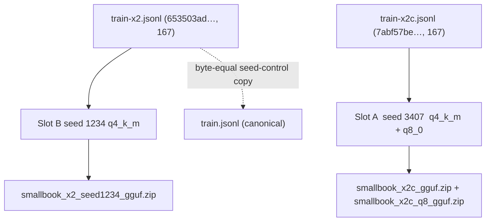

# Finetune dataset verification — x2c + Colab notebook (2026-10-14)

Verdict: **PASS** — `quote-refuse-2026-10-13.train-x2c.jsonl` (sha256 verified),
its seed-control copy `train-x2.jsonl`, and `artifacts/reports/finetune-colab-2026-10-13.ipynb`
are mechanically ready for the Google Colab run. Two non-blocking findings
(stale sealed-suite probe path; reading-repair `asked` note) are recorded below.

- Repo: `ask-this-book`, Windows, python 3.12.5 (`python`), stdlib only, offline.
- Verifier: `artifacts/scratch/verify-x2c-2026-10-14.py` (read-only; exit 0).
- Every number below is [measured] by that script / `sha256sum` / `cmp` unless
  labeled [inferred].

## PASS/FAIL table

| # | Check | Result | Measured value / note |
|---|---|---|---|
| 1 | `train-x2c.jsonl` sha256 == `7abf57be…0738` | PASS | `7abf57beb688d2f65ae490f463a0b748f23262d768894bc45df1d295af7a0738` |
| 2 | `train-x2.jsonl` sha256 starts `653503ad` | PASS | `653503ad257328a02f47ecaec0ab991eae2e952d6210b459e46a28f805cef92c` |
| 3 | `train-x2.jsonl` byte-equal to `train.jsonl` (seed-control copy restored) | PASS | `cmp` exit 0; Python byte compare True |
| 4 | Rows: 167 = 113 answer + 54 refusal | PASS | counted from the JSONL; `stats-x2c.json.written.train == 167` |
| 5 | 54 refusals = 27 unique questions ×2, copies byte-identical | PASS | group sizes `{2: 27}`; per-question `json.dumps` blobs identical; all 54 carry `meta.oversampled=true` |
| 6 | 30 `PERTURB_SWAPS` applied (10 acronym-casing / 10 order-flip / 10 bare-fragment) | PASS | 30/30 perturbed questions present, 0 originals left, `asked` form changed vs x2 for 30/30; spot-check table (12 shown, e.g. `crud stands for what` → `CRUD stands for what` cited `ch05-019` gold; `data science vs data engineering` → `What is data engineering vs data science?`) |
| 7 | Schema + JSON validity + app contract | PASS | 0 failures across 167 rows: roles `[system,user,assistant]`; system content == `prompt.SYSTEM` byte-exact; user shape `Question: …\nPassages:\n` with parsed `[Ch. N] chunk_id=…` blocks matching the index text; `meta.split == train` |
| 8 | Assistant targets | PASS | refusals exactly `Not in this book.`; answers exactly 2 lines: `[Ch. N] "…"` (`answer.py` L435-437 format) + one non-empty gloss line that never starts `[Ch.`; every quote passes `answer._quote_in_passage` against its cited chunk; every chapter tag matches `data/index.json` |
| 9 | Contamination rerun (x2c) equals recorded run | PASS | exact asked-form overlap 0; 9 near pairs ≥0.8; identical to `probe-contamination-2026-10-14-x2c.json`; pair set identical to x2 (no new pair) |
| 10 | Sealed fragment suite offline check | PASS (probe bug noted) | with corrected probe ROOT: 0 violations vs 235 train forms including x2c; visible-ten 0 violations; max sim r=0.727. **As shipped from `artifacts/probes/` the probe loads 0 files — finding F1** |
| 11 | Length vs notebook `max_seq_length = 4096` | PASS | chars/row: min 3790, p50 6219, p90 7167, max 7975 (`x2c:84`, "what is data vault modeling") ≈ 1994–2659 tokens by chars/4…chars/3 estimate [inferred]; 0 rows flagged for truncation |
| 12 | Notebook cross-check (JSON parses; 18 semantic checks + 2 file-existence checks) | PASS | `expected: 167` appears on both slots; seeds A 3407 / B 1234; exports A q4_k_m+q8_0, B q4_k_m; canary assert after responses-only prep; uploads exist on disk |

## Exact upload list for the Colab run (from the notebook)

Upload **both** train files in one picker (do **not** upload the bench file):

1. `quote-refuse-2026-10-13.train-x2c.jsonl` — Slot A, seed 3407, asserts 167
2. `quote-refuse-2026-10-13.train-x2.jsonl` — Slot B (seed control), seed 1234, asserts 167

Expected downloaded artifacts (names derived from `make_archive(export_name + …)`
in the notebook [inferred — deterministic from the code; only the q8 name is printed literally]):

| Slot | Export name | Zip (q4_k_m) | Zip (q8_0) |
|---|---|---|---|
| A (x2c, seed 3407) | `smallbook_x2c` | `smallbook_x2c_gguf.zip` | `smallbook_x2c_q8_gguf.zip` |
| B (x2 seed control) | `smallbook_x2_seed1234` | `smallbook_x2_seed1234_gguf.zip` | — (q4 only) |

Notebook also requires: "Num examples" banner = 167 for both runs, two STOP-CHECK
"looks sane" verdicts, q8 export failure must not kill the session.



## Findings (non-blocking, but act before the post-training gate)

- **F1 [measured] — the sealed-suite probe is a silent no-op from its current path.**
  `artifacts/probes/probe-fragment-2026-10-14.py` sets `ROOT = HERE.parent`, which
  after the artifacts migration points at `artifacts/`, so `load_train_forms()`
  globs `artifacts/data/finetune/` and returns **0 forms** — the sealed check then
  reports "0 violations" against nothing, and the run would proceed with an
  unverified suite. With `ROOT` corrected to the repo root (done in-process by the
  scratch verifier): 235 forms from all four `train*.jsonl` files incl. `train-x2c.jsonl`,
  **0 violations**, max similarity 0.727 ("Event Streams" vs "What is key-value store?").
  Matching recorded evidence (`artifacts/evidence/probe-fragment/…qwen2.5-7b.log`:
  "0 violations vs 235 forms"). Fix `ROOT = HERE.parent.parent` before re-running
  the gate; the suite itself is clean, only the path is wrong.
- **F2 [measured] — 14 rows' user `Question:` line is the seam's reading-repaired form.**
  `builder.capture` stores `meta.asked` = `canonical_query(question)` but builds the
  user message from `retrieval_context(...)["asked"]`, which the difflib reading
  repair can rewrite. All 14 mismatches resolve exactly to `ctx.asked` recomputed
  offline (0 unexplained): e.g. `what is observabilty` → user line `what is observability`,
  `normailzation` → `What is normalization?`; the 10 refusal rows show the repair's
  rough edge (`sourdough bread` → `sourdough read`, `World Cup` → `World cusp`,
  `painted` → `pointed`, `invented` → `invested`). This mirrors what the shipped
  seam sends at inference, so the data is consistent; `meta.asked` just does not
  record the reading. Cosmetic metadata note, not a dataset defect.
- **F3 [measured] — normalization counts differ between the recorded verifier and a
  strict re-check.** Recorded: 10 normalized-only quotes (x2c). Strict per-chunk
  byte check: 11 — the extra row is `x2c:14` ("types of metadata", cited `ch02-051`)
  whose quote is byte-exact only later in the message; all pass the app's
  `_quote_in_passage` rule (sanctioned, e.g. "(Figure X-Y)" omissions). PASS either way.
- **F4 [measured] — contamination status unchanged from x2.** Exact asked-form
  overlap 0. 9 near pairs ≥0.8 (1.00 ingestion; 1.00 enterprise-architecture;
  0.93 pragmatic; 0.93 Codd; 0.89 pragmatic; 0.82 France-vs-Australia refusals;
  0.81 mesh; 0.81 transformations-lifecycle; 0.80 MAD) — identical set to x2,
  including the four pre-accepted assisted twins. Casefold substring hits of bench
  strings inside train question-lines/targets are those same near-twins plus book
  vocabulary inside gloss targets (`data ingestion`, `watermark`); no bench question
  is present in a train question form.

## How this was measured (reproduce)

```bash
cd C:\Users\ADRIAN\workspace\github.com\Skufu\ask-this-book
sha256sum data/finetune/quote-refuse-2026-10-13.train-x2c.jsonl data/finetune/quote-refuse-2026-10-13.train-x2.jsonl
cmp data/finetune/quote-refuse-2026-10-13.train-x2.jsonl data/finetune/quote-refuse-2026-10-13.train.jsonl
python artifacts/scratch/verify-x2c-2026-10-14.py    # exit 0 (PASS); prints sections 1-9 above
```

Bench file integrity: `bench-x2c.jsonl` sha256 `174afd18c4dff3ea6e7f95e53806101f35dc3c4d389d7d16f6d7e6a4305172ed`,
byte-identical to `bench-x2.jsonl`/`bench.jsonl` (matches the x2c doc's `174afd18c4df` prefix).

## Evidence copies (added 2026-10-14, copied never moved)

In `artifacts/evidence/finetune-data-prep/`:

- `probe-contamination-2026-10-14-x2c.json`, `.log`
- `probe-finetune-verify-2026-10-13-x2c.json`, `.log`
- `quote-refuse-2026-10-13.stats-x2c.json`

(`finetune-data-prep-2026-10-13-x2c.log` was already present; the scratch scripts
are `artifacts/scratch/verify-x2c-2026-10-14.py`, with the pre-existing
`_scratch-preflight.py` / `_scratch-swap-report.py` under `data/finetune/`.)

Next check: upload the two files above in one Colab session and watch for
"Num examples" 167 on both runs.

---

## Amendment 2026-10-14 (P0-1 correction, pre-run) — supersedes rows 1, 6, 9, F1, F4

Per `finetune-expert-review-2026-10-14.md` P0-1, the class-(a) swaps were
rebuilt before any training run: crud/raid now teach the lowercase wh-forms;
six unmeasured uppercase swaps reverted; pii/oltp stay case-mix probes.
24 swaps (was 30); counts unchanged.

- `train-x2c.jsonl` sha256 `27a84899ac699f0d970a609721a37ae7b50a311d735f09e45598dbad1bfdd311` (replaces `7abf57be…0738`).
- Verifier re-run on the rebuilt file (before restoring `train.jsonl`): train 167 (113 answer / 54 refusal), 10 normalized-only quotes, failures 0 — PASS; bench 45 (43 / 2), failures 0; bench byte-identical (`174afd18…`).
- Contamination re-run: exact overlap 0; near pairs 11 (was 9). The two new pairs: CRUD battery golden 1.00 and CRU typo probe 0.96 vs the lowercase crud card — assisted items, reported separately. Fresh evidence: `artifacts/evidence/finetune-data-prep/probe-contamination-2026-10-14-x2c.{json,log}` (overwrites the pre-correction copy).
- Swap-report: 0 problems; gold-gold 6 / gold-demoted 1 (etl) / silver-silver 17; crud pin ch05-019 and raid pin ch06-034 kept.
- F1 is fixed and closed: `artifacts/probes/probe-fragment-2026-10-14.py` now uses `ROOT = HERE.parent.parent`, writes under `evidence/probe-fragment/`, and aborts when the train glob is empty (no more vacuous seal pass). Import + loader verified 2026-10-14.
- F4's 9-pair list is superseded by the 11-pair list above.
- The notebook was hardened to v6 under the same filename (mask/EOS spot-check, token histogram, stop-check on one answer + one refusal row, GGUF/zip hashes, LoRA adapter save, run-log JSON). Upload list unchanged; the x2c hash is the new one above.
