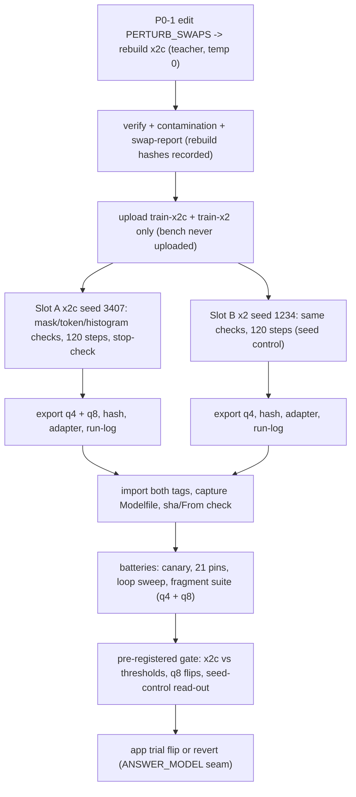

# Fine-tune expert review — x2c + seed control, before the next run (2026-10-14)

Scope: pre-run review of the plan to train `smallbook_x2c` (x2 + form swaps) and the
x2 seed control, plus the q4/q8 export design. Sources read: `AGENTS.md`,
`artifacts/reports/x2-trial-2026-10-14.md`, `smallbook_x2-{model-card,rebuild,scoreboard,provenance}-2026-10-14.md`,
`finetune-colab-2026-10-13.ipynb` (raw), `artifacts/probes/build-finetune-data-2026-10-13.py`,
`artifacts/probes/probe-fragment-2026-10-14.py` + its two model logs,
`finetune-data-prep-2026-10-13.md`, `finetune-loop-eval-2026-10-13.md`,
`data/finetune/*` (readable, not modified), `answer.py`/`prompt.py` seam, and live
`ollama show smallbook_x2` / `--modelfile` (v0.40.3). Claims are labeled
**[measured]** (I ran or read it this session) or **[inferred]**.

## Verdict — what is missing, front-loaded

1. **P0 — the x2c class-(a) swaps point away from the measured wart.** The failing
   surface is the lowercase wh-form (task: user's `What does crud stand for?`;
   bench form `What does CRUD stand for?` false-refused 2/3). x2c replaces the only
   lowercase card `crud stands for what` with `CRUD stands for what` **[measured]** —
   a form whose order the model already answers, while deleting lowercase coverage.
   Fix: 6 reverts + 2 swaps to lowercase wh-forms + 2 kept uppercase probes = 24 swaps
   (P0-1). Expected side effect: CRUD-lowercase is **not** expected to move unless this
   edit lands.
2. **P0 — the gate's 7B fragment comparison is at unequal draw counts.** 7B log = 3
   draws/item, x2 log = 10 **[measured]**. Gate item 2 says "per-class pass rate >=
   the 7B's"; at 3 vs 10 that verdict is undefined. Re-run 7B at 10 draws before the
   gate trial (P0-2). Note x2 itself fails gate items 2 and 3 as measured (order-flip
   0/4 coded, trailing 1/3, `File Formats` 10/10 length-stops), so x2c must beat a
   real bar, not "beat x2 at n=1".
3. **P0 — the notebook's canaries don't check the things that silently killed the past
   run.** No EOS/format assertion in the stop-check, no token-length histogram, no
   packing/mask readout, no Colab-side GGUF hash, no LoRA adapter saved **[measured:
   notebook source]**. Exact snippets in P0-3 and the checklist.
4. **P1 — false refusals are a margin problem fed by the data**, not a sampler that can
   be tweaked: refusal rows are 54/167 (32.3% of rows, one shared 17-char target ×54;
   **[measured]** from `data/finetune`) while 105 of the 109 topic labels carry exactly
   one surface form (4 topics carry two; **[measured]** by joining train questions to
   the sweep's `subject` field). Fix is systematic augmentation (x2d) + validation-gated decode retry;
   logit-bias/GBNF is not exposed by this Ollama surface and should not be shipped blind
   (P1-1, P1-2). Verdict: **167 is right for this controlled session; it is not the
   terminal dataset.**
5. **P1 — loops are one `File Formats` bare topic away from a user-visible timeout.**
   x2 length-stops 10/10 draws on that item at a 300-token cap **[measured]**, and the
   app seam sends no `num_predict` cap and no extra stops — only the Modelfile's
   `<|im_end|>`/`<|endoftext|>` **[measured: `answer.py` payload, `ollama show`]**.
   Client timeout is 120 s, so an uncapped loop is an error, not a slow answer. Engine
   loop-guard is P1-3 (do it when the current trial closes, per repo process).
6. **P1 — seed control is designed right but its comparison is confounded by session
   and toolchain** unless both are fingerprinted and logged; read-out rule in P1-4.
   Exposure is equal for both upcoming runs (both 167 rows → 5.7 epochs at 120 steps
   **[derived: 120 ÷ (167/8)]**).
7. **P1 — q4-vs-q8 A/B lacks harness parity and a flip rule.** Slot A exports both
   **[measured: notebook]**, but the gate text only asks "warts persist at q8_0".
   Parity plan + pre-registered interpretation in P1-5.
8. **P1 — provenance holes:** `data/models/` is **empty** **[measured]** — no archived
   Modelfile/GGUF copy; the Colab zip hash was never printed; adapters are discarded.
   Fix list in P1-6.
9. **P2 — post-gate data plan (x2d):** 54 *unique* refusal questions instead of 27×2,
   ~3 forms per answer topic from the measured classes, epoch-based steps, gate
   pre-registered before training (P2-1).

---

## What seed control buys us (plain words)

A training run makes thousands of small coin flips that nobody chose: the order rows
are shuffled, the starting random numbers inside the adapter, tiny nondeterminism in the
GPU software. Two runs of the *same recipe on the same file* can end up behaving
differently — one clean, one wart-ridden. When you only have one run, you cannot tell
whether x2's stable behavior is the recipe working or the coin landing well.

The seed control is a second run of the exact x2 file with one deliberate change: a
different starting seed (1234 vs 3407). It buys a measurement of that coin-flip noise:

- If the control run behaves like x2 (refusals exact, battery 18–19/21, no loops,
  same warts), then x2's behavior is reproducible, and if x2c behaves differently the
  honest reading is "the data change did it."
- If the control run behaves differently, then every single-run comparison so far was
  fragile — including x2c's. In that case x2c is judged only by the pre-registered
  thresholds (refusals 2/2, zero loops, fragment classes vs the 7B), never by "x2c
  looks better than the one recorded x2 run."

Either outcome is useful. The cost is roughly one more 20-minute A100 training slot.

## How we keep a fine-tune uncontaminated (plain words)

"Contamination" means the model was trained (directly or in disguise) on the very
questions we later use to judge it — so the exam grade is fake.

What this project already does right:
- The exam file (`bench.jsonl`, 45 rows) is split off by the data builder and is
  **never uploaded to Colab**. The notebook only asks for the two train files
  **[measured: notebook]**. Bench stays on this PC, hash-pinned
  (`174afd18…` **[measured today]**).
- A similarity scanner (`probe-contamination`) compares every train question with the
  exam: 0 exact overlaps on x2 and x2c **[measured: x2c doc + rerun today]**; the 9
  near-twins and the 4 assisted bench passes are reported separately.
- The fragment suite is a sealed quiz: 21 items frozen on 2026-10-14, a check fails
  the run if training text comes within difflib 0.70 of the ten visible trial queries
  **[measured: log header]**. Gate numbers use the clean subset, not the assisted one.
- The dataset directory is outside git; hashes are the receipts; toolchain is pinned.

What to add so a future rebuild can't silently cheat:
- Put the sealed files' hashes in one manifest (`artifacts/datasets/sealed-forms.json`)
  and make the contamination probe read it — today the seal is procedural, not
  mechanical.
- When the augmenter (x2d) generates forms, it must generate the **train** split only
  and re-run the contamination probe before any Colab upload.
- Rule of thumb: if a question is used to judge the model, it is never a training card.
  The ten visible trial queries are trainable; the fragment suite and the bench are not.

---

## P0 — before the next training run

### P0-1. Fix the x2c class-(a) swaps (edit + rebuild, ~30 min teacher time)

Why: **[measured]** today —
- `train-x2c.jsonl` contains `CRUD stands for what`; `train-x2.jsonl` contained
  `crud stands for what`. The lowercase card is gone from x2c.
- The bench exam form `What does CRUD stand for?` (gold `ch05-019`) is in
  `artifacts/datasets/eval-set.json` and x2 false-refuses it in 2 of 3 recorded
  battery runs (`smallbook_x2-scoreboard-2026-10-14.md`).
- No measured wart exists for `pii`, `oltp`, `acid`, `finops`, `togaf`, `kimball`,
  `reverse etl`, `cloud-scale data os` cards; the swap only converts them to
  uppercase-only coverage.

Exact change in `artifacts/probes/build-finetune-data-2026-10-13.py`, `PERTURB_SWAPS`:
1. Replace two values with the measured lowercase wh-forms:
   `"crud stands for what" → "what does crud stand for"` and
   `"raid stands for what" → "what does raid stand for"`.
   (Do **not** add `What does CRUD stand for?` — that exact string is the sealed exam
   form.)
2. Revert the six unmeasured uppercase swaps (`finops`, `togaf`, `kimball`, `acid`,
   `reverse etl`, `cloud-scale data os`) by deleting those dict entries — their trains
   cards return to x2's lowercase forms.
3. Keep `"what is pii" → "what is PII"` and `"what is an oltp system" → "what is an
   OLTP system"` as deliberate case-mix probes.

Result: 24 swaps (was 30); counts stay 167 = 113 + 54; the x2c doc table
(`data/finetune/x2c-2026-10-14.md`) must be amended (the pre-registered gate text is
pattern-based, so it stays valid).

Verify (commands from the x2c doc "Reproduce", updated):
- `python artifacts/probes/build-finetune-data-2026-10-13.py` → stats `perturb_swaps: 24`.
- `python artifacts/probes/probe-finetune-verify-2026-10-13.py` → PASS, 0 failures.
- `python artifacts/probes/probe-contamination-2026-10-14.py` → 0 exact; same 9 pairs.
- New check with `data/finetune/_scratch-swap-report.py`: for every swapped topic,
  print the train cards that contain it — each of crud/raid must now have exactly one
  card whose string contains the lowercase wh-form, and no topic may be left with an
  uppercase-only card except pii/oltp.
- Record the new train sha256 in the x2c doc. Pre-edit sha (today, measured):
  `7abf57beb688d2f65ae490f463a0b748f23262d768894bc45df1d295af7a0738`.

If you choose to keep the data as built: record in the x2c doc that class (a) is a
case-mix probe and that CRUD-lowercase remains an expected wart for this run.

### P0-2. Re-run the 7B fragment suite at 10 draws (before any gate verdict)

**[measured]** `probe-fragment-2026-10-14.model-qwen2.5-7b.log` ran 3 draws/item;
`model-smallbook_x2.log` ran 10. Gate item 2 is a per-class comparison; at 3 vs 10 it
cannot be scored. Flags verified in `probe-fragment-2026-10-14.py` (`--model`,
`--draws`, default 1; mode=answer, cap and temp 0 fixed). Command (7B is on disk):

```
python artifacts/probes/probe-fragment-2026-10-14.py --model qwen2.5:7b --draws 10
```

It writes `probe-fragment-2026-10-14.model-qwen2.5-7b.{json,log}` — land it under
`artifacts/evidence/probe-fragment/`, same family, preserving the recorded 3-draw
twin until the numbers are folded into the scoreboard.

Scoring notes for the gate: **[measured]** on the sealed suite x2 is 10 draws of FAIL
on 4/4 order-flips (prose without a parseable citation), 2/3 trailing letters,
2/5 bare topics (`File Formats` additionally loops 10/10), 1 fragment false-refuses
10/10 (`why does`); greetings are inconsistent (one off-format answer, two 10/10
refusals). Unverifiable prose in this seam is app-level refusal, so those FAILs are
false refusals a user would see **[inferred from `answer.py` `parse_completion`,
consistent with the probe's `cited=0` marks]**.

### P0-3. Notebook hardening (five small edits, all pre-run)

All against `artifacts/reports/finetune-colab-2026-10-13.ipynb`. Verdict: the current
stop-check can print "looks sane" for a 2-quote reply; the canary count cannot see
truncated rows that lose `<|im_end|>`.

1. **Mask/EOS spot-check before `trainer.train()`** (proves system+user+passages are
   masked and EOS is supervised):

```python
batch = trainer.data_collator([trainer.train_dataset[0]])
keep = [t.item() for t, l in zip(batch["input_ids"][0], batch["labels"][0]) if l != -100]
sup = tokenizer.decode(keep)
print("supervised tokens:", len(keep), "of", batch["labels"].shape[1])
print("supervised head:", sup[:120].replace("\n", "\\n"))
assert sup.rstrip().endswith("<|im_end|>"), "EOS/im_end not supervised — do not train"
```

2. **Token-length histogram + truncation count** (after the `dataset.map`, before
   training; the 1024 default silently cut 152/167 rows once):

```python
lens = sorted(len(tokenizer(d["text"])["input_ids"]) for d in dataset)
print("token lens p50/p90/max:", lens[len(lens)//2], lens[int(.9*len(lens))-1], lens[-1])
print("rows over max_length:", sum(1 for x in lens if x > max_seq_length))
assert lens[-1] <= max_seq_length, "truncation would cut the tail (EOS)"
```

3. **Config readout** (comparability evidence — write one run-log JSON):
   `print(trainer.args.max_length, trainer.args.max_steps, trainer.args.packing,
   trainer.args.seed, trainer.args.lr_scheduler_type, trainer.args.learning_rate)`,
   plus `trainer.args.to_json_string()` saved to `run-log-<export>.json` and
   downloaded. Current char stats say 4096 has ~1.9× headroom even at a punitive
   2.5 chars/token **[inferred from measured row lengths p90 7076 chars, max 7884]**,
   but the histogram is the authoritative check.

4. **Harden the stop-check** (assert format + EOS, and run it once per target class):

```python
import re
text = tokenizer.decode(reply_ids, skip_special_tokens=False)
ok = (re.match(r'^(\[Ch\. \d+\] ".*?"\n\S.*|Not in this book\.)', text)
      and text.rstrip().endswith("<|im_end|>") and reply_ids.shape[0] < 250)
print("STOP-CHECK verdict:", "sane" if ok else "SUSPECT - tell the agent")
```

   Run it on one refusal row and one answer row (find each in the file by its
   `messages[2]` prefix), not only `dataset[0]`.

5. **Export hygiene:** print `!sha256sum {path}` for the q4 GGUF, the q8 GGUF, and both
   zips in Colab before download; save the LoRA adapter
   (`model.save_pretrained(export_name + "_lora")`, zip + download) so any future
   quant can be re-made without retraining.

### P0-4. Capture the served Modelfile into the repo (silent provenance repair)

**[measured]** `data/models/` is empty; the GGUF exists only as an Ollama blob
(`sha256-391737a5…`), and the served Modelfile was never committed. After the next
`ollama create`, run `ollama show <tag> --modelfile > data/models/<tag>_gguf/Modelfile.captured`
and commit a sanitized copy (FROM reduced to the `sha256-…` blob id). Also verify
`FROM` in the captured file equals the local GGUF's sha256 and the `ollama list`
digest.

---

## P1 — with or immediately after the run

### P1-1. The false-refusal margin: what an expert actually ships

Diagnosis **[measured + inferred]**: 105 of 109 topic labels carry a single surface
form (4 carry two); refusal rows are 54/167 (32.3%) of first-token decisions
but only 17 chars each, so the decision is carried almost entirely by the first token
(`[` vs `Not`) with a strong refusal prior and no coverage on unmemorized forms. That
matches the measured wart pattern (same topic, unseen form → refusal; prose without
citation → app-level refusal).

Ship order:
1. **Data first** — x2d (P2-1). This is the only fix that moves the decision margin.
2. **Decoding-time safety net, validation-gated retry (implementable today):** in
   `answer.py`'s ask path, when the parsed body is a refusal and anchors/retrieval
   suggest the question is in-book, retry once with the assistant turn prefilled as
   `[Ch. ` (raw-prompt continuation), then run the existing `parse_completion` / quote
   check on the retry. Keep the retry only if a verbatim quote validates; otherwise
   the refusal stands. This is monotone (it can only convert refusals into *checked*
   quotes) and costs one extra generation on refusal turns only. Verify with the
   visible ten + fragment suite before/after; log retry counts.
3. **Do not** plan around logit bias (not in this API) or raw GBNF (not documented for
   Ollama 0.40.3 **[inferred]**; probe `format` support with a throwaway request before
   designing anything on it). JSON-schema `format` would force a JSON output envelope —
   an app-contract change, not a drop-in.

### P1-2. Loop root causes and the serving fix

Training-side **[inferred from measured artifacts]**:
- EOS is supervised (target ends `<|im_end|>`, template-correct), but the trained
  termination state is "end of the 2-line gloss". Once the model drifts into copying
  passage text (an unsupervised path), nothing it was trained on ends that path — the
  `File Formats` loop is drift + look-back degeneration, not a missing stop token.
- The exact-duplicate refusal targets add zero new information; 54 copies of one
  17-char target is the most likely calibrator of the refusal-first prior. The x2c run
  holds this ratio on purpose (control); the x2d change is real diversity on the *user*
  side with the same count (P2-1).
- Truncation is the one training-side mechanism that would genuinely break EOS: rows
  cut before `<|im_end|>` teach "never stop". P0-3's histogram + assert close that.

Serving-side (needed regardless): add `num_predict` (suggest 512 — p90 answer target is
622 chars with the longest legal reply far under 512 tokens) and a post-generation
guard that truncates at the first repeated quote/gloss pair. A length stop then becomes
a measurable event, not a 120 s client timeout. Land it in the engine backlog queue as
the trial closes; verify with the loop sweep + fragment suite.

### P1-3. Seed control: log and read-out

Keep the notebook design (Slot A x2c seed 3407; Slot B x2 file seed 1234; identical
everything else). Add per-run logging (see schema below). Pre-register the read-out
**now**:
- If B matches the recorded x2 (canary 2/2 exact; battery within 18–19/21 at equal
  draws; fragment classes no worse; 0 length-stops), x2's recipe is seed-stable and the
  x2→x2c delta can be read as data-attributable.
- If B diverges (>1 battery pin at equal draws, or a false refusal/loop class x2 was
  clean on), then n=1 comparisons anywhere in this history are unreliable; x2c is
  judged only against the pre-registered absolute thresholds.
- Confound to state in the write-up: B runs in a new session vs x2's recorded session.
  The toolchain pins (unsloth 2026.10.5 / transformers 5.17.0) make this acceptable;
  the run-log fingerprint is what makes it checkable.

### P1-4. Exposure confound — handled, with one follow-up

**[derived]** with effective batch 8 (2×4): x1 140 rows → 17.5 steps/epoch → 6.9
epochs at 120 steps; x2/x2c 167 → 20.9 → 5.7; x3 194 → 24.3 → 4.9. x2c vs control is
equal-exposure (same file size, same steps) — good. Follow-up: when x2d changes the row
count, switch to `num_train_epochs` (or `max_steps = ceil(6 * rows / 8)`) so exposure
stops moving with the data.

### P1-5. q4-vs-q8 A/B design

Slot A only is right (the question is about the candidate's warts, not the control's).
To make gate item 5 decidable:
- Export q8_0 in the same run (already in the notebook), hash both, import the q8 as a
  separate tag (`smallbook_x2c_q8`), never overwrite the q4 tag.
- Run the SAME harnesses at temp 0 with the SAME draw counts for both quants: fragment
  suite 10 draws, battery 3 draws, refusals 2 questions × 5 draws.
- Produce a per-item diff table (q4 verdict, q8 verdict, loops). Pre-register the
  interpretation now: a wart "persists at q8" if its q4 failure shows within ±1 draw
  count at q8 (e.g. 10/10 vs ≥9/10); a wart "vanishes" only if q8 is clean across all
  draws AND the battery pin flips — single-draw flips are noise (the repo already
  measured that temp-0 draws are not always byte-identical, `finetune-loop-eval`).
- Decision rule: ship q4 only if no false-refusal/loop item is q4-only; otherwise fix
  by shipping q8 or re-quantizing q5/q6 and re-running the fragment suite.

### P1-6. Run-log schema (one JSON per run, downloaded with the zips)

Print/save: repo commit (`git rev-parse HEAD`), data file name + sha256, row count +
answer/refusal split, refusal share, toolchain versions (already printed), GPU name,
SFTConfig JSON (`trainer.args.to_json_string()`), packing value, `max_length`, steps,
steps/epoch, effective batch, seed + data_seed + adapter `random_state`, token-length
p50/p90/max, rows over `max_length`, supervised-token count and EOS assert result from
the spot-check, stop-check text for both classes + verdicts, loss history
(`trainer.state.log_history`), final loss and last-5 mean, GGUF sha256 (q4, q8), zip
sha256s, adapter sha256. Missing items in the recorded x2 run that this closes: Colab
zip sha, adapter, packing value, token histogram.

---

## P2 — after the gate, next data iteration (x2d sketch)

For the record, so the plan does not stop at "swap 30 rows":
- **Refusals: 54 unique questions** (mine ~27 more through the same teacher/verifier;
  same count and share, exact sentence only, so the France/iops canary and the ratio
  stay measurable). This is the strongest single candidate for the false-refusal prior.
- **Answers: ~3 forms per topic** from the measured classes — canonical wh-form,
  lowercase/fragment form, bare topic/heading, order-flip where the topic is paired,
  a few greeting-prefixed (`hey …`) for the measured user style. Teacher-captured,
  verbatim-verified, tiered as today. Target ≈ 360–400 rows; `max_steps =
  ceil(6 * rows / 8)` keeps per-row exposure at the x2 level.
- Do not train trailing-letter typos (`ddr5s`): that is the engine's repair seam, and
  training on typos teaches the model to answer misspellings instead of the engine
  fixing them.
- Hold out: bench (hash-pinned) + fragment suite (sealed manifest). Pre-register the
  gate before training. Expectation to write down: `Location` / `DE Lifecycle` warts
  get no fix in x2c (no corresponding cards exist to swap); x2d is where they get
  cards.

---

## Silent-failure checklist (paste into the run notes)

**Before upload / in Colab**
- [ ] `sha256sum` the uploaded train file == the x2c-doc hash (new hash after P0-1).
- [ ] Runtime: pin install succeeded (`unsloth==2026.10.5`, `transformers==5.17.0`).
- [ ] Trainer banner: **Num examples 167** for both slots; the canary asserts both
      pre- and post-`train_on_responses_only` counts.
- [ ] Mask spot-check: supervised slice ends with `<|im_end|>`; supervised tokens <<
      total tokens (system+passages masked).
- [ ] Token histogram: 0 rows over `max_length`; p90 printed.
- [ ] `trainer.args.packing`, `max_length`, `max_steps`, `seed` printed into the log.
- [ ] STOP-CHECK ran on one answer row and one refusal row; both "sane".

**Export / import**
- [ ] q4 + q8 GGUF sha256 printed in Colab; zips hashed; run-log JSON downloaded.
- [ ] Adapter saved and downloaded.
- [ ] Local sha256 == Colab sha256 for both GGUFs (recorded comparison).
- [ ] `ollama show <tag> --modelfile` captured to `data/models/...`; FROM == GGUF sha;
      stops `<|im_end|>`/`<|endoftext|>` present; SYSTEM override note recorded
      (`answer.py` sends its own system; the Modelfile "You are Qwen…" default is
      dormant).
- [ ] Determinism micro-probe: same prompt 10×, count distinct outputs. If >1, set
      `min_p 0` in the Modelfile (the app overrides only `temperature`) and re-probe.

**Behavior (per model tag, temp 0, recorded draw counts)**
- [ ] Refusal canary France + iops: 2/2 exact.
- [ ] Ask battery 21 pins (3 draws): record; compare at equal draws only.
- [ ] Loop sweep capped 300 tokens: 0 length-stops (x2 recorded 0/168).
- [ ] Fragment suite 10 draws: per-class rates; loops counted separately (x2 recorded
      `File Formats` 10/10 length-stops on the current default).
- [ ] q4/q8 per-item diff table.
- [ ] Contamination probe on the final train file (must run after P0-1 rebuild).
- [ ] Trial gate: the six pre-registered items in `x2-trial-2026-10-14.md`, clean
      subset for bench claims, equal draws for the 7B comparison.

## Pipeline with checks (what runs when)



## Not measured (state honestly in the next record)

- Exact token lengths (no tokenizer on this box; char lengths used).
- Whether Ollama 0.40.3 `format` accepts a raw grammar (probe before relying on it).
- 7B fragment suite at 10 draws (P0-2 will produce it).
- Build duration/cost of the P0-1 rebuild (teacher calls ~191 + gloss synthesis).

## Ledger of this review (measured this session)

- `data/finetune/quote-refuse-2026-10-13.train-x2.jsonl` sha256 `653503ad…`: matches
  provenance. `bench.jsonl` `174afd18…`: matches.
- `train-x2c.jsonl` (pre-P0-1) sha256
  `7abf57beb688d2f65ae490f463a0b748f23262d768894bc45df1d295af7a0738`; 167 rows
  (113 answer / 54 refusal, 27 unique); refusal share 32.3%; refusal target 17 chars;
  answer targets p50 232 / p90 622 / max 974 chars; full-row chars p50 6128 / p90 7076
  / max 7884; duplicated-target groups 7 (max 54 copies); CRUD card
  `crud stands for what` → `CRUD stands for what`; bench form
  `What does CRUD stand for?` present in `eval-set.json`, absent from both train files.
- Fragment suite verdicts quoted above are read from
  `artifacts/evidence/probe-fragment/probe-fragment-2026-10-14.model-{qwen2.5-7b,smallbook_x2}.{json,log}`.
- `ollama 0.40.3`; `ollama show smallbook_x2`: Qwen2.5-Instruct template (tools-style,
  `<|im_start|>`/`<|im_end|>` turns), stops `<|im_end|>`/`<|endoftext|>`, `min_p 0.1`,
  `temperature 1.5`, SYSTEM "You are Qwen…". `data/models/` is empty.
- `answer.py` seam: `options {"temperature": 0}` only; no `num_predict`; system = the
  app `SYSTEM` per request; parses/quote-checks every completion.

Note: per the one-file constraint of this review, no row was added to
`artifacts/README.md`; it should be indexed when the x2c session lands.
