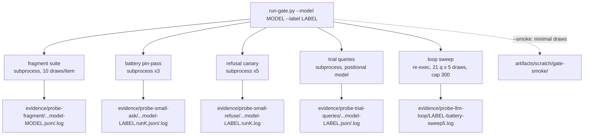

# run-gate.py — per-model gate driver notes (2026-10-14)

New harness: `artifacts/harnesses/run-gate.py`. It automates the manual
sequence that produced the x2c numbers (`x2-trial-2026-10-14.md`, "Verdict
2026-10-14"): sealed fragment suite, pin-pass battery xN, exact-refusal
canary xN, trial-queries repro, capped loop sweep — one command per model.

## Usage

```
python artifacts/harnesses/run-gate.py --model <tag> --label <name> \
    [--fragment-draws 10] [--battery-runs 3] [--refuse-runs 5] \
    [--sweep-draws 5] [--skip fragment,battery,refuse,trial,sweep]
python artifacts/harnesses/run-gate.py --smoke --model <tag>
```

Defaults match the x2c gate. `--smoke` forces minimal draws (fragment 1,
battery 1 run, refuse 1 run, sweep 1 draw) and writes every output under
`artifacts/scratch/gate-smoke/` instead of the evidence dirs. The driver
preflights Ollama (reachable + model tag present), runs each family as a
`sys.executable` subprocess with live stdio, aborts loudly on a non-zero exit
(listing evidence written so far), and prints a compact per-family summary
parsed from the probe logs.



The sweep is a faithful reimplementation of the gitignored one-off
`data/tmp_battery_sweep.py` inside the driver (battery questions from
`step2-battery.py`: 10 golden + 3 typos + 4 probes + 4 coherence, temperature
0, `num_predict=300`, counts draws ending `done_reason == "length"`); the
driver never imports the scratch file.

Canonical probe outputs (`probe-small-ask`, `probe-small-refuse`,
`probe-trial-queries`, and the fragment file in smoke mode) are snapshotted
byte-for-byte before each probe run and restored after the copies are made,
so a gate run changes no pre-existing tracked file. The fragment probe writes
its own model-suffixed evidence file directly (normal mode); refuse copies
are `.log`-only, matching the recorded x2c evidence layout.

## Smoke results (measured)

Command: `python artifacts/harnesses/run-gate.py --smoke --model smallbook_x2`
on this box, 2026-10-14 ~16:44 local; ~90 s wall clock for ~75 model calls
(scratch artifact timestamps 16:44:28–16:45:25 plus the fragment phase
before the first copy). 8 outputs under `artifacts/scratch/gate-smoke/`.

Printed summary (verbatim):

```
==================== gate summary ====================
model=smallbook_x2  label=smallbook_x2  mode=smoke
fragment  1 draw(s)/item: fragment 2/4, greeting 0/3 answ, bare-topic 2/5, order-flip 0/4, trailing-letter 1/3, control 2/2 | loops=0 errors=0
battery   1 run(s): run1 18/21 pin-pass | unique fails (3): 'When is an insert-only table useful?', 'What does CRU stand for?', 'Codd introduced the idea of what'
refuse    run1 2/2 exact
trial     answered 7/10, refused 3/10 | refused: 'warrup', 'DE Lifecycle', 'speed of ddr5s'
sweep     loops 0/21 draws (21 questions x 1)
outputs (8):
  artifacts/scratch/gate-smoke/probe-fragment-2026-10-14.model-smallbook_x2.log
  artifacts/scratch/gate-smoke/probe-fragment-2026-10-14.model-smallbook_x2.json
  artifacts/scratch/gate-smoke/probe-small-ask-2026-10-13.model-smallbook_x2.run1.log
  artifacts/scratch/gate-smoke/probe-small-ask-2026-10-13.model-smallbook_x2.run1.json
  artifacts/scratch/gate-smoke/probe-small-refuse-2026-10-13.model-smallbook_x2.run1.log
  artifacts/scratch/gate-smoke/probe-trial-queries-2026-10-14.model-smallbook_x2.log
  artifacts/scratch/gate-smoke/probe-trial-queries-2026-10-14.model-smallbook_x2.json
  artifacts/scratch/gate-smoke/probe-llm-loop-2026-10-13.smallbook_x2-battery-sweep1.log
======================================================
```

Cross-check against the recorded x2 session: battery 18/21 with the known
warts (insert-only, CRU, Codd); refusals 2/2 exact; trial refused warrup /
DE Lifecycle / speed-of-ddr5s — matches the trial table (warrup clean,
DE Lifecycle model wart, ddr5s engine plural); sweep 0 loops. The 1-draw
fragment rates sit below the recorded 10-draw ones, as expected at n=1.

A second smoke run (same command, after a diagnostics-only cleanup of the
driver) reproduced every number except one fragment draw: bare-topic 2/5 ->
3/5. Battery/refuse/trial/sweep identical. Single-draw fragment rates carry
n=1 variance across runs — the gate's real fragment read is the 10-draw run.

Invariant check (measured): after both smoke runs, `git status --short`
shows no changes under `artifacts/evidence/` — the canonical files were
restored to their committed bytes (restore rewrites the bytes, so mtimes
move; content is identical). Observed in the working tree during the same window, not touched
by the driver or any probe it ran: `M
artifacts/reports/finetune-colab-2026-10-13.ipynb` (16:41) and new
`artifacts/reports/x2d-plan-audit-2026-10-14.md` (16:44:49) — [inferred]
concurrent writer on this box.

## Known limits

1. One label drives both naming schemes: copies are
   `…model-<label>.runK…`, the sweep log is `…<label>-battery-sweep<N>.log`.
   The hand-run x2c session used `smallbook_x2c` for the copies and `x2c` for
   the sweep log, so no single `--label` reproduces both exact historical
   spellings; pick `--label smallbook_x2c`-style (model-derived) for copy
   parity. The fragment file always uses the model-derived label (the probe
   builds it itself), not `--label`.
2. Re-running the same model+label overwrites that pair's evidence in place
   (one live twin, latest run wins) — the fragment file is written directly
   by its probe in normal mode.
3. Scope is gate items 1-4 of the pre-registered list plus loops and the
   visible trial ten. It does NOT do item 5 (q8 quant re-check) or item 6
   (revert rehearsal), and it does not run the HTTP `step2-battery.py`
   battery — the battery here is the in-process ask bench, same check the
   battery makes for ask mode.
4. No driver-level timeout: a wedged call waits on the probes' own 900 s
   client timeouts (fragment retries once per draw; the sweep does not).
5. Summary parsing is anchored to the probes' current log formats. If a
   format drifts, the driver prints
   `… log parse failed — see <path>` instead of a number — visible, not silent.
6. Smoke mode still runs the fragment suite's seal check against the train
   files; if the suite is ever burned, the fragment family aborts the whole
   gate (by design).

Not yet in the artifacts index: `harnesses/run-gate.py`, this report, and the
`artifacts/scratch/gate-smoke/` outputs (scratch is gitignored; never
indexed). Add index rows for the two tracked files when they are committed.
