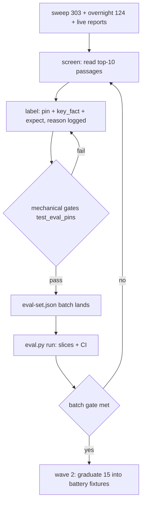

# Golden-set growth plan — 2026-10-13

Status: proposal, not approved, nothing implemented. Grows the labeled set
from 10 golden fixtures + 24 harness items to a set that can carry the
claims the ledger currently makes with wide error bars.

## Why (computed from the current readings, not measured)

Current baseline (`artifacts/eval-v1.json`, README ledger 2026-10-13):
dense recall@10 17/22, shown recall@5 22/22, MRR@10 0.708, false refusals
1/22, judged relevance 68/105 (unvalidated).

With N=22 answer items, 17/22 = 0.773 has a 95% Wald half-width of ±0.176
(computed): the set cannot tell "77%" from "60%" or "95%". The battery's
10/10 all-pass line has a Clopper-Pearson 95% lower bound of 0.741
(computed): "10/10 pass" only supports p >= 0.74.

| N | all-pass 95% lower bound (CP) | rate 95% half-width, worst case |
| --- | --- | --- |
| 10 | 0.741 | 0.31 |
| 24 | 0.883 | 0.20 |
| 29 | 0.902 | 0.18 |
| 43 | 0.933 | 0.15 |
| 59 | 0.951 | 0.13 |
| 96 | 0.969 | 0.10 |

Target shape:

| Set | Now | Target | Why |
| --- | --- | --- | --- |
| `eval-set.json` | 24 (22 answer, 2 refuse) | ~100 (82 answer, 18 refuse) | aggregate 95% half-width <= ±0.09 at the current rate |
| `eval-set-plain.json` | 10 | 20 | plain register currently has a 10-item verdict |
| golden fixtures + battery `GOLDEN_PINS` | 10 | 25 (graduated, wave 2) | all-pass claims become "p >= 0.88" not "p >= 0.74" |

Per-stratum floor: 15 items reads ±0.25 worst case, 24 reads ±0.20
(computed). Strata below target that range, not more.

## Where the questions come from (pools already in the repo)

- `qa-sweep-questions.json`: 303 questions, all answered through the engine
  (`qa-sweep-answer-overnight.json`: 31 refused, 254 coherent, citations over
  ch01–ch11 + preface, 39 with no usable citation). Primary source.
- `qa-questions-overnight.json`: 124 older questions; overlap with the
  above, use for fills.
- Existing pins: paraphrase twins (pin stays, wording varies).
- Live user reports: today they become probes; from now on each report also
  queues one candidate row.

Nothing lands unverified. The pool is candidates, not gold.

Growth strata (rough classes today -> target):

| Stratum | Now | Target |
| --- | --- | --- |
| definition / mechanism | ~10 | 30 |
| twin phrasings | 2 | 16 (8 pairs) |
| rare-word / exact term | 5 | 12 |
| list / disadvantages | ~5 | 10 |
| caption / figure | ~1 | 8 |
| acronym / typo | 3 | 8 |
| bare phrase (canonical) | ~1 | 8 |
| refusal near-miss (mention, not answer) | ~1 | 10 |
| refusal out of book | 2 | 8 |
| plain register | 10 | 20 |

## Labeling protocol (the part that keeps gold honest)

1. Screen: for each candidate, read the dense top-10 and shown passages.
2. Pin: choose the canonical answering passage(s) from the book text alone —
   never from what the current model answered — with a one-line reason.
3. `key_fact`: verbatim substring from the gold passage, regex-escaped.
   Expected refusals record the near-miss chunk considered and the rejection
   reason (refusal-mining v2 precedent).
4. Verify: mechanical gates first, then an independent re-check
   (pattern: `probe-finetune-verify-2026-10-13.py`).
5. Land: append to `eval-set.json` with its `source` tag; `eval.py` already
   says no other edit is needed for a row.

## Mechanical gates (new test; currently missing)

`tests/test_eval_pins.py`:

- every gold chunk id exists in `data/index.json`;
- every `key_fact` matches the text of at least one gold chunk (re.I);
- no duplicate questions (normalized);
- `expect=refuse` rows carry no gold and no key_fact;
- print a per-source count report (batch accounting).

Today nothing checks the 24 pins; a silent re-chunk drift would be invisible
(precedent: 4 ids moved on 2026-10-12). This test is the guard.

## Harness additions (small; keeps metrics separate)

- per-slice report: metrics grouped by source / class / chapter — the
  dashboard grows lines, not columns; still no blended score;
- print the 95% half-width next to each metric (a batch can be judged as
  worth it or not);
- `--repeat N` for borderline generation items (judge flips ±1-2 are
  measured; single draws stay labeled as such).

## Rollout — 4 batches, each its own commit + eval run

| Batch | Source | Adds | Gate |
| --- | --- | --- | --- |
| 1 | sweep coherent answers, stratified by chapter + question shape | ~26 answer | pin test green; first eval run; before/after table in one artifact |
| 2 | the 31 sweep refusals + guard-word refusals, labeled near-miss vs out-of-book | ~18 refuse | refusal classes reported separately |
| 3 | captions / rare words / lists / twins built from index metadata | ~26 | slice report: every class >= 8 |
| 4 | live reports + `known_issue` promotions + chapter fill | ~6 + graduation | >= 3 items per chapter; 15 fixtures graduated |

Graduation (after batch 4, separate approval): 15 items move into
`tests/fixtures/questions.json`, battery `GOLDEN_PINS`, and the demo sheet
is re-measured in the same commit. The battery then distinguishes >= 0.88
from 1.0 instead of >= 0.74. Until then the battery stays as it is.
Falsifiable plan-level check: aggregate dense-recall half-width must fall
from ±0.176 (22 items) to <= ±0.09 (82 items) at the same rate.

## Rules that do not change

- Eval set stays held out: tuning happens on the sweep. A failing eval item
  is a diagnosis, not a target; constants stay mechanism-justified.
- Add-only pins: a pin moves only when the book text or chunking moves, and
  then it is re-measured in the same commit (demo-sheet precedent).
- Finetune hygiene is inherited: `source: eval-*` routes to bench in
  `build-finetune-data` `split_for`, so every new item auto-excludes from
  training.
- No synthetic-only questions; the book text is the ground truth.

## Cost (estimates, marked as estimates)

- Eval runtime scales linearly with N. Warm asks run 0.4-1.2 s each per the
  battery profile, so 100 items is minutes, plus the judge phase; the real
  number gets measured on batch 1 and recorded.
- Labeling is the expensive part: minutes per item (read, pick pin, write
  regex, reason). Four batches keep review bounded; the 303-question pool
  supports further growth later without new generation.
- Risk register: judge nondeterminism (measured, ±1-2 borderline) -> repeats
  on borderline items; labeler drift -> pin test + independent verify; gold
  inflation -> the book-first rule.

## Flow

## Next step

Say yes to batch 1 (or a different N / strata split) and the first commit
is: `tests/test_eval_pins.py` + the batch-1 candidate list from
`qa-sweep-questions.json` with its screening sheet — no pins written until
the gates exist.
