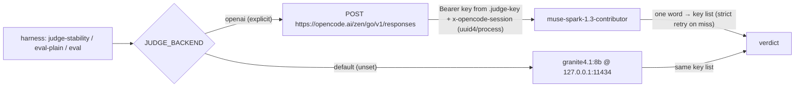

# Judge status — 2026-10-14: cloud judge wired, one-call end-to-end proof

**Verdict: the Muse relay is still wired.** Both judges answered today: the
offline default (`granite4.1:8b` via Ollama) and the opt-in cloud judge
(`muse-spark-1.3-contributor` on the OpenCode Zen/Go relay), each through the
existing `judge-stability.py` harness, one item, one draw, no retries observed,
no errors. Repo HEAD `4972adf`; nothing in `data/`, `books/`, or `.judge-key`
was touched; the key was never printed.



## 1. Config as coded [measured, `artifacts/harnesses/judge.py` @ 4972adf]

| Env var | Default in code | Needed for the Muse relay |
| --- | --- | --- |
| `JUDGE_BACKEND` | `ollama` (L38) | `openai` (explicit; hard rule — engine never takes this path) |
| `JUDGE_MODEL` | `granite4.1:8b` if backend is ollama, else `""` (L39-41) | `muse-spark-1.3-contributor` (required; empty model raises) |
| `JUDGE_BASE_URL` | `https://api.openai.com/v1` (L42) | `https://opencode.ai/zen/go/v1` (must be set, or you call OpenAI) |
| `JUDGE_WIRE` | `chat` (L43) | `responses` (muse serves `/responses` only, L10-12; suffix chosen L170-172) |
| `JUDGE_REASONING` | `minimal` (L44) → `reasoning.effort` (L156-157) | leave default |
| `JUDGE_MAX_OUTPUT` | `2048` (L45) | leave default |
| key | `JUDGE_API_KEY`, else `JUDGE_API_KEY_FILE` path read per call (L116-123) | `JUDGE_API_KEY_FILE=.judge-key` |
| session header | auto `uuid4()` per process **iff** base URL contains `opencode.ai` (L133-138); override `JUDGE_OPENCODE_SESSION` | automatic |

Retry/timeout shape (L190-221, L242-260): one transient retry (429/500/502/503/504, URLError,
TimeoutError; `CLOUD_TIMEOUT = 60.0` per attempt) plus one strict-prompt retry when a reply
misses the key list — worst case 4 HTTP requests per verdict, typical 1. A miss is real
(motivation comment: 19/20 Muse fidelity replies paraphrased past the key list, measured
2026-10-13). Missing key with `JUDGE_BACKEND=openai` fails closed with
`set JUDGE_API_KEY or JUDGE_API_KEY_FILE for JUDGE_BACKEND=openai` (L194-197).

`.judge-key` [measured 2026-10-14]: exists, 67 bytes, `git check-ignore` → `.gitignore:9:.judge-key`.
Path is relative to cwd — run from the repo root.

## 2. The exact invocation [measured from code; AGENTS.md "Verify" agrees]

Flip probe (this report's smoke; docstring `judge-stability.py` L11-17, bare basename
auto-found under `artifacts/evidence/*/` L48-54):

```
JUDGE_BACKEND=openai JUDGE_WIRE=responses JUDGE_MODEL=muse-spark-1.3-contributor \
JUDGE_BASE_URL=https://opencode.ai/zen/go/v1 JUDGE_API_KEY_FILE=.judge-key \
python artifacts/harnesses/judge-stability.py \
    --file eval-plain-v6-openai-muse-spark-1-3-contributor.json --match "<substring>" --n 1
```

Full plain scorecard (docstring `eval-plain.py` L24-29): same env, then
`python artifacts/harnesses/eval-plain.py --variants wired --label wired`
(replay = same with a new `--label`). Labeled-set judge-only replay
(AGENTS.md L832-833; use *this* line — `eval.py`'s own docstring L25-29 shows
`JUDGE_API_KEY=<k>` inline and omits `JUDGE_WIRE=responses`, which would hit
`/chat/completions` and fail on this relay): same env, then
`python artifacts/harnesses/eval.py --judge-only --label v1`.
Local default: the same commands with no env → `ollama:granite4.1:8b`, offline.

## 3. Smoke runs (2026-10-14, identical command, one item, one draw)

Pre-step [measured]: `/api/ps` showed no loaded models; loaded granite via
`POST /api/generate` (load_duration 21.9 s) because the harness caps each judge
call at 60 s and the cold load alone would eat it. Not a judge call.

Offline [measured]:

```
$ time python artifacts/harnesses/judge-stability.py \
    --file eval-plain-v6-openai-muse-spark-1-3-contributor.json --match "data ingestion" --n 1
judge ollama:granite4.1:8b | file eval-plain-v6-openai-muse-spark-1-3-contributor.json | n 1
explain data ingestion in simple words         paraphrase supported 1/1 ['supported']

real    0m3.254s
```

Cloud [measured]:

```
$ time env JUDGE_BACKEND=openai JUDGE_WIRE=responses JUDGE_MODEL=muse-spark-1.3-contributor \
    JUDGE_BASE_URL=https://opencode.ai/zen/go/v1 JUDGE_API_KEY_FILE=.judge-key \
    python artifacts/harnesses/judge-stability.py \
    --file eval-plain-v6-openai-muse-spark-1-3-contributor.json --match "data ingestion" --n 1
judge openai:muse-spark-1.3-contributor | file eval-plain-v6-openai-muse-spark-1-3-contributor.json | n 1
explain data ingestion in simple words         paraphrase supported 0/1 ['unsupported']

real    0m3.346s
```

Wall clock includes local index load + retrieval; the harness prints no internal
timing, so the cloud round trip is not isolated [inferred]. One deviation from
the task's example command, documented: `--match ingestion` matches **2** of the
10 v6 questions ("data ingestion" and "streaming ingestion", measured by
enumerating the file), so both runs used `--match "data ingestion"` to hold
"exactly one item, one draw". Verdicts differ (granite `supported` vs muse
`unsupported` at n=1) on the item the evidence already labels ~50% borderline
(below) — that is the known noise, not a relay finding. Whether the harness's
strict retry fired is not observable from its output; both runs finished in one
verdict.

## 4. What the stored Muse evidence says [measured; dates noted]

- `evidence/judge-stability/judge-stability-all-wired.txt` (2026-10-13, header
  `judge openai:muse-spark-1.3-contributor | ... | n 3`, 10 questions × 3 draws
  = 30 calls): 6 stable-supported, 3 stable-unsupported (batch/streaming, CRUD,
  insert-only — each 0/3, the judge stably catching concrete rewriter errors),
  1 borderline: data ingestion 2/3 `['unsupported', 'supported', 'supported']`.
- `evidence/eval-plain/` Muse draws (heads read): v6 probe assembly 8/10;
  post-wiring wired 6/10, replay 7/10; post-fragment-fix quotealign 9/10,
  quotealign2 8/10 — all `judge errors 0`. v4/v4b are the kept
  invalidated-run evidence (v4 `plain3` 0/10, judge errors 9 — diagnostic, not
  a record).
- Background, as recorded in AGENTS.md 2026-10-13 (not re-verified today):
  granite-vs-Muse agreement 86/105 on relevance, 1/1 key facts; graded 0-3
  scale does not transfer across judges; cloud judge is the calibration
  reference, local granite stays the loop default.

## 5. Recommendation on a ≥2-draw Muse scorecard; gate untouched

The judge is deliberately **not** in the pre-registered swap gate
(`reports/x2-trial-2026-10-14.md` L47-70: refusals, sealed fragment suite,
loops, battery pins, quant check, revert rehearsal — six objective items, no
judge). **Do not change the gate.**

Recommendation: **do not add a Muse scorecard to the swap evidence as a gate
input.** Reasons: (a) measured nondeterminism makes single draws ±1-2
borderline items and even a ≥2-draw mean a soft number; (b) the Muse draws
measured the plain register's assembly, not x2's refusals/loops/fragments, so
it answers a different question than the gate asks; (c) a 2-draw wired
scorecard costs ~40 verdict calls plus retries for non-gating color. Optional,
non-gating: if the plain-register record needs a fresh number under the new
app default (`smallbook_x2` flipped 2026-10-14), a ≥2-draw wired scorecard with
the borderline item flagged is the honest format — but the proposed local
one-in-one-out rewrite check remains the better gate-adjacent tool.

Limits: n=1 per family today; the verdict difference is noise-sized; nothing
here validates verdicts against human labels (they remain unvalidated, per
`judge.py`).
