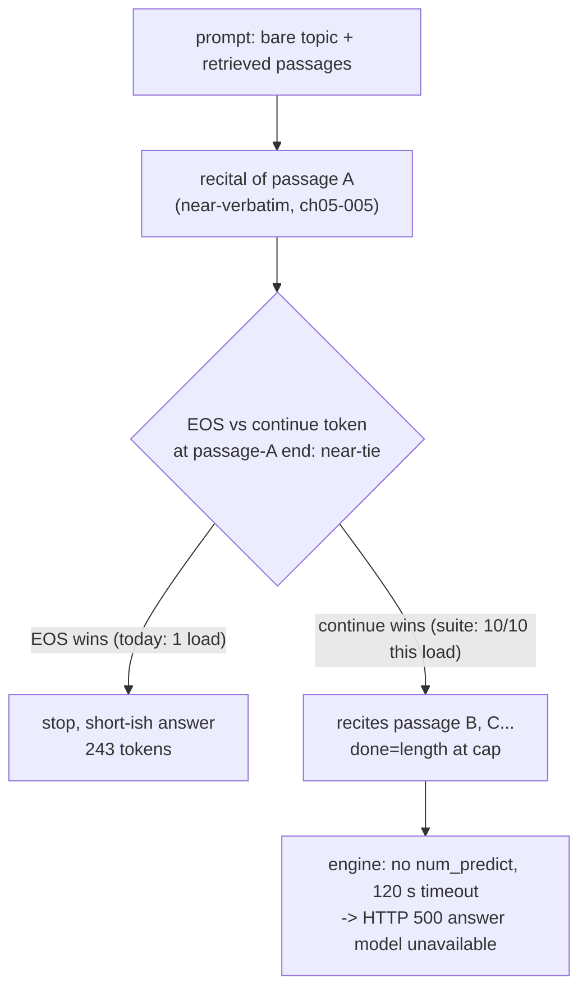

# Loop-mechanism analysis — smallbook_x2 "loop" class (2026-10-14)

Failure-mode forensics. One bounded live generation was spent (task allowance);
everything else is transcript/config forensics. All claims `[measured]`
(artifact + command named) or `[inferred]`. No engine file changed.

Inputs: `artifacts/reports/x2-trial-2026-10-14.md`,
`artifacts/reports/smallbook_x2-rebuild-2026-10-14.md`,
`artifacts/reports/smallbook_x2-model-card.md`,
`artifacts/reports/engine-edges-2026-10-14.md`,
`artifacts/evidence/probe-fragment/probe-fragment-2026-10-14.model-smallbook_x2.{json,log}`
(and `.model-qwen2.5-7b.*`), `artifacts/evidence/probe-llm-loop/*`,
`data/finetune/quote-refuse-2026-10-13.train.jsonl`,
`artifacts/reports/finetune-colab-2026-10-13.ipynb`, `ollama show` dumps.

## Verdict (ranked)

1. **Termination-margin failure, not repetition.** In the one x2 transcript that
   exists, the "loop" is a *context recital* that reaches the cap because the
   EOS decision at a passage boundary is a near-tie that the model loses.
   `[measured]`
2. **Run-to-run/branch variance beats any dose-response story.** The ×1/×2/×3
   refusal-repeat pattern is non-monotone and confounded by separate training
   runs and a floating toolchain. `[measured inputs, inferred ranking]`
3. **Template/stop mismatch at the Ollama export — contradicted for x2.** The
   served template and stop set are byte-identical to `qwen2.5:7b`'s, and stops
   demonstrably work on 158/168 battery draws and 20/21 suite items. `[measured]`
4. **Sampler path — rejected as the fix** (already measured: 10–40% under every
   tested temperature/penalty); it survives only as a *noise source*. `[measured]`

## The transcript (the key artifact)

`probe-fragment-2026-10-14.model-smallbook_x2.json`, item `File Formats`
(bare topic → canonical `What is File Formats?`), 10 draws:

- 10/10 `done=length` at the 300-token cap, 1346 generated chars each,
  **byte-identical across all 10 draws**, 4.1–8.9 s. Citations
  `[ch05-005, ch06-026]`. Log: `=> ... loops 10/10 -> PASS`.
- The text is a near-verbatim recital of retrieved chunk **ch05-005**
  (`Files and Unstructured Data`, 1090 chars; difflib ratio 0.825 over the
  whole output) — e.g. `Files in [Ch. 5] are described as a sequence of
  bytes, typically stored on a disk...` — and then glides into ch06-026:
  `...Chapter 6 covers the technical details of files. [Ch. 6] defines a
  file as a finite-length stream of bytes... Object storage behaves much
  like file storage but` (truncated mid-sentence at the cap). `[measured]`
- **No repetition**: max count for any repeated 10/12/20/30-gram = 1.
  "Loop" in every harness here is defined as `done_reason == "length"`
  (`probe-fragment-2026-10-14.py:247`), which this item satisfies without
  any textual looping. `[measured]`
- The recital is **not a memorized training target**: no train row cites
  ch05-005, and the distinctive phrases `universal medium of data exchange`
  / `source file formats` / `spotlight` appear in **0** train rows — the
  source is the prompt's retrieved context. `[measured]`
- Control: `qwen2.5:7b` on the identical item stops 3/3 in 474–485 chars
  with a glossed summary. `[measured]`

## The one live diagnostic (run, 2026-10-14)

Same seam (`A.respond`), same item, cap raised 300 → 2048, HTTP bound 110 s
(`artifacts/scratch/loop-continue-2026-10-14.{py,json}`):

`calls: [{'call': 'main', 'done': 'stop', 'chars': 1084, 's': 14.0,
'n_ctx_used_hint': 1333, 'eval_count': 243}]`

- It **stopped naturally at token 243** — the recital ends exactly at
  ch05-005's final sentence (`Chapter 6 covers the technical details of
  files.`), ratio 0.971 to ch05-005. Same prompt, same opening (identical
  through char 1084 except one token: `we'll` here vs `we’ll` in the suite),
  then EOS won here while the suite continued with `[Ch. 6] defines...`.
  `[measured]`
- So "10/10 deterministic" was a property of that model-load window, not a
  stable law: a single draw proves nothing (the repo already recorded 288-vs-
  296-char temp-0 draws and sampler-rate swings; the apostrophe flip shows the
  same micro-nondeterminism here). This is why the branch flips between model
  loads, and why x2c/x3 "loop rates" are non-monotone. `[measured; mechanism inferred]`
- What it does **not** show: how far the *continue* branch runs uncapped.
  The engine sends `options: {"temperature": 0}` only, no `num_predict`
  (`answer.py:110-126`), and a non-stopping generation is a hard HTTP 500
  `{"error": "answer model unavailable"}` after the 120 s socket timeout
  (`server.py:122-123`) — the observed live hang. I did not reproduce the
  120 s hang itself. `[code measured; hang user-observed]`

## Evidence by hypothesis

### (b) training-side termination calibration — leading, with a caveat
- For: all failures are *non-emitted EOS*; only the finetuned model does it
  (7B stops on the same item, same served template/stops); the branch is a
  razor-thin margin (above), exactly what a miscalibrated stop head produces.
- For: the training format teaches "short quote + one-line gloss" but nothing
  about bounding an enumeration passage; the notebook stop-check tests
  `dataset[0]` — an *exact training prompt* — with `max_new_tokens=250` and
  "looks sane if < 250" (`finetune-colab-2026-10-13.ipynb` cell 4), so this
  class is structurally invisible to it. 167 rows / 120 steps ≈ 1.4 epochs;
  54/167 targets are the byte-identical `Not in this book.` (27 unique ×2).
  `[measured]`
- Against a dose-response reading: ×1 loops on insert-only (10/10, x1 log),
  ×2 is clean on the battery but 10/10 on File Formats, ×3 loops 10–40%
  (loop-eval tables) — three different training runs, toolchain floating
  (`!pip install -q "unsloth==2026.10.5" ... || pip install -q unsloth`).
  `[measured]`
- Nuance: the x2 battery's `0/168` draws is *class coverage*, not model
  health: the 21-question battery contains no File-Formats-shaped
  enumeration item; the sealed suite is its first 10-draw coverage — and the
  harness still printed `PASS` at `loops 10/10` (`verdict()` ignores loops).
  `[measured]`

### (a) chat-template/stop mismatch — low, contradicted
- `ollama show smallbook_x2 --modelfile` vs `qwen2.5:7b --modelfile`: the
  TEMPLATE blocks are **byte-identical** (1497 chars each; same
  `<|im_start|>` chatml with tools stub and generation prompt), SYSTEM equal,
  x2 carries `stop <|im_end|>` + `stop <|endoftext|>`. The seam sets
  temperature 0 per request; the import defaults (`min_p 0.1`,
  `temperature 1.5`) are irrelevant at greedy. `[measured]`
- A stop break would be prompt-independent; instead stops fire on 158/168
  battery draws and 20/21 suite items, and the teacher under the same
  template stops on this very item. Residual unverifiable leg: the GGUF's
  embedded template bytes vs the HF training tokenizer's (no HF stack on this
  box, stdlib-only) `[not measured]` — but it could not explain the
  prompt-selectivity anyway; rank stays low.

### (c) sampler path — rejected as fix
Recorded: 1–4/10 loops across temp 0.1–0.3, repeat_penalty 1.1/1.3,
presence_penalty 0.5; one rp-1.3 draw produced a Chinese-tail distortion;
"no tested sampler setting removes the loops ... rates stay 10–40%". Keep as
the explanation of one-sided draw counts, not as remedy. `[measured]`

### (d) prompt-echo / insert-only expectations — absorbed into (1)
The evidence (context recital, boundary near-tie, "Asked as" trailer trail)
shows the model is in echo-the-passage mode on this item; the insert-only
failure is the same family (x1's 10/10 length runs at ~1567 chars have no
transcript — the old harness counted only; x2 now stops on insert-only but
still cites the wrong chunk, ch08-107 vs pin ch05-020). `[measured]`

## Mitigation for the x2c / q8_0 A/B

1. **Engine (independent of training; the backlog "no-output-cap" item):**
   send a `num_predict` cap in `answer.ollama_generate` so a non-stopping
   generation degrades to a truncated answer instead of a 120 s hang →
   HTTP 500. Value unmeasured — the suite's 300-token cap (≈1346 chars)
   already bounds every recorded draw; pick from real answer lengths and
   mark truncation. `[inferred]`
2. **Gate hygiene (before x2c is judged):** `verdict()` in
   `probe-fragment-2026-10-14.py` must fail on `loops > 0` (it currently
   prints PASS at 10/10); loop claims need ≥10 draws *after a fresh model
   load* and across ≥2 loads (today's 1/1 stop vs 10/10 is the proof);
   include an enumeration-bare-topic item set (File Formats shape) in the
   per-candidate run, and run it on **both x2c zips** (q4_K_M and q8_0) —
   gate item 5's quant A/B is exactly this: a near-tie amplified by q4 noise
   will widen at q8_0, and that is a quantization verdict, not a training one.
3. **Training A/B candidate (only if 2 shows x2c still recites):** add rows
   whose target quotes a *long* passage and then ends (gloss + stop) — a
   termination-boundary demonstration the current format lacks. An app-side
   SYSTEM reminder ("quote at most N sentences") is a contract change and
   belongs in a separate both-models A/B, not in x2c. Do not train on any
   sealed-suite item. `[inferred]`

## Not measured / open

- Logit-level margin at the branch token (no logprobs path verified on this
  Ollama build).
- How many chunks the continue branch recites before a natural stop (one
  generation was spent; the engine hang is consistent with several, but the
  unbounded trajectory was not captured).
- x1/x3 loop texts (never recorded) — cannot type them as recital vs
  repetition.
- GGUF metadata template bytes; HF tokenizer equality.

Artifacts: report here; raw live run `artifacts/scratch/loop-continue-2026-10-14.{py,json}`;
suite transcript `artifacts/evidence/probe-fragment/probe-fragment-2026-10-14.model-smallbook_x2.{json,log}`.
