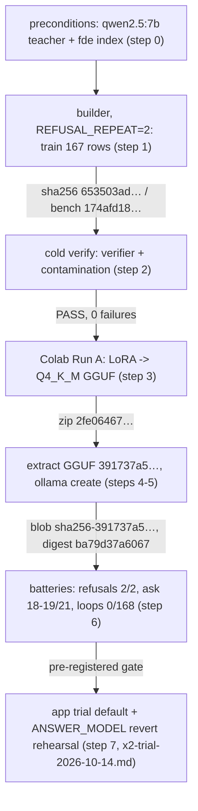

# smallbook_x2 — rebuild recipe (2026-10-14)

The 6-months-from-now reproduction path for the trial-default model. Hash
chain and toolchain: `smallbook_x2-provenance-2026-10-14.md` ("provenance"
below). Commands run from the repo root.

Recorded toolchain (provenance "Toolchain"): Unsloth 2026.10.5, Transformers
5.17.0, Torch 2.11.0+cu130, Triton 3.6.0, A100-40GB. The notebook floats
today (`!pip install -q unsloth` in `finetune-colab-2026-10-13.ipynb`). A
parallel edit may pin `unsloth==2026.10.5` / `transformers==5.17.0` — check
the install cell at rebuild time; if it still floats, pin it yourself and
print the versions in the run output. GGUF bytes depend on the
Unsloth/llama.cpp build; hash match is only expected on the pinned toolchain.

## 0. Preconditions

- `qwen2.5:7b` on disk (teacher; `ollama list` digest `845dbda0ea48`,
  4.7 GB, checked 2026-10-14).
- Book ingested once: `books/` source + `data/index.json` for book_id `fde`
  (AGENTS.md phases 0-3). The builder quotes from this index.
- Preserve recorded evidence first: the builder and probes overwrite fixed
  names (`artifacts/finetune-data-prep-2026-10-13.log`,
  `artifacts/probe-finetune-verify-2026-10-13.{log,json}`,
  `artifacts/probe-contamination-2026-10-14.{log,json}`,
  `artifacts/probe-small-ask-2026-10-13.{log,json}`,
  `artifacts/probe-small-refuse-2026-10-13.{log,json}`). Copy them aside.

## 1. Rebuild the dataset (x2 variant)

1. In `artifacts/build-finetune-data-2026-10-13.py` set
   `REFUSAL_REPEAT = 2` (the committed default is 1; x2 is the repeat-2 build).
2. `python artifacts/build-finetune-data-2026-10-13.py`
   (teacher `qwen2.5:7b` at temperature 0 through the shipped seam; writes
   `data/finetune/quote-refuse-2026-10-13.train.jsonl` and `.bench.jsonl`).
3. Expected outputs (hashes from the provenance table):
   - train.jsonl, 167 rows (113 answer / 54 refusal) — sha256
     `653503ad257328a02f47ecaec0ab991eae2e952d6210b459e46a28f805cef92c`;
     copy it to `quote-refuse-2026-10-13.train-x2.jsonl` (the name the
     notebook expects) and keep it as the canonical `train.jsonl`.
   - bench.jsonl, 45 rows (43 / 2) — sha256
     `174afd18c4dff3ea6e7f95e53806101f35dc3c4d389d7d16f6d7e6a4305172ed`.
4. If hashes differ: diff row counts/tiers first (167 = 113 + 54; bench
   45 = 43 + 2) and stop before training. The record says the temp-0 teacher
   run is deterministic (data-prep "Limits"); drift means teacher or inputs
   changed.
5. Optional rejected control (x1): `REFUSAL_REPEAT = 1` → 140 rows, sha256
   `5c622c4a3539377bf29f54a2bbf061fa00b6a1df2c5316bf44de31bdaa414416`.

## 2. Verify the files cold (before training)

- `python artifacts/probe-finetune-verify-2026-10-13.py` → expect PASS,
  0 failures: train 167 (113 / 54), bench 45 (43 / 2), overlap 0
  (x2 numbers, data-prep "Session results").
- `python artifacts/probe-contamination-2026-10-14.py` → expect exact 0;
  4 near-twins (data ingestion 1.00, enterprise architecture 1.00,
  pragmatic 0.93/0.89, codd 0.93); 9 pairs ≥ 0.80 overall (recorded log).

## 3. Train and export (Colab — the only cloud step)

- Notebook `artifacts/finetune-colab-2026-10-13.ipynb`; Runtime A100-40GB
  (L4 fallback; recorded session ran A100).
- Upload `quote-refuse-2026-10-13.train-x2.jsonl`; run Run A only:
  base `unsloth/Qwen2.5-3B-Instruct-bnb-4bit` → export `smallbook_x2`.
- Watch the trainer banner: "Num examples" must read 167 (a `max_length`
  regression silently dropped 152/167 rows once); the stop-check cell must
  pass before export.
- Export: `save_pretrained_gguf(..., quantization_method="q4_k_m")` →
  `smallbook_x2_gguf.zip` download.
- Record the zip's `sha256sum` in the run output — missing from the
  recorded run (provenance "Missing from the record").

## 4. Hash and import into Ollama

- zip sha256: expect
  `2fe06467cbb55bdec93a65666d9316f5513ee1a12465dfd4f6b34528af205030`
  (recorded post-download on the working box). Extract; the GGUF is
  1,929,902,592 bytes with sha256
  `391737a5ca1cfffff2e647b20a3eae364c7f368f9c60e726384c388070dae71a`.
- Modelfile in `data/models/smallbook_x2_gguf/` with
  `FROM <absolute path to the extracted GGUF>` (the recorded Modelfile was
  hand-patched to an absolute path), then:
  `ollama create smallbook_x2 -f data/models/smallbook_x2_gguf/Modelfile`
- Check: `ollama show smallbook_x2 --modelfile` FROM must read
  `sha256-391737a5…`; `ollama list` digest `ba79d37a6067`.
- Served Modelfile captured 2026-10-14 via `ollama show`: Qwen chat TEMPLATE,
  SYSTEM "You are Qwen, created by Alibaba Cloud…", stops
  `<|im_end|>` / `<|endoftext|>`, `min_p 0.1`, `temperature 1.5` (an import
  default; the app seam sets its own sampler per request, temperature 0).

## 5. Verification commands and expected outputs (recorded x2 values)

| command | expect |
|---|---|
| `python artifacts/probe-small-refuse-2026-10-13.py --model smallbook_x2` | `2/2 exact refusals` (France, iops) |
| `python artifacts/probe-small-ask-2026-10-13.py --model smallbook_x2` | `18-19/21 pin-pass`; fails: insert-only + Codd every recording, CRU in two of three |
| `python artifacts/probe-llm-loop-2026-10-13.py smallbook_x2 "What do source systems provide to the rest of the lifecycle?" 300 '{"temperature": 0, "num_predict": 300}' 10` | `length-stops (loops): 0/10` |
| full loop sweep: same per-question command over all 21 battery questions, x3 then x5 draws | `TOTAL loops: 0 out of 168 draws` |
| `python artifacts/probe-finetune-verify-2026-10-13.py` | PASS: 167 (113/54) / 45 (43/2), overlap 0 |
| `python artifacts/probe-contamination-2026-10-14.py` | 0 exact; 4 near-twins (assisted) |
| `ANSWER_MODEL=smallbook_x2 python server.py` + `GET /health` | ready; then judge against the pre-registered gate in `x2-trial-2026-10-14.md` (6 conditions) |
| revert rehearsal: `ANSWER_MODEL=qwen2.5:7b python server.py` + battery | starts and passes once (gate item 6) |
