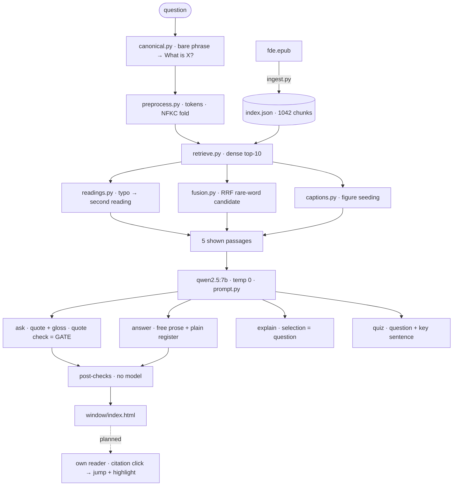

# System map — ask-this-book, 2026-10-13

One screen for the whole machine. Solid arrows are landed; dashed is planned
(not approved). Diagrams here are mermaid, per the repo rule — no ASCII
sketches. Numbers are as of this date; re-check the gates before trusting
them (artifacts policy, staleness gate).

## Gates (every commit)

| Gate | Number, 2026-10-13 |
| --- | --- |
| `tests/` | 210 green |
| `step2-battery.py` (ask + answer) | golden 10/10 · typos · probes · coherence · France |
| `eval.py` + `eval-set.json` (24 items) | recall@10 17/22 · shown@5 22/22 · MRR 0.708 |
| `eval-plain.py` (10 items) | draws 9/10, 8/10 (post fragment fix) |
| `judge.py` + `judge-stability.py` | agreement 86/105 · borderline verdicts flip ~1/3 |
| `groundedness.py` | support meter (measured, not gated) |

## Parked

`agentic.py` + `multihop-*` — measured no win; the next lever is decision
policy, not tool reach. Not wired.

## Models

| Job | Model | Note |
| --- | --- | --- |
| Embed | `nomic-embed-text` | bake-off winner |
| Answer | `qwen2.5:7b` | bake-off verdict: no swap |
| Judge | `granite4.1:8b` local / muse spark cloud | local default / release judge |
| Finetune | `smallbook` (writer track, in flight) | v1 rambles; v2/v3 stop clean, bench 19/21 pins against the 7B's 21/21, refusals lost — dataset regenerated. Numbers quoted from the writer's pending notes; fold into this map when their commit lands |
