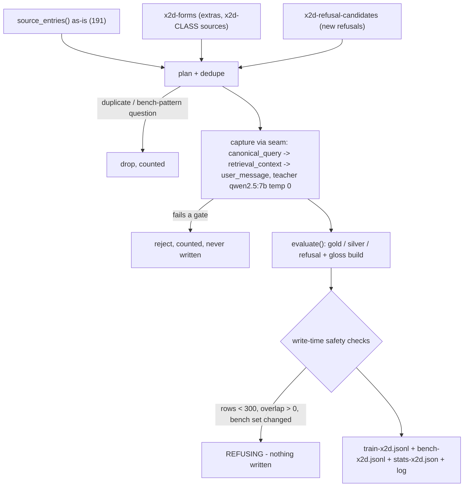

# x2d dataset builder — design notes + orchestrator runbook (2026-10-14)

Deliverable: `artifacts/probes/build-finetune-x2d-2026-10-14.py` — the x2d
dataset builder. It imports the 2026-10-13 reference builder via importlib
(`source_entries()`, `capture()`, `evaluate()`, `split_for()`,
`TEACHER_MODEL`, `REFUSAL_CANDIDATES`, `PERTURB_SWAPS`, `BENCH_PATTERNS`,
`SYSTEM`, `PARAPHRASE_SYSTEM`) and captures every row through the shipped
seam (teacher `qwen2.5:7b`, temperature 0). The real build was NOT run here;
the orchestrator runs it.

## What x2d changes vs the reference

- **No in-place swaps.** Source entries are captured as-is; the swap forms
  arrive as extras from `data/finetune/x2d-forms-2026-10-14.json` (class
  `swap`) and are appended after the source entries. Both the original and
  the perturbed form stay in training.
- **Refusals: one row per question.** The kept reference refusals (28
  candidates, 27 kept when last measured) plus the new questions from
  `data/finetune/x2d-refusal-candidates.json`, deduped, no `REFUSAL_REPEAT`
  oversampling.
- **Answer rows = kept train-source answers + kept extras.** An extra failing
  any acceptance gate (teacher refusal, no citation, non-verbatim quote,
  hard-pin miss, gloss failure, target shape, malformed input item) is
  rejected and counted, never written.



## Modes and write-time safety

- `--dry-run` — loads inputs, plans, prints entries by source/class,
  projected rows, the bench-set diff and overlap counts. No index load, no
  teacher calls, nothing written. Exit 1 on any structural problem.
- `--limit N` — captures the first N planned entries through the seam,
  prints a preview, writes nothing (also exits early after 3 consecutive
  capture errors, e.g. Ollama down).
- `--stub-inputs DIR` — reads the two x2d inputs from DIR instead; allowed
  only with `--dry-run`/`--limit` (a stubbed dataset can never be written).
- The real build refuses to write (prints `REFUSING: …`, exit 1, disk
  untouched) when: an input file is missing; the planned ceiling is below
  300; captured total rows < 300; train/bench question overlap != 0;
  duplicate questions within a split; or the built bench question set !=
  the current `bench.jsonl` question set. No other file is ever written.

## What was tested here [measured]

The two input files did not exist yet at test time (`data/finetune/x2d*`
absent), so both specified tests ran:

1. **Real-state dry-run** — guard message, exit 1:
   `REFUSING: missing input file: data\finetune\x2d-forms-2026-10-14.json
   (x2d extra answer cards) — for a plumbing dry-run before the file exists,
   use --dry-run --stub-inputs DIR`
2. **Stub dry-run** (`--dry-run --stub-inputs
   artifacts/runs/x2d-dry-run-stubs-2026-10-14`, five forms incl. one
   malformed, three refusals incl. one duplicate) — exercises drop paths
   (duplicate, bench-protected, malformed), the bench projection
   (46 planned − 1 previous capture reject = 45 = file) and exits 0:

```text
x2d builder — DRY RUN (no index load, no teacher calls, nothing written)
STUB INPUT MODE — the two x2d inputs are stubs from artifacts\runs\x2d-dry-run-stubs-2026-10-14 (plumbing test only)
inputs: forms=...\x2d-forms-2026-10-14.json (5 items), refusals=...\x2d-refusal-candidates.json (3 items)
source entries as-is (no PERTURB_SWAPS applied): 191  [reference refusal candidates: 28]
entries by source/class: {'class-variant': 8, 'eval-battery-golden': 10, 'eval-battery-probe': 5, 'eval-battery-typo': 3, 'eval-coherence': 3, 'eval-plain': 10, 'eval-refusal': 3, 'refusal-mined': 28, 'sweep-bare': 30, 'sweep-list': 10, 'sweep-quiz': 10, 'sweep-subject-first': 13, 'sweep-what-is': 58, 'x2d-lowercase': 1, 'x2d-refusal-mined': 2, 'x2d-swap': 1}
extras kept: 2 of 5 forms (drops: {'extras-bench-protected': 1, 'extras-duplicate': 1}; malformed: 1)  by class: {'x2d-lowercase': 1, 'x2d-swap': 1}
new refusal candidates kept: 2 of 3 (drops: {'new-refusal-duplicate': 1}; malformed: 0)
planned entries: 195 — train 149 (119 answer + 30 refusal), bench 46
projected rows ceiling: 195 (previous build (quote-refuse-2026-10-13.stats-x2c.json): 191 planned -> 6 rejects; capture rejects reduce the total)
row floor: MIN_TOTAL_ROWS=300 — ceiling BELOW — a real build on these inputs would refuse
PERTURB_SWAPS swap forms among kept extras: 2 of 24 (report only; extras are the forms agent's set)
extras diagnostics: source_card missing 0, pin/soft mismatch vs source card 0, asked_probe mismatch 0
bench-set diff vs quote-refuse-2026-10-13.bench.jsonl (45 questions):
  previous bench capture rejects excluded: 1 ['explain transformations in simple words']
  projected bench questions: 45; missing from projection: 0 []; extra: 0 [] -> MATCH
train/bench question overlap: 0 []
duplicate questions within train entries: 0; within bench entries: 0
same-asked forms (case-folded, informational): 2 groups
dry-run verdict: CLEAN
note: stub mode exercises plumbing only; the floor check engages on the real inputs
```

3. **Bonus, not requested:** `--limit 3 --stub-inputs …` captured the first
   three planned entries (eval battery questions) through the seam — gold
   `What does CRUD stand for?` ch05-019, `What is data ingestion?` ch07-002,
   `What is a watermark?` ch08-039 — and wrote nothing (outputs verified
   absent; `git status` unchanged by the runs).
4. `python -m py_compile` passes. Arg guards measured: `--stub-inputs`
   without a preview mode and `--dry-run --limit 3` both refuse, exit 1.

Measured repo facts used by the checks [measured 2026-10-14, this box]:
source entries 191 (161 answer-expect / 30 refusal-expect) → split train 145,
bench 46; current `bench.jsonl` 45 questions (42 gold / 1 silver / 2 refusal);
canonical train/bench are byte-identical to their `-x2` copies
(sha256 `653503ad…` / `174afd18…`); Ollama 11434 serves `qwen2.5:7b`.

## Exactly what the orchestrator must run

Real build (after the two input files land; preflight with the real dry-run
first — it must print `dry-run verdict: CLEAN` and a ceiling ≥ 300):

```text
cd C:\Users\ADRIAN\workspace\github.com\Skufu\ask-this-book
python artifacts/probes/build-finetune-x2d-2026-10-14.py --dry-run
python artifacts/probes/build-finetune-x2d-2026-10-14.py
```

Writes (own files only): `data/finetune/quote-refuse-2026-10-13.train-x2d.jsonl`,
`.bench-x2d.jsonl`, `.stats-x2d.json`, and
`artifacts/evidence/finetune-data-prep/finetune-data-prep-2026-10-14-x2d.log`.
The log and stats carry the train/bench sha256 for the record.

Verifier + contamination run on canonical names (both probes hardcode
`quote-refuse-2026-10-13.{train,bench}.jsonl`), so swap the x2d bytes in,
run, then restore the x2 copies (measured byte-identical to today's
canonical files):

```text
cp data/finetune/quote-refuse-2026-10-13.train-x2d.jsonl data/finetune/quote-refuse-2026-10-13.train.jsonl
cp data/finetune/quote-refuse-2026-10-13.bench-x2d.jsonl data/finetune/quote-refuse-2026-10-13.bench.jsonl
python artifacts/probes/probe-finetune-verify-2026-10-13.py
python artifacts/probes/probe-contamination-2026-10-14.py
cp data/finetune/quote-refuse-2026-10-13.train-x2.jsonl data/finetune/quote-refuse-2026-10-13.train.jsonl
cp data/finetune/quote-refuse-2026-10-13.bench-x2.jsonl data/finetune/quote-refuse-2026-10-13.bench.jsonl
```

The build log prints the same verify/contamination reminder at the end.
The seal check for upload is a separate step (see risks; the fragment probe
needs its known ROOT fix first).

## Known risks

1. **Bench re-capture vs the hash-pinned hold-out.** The builder re-captures
   the 46 bench-split entries and aborts unless the kept question set equals
   `bench.jsonl` exactly (45). Teacher temp-0 wobble could flip a marginal
   keep/reject → abort (by design; investigate, don't force). Content wobble
   (a different gloss on a bench row) does NOT abort: stats/log record
   `bench_check.byte_identical` and a per-question differing list — expected
   `true` (x2c rebuilt byte-identical); if `false`, review the differing
   rows before publishing the new bench hash.
2. **Unknown real forms file.** The other agent's file is parsed
   defensively; malformed items and duplicates/bench-patterned extras are
   dropped and counted (visible in the dry-run and stats). Silent shrinkage
   is bounded by the 300-row write floor. Dry-run diagnostics flag any
   `source_card` pin/soft disagreement and `asked_probe` mismatch — zero at
   stub time; a nonzero count on the real file is a signal to inspect, not
   an automated failure.
3. **Row floor arithmetic.** With 191 source entries and x2c's ~3% reject
   rate, clearing 300 needs roughly ≥ 88–113 kept extras (refusal count
   dependent); the plan's 360–400 target needs F ≈ 193–233 forms (audit
   §4). If the real dry-run prints `ceiling BELOW`, the build will refuse —
   that is the feature working.
4. **Hardcoded probe filenames.** Verify/contamination require the copy-swap
   dance above; current canonical files are byte-identical to `-x2`
   [measured], but re-check with `cmp` before swapping if other sessions
   touched the tree.
5. **Refusal re-capture.** New candidates are re-verified by the live seam
   (the mechanical gate governs the written rows); disagreements with the
   file's recorded completion are counted in
   `stats.refusal_file_crosscheck`. Deterministic teacher expected; any
   `differs-from-capture` count should be read before training.
6. **`--limit` order.** The preview captures in planned order — source
   entries first (~46 bench/eval items), then extras, then new refusals. A
   small `--limit` is a seam smoke test, not an extras preview.
7. **Seal/contamination caveats (outside this script).** The fragment
   probe's `ROOT` bug (finding F1 in
   `finetune-dataset-verification-2026-10-14.md`) must be fixed before the
   upload seal check; the contamination probe will show the known assisted
   near pairs plus anything the new forms add — exact overlap must stay 0.
8. **Concurrent sessions.** Other agents are editing this tree (measured:
   colab notebook modified, `run-gate.py`, `x2d-plan-audit` added while
   these tests ran). The builder itself only ever writes its four x2d paths.

Files this task created: `artifacts/probes/build-finetune-x2d-2026-10-14.py`,
this report, and gitignored stubs under
`artifacts/runs/x2d-dry-run-stubs-2026-10-14/` (safe to delete once the real
inputs exist). Nothing else was modified; nothing was committed.
