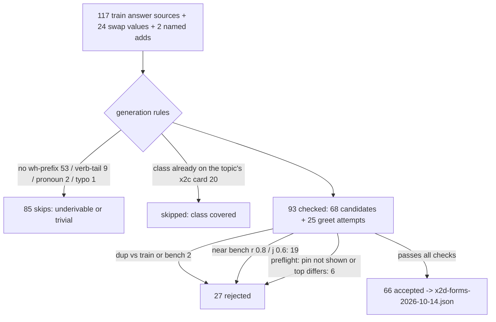

# x2d form generation — run record (2026-10-14)

Step 1 of the x2d build (`x2d-plan-2026-10-14.md`, "Build steps"). Builds the
candidate form list for teacher capture; **the teacher was not run** (that is
the orchestrator's next step). The sections below record the **v1 run**; the
same-day **v2 widening** (final, same file paths) is at the end — the output
file now holds the v2 result (171 entries).

- Script: `artifacts/probes/gen-x2d-forms-2026-10-14.py` (v2 widening applied;
  v1 behavior described in the report's v1 sections)
- Output: `data/finetune/x2d-forms-2026-10-14.json` — **v2: 171 entries**
  (v1: 66); schema `{question, pin, soft, class, source_card, asked_probe}`
  exactly (verified by reload; every `asked_probe == canonical_query(question)`).
- Run logs (receipts): `artifacts/runs/x2d-forms/run-2026-10-14.log` (v1) and
  `artifacts/runs/x2d-forms/run-2026-10-14-v2.log` (v2; both gitignored).
- Command: `python artifacts/probes/gen-x2d-forms-2026-10-14.py`
- Environment [measured]: index `data/index.json` (1042 chunks, 8244 words),
  117 train+answer source entries, teacher stays `qwen2.5:7b` for the capture
  step, v1 runtime 31.9 s / v2 73.5 s warm, 0 retrieval errors (local Ollama
  embeddings only).

## Counts [measured]

Accepted 66: **swap 24, bare 31, greet 10, named 1**; `lower` 0, `flip` 0 net
(both explained below). 33 forms carry a pin, 33 are pin-None (preflight on
the top-chunk rule).

Rejected 27: `near-bench` 19, `top-chunk-differs` 6, `duplicate-of-bench` 1,
`duplicate-of-candidate` 1.
Generation skips 85: `no-prefix` 53, `class-covered-by-x2c-card` 20, `verb` 9,
`pronoun` 2, `word-not-in-book` 1.

Projected x2d dataset: **113 + 66 + 54 = 233 rows** (target 360–400 — gap
analysis in "Coverage vs target"; the four specified classes cannot reach the
target on this data without widening the rules).

## What each class contributed

- `swap` 24 [measured]: every `PERTURB_SWAPS` value whose key is a train
  answer card — the x2c-taught sloppy forms survive the rebuild; the keys
  remain source entries, so both forms get cards. Extras are exempt from the
  duplicate rule **by design** (they are x2c's cards — all 24 values are in
  `train-x2c.jsonl`). They still passed the near-match and preflight
  checks; the crud/raid bench overlap is logged below.
- `bare` 31 [measured]: e.g. `the data engineering lifecycle`,
  `total cost of ownership`, `pii`, `tokenization`, `shared responsibility in
  the cloud`, `the cloud-scale data os`. 17 pin-None.
- `flip`: 10 derivations, all skipped as class-covered (the x2c card IS the
  flipped direction, e.g. `elt vs etl`); **both directions of the 10 order
  pairs exist** as base source card + swap extra, as required.
- `lower` 0 [measured]: all 117 source questions are already lowercase (scan);
  the two case-mixed forms in the pipeline (`what is PII`, `what is an OLTP
  system`) are re-added as swap extras; their lowercase variants are x1/x2
  source forms (duplicates, correctly not re-derived).
- `greet` 10 [measured]: `an event-streaming platform`, `a fact table`,
  `a dimension table`, `a broadcast join`, `a query optimizer`,
  `a feature store`, `a direct database connection`, `the principle of least
  privilege`, `shared responsibility in the cloud`, `a key-value store`.
  Mechanism note: 6 of these capture through the reading repair
  (`hey` → `they`, e.g. "they can you tell me about a fact table") because
  `hey` is not a book word; the preflight (pin shown) still passed. The
  x2d-plan target "greetings without tripping the reading repair" is an
  engine-side display question, not fixed by these cards.
- `named` 1: `change data capture` (pin ch05-013) added. The other named add,
  `undercurrents of data engineering`, was **rejected by the preflight** —
  its top shown chunk is `ch02-042` ("Major Undercurrents Across the Data
  Engineering Lifecycle") while the source question's top is `ch02-003`
  ("What Is the Data Engineering Lifecycle?") — see the decisions list.

Funnel [measured]:

## Rejects by reason [measured]

- `near-bench` 19 — 8 bare: `data engineering`, `dataops`, `orchestration in
  the data engineering lifecycle`, `data architecture`, `a data lake`,
  `data retention`, `a data migration`, `data masking`; 11 greet: the two
  bench `hey can you tell me about …` items (`change data capture`, `source
  systems`, `a data warehouse`, `a star schema`, `a message queue`, `data
  vault modeling`, `denormalization`, `normalization`, `a data migration`,
  `query federation`, `data masking`). 5 of the 19 are the "What is data X"
  template artifact against the single bench item "What is data ingestion?"
  (`j = 0.6` exactly: data engineering, data architecture, data retention,
  a data migration, data masking) — mechanically rejected per the specified
  thresholds; the same artifact sits on 6 swap extras, which are logged
  instead of rejected. A deliberate tie-break change would recover the 5
  (decisions list).
- `top-chunk-differs` 6: named `undercurrents of data engineering`
  (ch02-042 vs ch02-003), bare `a materialized view` (ch08-132 vs ch08-131),
  greets `an oltp system` (ch09-044 vs ch05-007), `a materialized view`
  (ch08-112 vs ch08-131), `the undercurrents …` (ch08-001 vs ch02-003),
  `orchestration in the data engineering lifecycle` (ch02-073 vs ch09-068).
- `duplicate-of-bench` 1: bare `data ingestion` (the bench question is
  exactly that string).
- `duplicate-of-candidate` 1: bare `change data capture` — identical to the
  named add, which was kept first.

## Worst similarities seen [measured]

- Sealed suite: the two declared twins, `what does crud stand for` and
  `what does raid stand for` vs `what does etls stand for` — r=0.833,
  j=0.667 (above thresholds; declared in `SEAL_TEMPLATE_TWINS`, logged, kept —
  per the probe's own note). Next-worst non-twin accepted form: `key-value
  store` vs `Event Streams` r=0.727, j=0.286 (clear).
- Bench: `what does crud stand for` r=1.000/j=1.000 vs "What does CRUD stand
  for?" (normalized-equal — it is x2c's deliberately corrected card; kept,
  bench twin logged) and `what does raid stand for` r=0.917/j=0.667 vs the
  same item. Six swap extras also sit at j=0.6 against "What is data
  ingestion?" via their canonical "What is data X?" form (template artifact,
  logged). Everything else above threshold was rejected (list above).
- Visible ten (report only, they are trainable): worst pair `what is PII` vs
  `what is` r=0.778/j=0.667 (PII is an already-trained x2c string); `the data
  engineering lifecycle` vs `DE Lifecycle` r=0.524/j=0.2.

## Forms not generated (with the reason)

- Trivial/verb-tailed remainders, 12: `a data engineer actually do` (verb
  do), `finops help a data team do` (help), `it mean to always be paranoid
  about security` (pronoun it), `data architecture relate to enterprise
  architecture` (relate), `separation of compute and storage help` (help),
  `replay matter for event streams` (matter), `micro-batch differ from true
  streaming` (differ), `encryption at rest differ from encryption in motion`
  (differ), `data definitions matter when serving data` (matter), `data
  scientists use notebooks` (use), `you detect upstream and downstream schema
  changes` (pronoun you), `observabilty` (not a book word — the engine's
  reading repair owns typos, per P2-1).
- Class already covered, 20: 10 bare-class forms (`a data warehouse`,
  `a data lakehouse`, `a data catalog`, `a message queue`, `a star schema`,
  `a fact table`, `a key-value store`, `data maturity`, `data management`,
  `data quality` — the topic's x2c card already carries the bare class) and
  10 flips (the curated PERTURB swapped orders, present as swap extras).
  "Prefer classes not already covered" was applied as a skip; lifting it
  would add ~10 near-duplicate bare-class forms.
- Underivable at generation, 65 sources: 53 questions with no listed
  wh-prefix (bare topics, quiz/list/subject-first shapes: `source systems`,
  `kafka`, `types of joins`, `crud stands for what`, `how are data and
  applications fusing`, …) and 12 trivial remainders (list above). None of
  the four specified classes applies; this bucket contains most of the
  plan's measured weak spots (bare-topic exposure, quiz-card coverage).
  One further derived form, `change data capture`, was rejected as a
  duplicate of the named add.
- `undercurrents of data engineering` (named): see decisions.
- Trailing-letter typos, gibberish, refusal entries, bench-split sources
  (`eval-` / `class-variant`): not generated, per the rules (the split filter
  excluded them at the source).

## Coverage vs target [derived]

The 190–220 target is not reachable under the four specified classes on this
data: even lifting every in-spec skip/reject would yield
66 + 20 (class-covered) + 19 (near-bench) + 6 (top-chunk) ≈ 111 forms; the
remaining sources offer no bare/lower/flip/greet derivation. The four classes
cover ~1.2 forms per topic (54 source cards), against the plan's "~3 forms
per topic". Concrete rows, not a count guess [measured]: `bare` 52 derivable
→ 31 accepted (10 class-covered, 11 check-rejected), `lower` 0, `flip` 10
(all pre-existing as extras), `greet` 25 attempted / 10 passed, `swap` 24,
`named` 1 of 2.

Widening options (orchestrator decision; none applied here):
1. lift the class-covered rule for article bares (+10 strings);
2. relax the near-bench tie-break for the "What is data X" template artifact
   cluster (+5 rejected; 6 more are already kept as logged swap extras) —
   e.g. compare content tokens only;
3. add pin hints so evidence-checkable forms survive (`undercurrents …`,
   materialized-view variants, oltp greet) (+6);
4. add classes outside this task's scope: section-heading cards
   (`Location`, `Our Advice` shapes), restatements of quiz/list questions,
   explain-prefixed forms for the measured fragment class.

## Decisions recorded (honest flags)

- Swap extras are exempt from the duplicate rule (they are x2c's cards,
  "both forms get cards"); their crud/raid bench overlap and the six j=0.6
  canonical hits are logged above rather than silently dropped.
- Class-covered was applied as a skip, not a preference (no topic was over
  the 3-form cap anywhere, so a preference would have had no effect).
- The `undercurrents of data engineering` named add is left out by the
  preflight as specified; its evidence (`ch02-042`, the undercurrents
  heading) is arguably better than the source's own top (`ch02-003`) — one
  manual pin would admit it.
- The long form `the undercurrents of the data engineering lifecycle` IS
  accepted as `bare`, so the topic is covered either way.

## Verification

- `python artifacts/probes/gen-x2d-forms-2026-10-14.py` — exit 0; JSON
  reloaded: 66 entries, exact key set, classes in
  `bare|lower|flip|swap|greet|named`, `asked_probe` identity holds, no
  internal normalized duplicates.
- Post-hoc scan of the output: **0** non-swap duplicates vs
  `train-x1/x2/x2c` question sets, **0** vs bench questions/asked strings,
  **0** non-twin suite hits at the thresholds.
- Teacher not run; no engine route touched; the `:8000` server was not
  disturbed (embeddings go to `127.0.0.1:11434`).

Next (orchestrator): capture through the seam (`qwen2.5:7b`, temp 0) →
verifier → contamination probe → seal check → notebook/upload. Status:
step 1 complete; two decisions above are worth a look before capture.

---

## v2 widening (2026-10-14, follow-up decision)

Applied to the same script and re-run; the output file was regenerated
(`run-2026-10-14-v2.log`, exit 0, 73.5 s warm, 0 retrieval errors). All v1
checks stayed on (strict suite r>=0.8 / j>=0.6, duplicates, preflight,
class-covered skips for the 10 article bares + 10 flips, no typos/gibberish/
refusal/bench-split forms). **This section supersedes "Coverage vs target".**

### Final counts [measured]

**171 accepted** (v1: 66; +105): swap 24, bare 38 (+7), restate 32 (new),
explain 27 (new), heading 25 (new), greet 23 (+13), named 2 (+1).
109 forms carry a pin, 62 are pin-None; 25 heading rows are hard-pinned
(soft=False), everything else stays soft=True.

Rejected 56 (v1: 27; +29): each v1 reason kept, plus new-class rejects —
top-chunk-differs 26 (of which 19 are explain), near-bench 19 (net 0: the six
recovered cluster bares left; five explain pairs + the `Ingestion` heading
entered), pin-not-shown 5 (new), near-suite 2 (new), duplicate-of-bench 2,
duplicate-of-train 1 (new), duplicate-of-candidate 1.

Generation skips 115 (v1: 85): no-prefix 53, question-already-carries-wh 28
(new; a restatement of a quiz/subject-first question would be gibberish and
is skipped by the standing rule), class-covered 20, verb 9, pronoun 2,
word-not-in-book 3. Cap-4-per-source skips: 0 (no source reached 4 forms).

### What the five decisions did [measured]

1. **Article bares (option 1): still skipped** — the 20 class-covered skips
   are unchanged.
2. **Bench tie-break**, implemented as a pair-shape rule (both sides are
   "what is …" questions; shared tokens are exactly the template +
   "data": `{what,is,a,an,the,data}`, at least 3 shared). 33 pair notes,
   **12 distinct candidates admitted** as assisted-template twins (all
   accepted, all logged):
   - the requested five: `data engineering`, `data architecture`,
     `data retention`, `a data migration`, `data masking` ✓;
   - mechanically also: `a data lake` (r=0.800 exactly vs "What is MAD data
     landscape?"), the restate `what is data wrangling`, and the heading
     forms `Data architects`, `Data scientists`, `Data analysts`,
     `Serving Data`, `Data governance`.
   Note [derived from the log]: the literal "strict j > 0.6" change alone
   would NOT have admitted all five — `data retention` (r=0.818) and
   `a data migration` (r=0.826) still trip r>=0.8; the cluster exemption
   covers those pairs' r as well. The explain-vs-explain bench template
   pairs (`explain data retention` r=0.818, `explain a data migration`
   r=0.826, `explain a data lake` r=0.800, `explain data masking` r=0.811
   vs "explain data ingestion" / "explain MAD data landscape") stayed
   REJECTED — the tie-break was scoped to the "What is data X" cluster only.
3. **Manual pins: all six pinned forms accepted** — `undercurrents of data
   engineering` (ch02-042), materialized-view bare/explain/greet (ch08-131),
   oltp greet/explain (ch05-007). The two explain siblings inherit the same
   hand-evidenced pins (documented extension, no special handling). The
   unpinned undercurrents and orchestration greets stay rejected
   (top-chunk); the unpinned oltp/materialized retries passed because the
   pin is now shown.
4. **New classes:**
   - `explain`: 52 attempts (the full remainder pool) → 27 accepted; 25
     rejects = 19 top-chunk-differs (the "explain X" retrieval leads with a
     different chunk, e.g. ch04-001, than the wh form), 5 near-bench, 1
     duplicate-of-bench (`explain data ingestion`).
   - `restate`: 35 attempts → 32 accepted (rejects: `what is types of
     metadata` and `what is big ball of mud` top-chunk, `what are slowly
     changing dimensions` pin-not-shown); 28 sources skipped as
     already carrying the interrogative, 2 as non-book words (`multicloud`,
     `normailzation` — typo rule).
   - `heading`: 2 specials + 30 mechanical attempts → 25 accepted; 7 rejects
     (`Storage` and `Batch versus streaming` near-suite — the strict suite
     rule fired on heading-shaped collisions, exactly the requested guard;
     `Ingestion` near-bench; `Technical Responsibilities` / `Machine
     learning` / `Security` pin-not-shown; `Data Management` dup-train).
     Specials: `Location` → ch07-046 (the 7B's citation) and `DE Lifecycle`
     → ch02-002 (the 7B's first citation) accepted; **`Our Advice`
     skipped** — x2 answered uncited and the 7B's cites (ch01-064/057,
     ch10-008) are a meta-answer, not an evidence-backed pin.
   - `greets`: 40 topics attempted → 23 accepted (v1's 10 + the oltp and
     materialized-view pin retries + 11 new topics: total cost of ownership,
     acid in database terms, advantages of insert-only tables, streaming
     pipelines and real-time analytics, wide-column databases,
     stream-to-batch architecture, principles of good data architecture,
     immutable vs transitory technologies, hashing vs encryption, schema on
     read vs schema on write, etl vs elt). 17 rejected: 11 unchanged
     near-bench, 5 top-chunk (undercurrents, orchestration, big ball of mud,
     ways to serve data to consumers, push vs pull ingestion), 1
     pin-not-shown (slowly changing dimensions).
5. **Cap:** 0 cap-4 skips — no source approached four accepted forms.

### Worst similarities, v2 (all candidates) [measured]

- **Suite:** `Batch versus streaming` r=0.929 (REJECTED), the declared twins
  (`what does crud stand for` / `what does raid stand for` vs the etls item)
  r=0.833 / j=0.667 (kept, `SEAL_TEMPLATE_TWINS`), `Storage` r=0.812 and
  `Batch versus streaming` j=0.6 vs item `Streaming` (both REJECTED). Worst
  accepted non-twin: `key-value store` r=0.727 vs `Event Streams`.
- **Bench:** `what does crud stand for` r=1.000 / j=1.000 (swap twin,
  kept), `data ingestion` and `explain data ingestion` r=1.000 (REJECTED as
  duplicates), `what does raid stand for` r=0.917 (kept), greet forms vs
  the two `hey …` bench items up to r=0.904 / j=0.778 (REJECTED), `Ingestion`
  r=0.872 / j=0.750 (REJECTED).
- **Visible ten** (report only): `Location` and `DE Lifecycle` r=1.000 —
  they are two of the ten, admitted by the explicit evidence pins
  (trainable); then `what is PII` r=0.778, `what is kafka` r=0.700 /
  j=0.667 vs `what is` (the known two-token artifact).

### Projected dataset size [derived]

113 + 171 + 54 = **338 rows**; training steps at 6-epoch exposure:
`ceil(6 × 338 / 8)` = **254 steps** (x2's recipe was 120 steps at 167 rows ≈
5.7 epochs; x2d holds ≈ 6.0 by construction).

### Awkward-but-kept forms (flagged for the capture review)

Per the "simple plurality rule, let the checks filter": `what is principles
of good data architecture`, `what is types of windows in stream processing`,
`what is architecting for iot`, `what is caveat emptor`; heading forms read
as section titles (`What is Data scientists?`, `What is Serving Data?`);
`explain pii` (suite r=0.778, under the bar). Every one is the engine's own
shape for that input (canonicalization prefixes bare topics exactly this
way) and passed the suite/bench/preflight gates; drop any the orchestrator
dislikes.

### Verification, v2

- Reload scan: 171 entries, exact key set, classes in
  `bare|lower|flip|swap|greet|named|explain|restate|heading`, 0 `asked_probe`
  mismatches vs `canonical_query`, 0 internal normalized duplicates.
- Post-hoc scan: **0** non-swap duplicates vs train-x1/x2/x2c, **0** vs bench
  questions/asked strings, **0** non-twin suite hits at the thresholds.
- Teacher not run; only local Ollama embeddings (127.0.0.1:11434); the
  `:8000` engine was not touched; nothing committed.

Status: both files final for the orchestrator's capture step; the four
flagged items to eyeball first are the cluster admits beyond the five, the
rejected explain-template pairs, the awkward-but-kept restates, and the
heading soft=False convention.
