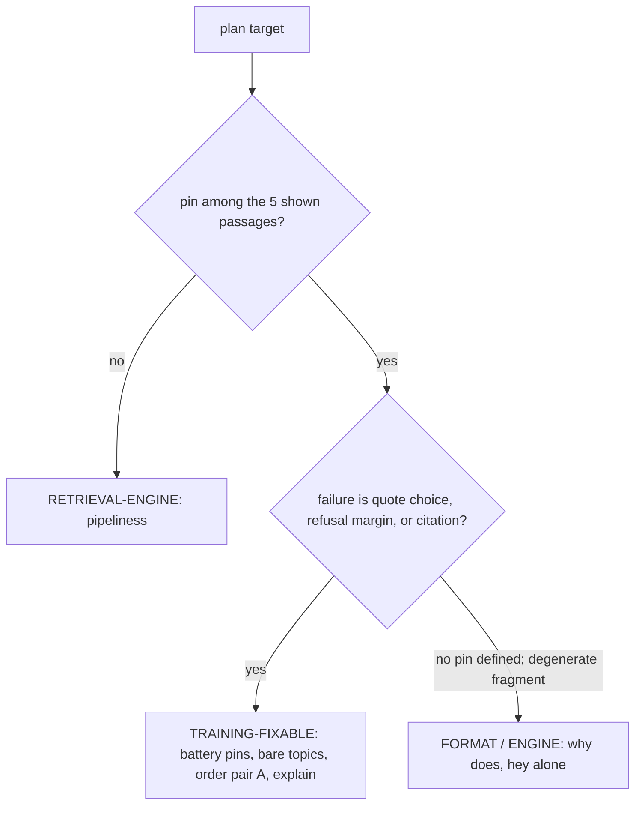

# x2d plan audit — red-team with retrieval reconstruction (2026-10-14)

Verdict, front-loaded: the plan's targets are mostly training-fixable — for
every battery pin miss in it, the pin chunk is in the five passages the model
sees, at rank 1–3 [measured]. The two exceptions are `pipeliness` (pin absent
after the engine's own repair — RETRIEVAL-ENGINE, not training) and `hey`-alone
(reading repair fires before the model — ENGINE). Two wording fixes are
required (the "same count and share" claim is false for share), one P2-1 rule
was dropped (do not train trailing-letter typos, which the ET-typo target
contradicts), and the row arithmetic only reaches 360–400 under one unstated
reading. No GOAL/AGENTS hard-rule conflict found.

## Method (what was re-run)

- Reconstructed what retrieval shows, per question:
  `answer.retrieval_context(index, canonical_query(q))` in-process, index
  `data/index.json` (embedder `nomic-embed-text`, 1042 chunks, `PASSAGE_LIMIT = 5`),
  with a stubbed model only for the LLM reading fallback [measured].
  The stub is faithful for these questions: where a reading fired it was the
  difflib path; where none fired there was no out-of-book token (e.g. `et` is
  in the book's vocabulary, so the LLM fallback is unreachable by code path)
  [measured: `keywords.postings`; `readings.llm_second_reading` guard].
- Cross-check: for the ETL and ET battery questions, the reconstructed,
  caption-seeded shown lists are byte-identical to the shown lists recorded in
  `artifacts/evidence/eval-v1/eval-v1.json` [measured]. The method reproduces
  recorded evidence.
- Live-data counts from `data/finetune/quote-refuse-2026-10-13.train-x2c.jsonl`
  and `...stats-x2c.json` [measured]. No server was started; the app engine on
  :8000 was not touched; embeddings went to local Ollama 127.0.0.1:11434.

## 1. Per-target triage

### Battery pin misses — pin rank as shown to the model [measured]

| Question | Pin | Pin rank | Rank-1 shown | x2c failure (evidence) | Verdict |
|---|---|---|---|---|---|
| source-systems | ch02-005 | **1** (0.7627) | ch02-005 | q4 ×3 runs: cited ch05-004 (shown rank 3) [probe-small-ask x2c run1-3] | TRAINING-FIXABLE — quote choice |
| extracted-in-ETL | ch07-033 | **1** (0.7501) | ch07-033 | q4 ×3: `refused=True` with pin rank 1 in the shown list | TRAINING-FIXABLE — refusal margin |
| ET typo | ch07-033 | **2** (top = caption-seeded ch08-120) | ch08-120 | q8 ×3: cited ch02-022 (rank 3); q4 passes | TRAINING-FIXABLE — quote choice, but see layer conflict below |
| insert-only | ch05-020 | **3** (0.8049) | ch08-107 (0.8095) | q4+q8, every run: cited ch08-107 | TRAINING-FIXABLE in principle; 0.0046 near-tie at retrieval — expected low return, plan's "known bad card" acceptance is right |

Notes:

- source-systems fails q4 only (q8 passes); ETL fails q4 only (q8 passes); ET
  fails q8 only (q4 passes); insert-only fails both quants. The x2c failure
  list is quant-split, so a gate that says "the x2c session's list" without a
  quant is not decidable [measured, run1–3 logs].
- ET-typo layer conflict: the engine does not repair `ET` — `et` is in the
  book vocabulary (so `readings.py`'s LLM fallback never runs), difflib finds
  no ≥0.85 swap, and the reading is null [measured]. P2-1 says typos are the
  engine's repair seam and must not be trained; for ET that seam is currently
  dead code. The plan must pick a layer explicitly (train the form, or extend
  the repair), or it silently violates the rule it cites.

### Sealed-suite classes (x2c q4, 10 draws) [measured: probe-fragment log]

| Target item | x2c q4 | Passages shown at serve time (reconstructed) | Verdict |
|---|---|---|---|
| fragment `how do` | 0/10 uncited | (class swept; same disease) | TRAINING-FIXABLE — citing |
| fragment `what about` | 0/10 uncited | same | TRAINING-FIXABLE — citing |
| fragment `explain` | 0/10 uncited | ch06-086 Schema (caption-seeded, the exact text it answered) was rank 1; it cited nothing | TRAINING-FIXABLE — citation format |
| fragment `why does` | 0/10; meta line "The question why does is not fully specified…" | top chunk is `Time series` — no on-topic pin exists | FORMAT/ENGINE — degenerate input; training citing cannot create the answer |
| bare Time Series | 1/10 cited | ch05-045 `Time series` rank 2 (0.8087) | TRAINING-FIXABLE — citing |
| bare Micro-Batch | 0/10 | ch08-141/142/143 rank 1–3 | TRAINING-FIXABLE — citing |
| bare Streaming | 0/10 | ch02-087 `Streaming` rank 1 | TRAINING-FIXABLE — citing |
| bare Event Streams | 0/10 | ch05-064 rank 1 | TRAINING-FIXABLE — citing |
| order `batch vs streaming` | 0/10 | ch02-019 rank 1, ch02-018 rank 2 | TRAINING-FIXABLE — citing |
| order `streaming vs batch` | 0/10 | same chunks rank 1–2 | TRAINING-FIXABLE — citing |
| trailing `what does etls` | 10/10 PASS | reading `what does etl stand for` fired; top ch01-075 | already fixed in x2c |
| trailing `benefits of data meshs` | 0/10 | (not in plan's target list; class covered by gate) | TRAINING-FIXABLE — citing, but not named |
| trailing `pipeliness` | 0/10 | reading `how do data pipelines work` fired; shown: ch07-091 DataOps, ch07-003/004 ingestion, ch02-089, ch11-019 — **no chunk heading contains "Data Pipeline(s)" anywhere in the index** | RETRIEVAL-ENGINE — pin absent. Sealed item; cannot be trained; the plan's own step-1 preflight ("pin stays in the shown passages") will veto it |

Naming trap: the plan's "Measured targets" (L12–15) names sealed-suite items as
targets. Sealed items are never trained. The build must mint fresh forms in the
same classes; retitle the list "measured classes" so a literal reading does not
produce a training file that aborts the seal check.

### Greetings

- `hi there` in the suite: answered, 0 citations, 10/10 [measured: fragment log] — citation-format, trainable.
- `good morning` / `howdy`: refuse cleanly (`either` class, recorded) — no action needed.
- `hey` alone: reading repair fires and is kept — `hey` → `they`, top passage "Acknowledgments" 0.6022 [measured]. This is the engine over-repair the trial logged. `canonical.py` intentionally passes openers through, and the repair runs before the model, so no trained greeting form changes this. `hey what is data ingestion` is fine (no repair; ch07-002 rank 1) [measured].
- Plan line 20 ("greetings without tripping the reading repair") mislays the mechanism: the fix layer for `hey`-alone is the engine, not the training data (AGENTS "Mechanism precision").

### Named adds — preflight preview [measured]

- `change data capture` → ch07-051 rank 1 (0.8286), ch05-013 rank 2 — a source card exists; soft-pin risk looks low.
- `undercurrents of data engineering` → ch02-042 rank 1 (0.8284) — exists.

## 2. Ratio audit

Measured base: 167 rows = 113 unique answer cards + 54 refusal rows = 27
unique questions ×2, all copies exactly 2 [measured: train-x2c.jsonl; x2
identical]. The x2d change: 54 unique refusal questions, one row each.
54/~380 ≈ 14% vs 54/167 = 32.3% — the count stays, the **share drops by
design** (diversity over dose).

The plan's language does **not** say this. Exact lines:

- Plan L32–33: "Refusals: 54 unique questions (compose ~27 more through the
  same teacher; exact sentence only; same count and share as x2/x2c)."
  — "same share" is false.
- Review P2-1 L347–349: "same count and share, exact sentence only, so the
  France/iops canary and the ratio stay measurable."
  — same error; the ratio is measurable, it just changes. (Review P1-2 L278–281
  already uses the correct phrase: "with the same count" — use that precedent.)

Recommended wording for both: "same refusal-row count (54; one row per
question, 27 → 54 unique) and the same France/iops canary; the refusal **share
intentionally drops** (~32% → ~14%) — diversity over dose. The share change is
part of the intervention and is a known confound vs x2/x2c."

Risk list (ratio-specific):

1. A 32% → 14% refusal dose may move the false-refusal margin; gate 1
   (France+iops 10/10 ×5) covers exact refusals, but the plan's gate item 2
   lists only four suite classes — the **control class (20/20) is not in the
   gate text**. Add it, or a loosened prior ships unseen.
2. Changed ratio + changed forms in one run ⇒ no x2c→x2d delta is
   attributable to one variable; seed variance alone moved battery pins by
   1–2 [measured: x2-trial]. The plan's absolute-threshold gates are the right
   response — say so, and keep the n=1 limitation in the verdict doc.
3. Keep the exact-sentence-only rule enforced mechanically in the generator
   (refusal rows = `Not in this book.` and nothing else) — build step 2 does
   this through the seam; keep it.

## 3. P2-1 gap check (review → plan)

| P2-1 spec item | In the plan? |
|---|---|
| 54 unique refusals, ~27 more, same teacher/verifier | Present (L32; build step 2) |
| Exact sentence only | Present (L32–33) |
| "Same count and share" | Present verbatim but wrong — fix (share drops) |
| France/iops canary measurable | Present (gate 1) |
| ~3 forms per topic, five classes (wh, lowercase/fragment, bare, order-flip, greeting) | Present (L24–27) |
| Teacher-captured, verbatim-verified, tiered as today | Present (L30–31, + soft-pin → silver) |
| Target ≈ 360–400 rows | Present (L34) — arithmetic not shown (see §4) |
| `max_steps = ceil(6 * rows / 8)`, exposure at x2 level; epoch-based | Present (L34–35) |
| **Do not train trailing-letter typos** | **Missing** — and contradicted: ET typo is a target, `pipeliness` is named, `data meshs` sits in the same class |
| Hold out bench (hash-pinned) + suite (sealed manifest) | Partial: hold-outs + seal check + "record the new hashes" present (L36–37); the manifest file P0-era docs asked for (`artifacts/datasets/sealed-forms.json`) **does not exist** [measured] and the plan does not add it; "augmenter generates the train split only" (review L103–106) is implicit at best |
| Pre-register the gate before training | Present (title + gate section) |
| Write down that Location / DE Lifecycle get cards in x2d | **Missing** — gate 6 only says they "keep working"; no data instruction names them (x2c q4 answered them some-uncited [measured: trial]) |
| Greeting set size | Unspecified in both ("a small greeting-prefixed set"); pick a number — and note `hey`-alone is engine (§1) |

## 4. Row arithmetic (does 360–400 hold?)

Base [measured]: 113 unique answer cards + 54 refusal rows; x2d refusals = 54.
Target ⇒ answer rows must total 306–346; keeping the 113 ⇒ **new forms F ∈
[193, 233]**. The stated generator target 190–220 lands 357–387: at F=190 the
total is 357 — **3 rows short of 360**. It lands in range only for F ≥ 193
(and ≤ 233).

The plan's "~3 forms per topic" reconciles only under one of two unstated
readings: replacing single-form cards (3 × ~109 topics = 327 answer rows →
~381 total ✓) or augmenting every topic while keeping all 113 (→ ~440,
overshoot). Scope "from the measured classes" could also mean only the ~30–40
affected topics (→ 250–290 total, way under). Write down which reading, the
kept-card count, and the natural gross-up: the x2c build rejected 6 of ~212
candidate rows (~3%) [measured: stats-x2c.json], so generate gross ≥ net × 1.03.

- Under-shoot (F < 193): target missed (cosmetic — no gate row-count item);
  steps scale down with rows (`ceil(6·357/8) = 268` vs 300 at 400), per-row
  exposure held by the formula; refusal share drifts up (15.1% at 357).
- Over-shoot (F > 233): >400 rows → >300 steps ≈ 2.5× the x2c session's 120
  steps; Colab time/memory for one A100/L4 slot is unquantified in the plan
  [inferred: no measured 400-row session exists]. Cap forms per topic and total
  rows, or state the expected session time.

## 5. Conflicts vs GOAL.md / AGENTS.md hard rules

- None found on the constitution: exact refusal string (plan keeps it; gate 1),
  grounded/verbatim teacher capture (L30–31), local-only engine (unchanged),
  stdlib (no package proposed), no-commit (none proposed), measured claims
  (gate pre-registered with evidence paths).
- One review-level rule conflict: P2-1 "do not train trailing-letter typos"
  vs the plan's ET-typo target and `pipeliness` entry (§1, §3). Resolve
  explicitly; do not leave both readings live.
- AGENTS "Mechanism precision" (L106–108): greetings/`pipeliness`/ET mix
  engine-layer and training-layer mitigations; label each target with its fix
  layer in the plan table.
- Gate wording vs measured evidence: gate 5's "x2c session's list" is
  quant-split; name q4/q8 separately (source-systems and ETL are q4 failures;
  ET is q8). Same for gate 4's "equal draws" bar at 19/21 — state the quant.

## Files

- New: `artifacts/reports/x2d-plan-audit-2026-10-14.md` (this file).
- Read-only inputs: x2d plan, expert review, x2 trial, probe logs
  (probe-small-ask x2c/q8 runs 1–3, probe-fragment x2c), train-x2c.jsonl +
  stats, `answer.py`/`canonical.py`/`readings.py`/`retrieve.py`, `eval-v1.json`.
- No other file was created or modified.

Next check: apply the two wording fixes in the plan (ratio share; sealed-items
vs classes), decide the ET-typo layer, add the control class and the quant to
the gate text, and write the generator count (kept cards + net forms + 54).
