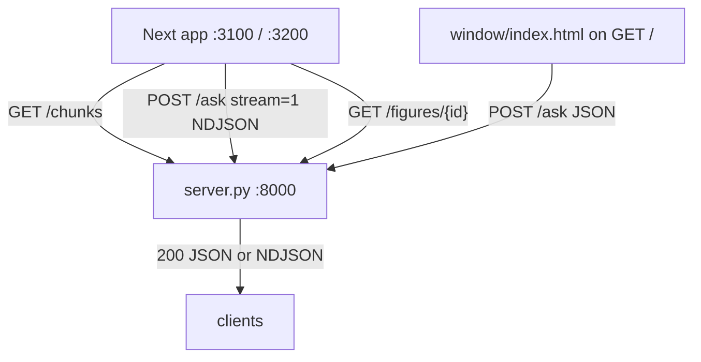

# UI review — ask-this-book

Two surfaces exist. Next (`web/`) is the reader. `window/index.html` is what `GET /` actually serves. Neither was run. Findings are from source.

## What the UI actually does

### Routes

| Surface | Route | What it is |
| --- | --- | --- |
| Next | `/` only (`web/app/page.tsx` `Page`) | Two-pane shell: `Reader` + optional `AskPane`. Static export (`web/next.config.ts`). Dev on :3100. |
| Engine | `GET /` | `window/index.html`. Not the Next export. |
| Engine | `GET /chunks` | Reader payload. |
| Engine | `POST /ask` | Answer. `stream` truthy → NDJSON. |
| Engine | `GET /figures/{id}` | PNG. |
| Engine | `GET /health` | `{ok, ollama}`. No UI caller. |
| Engine | `OPTIONS` | CORS for :3100 and :3200. |

Next has no other pages, no public assets, no proxy.

### Next — state (`web/lib/store.ts` `useAsk`)

`mode`: `"answer"` \| `"ask"`.
`question`, `status` (`idle` \| `loading` \| `streaming` \| `done` \| `refused` \| `stopped` \| `error`), `streamText`, `resetting`, `body`, `error`, `elapsed`, `firstToken`, `latency`, `highlight`, `highlightNote`, `anchor`, `cardVisible`.

In-flight lock: module `controller`. A second `begin` no-ops.

Page-local (`web/app/page.tsx` `Page`): `payload`, `loadError`, `askWidth` (localStorage `ask-width`, clamp 288–min(720, viewport−520)), `sidebarOpen`, `animating`. Closed sidebar unmounts `AskPane` and the resize handle.

### Next — calls

1. Mount: `fetchChunks()` → `GET {engine}/chunks`. `engineUrl()` is `http://127.0.0.1:8000` unless the page itself is on port 8000.
2. Composer submit (`AskPane` → `useAsk.submit`): `POST /ask` `{ question, mode, stream: 1 }`. Empty question disabled.
3. Lens empty submit (`Lens.submit` → `useAsk.askSelection`): `{ mode: "explain", selection, stream: 1 }`.
4. Lens typed submit: `{ mode: "ask", question: typed, stream: 1 }`. Selection is not in the body. It is only the visual `anchor`.
5. Images: `{engine}{figure.src}` with `src` `/figures/{id}`.

NDJSON frames handled in `askStream`: `token`, `reset`, `final.body`, `error`. EOF without `final`/`error` → onError.

### Next — what the user can do

- Scroll the book (`Reader` / `ChunkBlock`). Headings render when they change. Figures sit in the chunk.
- Drag/keyboard-resize the ask pane. Double-click resets to 384px. Hidden under 900px.
- Toggle the ask pane.
- Type a question. Enter submits. Shift+Enter newline. Stop aborts.
- Select a passage → `Lens` pill. Enter with empty field explains the selection. Typed text asks that question.
- Citation chip (and the quote span, mouse only) → `showCitation` → mark + scroll in the reader.
- If the reader has room (≥300px + 24px beside the text column), a lens ask opens `MarginCard` and the pane log goes quiet (`cardVisible`).
- Escape: `AskPane` clears highlight/anchor (only while mounted). `Lens` closes the pill.

### window/index.html

One form. Modes `answer` | `ask` | `explain` | `quiz`. Fields `question`, `selection`. `POST /ask` without `stream`, plus unused `book_id: "fde"`. Renders `body.answer` or `body.error`, citation `chunk_id`s, figures, quiz “Show the key” from `citations[].quote`. Same-origin `/figures/…`.

## API mismatches

Cite client symbol vs server symbol. Payload field names for 200 bodies are what `Handler.do_POST` / `_stream_ask` / `chunks_body` return.

| Rank | Client | Server | What |
| --- | --- | --- | --- |
| 1 | `window/index.html` submit sends `book_id: "fde"` | `Handler.do_POST` never reads `book_id` | Extra field. Ignored. One-book engine. |
| 2 | `useAsk.askSelection` typed path sends `{ mode: "ask", question }` and drops `selection` | `Handler.do_POST` for `ask` only uses `request["question"]` | Not a path error. The lens copy says “ask about this passage”; the engine never sees the passage. Empty-lens `explain` does send `selection`. |
| 3 | `useAsk.submit` never sends `selection` even if `highlight` is set | same | Pane asks are question-only. Window always sends `selection`. |
| 4 | `AnswerBody.error?` in `web/lib/engine.ts` | Success bodies from `ask` / `respond` / `explain` / `quiz` are `{ answer, citations, figures, refused }` — no `error` | `error` exists on HTTP 4xx/5xx JSON and on stream `{ type: "error" }`. The Next success renderer never reads `body.error`. Harmless extra on the type. |
| 5 | `window/index.html` maps `body.citations` → `item.chunk_id` only | citations are `{ chunk_id, chapter, quote }` | Ignores `chapter`. Next chips use `chapter`. |
| 6 | `window/index.html` figure `img.src = figure.src` | `figure.src` is `/figures/{id}` | Match on :8000. Would break if this file were opened from another origin. Next prefixes `engineUrl()`. |
| 7 | `web/lib/engine.ts` `FigureCard.width?` / `height?`; `AnswerView` passes them | Reader cards (`figure_cards`) may include PNG `width`/`height`. Answer attachments (`figures_for`) do not | Optional on the client. Answer figures never reserve aspect. |
| 8 | `ChunksPayload.book_id`; `Chunk.section`, `Chunk.source`; `FigureCard.chapter` | `chunks_payload` sends all of them | Next never reads them. Not a call mismatch — ignored fields. |
| 9 | Next never `GET /health` | `Handler.do_GET` `/health` | Dead endpoint to the UI. Load error copy guesses “is the engine running on :8000?” instead of asking. |
| 10 | Next never `POST /ask` without `stream` | non-stream JSON path exists | Intentional. Window is the only non-stream client. |
| 11 | Next composer has no `quiz`; no `explain` in the `<select>` | `MODES = ("ask", "answer", "explain", "quiz")` | `explain` is lens-only. `quiz` is window-only. |
| 12 | `web/next.config.ts` comment: engine serves `web/out/` in production | `GET /` serves `window/index.html`; any other path 404s | Comment is false. `web/out/` is empty here. |

No Next call hits a path the server does not define. Required fields the Next client *does* send (`mode`, `question` for ask/answer, `selection` for explain, `stream: 1`) match `Handler.do_POST`.

## Accessibility and interaction bugs

Code-visible. Not pixel-checked.

### Failures swallowed or stuck

- `window/index.html` submit: no `try/catch`, no `response.ok`. Network throw or non-JSON body leaves `#answer` at `"Looking..."`.
- `MarginCard` copy: `navigator.clipboard.writeText(...).then(..., () => undefined)` — failure is silent. Button has `title`, no accessible name change on fail.
- `useAsk` `onError` does not clear `streamText`. `AskPane` then shows the partial stream *and* `{error}` (`status === "error"` branch).
- `Page` load failure is a line in the reader. No retry control.

### Missing labels / keyboard

- `AskPane` textarea: placeholder `"Ask the book…"` only. No `<label>` / `aria-label`.
- `AnswerView` quote: `` — not a button, no `tabIndex`, no Enter/Space. The sibling `.chip` is the only keyboard path.
- `window/index.html`: `<select>` and both `<input>`s have no labels (placeholders only).
- `page.tsx` resize: `aria-valuemax={MAX_ASK}` (720) is a lie when `maxFor(innerWidth)` is smaller.
- `Lens` input CSS `outline: 0` with no replacement focus ring. Global `:focus-visible` is 2px `--focus` on paper; the pill is dark.
- `MarginCard` copy control: no `aria-label`. Visible text is “Copy” / “Copied” only.
- No document `h1`. Chunk `h2`s exist. No skip link.
- `sidebar-toggle` has `aria-expanded` and `aria-label`, no `aria-controls`.

### Loading / empty / error gaps

- Next reader: has “Loading the book…”, load error, then chunks. Fine.
- Next ask idle: honesty paragraph. Fine.
- Next `status === "refused"`: still renders `AnswerView` (verbatim + “nearest misses”). Live region says “Not in this book.” Fine.
- Next live region (`AskPane` `announce`) does not speak “Looking…” / streaming. `aria-busy` is on the section.
- Next mode `"answer"`: server `_stream_ask` holds tokens (`live` false unless a prefill retry). Pane stays on “Looking… {n} s” until `final`. That is the contract, not a missing spinner — but there is no other progress.
- Closing the sidebar unmounts `AskPane`. Stop disappears. In-flight `controller` keeps running. Stream is invisible unless a margin card is up.
- Escape-to-clear-highlight lives in `AskPane` only. Sidebar closed → Escape does not clear (`Lens` Escape still closes a pill).

### Other interaction

- `ChunkBlock` uses `content-visibility: auto` and then `scrollIntoView` with rAF + 160ms retry — acknowledged in code; jumps can still land off-target once.
- Lens `open` binds the quote to the *start* container’s `[data-chunk-id]`. A selection that crosses chunks asks as the first chunk.
- `Reader` `positionCard`: missing block sets `cardTop` to `0`, not null — card can pin to the top of `.reader-inner`.
- `cardShown` requires `cardTop != null`. While `top` is null the card node still mounts with `visibility: hidden`; pane is not yet `beside`.
- Under 900px the grid becomes a stack (`globals.css`). Resize handle is `display: none`. Toggle still works. Not a trap, but the ask pane is below a long book with no jump-to-composer.
- `begin` early-return if `controller` is set: no queue, no message.

Not a keyboard trap: nothing sets `inert` / focus loop. The lens is not a dialog.

## Dead UI and unused assets

- Tailwind: `@import "tailwindcss"` in `web/app/globals.css`, PostCSS plugin, `package.json` `tailwindcss` / `@tailwindcss/postcss`. No `className` utility in components. Custom CSS only.
- `web/app/tokens.css` `--size-large`: no references.
- `AskPane` `input` ref: assigned, never read (no autofocus, no restore).
- `ChunksPayload.book_id`, `Chunk.section`, `Chunk.source`, `FigureCard.chapter`: typed and stored, never rendered.
- `GET /health`: unused.
- Next composer: no quiz. Window quiz + “Show the key” exist only on `GET /`.
- `web/out/` empty. Gitignored. Not a shipped asset.
- No `web/public/`. No leftover images in the UI trees.
- Dual homepage: editing Next does not change what a user sees at `http://127.0.0.1:8000`.

## Ranked fixes

### Safe hygiene (contract and DOM labels; behavior unchanged if done carefully)

1. Label the ask textarea (`aria-label` or `<label for>`). Label window form controls.
2. Make the quote span a `<button type="button">` (or drop the click and keep the chip only).
3. `aria-valuemax` on the splitter = the live `maxFor(innerWidth)`, not 720.
4. Visible focus on `.lens input` / `.lens-submit` (do not leave `outline: 0` without a ring).
5. `aria-label` on Copy. Announce “Copied”. Do not swallow clipboard rejection.
6. On stream `error`, clear `streamText` or stop rendering it next to `{error}`.
7. Drop unused `book_id` from the window POST. Drop unused Tailwind import if the build does not need it. Remove the `AskPane` dead ref.
8. Fix `next.config.ts` comment: engine does not serve `web/out`.
9. Optional: call `/health` to distinguish “engine down” vs “missing index” vs “Ollama down” in the reader error line.

### Behavior-change (do not do as drive-by)

1. Window fetch: `try/catch` + `response.ok`; never leave “Looking...” as the terminal state.
2. Keep `Stop` mounted while `controller` is set even if the sidebar is closed — or abort on unmount (pick one; they disagree).
3. Typed lens ask: send `selection` *and* have the engine use it, or stop implying the passage is the query context. Today neither side binds them in `ask` mode.
4. Move Escape-to-clear-highlight out of `AskPane` so it survives sidebar close.
5. `positionCard`: missing target → `cardTop = null`, do not show a card at 0.
6. Answer-mode waiting copy: say tokens are held until `final`, or stream that path (server `live` flag).
7. Quiz / explain in the Next composer — only if that surface is meant to replace `window/index.html`.
8. Serve `web/out` from `GET /` if the Next app is the product. Until then, :8000 is the old form.

## Measured vs assumed

**Measured (read in this review):** `web/app/*`, `web/components/*`, `web/lib/*`, `web/next.config.ts`, `web/package.json`, `window/index.html`, `server.py` `Handler` (GET/POST/OPTIONS/`_stream_ask`). Field lists for `/chunks` and `/ask` 200 bodies traced from `chunks_body()` → `chunks_payload` and from `do_POST` returning `ask`/`respond`/`explain`/`quiz` dicts `{answer, citations, figures, refused}`. `web/out/` is empty. Contrast ratios, real timings, and on-screen layout were not measured.

**Assumed:** how the splitter feels; whether citation scroll lands on the mark after `content-visibility`; whether CORS fails from any origin other than the four allowlisted; production users hitting :8000 vs :3100; Ollama / index being up.

Not measured: runtime, screenshots, lighthouse, keyboard in a browser.
