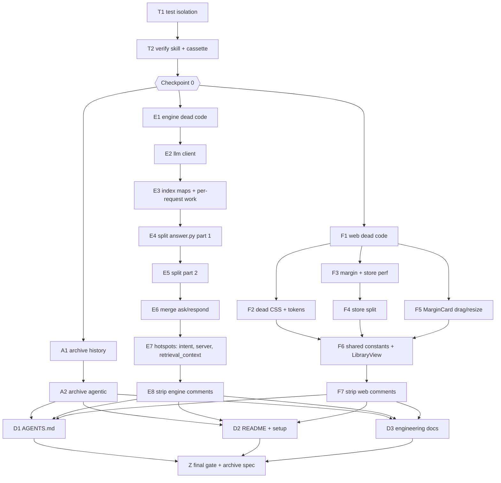

# Implementation Plan: Deslop the codebase

Spec: `SPEC.md`. Branch: `fix/deslop-codebase`. Task list: `tasks/todo.md`.

## Overview

Five phases. Phase 0 builds the safety net (machine-independent tests, the
verify skill, a behavior cassette recorded on the untouched tree). Phases 1–3
clean history, engine and frontend; engine and frontend run in parallel because
they share no files. Phase 4 rewrites the docs last, because code changes rename
things the docs describe. Phase 5 measures, runs every gate, and archives the
spec and task files.

## Architecture Decisions

- **Cassette before any engine edit.** Live Ollama is not bit-exact across runs
  (AGENTS.md), so "same answers" is proven by record/replay: every
  generate/stream/embed call and every engine response for a fixed question set
  is recorded once on the pre-refactor tree. Replay must be byte-identical. The
  cassette holds book text, so it lives in gitignored `data/verify/`.
- **Workers run in git worktrees.** Each worker gets `isolation: worktree`, so a
  half-finished task never pollutes another worker's gate. The orchestrator
  merges a worker's commits into `fix/deslop-codebase` only after the verifier
  passes.
- **Engine work is sequential** (most of it touches `answer.py`). Frontend work
  is sequential within `web/lib/store.ts` and parallel elsewhere. Engine and
  frontend streams run in parallel to each other.
- **`answer.py` keeps re-exports** of every moved name that tests or kept
  harnesses import, so callers do not break.
- **Comments are stripped late**, after the refactor in each stream, so workers
  keep the context while they restructure. The stripping task first copies every
  measured "why" into `docs/DECISIONS.md`.
- **Archive, not delete.** History moves to `archive/` with `git mv`. Nothing
  under `archive/` is edited, tested, or imported.

## Dependency graph

## Loop per task (autonomous)

Agent models (owner decision): workers run `model: sonnet` (Sonnet 5.5),
`effort: medium`; verifiers/reviewers run `model: opus` (Opus 5.5),
`effort: medium`.

1. **Build:** a worker subagent (worktree) runs `/agent-skills:build` on one
   task from `tasks/todo.md` and commits in its worktree.
2. **Verify:** a fresh verifier subagent runs the `verify` skill and
   `/agent-skills:review` on the worker's diff, without the worker's reasoning.
   Verdict PASS / FAIL with evidence.
3. **Land:** on PASS, the orchestrator merges into `fix/deslop-codebase`, reruns
   `verify` (offline + cassette) on the merged tree, ticks the task, pushes.
   On FAIL, one fix round by the worker; a second FAIL reverts and logs the task
   under "Needs owner".
4. **Checkpoint:** at each phase end, the full `verify --live` gate (restart
   `server.py`, both batteries) runs before the next phase starts.

## Risks and Mitigations

| Risk | Impact | Mitigation |
|---|---|---|
| Refactor changes answers silently (`_is_live` attr, `TypeError` probing, regex order, `id(index)` caches) | High | Cassette replay on every engine task; fakes keep `_is_live`; no signature changes without the cassette |
| Cassette miss caused by legitimate dedup (e.g. merged sentence splitters) | Med | Do not merge behavior-different helpers (sentence splitters stay separate); a miss = revert |
| Live battery flake (multicloud cold run) | Low | Re-run once; only a repeat is red |
| Moved names break the ~59 archived scripts | Low | Archived scripts are history, not run; kept harnesses get re-exports |
| Frontend regex rule tests pin exact strings in `store.ts` | Med | Keep the strings in `store.ts` or update the rule to the new path, never weaken it |
| User localStorage data lost | High | Keys and stored shapes frozen (SPEC open question 6) |
| `launch.py` / restart kills a non-engine process | Med | Restart only a PID whose command line is `server.py` |
| Chrome browser smoke cannot run unattended | Low | Optional in `verify`; skipped runs are logged, not faked |

## Open Questions

None blocking. Defaults from `SPEC.md` apply; anything that would change engine
output is logged under "Needs owner" in `tasks/todo.md`.
