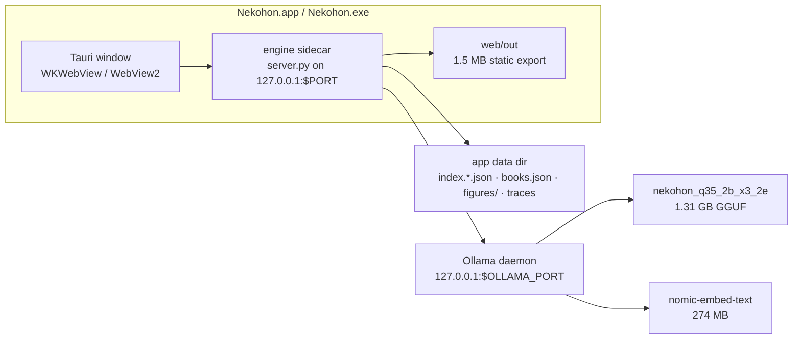

# App packaging — 2026-10-30

Status: **proposal, not approved; nothing implemented.** Supersedes the
installer/launcher half of `packaging-plan-2026-10-17.md` (the Modelfiles and
`scripts/setup_models.py` half of that plan did ship; its own status line,
"nothing implemented", is stale for the setup scripts and still true for the
installer).

Owner question 2026-10-30: "bundle this to an app. in mac, pc or phone."
Owner decisions 2026-10-30: **Mac first**, **Tauri** shell, **bundle Ollama**.
Windows stays the second build. Phone stays a separate track.

## The honest split

Desktop and phone are not the same task.

- **Mac and PC** share one codebase and one build recipe. The app is a window
  on an engine that already runs: `scripts/launch.py` starts Ollama, starts
  `server.py`, opens a browser. Packaging replaces "browser tab" with "app
  window", "repo checkout" with "installer", and "python server.py" with
  "double-click".
- **Phone is a port, not a bundle.** Ollama has no iOS/Android runtime; the
  engine is ~7,700 lines of Python across `server.py`, `answer.py`,
  `retrieve.py` plus a stdlib HTTP loop; iOS gives an app a few GB of memory
  before jetsam and forbids a persistent background server. A phone app means
  rewriting retrieval and answer orchestration in Swift/Kotlin around
  llama.cpp, not shipping this tree. The cheap phone story that works today is
  the reader as a LAN PWA served by the desktop; the expensive one is a new
  product.

Recommendation: **Mac first, Windows second, phone only as a LAN PWA** until
"phone without a desktop" is a stated requirement.

## What already exists (verified 2026-10-30)

| Piece | State |
| --- | --- |
| Engine serves the built UI | yes — `server.py:39-40` (`WEB_OUT = ROOT / "web" / "out"`), export is 1.5 MB |
| Launcher | `scripts/launch.py` — starts Ollama if down, applies env, starts engine, `--open` browser |
| Model setup | `scripts/setup_models.py` — SHA-256 verify, `ollama create`, warm probe |
| Port | `$PORT` / `--port` (`server.py:44-52`) |
| Trace log path | `$OBSERVE_LOG` (`observe.py:39`) |
| Data path | **repo-relative and hardcoded** — `ROOT = Path(__file__).resolve().parent` in `server.py:39`, `retrieve.py:21`, `ingest.py:16`, `figures.py:11` |
| Inference endpoint | **hardcoded** `127.0.0.1:11434` in `retrieve.py:23`, `answer.py:240`, `server.py:86`, `preflight.py:30`, `scripts/setup_models.py:96` |

Measured weights: answer GGUF `nekohon_q35_2b_x3_2e` 1.31 GB, embedder
`nomic-embed-text` 274 MB, one book index 5–12 MB, `web/out` 1.5 MB. Ollama's
Windows installer alone measured 1,578,217,944 B on 2026-10-11; the mac app is
smaller (not measured here). Expect **2–3.5 GB installed**, dominated by the
model and the runtime.

## Architecture of the bundle

The window is a viewport on the engine URL. No new UI code; no Node at
runtime.

## Decisions (recommended default in bold)

1. **Shell.** **Tauri v2** (owner pick). Rust shell + system webview, Python
   engine shipped as a sidecar. The Tauri bundler produces the Mac `.app` and
   `.dmg` directly. Two integration options:
   - **Window points at the engine URL** (`http://127.0.0.1:8000`) — chosen for
     v1. No change to `web/`, no CORS work: the page is same-origin with the
     engine, so `engineUrl()` (`web/lib/engine.ts:63-72`) keeps returning `""`.
   - Tauri loads `web/out` from the bundle (`frontendDist`) — faster first
     paint, but the page origin becomes `tauri://localhost` (macOS) /
     `http://tauri.localhost` (Windows), so `engineUrl()` must return the
     engine URL and `ORIGINS` behind `_cors` (`server.py:207-212`) must
     allowlist both. Only worth it if startup time measurably matters.
2. **Model runtime.** **Bundle the Ollama daemon as a child process** and
   point it at the app's own model store, on its own port (daemon started with
   `OLLAMA_HOST=127.0.0.1:11435`, engine pointed there by `$OLLAMA_URL`) so it
   never fights a user's existing Ollama on 11434. Replace it with a bundled
   `llama-server` only after a measured bake-off (Phase 4).
3. **Installer weight.** **Thin** (≈ engine + UI; first run downloads the two
   GGUFs with SHA-256 verify and a progress card) over fat (2 GB+ installer,
   cannot be a GitHub release asset).
4. **Signing.** Ad-hoc for personal use now; Developer ID + notarization
   ($99/yr) and a Windows certificate only if this is distributed to other
   people.
5. **Books.** Ship **no book content**. The app installs with an empty shelf;
   the reader imports an EPUB (`mode: "import"` already exists). The current
   three-book index is derived from copyrighted files and stays local.

## Phases

Each phase is one commit with its own gate. Phase 0 is the only real refactor.

### Phase 0 — writable data dir + endpoint seam

- Resolve a data home in one place: `$NEKOHON_DATA_DIR` → platform default
  (`~/Library/Application Support/Nekohon` on macOS,
  `%LOCALAPPDATA%\Nekohon` on Windows) → repo root when unset, so dev and
  tests are unchanged.
- Route every `ROOT / "data"` and `ROOT / "books"` read/write through it:
  `server.py`, `retrieve.py`, `ingest.py`, `figures.py`, `observe.py`.
- Route every `127.0.0.1:11434` through `$OLLAMA_URL` (same five files).
- Gate: run the tree from a read-only copy with `NEKOHON_DATA_DIR` set to an
  empty dir → shelf loads, import an EPUB, ask, figure renders; `python -m
  unittest discover -s tests` green; battery unchanged.

### Phase 1 — the window (Tauri)

- Add `src-tauri/` beside `web/` with two jobs: spawn the Python engine as a
  Tauri sidecar (`bundle.externalBin`), and navigate the window to
  `http://127.0.0.1:8000` once `/health` answers.
- The sidecar is a PyInstaller build of a small `app.py` supervisor: it starts
  Ollama (Phase 2), starts `server.py`, and owns both. PyInstaller cannot
  cross-compile, and Tauri requires a target-triple suffix
  (`nekohon-engine-aarch64-apple-darwin`).
- Port: fixed 8000 for v1. If it is taken, show "another Nekohon or a dev
  server is running" rather than silently picking another port — the repo
  rule is one listener on :8000.
- Apple silicon only for v1. A universal `.app` needs a universal Python
  sidecar, which PyInstaller does not produce; Intel waits for a measured
  reason.
- **Lifecycle is the Tauri-specific risk.** Tauri's shell plugin kills a
  sidecar with SIGKILL, so no Python cleanup runs and an Ollama child would
  orphan holding ~1.5 GB. Fix at landing: put the supervisor in its own
  process group and kill the group from Rust, or send SIGTERM and let the
  supervisor stop Ollama before exiting.
- Gate: double-click opens a window; ask works; quit leaves no listener on
  8000 or the Ollama port and no orphan `ollama` process; second launch
  focuses the first window.

### Phase 2 — model runtime

- Detect an existing Ollama; otherwise run the bundled daemon with
  `OLLAMA_MODELS` inside the app data dir and `$OLLAMA_PORT` free.
- First run: download answer GGUF + embedder, verify SHA-256, `ollama create`,
  warm probe (reuse `scripts/setup_models.py` functions), progress UI.
- Gate: fresh user profile, no Ollama, network on for first run only; then
  wifi off and ask — the answer and refusal still work.

### Phase 3 — installers

- macOS: `tauri build` → `Nekohon.app` + `Nekohon_<version>_aarch64.dmg`
  (Tauri's bundler; no `create-dmg`). Ad-hoc sign for personal use; Developer
  ID + notarization only if this goes to other people.
- Windows: same `src-tauri/` → NSIS `Nekohon_<version>_x64-setup.exe`, sidecar
  built as `nekohon-engine-x86_64-pc-windows-msvc`.
- Build on each OS; neither Tauri nor PyInstaller cross-compiles. Both
  machines exist.
- Gate: clean VM/user → install → ask the France question (exact
  `Not in this book.`) → ask an in-book question (cited answer) → quit →
  uninstall keeps the library.

### Phase 4 — optional: drop Ollama

- Adapter to `llama-server` (OpenAI-shaped API) behind the same env seam;
  measure TTFT, tok/s, sealed-suite parity, footprint delta against the Ollama
  path. Adopt only on a measured win.

## Phone track (separate plan, not this one)

| Option | Cost | What breaks |
| --- | --- | --- |
| LAN PWA | a weekend | desktop must be awake; no offline; needs a manifest + icons only |
| Native app | months, new repo | rewrite of retrieval + orchestration, llama.cpp per platform, 1.5B mobile model (986 MB), iOS memory ceiling, App Store review |

Do not start the native track until "phone without the desktop" is a real
requirement.

## Risks

- **macOS Gatekeeper and translocation.** Unsigned apps show the "unidentified
  developer" dialog; a DMG-launched app runs translocated and its bundle is
  read-only — another reason every write goes to the data dir.
- **Tauri + PyInstaller signing.** The `.app` contains a Rust binary, a
  PyInstaller onefile/onedir sidecar, and the Python runtime's dylibs; all
  must be signed inside out. Notarization needs a paid account. Personal use
  can stop at ad-hoc.
- **A new toolchain.** Tauri adds Rust (stable) and the Tauri CLI to a repo
  that has none today. That is the cost the owner accepted with the shell
  pick; it stays inside `src-tauri/`.
- **Windows WebView2** ships with Win11; Win10 needs the runtime (bootstrapper
  or fixed-version ~150 MB).
- **Ollama drift.** Bundled version vs a user's installed version; two model
  stores; a killed engine can orphan the daemon — supervise and reap.
- **Index/model coupling.** An index records its embedder (`retrieve.py:357`);
  changing the embedder invalidates every index. Migration needs a re-embed,
  not a rename.
- **Model license.** Verify the answer model's base license before
  redistributing weights; Ollama is MIT (ship its license text).
- **Disk.** 2–3.5 GB installed, plus a second copy if a user already has the
  models in `~/.ollama`.

## Not doing

Auto-update, App Store / Microsoft Store, cloud sync, shipping books,
Windows code signing, a phone build.

## Verification per release (clean machine, not this box)

1. Install → double-click → window opens, no browser tab, no terminal.
2. France question → exactly `Not in this book.`; one in-book question →
   cited answer; one figure renders.
3. Wifi off after first run → still answers.
4. Quit → no listener on the engine or Ollama port; relaunch reuses the data
   dir and the shelf.
5. Existing gates unchanged: battery, pins, `python -m unittest discover -s
   tests`.

## Next step

Phase 0 lands alone: data dir + `$OLLAMA_URL` seam, tests re-run. Phase 1 then
adds `src-tauri/` and the PyInstaller sidecar against the fixed port 8000.
