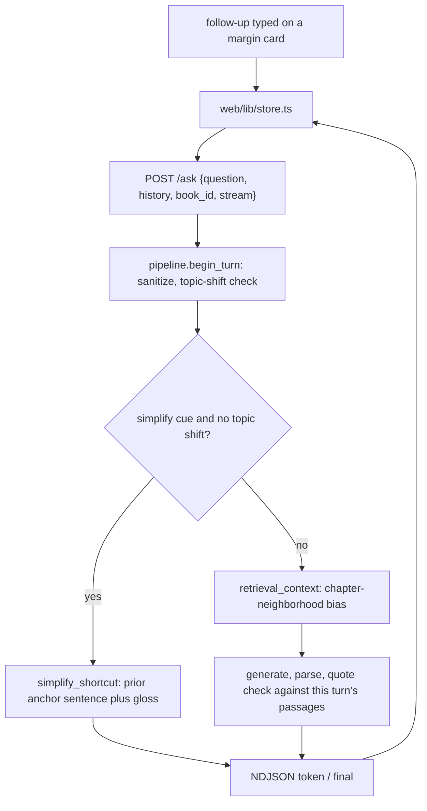

# Conversation map

Read before touching the thread. The browser holds the thread in zustand; the
server stays stateless. Each margin card keeps independent turns.

## What you may change

| May change | Must not change |
| --- | --- |
| Optional `history` on `POST /ask` (last 2 turns) | Server-side sessions, any database |
| Client thread in the store (turns shown per card) | Retrieval source: it is never a prior answer or prior passages |
| Clip rules: question 200 chars, answer 400 chars per history item (`engine/answering/sanitize.py`) | Quote check scope: this turn's passages only |
| `user_message` labeling earlier turns as context, not source | Refusal text: exactly `Not in this book.` |
| Chapter-neighborhood bias for follow-up retrieval | Groundedness: quotes must be verbatim passage text |
| Multi-book routing via `book_id` | New routes beyond the documented set |

A missing or empty `history` is the one-shot path. The battery, golden pins,
curl and `window/index.html` work without the field.

## What breaks the quote check

1. A prior answer's text ends up inside `Passages:`.
2. Prior passage bodies are stored on the client and resent as evidence.
3. Retrieval is skipped or frozen to the last turn's chunk ids instead of
   searching on the current question.
4. A quote parser (`parse_completion`, `parse_answered`) is pointed at history
   text instead of this turn's passages.
5. A citation chip on turn 2 is claimed from turn 1's prose without that span in
   turn 2's passages.
6. A stopped or error partial is committed into `history`, and the next turn
   quotes unchecked text.
7. A refusal is softened, padded or replaced because a later turn "is chat".

Earlier turns help resolve pronouns and "simpler" cues. They are never a source.

## Wire

`POST /ask` accepts, besides `mode`, `question`, `selection`, `heading`,
`chunk_id`, `end_chunk_id`, `book_id`, `stream`: `history`, a list of
`{"question": str, "answer": str}`. At most the last 2 completed turns are used.

## File map

| File | Role |
| --- | --- |
| `engine/server.py` | Validates the request, streams NDJSON. |
| `engine/answering/sanitize.py` | Clips and cleans `history`; prompt-injection check. |
| `engine/answering/pipeline.py` | `begin_turn`, `simplify_shortcut`, follow-up quote advance, history guards. |
| `engine/answering/conversation.py` | Topic shift, subject from history, contextual query resolution. |
| `engine/answering/context.py` | History-sequence passages and pin neighbors in `retrieval_context`. |
| `engine/answering/messages.py` | `user_message`: earlier turns labeled as context. |
| `web/lib/store.ts`, `web/lib/turns.ts` | Card turns, per-book state, in-flight streams, follow-up dispatch. |
| `web/lib/persist.ts` | Per-book localStorage (`nekohon-state-<book_id>`). |
| `web/components/margin/MarginCard.tsx`, `TurnView.tsx`, `FollowUpForm.tsx` | Stacked turns, chips, figures, follow-up input. |

## Verification

`tests/test_query_understanding.py` keeps query understanding, canonicalization
and coreference book-agnostic. Scenario harnesses: `artifacts/README.md`.
