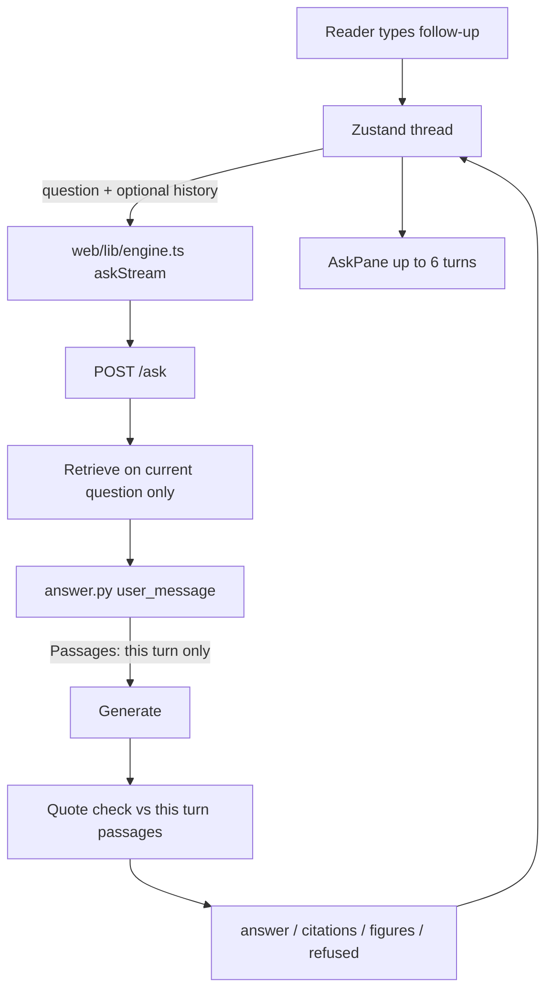

# Conversation map — read before touching the thread (2026-10-15)

Status: intended design for this session. Browser holds the thread; server stays
stateless. Do not wire `agentic.py`. This page is the map a later agent opens
first.

## What you may change

| May change | Must not change |
| --- | --- |
| Optional `history` on `POST /ask` (last 2 turns) | Server-side sessions, any database, sqlite |
| Client thread in Zustand (up to 6 turns on screen) | Retrieval source = prior answer or prior passages |
| Clip rules: question 200 chars, answer 400 chars per history item | Quote check scope: **this turn's passages only** |
| `user_message` block that labels earlier turns as not a source | Refusal text: exactly `Not in this book.` |
| New conversation control that clears the client thread | New routes beyond the frozen set |
| Send `history` from `engine.ts` when the store has finished turns | `agentic.py` wiring |

Missing or empty `history` = today's one-shot path. Battery, pins, curl, and
`window/index.html` stay valid without the field.

## What breaks the quote check

The grounded rule fails if any of these land:

1. Prior answer text is treated as a passage, or ends up inside `Passages:`.
2. Prior passage bodies are stored on the client and resent as evidence.
3. Retrieval is skipped or frozen to last turn's `chunk_id` list instead of
   searching on the **current** question.
4. Quote parse (`parse_completion` / `parse_answered`) is pointed at history
   text, or at last turn's citations, instead of this turn's `retrieval_context`
   passages.
5. A citation chip on turn 2 is claimed as evidence from turn 1's prose without
   that span appearing in turn 2's passages.
6. A stopped or error partial is committed into `history` and the next turn
   quotes unchecked text.
7. Refusal is softened, padded, or replaced because a later turn "is chat".

Earlier turns may help the model resolve "that" / "simpler". They are never a
source. The book is the source. Chat is not.

## Contract (this session)

- **Where the thread lives:** browser (Zustand). Reload = new thread. Server
  does not keep it after the handler returns. No database.
- **Wire:** `POST /ask` may include:
  ```
  history: [ { "question": string, "answer": string }, ... ]
  ```
  Last **2** turns only. Clip each `question` to **200** chars and each
  `answer` to **400** chars before send. Drop oldest first if longer.
- **Missing history:** one-shot, unchanged.
- **Retrieval:** current question only (fold or rewrite on the client is fine;
  the search string is still "this ask"). Earlier text is not a source.
- **Quotes:** must appear in this turn's retrieved passages. Same refusal
  sentence on every turn.
- **UI:** show up to **6** finished turns; **New conversation** clears the
  thread, live body, highlight, and composer. Stop still does not commit.
- **Out of scope:** `agentic.py`. Clarify-back (third response type) stays
  parked in `AGENTS.md` post-v1 backlog.



## File map

| File | Role in conversation |
| --- | --- |
| `server.py` | `Handler.do_POST` / `_stream_ask`. May validate optional `history` (type, max 2, clip). Pass through; do not store. Missing = today. Still only `/ask`. |
| `answer.py` `user_message` | Builds `Question:` + `Passages:` + reminder. May add a short "Earlier (not a source)" block from clipped history. `ask` / `respond` still retrieve on the current question. Quote check stays on this turn's passages. |
| `web/lib/store.ts` | Thread owner. Today: one `priorQuestion` / `priorAnswer` and a client fold for short follow-ups. Target: finished turns (show ≤6), send last 2 as `history`, `newConversation()` clear, no commit on `stopped` / `error`. |
| `web/lib/engine.ts` | `askStream` payload. Today: `{ mode, question?, selection?, stream: 1 }`. May add `history` when the store has finished turns. |
| `web/components/AskPane.tsx` | Renders the log + composer. Today: one prior block above the live answer. Target: up to 6 turns, New conversation control, chips still jump the book per that turn's `citations`. |

Related, do not start here: `follow-up-history.md` (longer design draft; first-slice fold already started), `companion-track.md` (order of the companion steps), `prompt.py` (at most one SYSTEM line that earlier turns are not passages — only if needed).

## Done-when (human check)

A person can verify without a battery number:

1. Ask a normal in-book question; get an answer with a citation.
2. Ask a second question that says "what about that" (or similar).
3. The first turn stays on screen.
4. A quote in the second answer is a span from a **passage retrieved this turn**,
   not a copy of the first answer's gloss.
5. Citation chip on the second answer jumps that passage in the open book.
6. New conversation clears the thread; the next ask behaves like a first ask.
7. A question with no `history` (curl / battery path) still matches today's body
   shape; refusal is still exactly `Not in this book.`

Latency, rank, and suite scores are **Not measured** on this page unless a later
report ships command + evidence path + before/after.

## Revert

1. Remove the `history` argument from the client payload and from any server /
   `answer.py` handling. Unknown keys were already ignored before this field.
2. Remove the client thread (turns list / New conversation); restore one-shot
   pane behavior (or the prior-only fold if that slice stays).
3. If a model was swapped while testing: `ANSWER_MODEL=qwen2.5:7b`, restart the
   engine. `ANSWER_MODEL=smallbook_x2d` restores the shipped tag without a file
   edit.

## Measured vs assumed

**Measured in tree before this session's history wire (2026-10-15):** stateless
`ask` / `respond`; no server `history`; `engine.ts` sends mode + question +
stream; store holds one prior pair and may fold a short follow-up into
`question`; quote check uses this turn's passages; refusal sentence fixed;
`agentic.py` unwired; sqlite forbidden.

**Intended this session (treat as design; re-read the named files after the
edit):** optional last-2 `history` with 200/400 clips; UI ≤6 turns + New
conversation; retrieval still current-question-only.

**Assumed until someone runs it:** that two clipped turns stop chat-from-memory
copying; that "what about that" retrieves the right passage; any latency delta.
