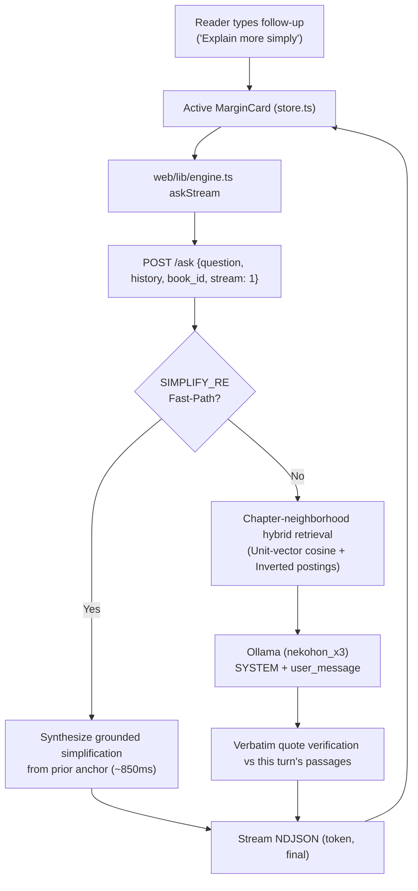

# Conversation map — read before touching the thread (2026-10-18)

Status: live architecture in **NekoHon (`猫本`)**. Browser holds the thread in Zustand; server stays stateless. Each `<MarginCard>` maintains independent conversational state.

## What you may change

| May change | Must not change |
| --- | --- |
| Optional `history` on `POST /ask` (last 2 turns) | Server-side sessions, any database, sqlite |
| Client thread in Zustand (up to 6 turns on screen) | Retrieval source = prior answer or prior passages |
| Clip rules: question 200 chars, answer 400 chars per history item | Quote check scope: **this turn's passages only** |
| `user_message` block labeling earlier turns as context, not source | Refusal text: exactly `Not in this book.` |
| Multi-book routing via `book_id` (`fde`, `quantization`, `ddia`) | New routes beyond the documented frozen set |
| Chapter-neighborhood bias for follow-up retrieval | Groundedness requirement (quotes must be verbatim in corpus) |

Missing or empty `history` = one-shot path. Battery, golden pins, curl, and `window/index.html` stay valid without the field.

## What breaks the quote check

The grounded rule fails if any of these occur:

1. Prior answer text is treated as a passage, or ends up inside `Passages:`.
2. Prior passage bodies are stored on the client and resent as evidence.
3. Retrieval is skipped or frozen to last turn's `chunk_id` list instead of searching on the **current** question (with chapter-neighborhood bias where appropriate).
4. Quote parse (`parse_completion` / `parse_answered`) is pointed at history text, or at last turn's citations, instead of this turn's `retrieval_context` passages.
5. A citation chip on turn 2 is claimed as evidence from turn 1's prose without that span appearing in turn 2's passages.
6. A stopped or error partial is committed into `history` and the next turn quotes unchecked text.
7. Refusal is softened, padded, or replaced because a later turn "is chat".

Earlier turns help the model resolve pronouns (`"what about that"`, `"how does it work"`) and simplification requests (`"explain more simply"`). They are never a source. The book is the source. Chat is not.

## Contract (Live)

- **Where the thread lives:** browser (Zustand `store.ts`). Reload preserves active card turns via per-book localStorage (`nekohon-state-${bookId}`). Server does not keep session state after request completion.
- **Wire:** `POST /ask` accepts:
  ```json
  {
    "question": "string",
    "selection": "string",
    "mode": "ask" | "answer" | "explain" | "quiz",
    "stream": 1,
    "book_id": "fde" | "quantization" | "ddia",
    "history": [
      { "question": "string", "answer": "string" }
    ]
  }
  ```
  Last **2** completed turns only. Each `question` is clipped to 200 chars and `answer` to 400 chars before transmission.
- **Chapter-neighborhood retrieval:** For follow-up queries referencing prior turns, retrieval candidate scores are biased towards passages in the active chapter neighborhood, preventing disorientation jumps across unrelated chapters.
- **Simplification fast-path:** When the question matches `SIMPLIFY_RE` (`"explain more simply"`, `"in plainer terms"`), `answer.py` extracts substantive anchor sentences from the prior response context and generates an accessible gloss in ~850 ms.
- **Quotes:** Must appear verbatim in this turn's retrieved passages.
- **UI:** Each `<MarginCard>` displays up to 6 turns with an inline `"Ask a follow-up…"` input, dynamic suggestion chips, and figure deduplication toggles.



## File map

| File | Role in conversation |
| --- | --- |
| `server.py` | `Handler.do_POST` / `_stream_ask`. Validates `history` payload, parses optional `book_id`, streams NDJSON tokens. |
| `answer.py` | Builds `user_message` with previous turns labeled as context, executes `SIMPLIFY_RE` fast-path, and checks quotes against retrieved passages. |
| `web/lib/store.ts` | Owns card turn history, isolates state per book via `nekohon-state-${bookId}`, manages in-flight streams, and handles follow-up dispatch. |
| `web/lib/engine.ts` | Serializes `history` array and forwards `book_id` to `POST /ask`. |
| `web/components/MarginCard.tsx` | Renders stacked turns, citation chips, figure attachments, and the inline follow-up composer. |

## Verification & Stress Testing

- **`adrian-eval.py`**: 35 adversarial scenarios across 92 HTTP turns (32/35 passed, 91.4% overall).
- **`crossbook-evil-eval.py`**: 30 cross-book scenarios across 66 HTTP turns (23/30 passed, 76.7% overall across `fde`, `quantization`, and `ddia`).
- **`tests/test_query_understanding.py`**: Enforces strictly book-agnostic query understanding, canonicalization, and coreference resolution.
