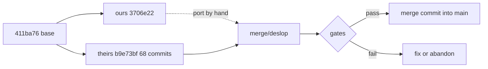

# Merge plan — `fix/deslop-codebase` into `main` (2026-10-25)

Goal: one tree that keeps the friend's refactor and frontend, and keeps our
measured engine fixes, bench and docs. Nothing is merged until the gates below
pass on the merged tree.

## Inputs

| side | ref | what it is |
| --- | --- | --- |
| ours | `main` = `3706e22` | 1 commit on top of `411ba76`: bench, 3 engine fixes, docs audit, round-5 record |
| theirs | `nekolabs/fix/deslop-codebase` = `b9e73bf` | 68 commits on the same base: `engine/` split, new docs, restructured `web/`, 405 tests |
| base | `411ba76` | the commit both sides started from |

No PR exists in either repo; the branch is the artifact.

## Why this is not a plain `git merge`

They deleted `answer.py` and moved `prompt.py`, `retrieve.py` and `server.py`
into `engine/`. A textual merge either conflicts or, with rename detection,
silently drops our changes. So the branch becomes the **base**, and our delta is
re-applied by hand. Our delta is small: ~110 lines of behaviour across three
modules, six test files, ten harnesses, five docs.

## What we merge, file by file

### 1. Engine behaviour — port into their modules

| our change | lands in | work |
| --- | --- | --- |
| 4 plain-register cues | `engine/answering/answermode.py` `SIMPLE_CUES` | add 4 strings |
| default answer model `nekohon_q35_2b_x3_2e` | `engine/llm.py` (`ANSWER_MODEL`, still `nekohon_x3`) | 1 line + reason in DECISIONS |
| whitespace-safe prior-quote lookup | `engine/answering/conversation.py` | first verify their `norm_prior` covers CRLF; if yes, nothing to port |
| fabricated-attribution guard | `engine/answering/sanitize.py` + call sites in `askmode.py`, `answermode.py` | ~25 lines, both modes |

### 2. Tests — ours onto their layout

Keep: `test_followup_subject`, `test_fabricated_attribution`, `test_hard_mt_leakage`,
`test_training_quotes`, `test_eval_leakage`, `test_harness_fairness`,
`test_opencode_call`. Change imports (`answer` → `engine.answering.*`,
`prompt` → `engine.answering.prompt`, `retrieve` → `engine.retrieval.retrieve`).
Drop any test whose behaviour their refactor already covers, after checking.

### 3. Harnesses — re-apply on theirs

The branch modified most of `artifacts/harnesses/`. Port our three new files
(`fair_cite.py`, `sealed-eval.py`, `hard-mt-eval.py`) and re-apply our edits to
`adrian-eval.py`, `crossbook-evil-eval.py`, `hard-bench.py`, `judge.py`,
`secret-scan.py`, `step2-battery.py` against their versions.

### 4. Frontend — take theirs

Their `web/` is the Oct 24 structure (`components/library`, `components/margin`,
`lib/stream.ts`). It calls only `/health`, `/chunks`, `/ask` (+ `import`), all of
which exist. No `study.css`/`ledger.css`. No new dependencies.
Our current `web/` is the Oct 19 version; the Antigravity one is in `stash@{0}`.

### 5. Docs — ours for state, theirs for reasoning

| doc | winner |
| --- | --- |
| `README.md`, `BUILD_PLAN.md`, `GLOSSARY.md`, `AGENTS.md`, `artifacts/README.md` | **ours** (measured 2026-10-25 state) |
| `docs/DECISIONS.md` (475 lines), `docs/ENGINEERING.md` (209) | **theirs**, new to us |
| their `archive/`, `tasks/`, `.agents/` | theirs, kept as-is |

Cross-link: every ported fix gets one bullet in `docs/DECISIONS.md`, because
their source carries no comments.

## Phases and gates

| phase | work | gate before moving on |
| --- | --- | --- |
| 0 | tag `pre-merge`, branch `merge/deslop` from `b9e73bf` | tag exists |
| 1 | port engine (4 items) | their suite still 405, 0 failures |
| 2 | port tests and imports | merged suite green |
| 3 | port harnesses | `hard-mt` runs, 0 import errors |
| 4 | docs merge | path check: 0 broken `artifacts/` refs |
| 5 | frontend already theirs | `npm run build` if node_modules allow; else `tsc --noEmit` |
| 6 | run the six gates on the merged tree | see acceptance |
| 7 | merge commit into `main`, push | `main` builds, gates recorded |

## Acceptance (all must hold on the merged tree)

| gate | bar |
| --- | --- |
| test suite | 0 failures (their 405 + our ported tests) |
| hard-mt (12) | 12/12 |
| sealed (30) | >= 27/30 |
| hard bench (60) | >= 59/60 |
| adrian (35) | >= 32/35 |
| battery | PASS, both modes |
| default model | `nekohon_q35_2b_x3_2e` |

## Rollback

`main` is untouched until phase 7. `pre-merge` tags `3706e22`. The branch
`merge/deslop` can be deleted without consequence. Nothing is pushed until the
gates pass.

## Cost

Roughly one working day: ~3 h engine port, ~2 h tests/harnesses, ~2 h docs,
~1 h gates. The engine split is the only part that cannot be automated.

## Decisions needed before phase 1

1. **Comments.** Their E8 removed every comment and docstring; reasons live in
   `docs/DECISIONS.md`. Do we keep that rule inside `engine/` (recommended, one
   convention per tree), or re-add why-comments where we port fixes?
2. **Docs.** Confirm ours wins for current state; theirs is added as new files.
3. **Their `tasks/` and `archive/`.** Keep them in the merged tree, or drop them
   from the merge?
