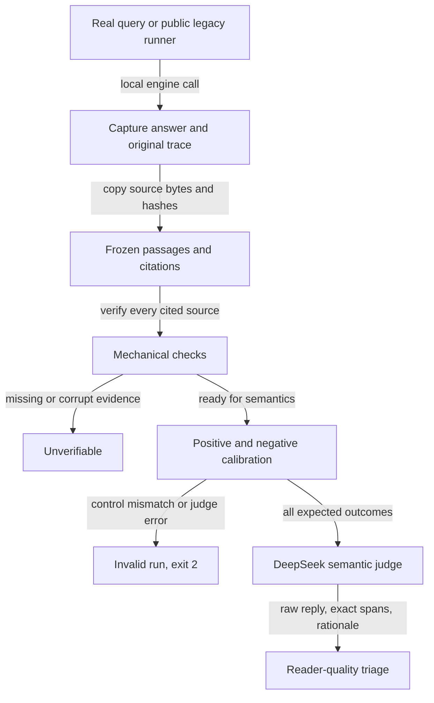

# Evaluation integrity, 2026-10-29

The judge now uses DeepSeek V4.1 Flash. Saved answers are evaluated against
frozen source text, not a new retrieval. Real-query replay and browser checks
expose failures that a green type or source-pattern check cannot establish.

## What changed

- `harnesses/judge.py` defaults to `opencode/deepseek-v4.1-flash-free`.
  Its only automatic fallback is `opencode-go/deepseek-v4.1-flash`.
  Muse is no longer a default, including the explicit HTTP backend.
  `JUDGE_BACKEND=ollama` selects the offline judge explicitly.
- CLI judging uses a private configuration, empty working directory,
  `--standalone`, and a tool-disabled verdict agent. Prompts go through stdin.
  The result records the requested and actual model, fallback, errors, prompt
  hashes, raw replies, and bounded transport attempts. Invalid or ambiguous
  labels are errors, not inferred verdicts.
- `harnesses/rank-answers.py` does not retrieve on replay. Missing original
  text and ambiguous citation attribution are unverifiable, not invented claims.
  Supplied passage hashes are checked. Explicit chunk citations cannot borrow
  another passage from the same chapter. Regex/chapter hints and `no_reask` are
  advisory. Semantic completeness checks the requested definition, list, or
  comparison. Owner ratings remain separate from checker/persona ratings.
- `harnesses/behavioral_eval.py` checks frozen evidence, every citation, the
  displayed quote versus citation metadata, the exact refusal contract, and
  useful gloss presence. Its semantic rubric accepts short correct definitions.
  It requires exact source spans in a structured judge rationale. A malformed
  JSON reply gets one strict retry; both attempts are retained.
- `harnesses/reader-eval.py` captures real local queries and replays those bytes.
  Its `suite` command instruments public in-process legacy runners through
  `harnesses/eval_capture.py`. Delegation such as `respond -> ask` is captured
  once. Original function results and existing traces are preserved.
- Legacy suite output directories are redirected into the new run directory.
  A process-local audit guard blocks writes, deletes, or renames under historical
  `artifacts/evidence/`. HTTP-only or unsupported runners with no captured calls
  fail explicitly instead of reporting a passing capture.
- `fair-eval.py` now defaults to `dev`. A quote must exist in its actual cited
  source; one good citation cannot hide a fabricated second citation.
  `hard-bench.py` rejects unknown citation IDs and cannot validate controls with
  zero exercised answer items. These are integrity fixes, not a claim that the
  old regex-based semantic scores became authoritative.
- `harnesses/ux-eval.py` drives a real isolated agent-browser session. It checks
  keyboard submission, answer rendering, citation navigation and return, exact
  refusal rendering, and book-switch isolation. Failed and blocked steps exit
  nonzero and retain screenshots.



## Label review, not manufactured ground truth

The original `owner-rated-2026-10-15.jsonl` has 27 rows. Only IDs 25, 26, and
27 have an owner `rating`. It was not rewritten.

Case-insensitive search of all 1,042 FDE chunk texts found DDR4 in 0 chunks
and DDR5 in 1, `ch06-011`. Row 13's answer-only expectation cannot justify
calling its historical exact refusal false.

`datasets/answerability-reviews-2026-10-29.json` records that correction with
question and index hashes, search scope, counts, and reviewer identity. It is
an **agent source review, not a fourth owner rating**.

The existing product also permits a covered-side quote plus a gloss explicitly
naming the missing side (`tests/test_half_covered.py:1-5,57-70`). The review
therefore accepts either a clean refusal or an honest boundary answer. It does
not demand an invented DDR4 comparison. A boundary-free one-sided answer still
fails. The semantic judge receives this permission only when the review matches
the exact question, book, and captured index hash.

## Measured real-query replay

Source capture: `artifacts/runs/reader-capture-2026-10-29-sample.json`.
Final replay: `artifacts/runs/reader-judged-2026-10-29-sample-v3.json`.
These files contain local book prose and remain gitignored. Evaluation sends the
selected frozen snippets to the configured cloud judge. Runtime answering and
retrieval remain local.

The source capture's answer bytes were held fixed across replay revisions.
Version 3 applied the versioned review overlay; it did not regenerate answers.

Calibration: **2/2 positive controls accepted; 9/9 negative controls rejected**.
The positives cover a brief paraphrase and a source-reviewed partial answer with
an explicit boundary. Negatives cover refusal-all, question echo, generic filler,
quote-only, wrong citation, template text, missing list, missing comparison, and
partial comparison without its boundary.

The five selected development queries scored **2/5**. Wilson 95% interval for
this selected sample is **11.762077423264783% to 76.9275718723987%**. This is not a
random sample, a held-out benchmark, or an estimate of overall product accuracy.

| Original row | Fresh answer outcome | Evidence |
| --- | --- | --- |
| 2, micro-partitioning | Pass | Short quote and useful gloss; no brevity penalty |
| 13, DDR4 vs DDR5 | Pass as a boundary answer | Sourced DDR5 quote; explicit DDR4 absence; consistent with existing half-covered policy |
| 24, column vs row | Fail | Only the row-oriented side is answered despite columnar evidence being available |
| 26, OSS factors | Fail mechanically | The displayed expanded quote and citation metadata differ; recorded `list_expanded` transform |
| 27, monolith vs modular | Fail | Missing modular side; judge also flags an unsupported gloss claim |

The actual judge model for accepted semantic calls was
`opencode-go/deepseek-v4.1-flash`. The free primary returned a usage-limit error;
that error and the authorized fallback are in each transport record. No other
model was substituted. The final replay recorded 11 judge attempts and 170,733 ms
summed transport time, including calibration. Token use was not measured.

### Earlier runs are retained

- `reader-judged-2026-10-29-sample.json`: invalid calibration because one control
  returned malformed JSON. No quality score was published.
- `reader-judged-2026-10-29-sample-v2.json`: calibration succeeded, 1/5 passed,
  but the new row-13 review was stricter than the existing half-covered policy.
- Version 3 corrected that policy mismatch, added positive/negative partial
  controls, and scored 2/5 on the same answer bytes. The change is in evaluation
  policy, **not an improvement to the answer model**. The extra controls and
  replay calls cost additional time; no before/after efficiency win is claimed.

## Measured browser failure

Independent verification command:

```sh
python artifacts/harnesses/ux-eval.py --session eval-ux-verification --budget 100
```

Result: `artifacts/runs/ux-eval-2026-10-28T173933Z.json`, exit 1.
Its timestamp uses UTC; the local run date was 2026-10-29.

**8/9 steps passed; citation-jump failed.** The mark came to rest at top 875,
bottom 966 in a 900-pixel viewport. The cited sentence is clipped below the
viewport after navigation. Return navigation, refusal, and book-switch isolation
passed. The UI was not patched to hide this result.

Screenshot:
`artifacts/runs/ux-eval-2026-10-28T173933Z/04-citation-jump-failed.png`.

This smoke covers one desktop viewport and one book pair. It does not establish
mobile behavior, import, highlight/explain/quiz interactions, or accessibility
across devices. Source-pattern tests and the runner's plumbing tests are not
counted as this live UX proof.

## Unit and integration validation

The focused regression command is:

```sh
python -m unittest tests.test_eval_capture tests.test_behavioral_eval tests.test_eval_integrity tests.test_judge_transport tests.test_triage_fairness tests.test_judge_axes tests.test_opencode_call tests.test_ux_eval
```

Final focused check: **166 tests, all passed** in
`artifacts/runs/eval-tests-2026-10-29-complete.log`. Compilation of the changed
Python runners also passed. The language server reports no type errors in the
new reader scorer/runner or judge after a focused cleanup; lint warnings remain.

Final full-suite command `python -m unittest discover -s tests` ran **662 tests**
in `artifacts/runs/full-tests-2026-10-29-complete.log`, with one failure:
`test_keywords.RareTests.test_common_words_do_not_fire` at
`tests/test_keywords.py:25`. Its `assertFalse(rare(...))` receives True.
The isolated keywords module ran **6 tests, all passed** in
`artifacts/runs/keywords-isolated-2026-10-29.log`. This is an order-dependent
failure, not a green full suite. `keywords.postings` caches by a recyclable
list ID, length, and first chunk ID; cache aliasing is the leading hypothesis,
not a root cause reproduced by this change. No runtime cache fix or weakened
assertion is included here.

The safe legacy integration smoke ran one Adrian scenario and captured all
**3 actual engine turns**, exit 0:
`artifacts/runs/reader-suite-2026-10-29-adrian-safe-v2.json`.
The historical 35-scenario evidence remained byte-identical during that run.
This verifies the wrapper and original scenario execution, not semantic accuracy
on those three turns; they were not included in the five-query judge score.

An earlier wrapper smoke exposed the legacy runner's fixed output filename and
overwrote its historical output. The original 35-scenario uncommitted content
was recovered from OpenCode's pre-task snapshot, not reset from HEAD. The
recovered file's SHA-256 is
`8305c44b86056f95c1ede7aa8eea0307e3f3d3344d71236ba31eb29827a657da`.
The redirected-output path and write guard were then tested against actual file
writes and deletes before the safe rerun. Both the early smoke and recovery
record remain in `artifacts/runs/`.

## Commands for the next run

```sh
python artifacts/harnesses/reader-eval.py capture --dataset artifacts/datasets/owner-rated-2026-10-15.jsonl --ids 2,13,24,26,27 --reviews artifacts/datasets/answerability-reviews-2026-10-29.json --output artifacts/runs/reader-capture-2026-10-29-next.json
python artifacts/harnesses/reader-eval.py replay --input artifacts/runs/reader-capture-2026-10-29-next.json --reviews artifacts/datasets/answerability-reviews-2026-10-29.json --output artifacts/runs/reader-judged-2026-10-29-next.json
python artifacts/harnesses/reader-eval.py suite --script artifacts/harnesses/adrian-eval.py --output artifacts/runs/reader-suite-2026-10-29-next.json -- --direct --limit 1
```

Capture accepts repeated `--dataset` arguments, including public single-query
sets and Adrian/crossbook scenario formats. It excludes locked development rows
and refuses sealed sets. Suite instrumentation is available to other public
in-process runners; only Adrian was live-validated here. Historical semantic
scores remain legacy/advisory until their actual captured answers are replayed.

## Scope and remaining work

The [suite-wide audit ledger](test-suite-audit-2026-10-29.md) identifies which
assertions and scoring paths were read, reproduced, or only skimmed. It includes
unit, transport, retrieval, generation, multi-turn, streaming, and frontend tests.
It does not turn a source inspection into a claimed live test.

Still open:

- Fix and reproduce the runtime column/row, OSS display/metadata, and
  monolith/modular failures before claiming an answer-quality improvement.
- Fix the citation landing behavior, then rerun the same browser smoke.
- Isolate the full-suite postings-cache failure without clearing state merely
  to make the test green.
- Capture and replay the remaining public eval families. Their old regex-only
  success rates, permissive dummy-baseline ceilings, and sparse owner labels
  remain limitations. HTTP-only batteries cannot supply original in-process
  snapshots through this wrapper and fail capture explicitly.
- Extend UX coverage to mobile, keyboard-only navigation, highlight flows,
  import failures, and streaming interruption. No measurements for these are
  claimed here.
