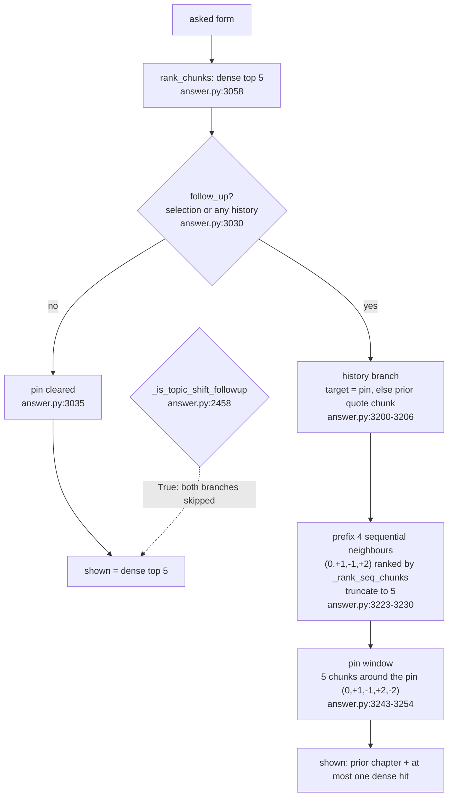

# Follow-up retrieval drift: a prior turn plus the page pin evicts the dense hits

2026-10-29. Read-only diagnosis. No engine code changed, no model or config
touched, no server restarted. All retrieval ran in-process on
`data/index.json` (fde, 1042 chunks) with embeddings from local Ollama
(`127.0.0.1:11434`); `generate_fn` is a stub that returns exactly
`Not in this book.`, so the answer layer never generated. `OBSERVE=0` on every
run: `artifacts/runs/traces.jsonl` was last written at 17:56 local, before any
probe below.

## Result

**11 of 15 questions lost the gold chunk** when the same question was re-asked
as a follow-up after one plausible prior turn *and* the reader's page pin was
present, which is the shape of the live trace. With the prior turn but no pin,
**2 of 15** lost it. Among the 11 questions where the follow-up branch actually
fired (the other 4 were classified as topic shifts and skipped the branch
entirely), the pinned follow-up lost the gold **11 of 11** times.

Standalone, all 15 had their gold chunk in the top 5 by construction; 10 of them
had it at rank 1, and the pinned follow-up evicted 9 of those 10 (the tenth was
one of the four rows the topic-shift check spared).

## Reproduction matrix (trace `879b5033eedd`)

Question `what happened in the early 200`, prior turns taken from the trace's
own `history_preview` (turn 1 quotes `ch01-009`, turn 2 quotes `ch01-025`),
`answer.respond` with the stub.

| prior turns | pin | shown passages |
| --- | --- | --- |
| 0 | none | `ch11-022 ch05-045 ch01-009 ch07-096 ch04-020` |
| 0 | `ch01-025` | `ch11-022 ch05-045 ch01-009 ch07-096 ch04-020` (pin ignored) |
| 1 | none | `ch01-008 ch01-009 ch01-010 ch01-007 ch11-022` |
| 1 | `ch01-025` | `ch01-025 ch01-026 ch01-024 ch01-027 ch01-023` |
| 2 | none | `ch01-025 ch01-026 ch01-024 ch01-027 ch11-022` |
| 2 | `ch01-025` | `ch01-025 ch01-026 ch01-024 ch01-027 ch01-023` |
| 3 | none | `ch01-025 ch01-026 ch01-024 ch01-027 ch11-022` |
| 3 | `ch01-025` | `ch01-025 ch01-026 ch01-024 ch01-027 ch01-023` |

The `N=2 pin=ch01-025` row is the trace's own shown set, chunk for chunk
(`observe.py --id 879b5033eedd`: `['ch01-025','ch01-026','ch01-024','ch01-027','ch01-023']`,
stages `dense, fusion, pinned`, dense top-5 `ch05-045, ch01-009, ch07-096, ch04-020, ch01-010`).
So the answer quoted data maturity because the passage about the early 2000s
was never shown, even though it sat at dense rank 2 and rank 5.

Two corrections to the starting statement, both measured:

- A pin with **zero** prior turns is ignored: standalone `pin=ch01-025` returns
  exactly the unpinned set. The 2026-10-28 anchor rule holds on its own.
- The trace set needs the pin. With the two recorded turns and **no** pin the
  result is `ch01-025 ch01-026 ch01-024 ch01-027 ch11-022` — four prior-turn
  neighbours plus the one surviving dense hit (`ch11-022` was not the gold
  either). `ch01-023` appears only through the pin window. Any prior turn whose
  answer carries a `[Ch. N] "…"` citation reproduces the 4-neighbours-plus-one-
  dense shape; the fifth id depends on which quote the last answer carries.

## The 15 questions

Source: `artifacts/datasets/wide-net-2026-10-23.jsonl`, rows for this index's
book (21 of 57 rows are fde; 15 of those 21 have a gold chunk in the standalone
top-5, and all 15 were used, no selection on top of that). Prior turn for every
row, the reader's first question about the page they are on:

> **Q:** `What is data maturity?`
> **A:** `[Ch. 1] "The level of data engineering complexity within a company depends a great deal on the company's data maturity." Data maturity sets how much data engineering a company actually needs.`
> (prior chunk `ch01-025`; the pin in the pinned condition is that same chunk)

| id | question | gold | standalone rank | shown after 1 turn, history only | gold | shown after 1 turn + pin | gold |
| --- | --- | --- | --- | --- | --- | --- | --- |
| `fde-10-literal` | Which network access misconfigurations do data engineers most commonly leave exposed? | `ch10-024` | 1 | `ch01-025 026 027 024 ch10-024` | kept | `ch01-025 026 024 027 023` | **LOST** |
| `fde-10-conversational` | why is it risky to leave a database reachable from the open internet | `ch10-024` | 1 | `ch01-025 026 027 024 ch10-024` | kept | `ch01-025 026 024 027 023` | **LOST** |
| `fde-10-vague` | who should own the decision about which ports and addresses are reachable, and when does an engineer handle it alone | `ch10-024` | 1 | `ch01-026 027 025 024 ch10-024` | kept | `ch01-025 026 024 027 023` | **LOST** |
| `fde-2-literal` | What characteristics determine whether data quality is acceptable? | `ch02-057` | 1 | `ch01-025 026 027 024 ch02-057` | kept | `ch01-025 026 024 027 023` | **LOST** |
| `fde-2-vague` | what do you compare against the expectations the business wrote down before calling the data usable | `ch02-057` | 1 | `ch01-027 025 026 024 ch02-057` | kept | `ch01-025 026 024 027 023` | **LOST** |
| `fde-6-literal` | What breaks when a shallow copy shares its underlying files with the original? | `ch06-100` | 1 | `ch01-025 026 027 024 ch06-100` | kept | `ch01-025 026 024 027 023` | **LOST** |
| `fde-6-conversational` | if I delete the source files after cloning a table, what happens to the clone | `ch06-100` | 2 | unchanged (topic shift) | kept | unchanged (topic shift) | kept |
| `fde-6-vague` | why is the cheap copy risky and what does the expensive alternative protect you from | `ch06-100` | 1 | unchanged (topic shift) | kept | unchanged (topic shift) | kept |
| `fde-8-literal` | Which responsibilities fall to the data engineer during querying and transformation? | `ch08-144` | 1 | `ch01-025 026 027 024 ch08-144` | kept | `ch01-025 026 024 027 023` | **LOST** |
| `fde-3-literal` | What is the difference between a domain and a service in data architecture? | `ch03-044` | 3 | unchanged (topic shift) | kept | unchanged (topic shift) | kept |
| `fde-7-literal` | What is the difference between a message queue and an event-streaming platform for ingestion? | `ch07-059` | 4 | unchanged (topic shift) | kept | unchanged (topic shift) | kept |
| `fde-7-conversational` | when should I use a queue instead of a stream to get data in | `ch07-059` | 2 | `ch01-025 026 027 024 ch08-043` | **LOST** | `ch01-025 026 024 027 023` | **LOST** |
| `fde-9-literal` | What responsibilities does data mesh give to domain teams? | `ch09-016` | 1 | `ch01-025 026 027 024 ch09-016` | kept | `ch01-025 026 024 027 023` | **LOST** |
| `fde-9-conversational` | who serves the data when a company stops having a central data team | `ch09-016` | 3 | `ch01-026 027 025 024 ch03-071` | **LOST** | `ch01-025 026 024 027 023` | **LOST** |
| `fde-9-vague` | what changes when every team has to both produce and consume data | `ch09-016` | 1 | `ch01-026 027 025 024 ch09-016` | kept | `ch01-025 026 024 027 023` | **LOST** |

Ids in the shown columns are abbreviated to `chNN-NNN` tails. The full ids, the
`asked` string, the injected sequence order and the topic-shift flag per row are
in `artifacts/runs/2026-10-29-followup-drift/drift.json`.

The two history-only losses are the two questions where the branch fired and the
gold chunk was not the dense leader (rank 2 and rank 3): the history branch
leaves room for one dense passage, so only the leader survives. Pin-only (no
history) is byte identical to standalone on all 15 — the pin is inert until a
turn of history exists.

## Code path

Everything happens inside `answer.retrieval_context` (`answer.py:3006`), called
from `answer.respond` (`answer.py:4706`). Three sites change the passage set,
in this order.

| # | Site | Lines | What it does |
| --- | --- | --- | --- |
| 1 | `retrieval_context`, `follow_up` gate | `answer.py:3030-3035` | `follow_up = bool(selection) or any(history dict has question/answer)`. The pin is cleared only when `effective_pin is not None and not follow_up`, so **any** history turn re-arms the pin that a standalone ask ignores. |
| 2 | `retrieval_context`, history injection | `answer.py:3189-3230` | `target_idx` = the pinned chunk, else `_prior_quote_chunk(...)` (`answer.py:2975-3003`) on the last answer's `[Ch. N] "quote"`. It builds `seq_chunks` from offsets `(0, 1, -1, 2)`, orders them with `_rank_seq_chunks` (`answer.py:2882-2927`) and prefixes them: `passages = injected + [p for p in passages if …]`, then truncates to `PASSAGE_LIMIT` (`answer.py:241`, = 5) at `answer.py:3228-3230`. |
| 3 | `retrieval_context`, pin window | `answer.py:3232-3254` | rebuilds the list as the five chunks at offsets `(0, 1, -1, 2, -2)` around the pin (`same_chap_seq`, `answer.py:3243-3248`), then same-chapter dense hits, then the rest, truncated at `answer.py:3254`. `_pin_chunk` (`answer.py:5272-5310`) runs again at `answer.py:3295-3297`. |

`_is_topic_shift_followup` (`answer.py:2458-2556`) is the only escape: when it
returns True, sites 2 and 3 are both skipped, and that is why the four
`topic shift` rows above keep their passages. `dense_top5` is recorded before
any of this at `answer.py:3073`, so the trace shows the correct hits next to a
passage set that no longer contains them.



## Root cause

`retrieval_context` treats *any* history turn as a follow-up (`answer.py:3030-3035`), which re-enables a pin that it deliberately ignores on a standalone ask, and the pin branch then rebuilds all five passage slots from the chunks around that pin (`answer.py:3243-3254`); the history branch independently prefixes up to four sequential neighbours of the previous answer's chunk and truncates to five (`answer.py:3223-3230`). Both mechanisms assume the new question is *about the previous passage*, and neither compares the injected chunks with the dense leader or checks whether the question still shares content words with it, so a question that is merely the next turn in a conversation loses the passage that answers it.

## What this does not show

- No model was called: these are the passages the model would receive, not the
  answers it produces. The trace shows the consequence for one real answer.
- The prior turn is fixed (data maturity, `ch01-025`) for all 15 rows. The
  history-only loss rate depends on which chapter that prior chunk sits in; the
  pinned rate does not, because the pin window always wins the five slots.
- One book, one index, 15 questions, one conversation length (two turns of
  history in the trace replay). No claim about how often this happens in live
  traffic beyond trace `879b5033eedd`.
- The index and the embedder were not rebuilt, so old measurements on the same
  `data/index.json` stay comparable.

## Reproduction

```bash
cd /Users/adriangabriellfrancisco/workspace/github.com/Skufu/ask-this-book

# matrix: trace 879b5033eedd at 0/1/2/3 prior turns, with and without the pin
OBSERVE=0 python3 artifacts/probes/probe-followup-drift-2026-10-29.py \
  matrix artifacts/runs/2026-10-29-followup-drift/matrix.json

# drift over the 15 wide-net questions, one prior turn
OBSERVE=0 python3 artifacts/probes/probe-followup-drift-2026-10-29.py \
  set artifacts/runs/2026-10-29-followup-drift/drift.json

# the live trace this reproduces
python observe.py --id 879b5033eedd --json
```

Both runs are deterministic: `drift.json` and `drift-rerun.json` are
byte-identical, and the matrix prints the same eight rows on every run.

## Artifacts

- Probe: `artifacts/probes/probe-followup-drift-2026-10-29.py`
- Raw output: `artifacts/runs/2026-10-29-followup-drift/{matrix,drift,drift-rerun}.json`
  plus the matching `.log` files (gitignored).
