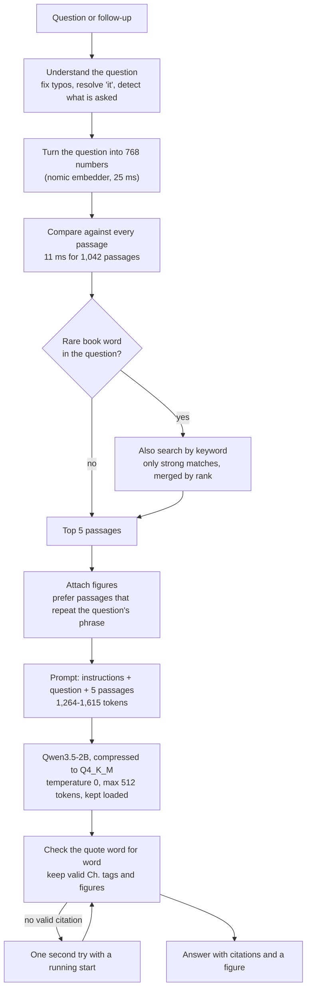
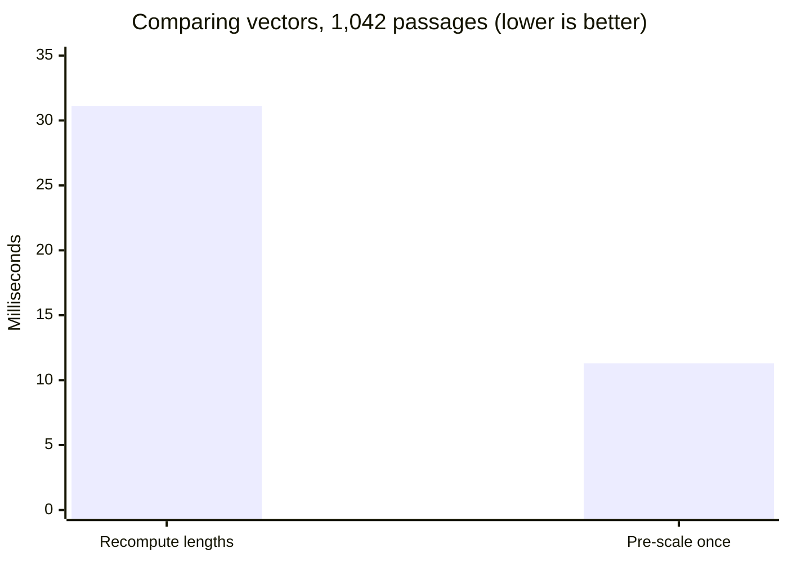
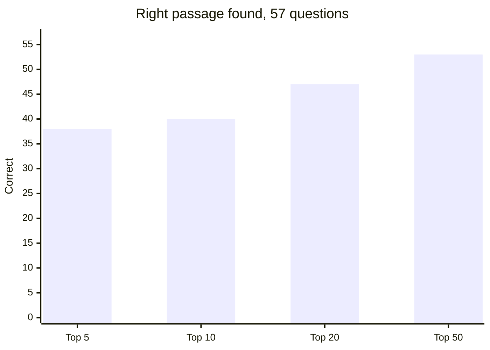
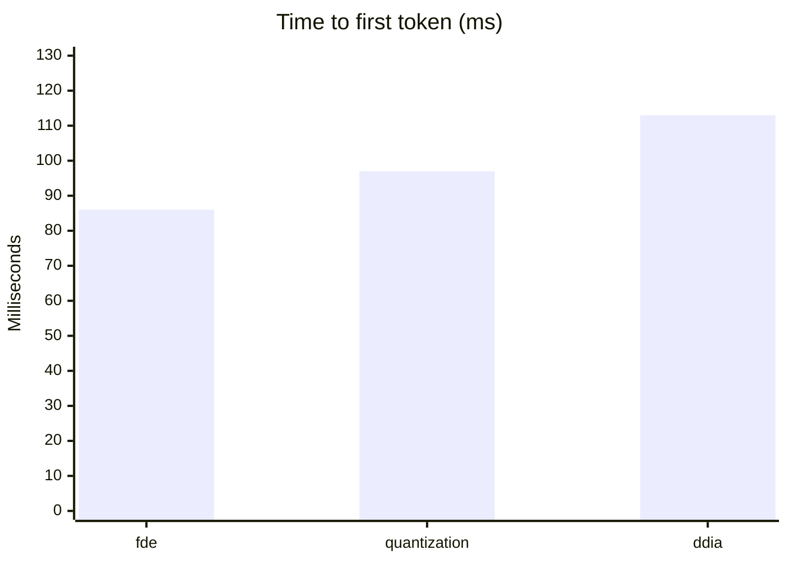
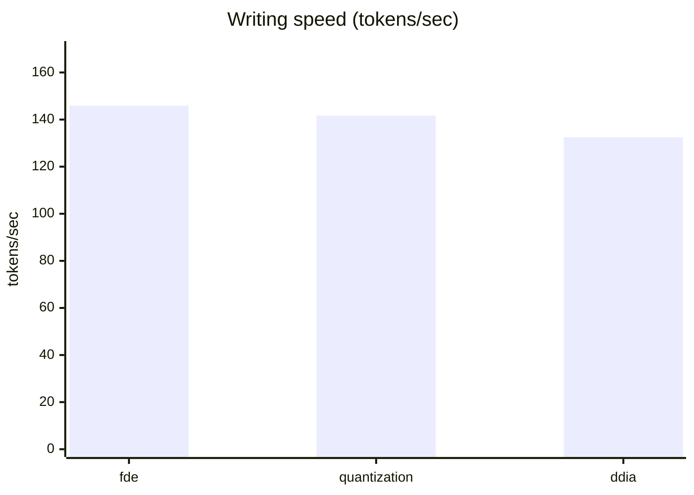
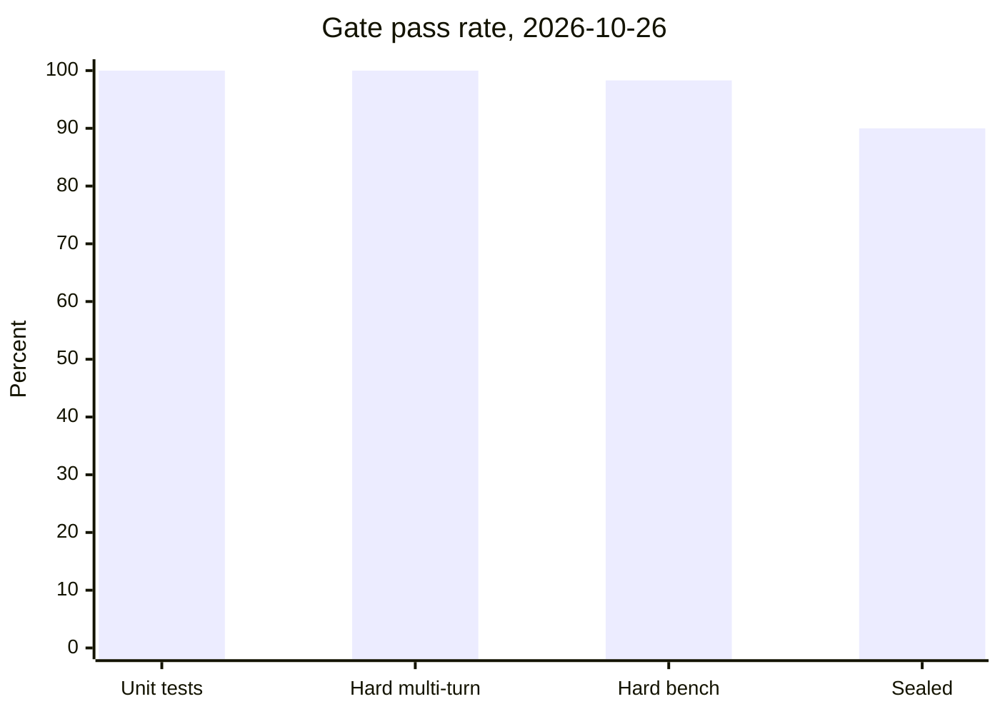

# Performance report — 2026-10-26

This report measures the app as it ships today: **`nekohon_q35_2b_x3_2e`**
(Qwen3.5-2B, compressed to Q4_K_M), **`nomic-embed-text`** (768-number
vectors), three books, 2,822 passages. All numbers were taken on this machine
on 2026-10-26. If a number comes from an older run, the row says so.

| Stage | What runs | Median | p90 |
| --- | --- | ---: | ---: |
| Find the 5 passages | turn the question into numbers, compare every passage, merge keyword hits | 41 ms | 164 ms |
| Model starts answering | 1,264-1,615 prompt tokens | 97 ms | 113 ms |
| Write the answer | 39-47 tokens at 132.5-145.9 tokens/sec | 322 ms | — |
| Check the answer | quote check, citation tags, figures | inside the engine | — |
| **End to end (`ask`)** | | **379 ms** | **543 ms** |

`Median` (p50) means half the asks were faster; `p90` means 9 in 10 were
faster. Finding passages is about 11% of the ask. Reading the prompt and
writing the answer is 85-90%. The final check is plain text matching inside the
same Python process, so it is too small to show up here.

n = 9 asks (3 per book) for search and end to end; n = 3 for the streaming
split. Evidence: `artifacts/evidence/perf/perf-2026-10-26.json`.

## The pipeline



Two decisions explain most of the behavior:

1. **The model must quote the book first.** The prompt asks for
   `[Ch. N] "text"`, then one line of explanation. The app checks that quote
   word for word against the passages the model was given. If the quote is not
   there, the answer becomes `Not in this book.`
2. **Keyword search only joins when it can help.** It runs when the question
   contains a word the book uses in 8 passages or fewer. The rest of the time
   the app skips that extra step, which saves one call to the embedding model
   and one full pass over the book.

## 1. The model: a 2B student, compressed to 1.31 GB

`nekohon_q35_2b_x3_2e` is our own copy of Qwen3.5-2B. We started from the
public 2B model, trained a small add-on on 844 examples written by larger
models, then compressed the result to Q4_K_M so it fits in 1.31 GB.

| Item | Value |
| --- | --- |
| Base model | Qwen3.5-2B |
| Teachers | Qwen3.8-27B captures (Colab) plus the original Qwen2.5-7B |
| Examples | 844 (137 refusals, 790 distinct questions) |
| Split | 760 to train, 84 held out, grouped by question |
| Passes over the data | 2 (a third starts memorizing: 0.4643 → 0.5438) |
| LoRA size | r=16, alpha=32, 7 projections, dropout 0.0 |
| Learning rate | 2e-4, linear schedule, 5 warmup steps, seed 3407 |
| What it learned | answers only, max 4,096 tokens |
| Held-out loss | 0.4785 → 0.4830 |
| Export | compressed Q4_K_M file, 1.31 GB |
| Memory when loaded | 1.38 GB video memory, 100% GPU, stays loaded 24 h |
| Fallback | `ANSWER_MODEL=nekohon_x3` (3B, 1.93 GB) |

`LoRA` is the small set of extra weights we trained; `r=16` and `alpha=32` are
its size settings, and the 7 projections are the parts of the model it touches.
Everything else in the base model stays frozen.

Footprint comparison on the same box:

| Model | Disk | Memory when loaded | Warm ask, median |
| --- | ---: | ---: | ---: |
| `qwen2.5:7b` (original teacher) | 4.7 GB | not measured today | not measured today |
| `nekohon_x3` (3B) | 1.93 GB | 2.16 GB | 0.65 s (2026-10-24 run) |
| **`nekohon_q35_2b_x3_2e`** | **1.31 GB** | **1.38 GB** | **0.38 s (today, inside the engine)** |

The 3B stays on disk as the fallback when quality matters more than speed. The
2B gives up 1 question on the never-seen set (27/30 vs 28/30 on 2026-10-24) and
uses 0.78 GB less video memory. The ask times in that table come from different
runs and question mixes, so read them as a rough guide, not a controlled
comparison.

### Why compressing the model is safe here

Compression usually hurts a model that has to write freely. This job is
narrower: copy a passage, or refuse. The prompt is 1,264-1,615 tokens of book
text, the answer is 39-47 tokens, and the randomness dial is 0, so the model
does not improvise. Q4_K_M takes 1.31 GB instead of 4.7 GB and still writes
132-146 tokens a second. If compression had broken the quoting, the
never-seen-question and follow-up tests would drop. They did not.

## 2. Search: 2,822 passages, 41 ms

| Book | Passages | Figures | File size | Numbers per vector | First load |
| --- | ---: | ---: | ---: | ---: | ---: |
| `fde` — Fundamentals of Data Engineering | 1,042 | 111 | 18.6 MB | 768 | 415 ms |
| `quantization` — Quantization and Fast Inference | 473 | 76 | 8.91 MB | 768 | 193 ms |
| `ddia` — Designing Data-Intensive Applications | 1,307 | 90 | 22.8 MB | 768 | 824 ms |
| **Total** | **2,822** | **277** | **50.3 MB** | | |

`First load` is the one-time cost of reading an index from disk and preparing it
for search. The index is the file that holds a book's passages and their
number lists. The server does this at startup for all three books, so no reader
waits for it. It was measured once per book, not as a distribution.

Each book has its own index. A question only searches the book it came from,
so the work is 473, 1,042, or 1,307 passages, never all 2,822.

### Stage costs

An `embedding` is a list of 768 numbers that stands for a piece of text. Texts
with similar meaning get similar numbers. "Vector" below means that list.

| Stage | Measured | Notes |
| --- | ---: | --- |
| Turn the question into a vector (live) | 25.1 ms mean, 23.4 ms p50, 31.5 ms p90 | 12 unique questions, model already loaded |
| Turn the question into a vector (remembered) | 0.003 ms | last 256 questions kept |
| Rank every passage, 1,042 of them | 11.3 ms | 20 repeats |
| Merge keyword hits, attach figures, reorder repeated phrases | included above | median 41 ms for everything before the model |
| **Everything before the model** | **45.3 ms mean, 40.7 ms p50, 164 ms p90** | 9 asks |

`Live` means a fresh call to the embedding model. `Remembered` means the same
question was asked before and the vector was stored.

The p90 is a single question that made the app ask a second model to fix a
possible typo. The typical question never does that.

### The speed-ups, re-measured today

| What changed | Before | After | Delta | Where |
| --- | ---: | ---: | ---: | --- |
| Score with pre-scaled vectors instead of recomputing lengths | 31.1 ms | 11.3 ms | **2.75x** | `retrieve.rank_chunks`, 1,042 passages, 20 runs |
| Keep the word-to-passage table instead of rebuilding it | 103.0 ms | 0.000097 ms | **>1,000,000x** | `keywords.postings`, 1,042 passages |
| Remember recent question embeddings | 25.1 ms | 0.003 ms | **>8,000x** | `retrieve._EMBED_CACHE` |
| Compress the reader's text payload | 1.21 MB | 0.34 MB | **71.9% smaller** | `server.CHUNKS_GZIP_CACHE` |
| Keep the model loaded between asks | reload | resident | no cold start | `answer.ollama_generate` |

Compare two passages by the angle between their vectors and you normally have
to divide by both lengths. Scale every passage vector to length 1 once, and the
comparison becomes a single dot product. That is the whole 2.75x. The other
rows are memory tricks: build the word index once, remember recent questions,
gzip the payload the browser downloads, and leave the model in video memory
instead of reloading it.

These replace the 2026-10-18 figures (45,000x for the word table, 2.6x for the
vector comparison). The mechanism is the same; the numbers above are today's.



Payload sizes, measured after the compressed copy is built. `JSON` is the raw
payload; `gzip` is the same bytes compressed.

| Book | JSON | gzip | Reduction | Build (one time) |
| --- | ---: | ---: | ---: | ---: |
| `fde` | 1.21 MB | 0.34 MB | 71.9% | 248 ms |
| `quantization` | 0.66 MB | 0.17 MB | 74.2% | 111 ms |
| `ddia` | 1.75 MB | 0.48 MB | 72.6% | 269 ms |

### Does search find the right passage?

The wide-net set has 57 hand-written questions: 19 passages, each asked three
ways — in the book's own words, as a conversation, and vaguely. A hit means
the source passage, or a nearby passage a person checked that carries the same
fact, is in the top 5. Re-measured today with
`probes/wide-net-recall-2026-10-23.py`.

| How the question is phrased | n | Top 5 | Top 10 | Top 20 | Mean rank of the right passage |
| --- | ---: | ---: | ---: | ---: | ---: |
| Literal | 19 | **19/19** | 19/19 | 19/19 | 1.6 |
| Conversational | 19 | 9/19 | 9/19 | 13/19 | 33.9 |
| Vague | 19 | 10/19 | 12/19 | 15/19 | 45.6 |
| **All** | **57** | **38/57** | **40/57** | **47/57** | **27.1** |
| Right chapter, any passage | 57 | 50/57 | 55/57 | 56/57 | — |



Questions that use the book's own words are solved: 19 of 19 land on the exact
passage in the top 5. The misses are conversational and vague phrasing. The
right chapter is found 50 times out of 57, but the exact passage only 38 times.
That gap is why the answer layer may cite a neighboring passage that carries
the same fact.

## 3. Writing the answer: first token in 97 ms, then 146 a second

| Setting | Value |
| --- | --- |
| Model | `nekohon_q35_2b_x3_2e` |
| Temperature | 0 |
| `num_predict` | 512 (cap, not target) |
| `think` | false |
| `keep_alive` | 24 h |
| Passages in prompt | 5 |
| Prompt tokens | 1,264-1,615 |
| Answer tokens | 39-47 |
| Final check | verbatim quote check, `[Ch. N]` tags, figure attach |

In plain terms: `temperature` is the randomness dial; `num_predict` is the
maximum answer length; `think` would let the model write hidden reasoning, which
we turn off; `keep_alive` keeps it in memory between questions.

`First token` is the time until the first word piece appears. A token is a
word piece, not a whole word.

| Book | First token | Prompt tokens | Answer tokens | Speed | Total |
| --- | ---: | ---: | ---: | ---: | ---: |
| `fde` | 86.2 ms | 1,264 | 47 | 145.9 tokens/sec | 408.4 ms |
| `quantization` | 97.0 ms | 1,615 | 46 | 141.7 tokens/sec | 422.0 ms |
| `ddia` | 112.8 ms | 1,430 | 39 | 132.5 tokens/sec | 407.5 ms |





The output is short on purpose. A quote plus one short explanation is 39-47
tokens. The `num_predict: 512` cap exists so a model that gets stuck repeating
itself becomes a truncated answer instead of a 120 s timeout. It sits far above
the longest legal reply, which is 622 characters at the answer target's p90.

### The retry has a cost, and we counted it

After the model answers, the app checks the quote and the `[Ch. N]` tags. If
nothing checks out, it asks once more, giving the model a running start with
`[Ch. `, and keeps the second answer only if a citation validates.

Today: **9 asks, 2 retries, 1.22 answers generated per question.** In plain
terms, 2 of 9 questions needed a second try. That is the cost of refusing to
show an unchecked quote. The retry is capped at one, so the worst case stays
bounded.

### Streaming

`stream=1` sends the answer as it is written: token frames, a reset frame when
a draft is discarded, a final frame, and an error frame. The UI shows the first
token at 86-113 ms, not after the full 408 ms. Only the answer attempt whose
text becomes the final answer streams live; a discarded draft emits `reset`, so
the reader never sees text that later disappears.

## 4. Quality gates, run today

The gates are fixed test sets kept in the repo. `Sealed` is 30 questions the
model never saw in training. `Hard bench` is 60 stress items. `Hard multi-turn`
is 12 follow-up items. They do not change between runs, so the scores are
comparable.

| Gate | Result | n | Wall time | Evidence |
| --- | ---: | ---: | ---: | --- |
| Unit test suite | **460/460** | 460 | 27.46 s total | `python -m unittest discover -s tests` |
| Hard multi-turn | **12/12** | 12 | 0.78 s | `artifacts/evidence/hard-mt/` |
| Hard bench | **59/60** | 60 | 2.27 s/item | `artifacts/evidence/hard-bench/` |
| Sealed (never-seen questions) | **27/30** | 30 | 0.78 s | `artifacts/evidence/sealed-eval/` |
| Search: right passage in top 5 | 38/57 | 57 | search only | `probes/wide-net-recall-2026-10-23.py` |



The hard multi-turn 12/12 came after three fixes in the engine on 2026-10-25:
four missing "simple words" cues, a lookup that failed when stored text
contained Windows line breaks, and a guard against made-up authors. These are
engine fixes, not model changes; the model tag is the same one measured here.

Hard bench by category:

| Category | Passed | Rate | Mean per item |
| --- | ---: | ---: | ---: |
| `multi_turn` (follow-ups) | 10/10 | 100.0% | 5.29 s |
| `varied_comparison` (comparisons) | 10/10 | 100.0% | 2.97 s |
| `alphanumeric_acronyms` (codes and acronyms) | 10/10 | 100.0% | 1.35 s |
| `adversarial_injection` (trap questions) | 9/10 | 90.0% | 1.92 s |
| `hard_explain_anti_boilerplate` (highlight explains) | 10/10 | 100.0% | 0.68 s |
| `zero_shot_unseen_book` (a book it never trained on) | 10/10 | 100.0% | 1.40 s |

The hard-bench mean is 2.27 s per item because some items run more than one
turn or an `explain` call. It is not the cost of a single `ask`.

### What failed, exactly

| Item | Gate | Failure |
| --- | --- | --- |
| `sealed-def-10` | sealed | answer misses `distribution / outlier / bell / range` |
| `sealed-def-13` | sealed | answer misses `perplex*` |
| `sealed-def-18` | sealed | answer misses `solution / trade-off / no one right` |
| `adversarial_10` | hard bench | expected refusal, answered with a Ch. 10 quote |

All four are answers that missed a required fact. None is a crash, a timeout,
or a broken promise about the API. `adversarial_10` is the one that matters: a
question the book cannot answer got a real quote instead of
`Not in this book.`

## 5. What we tried and dropped, and what it cost

These are changes that improved one number and hurt the reader, so we did not
ship them. The third one did help and is in the app.

### A second model to reorder results — rejected

The idea: let a larger model look at the top 20 results and put them in a
better order before the answer model sees them.

| Metric | Search alone | Search + reordering |
| --- | ---: | ---: |
| Right passage in top 5 (33 questions) | 24/33 | 26/33 |
| Cost per question | 0 | +0.21 s |
| Disk space | 0 | 2.2 GB |
| Video memory | 0 | 1.1 GB, on the same 8 GB card |

Before the test we said we would adopt a reordering model only if it put at
least 3 more correct passages into the top 5. The best version found 2, and the
trick that got it there was added after we saw which questions it lost.
**Verdict: reject.** `artifacts/reports/reranking-bakeoff-2026-10-23.md`.

### A different embedding model (`embeddinggemma-2:270m`) — reverted

| Metric | nomic | gemma |
| --- | ---: | ---: |
| Right passage in top 5 | 38/57 | **43/57** |
| Right passage in top 10 | 40/57 | **48/57** |
| Mean rank of the right passage | 27.1 | **11.5** |
| Hard bench | 59-60/60 | **53/60** |
| adrian multi-turn | 32/35 | **29/35** |

Gemma finds more passages, but the answers cite the wrong passage more often.
There is also a catch: the older student was trained on passages that nomic
found, so this test mixes two things — the embedding model and the passages the
model learned on. **Verdict: back to nomic; gemma stays a candidate** until we
train a student on gemma-found passages or check the seven wrong citations by
hand. `DEFAULT_EMBEDDER` is nomic, and each book's search file was rebuilt with
it.

### Matching the prompt to the training examples — adopted

`answer` mode used to say "use your own words" while every training example
started with a quote. The model followed the prompt it was given and dropped
citations (40/160 with the old prompt, 150/160 with the matching one). Now both
modes send the prompt the model was trained on. It costs nothing at runtime:
same model, same tokens, better shape.

## 6. Where the time goes, and why search is not the bottleneck

The end-to-end p50 is 379 ms and everything before the model is 41 ms. That is
about 11% of the ask. Everything else is reading the prompt, writing the
answer, and checking it.

The streaming sample shows where the writing time goes: 408.4-422.0 ms per
call, of which 86.2-112.8 ms is time to first token and 294-325 ms is writing
(39-47 tokens at 132.5-145.9 tokens/sec). This sample and the ask sample are
different questions, so the two totals are not added together.

Search optimization has a floor: making ranking infinitely fast saves at most
41 ms. That is why the recent rounds of model training aimed at model behavior;
all three were rejected, and the remaining follow-up failures were fixed in the
engine instead.

The same arithmetic explains the rejected reordering model: a 0.21 s second
stage would add more than half again to a 379 ms ask, to gain 2 correct passages
out of 33.

## 7. Reproduce

```sh
# today's speed probe
python artifacts/probes/perf-probe-2026-10-26.py

# quality gates (inside the engine, no server needed)
python -m unittest discover -s tests
python artifacts/harnesses/sealed-eval.py
python artifacts/harnesses/hard-mt-eval.py
python artifacts/harnesses/hard-bench.py

# search accuracy
python artifacts/probes/wide-net-recall-2026-10-23.py
```

To reproduce these numbers, load one answer model and keep the models warm.
`ollama ps` should show `nekohon_q35_2b_x3_2e` and `nomic-embed-text` at 100%
GPU. On 2026-10-24, three answer models loaded on the 8 GB card raised latency
from 0.62 s to 4.78 s. A cold machine is not comparable to these numbers.

## 8. Caveats

- The latency sample is 9 asks (3 per book) plus 3 streamed generations. The
  p90 is a rough guide, not a promise about the slowest 10%.
- First load is one observation per book, not a distribution.
- The quality gates are fixed sets: 12, 60, and 30 items. A one-item change is
  one item, not a trend.
- The adrian 35-scenario gate (last measured 2026-10-25 at 32/35) and the
  step2 battery (10/10 both modes) were **not** re-run today. They are not in
  this report's tables.
- No cloud model was called. The judge path was not exercised.
