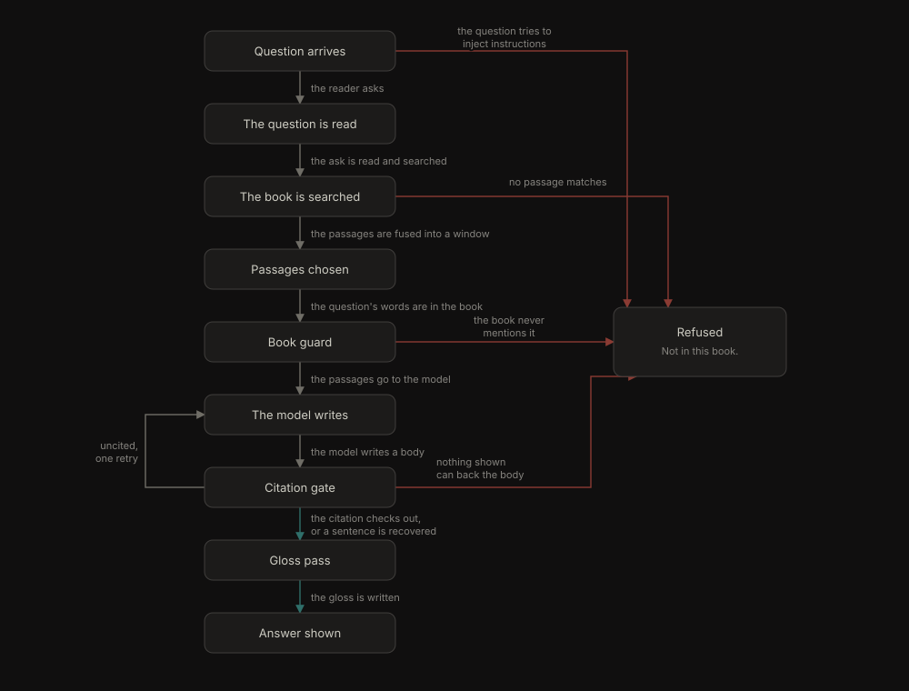

# RAG statechart — 2026-11-04

The verified state machine of one question through the engine: reading,
retrieval, the book guard, generation, the citation gate, the gloss, and the
two terminal states. The chart is drawn from `RagPipeline.tla` and checked by
TLC 2.19: 115 reachable states, 231 steps, collapsed to **10 chart states and
13 arrows**. All rules held; TLC also found no deadlock.



Interactive replay (six scenarios, token on the edges): open
`rag-statechart-2026-11-04.html`. The technical version, with clickable
nodes for chunking, embedding, retrieval, reranking and the gate, is
`rag-statechart-technical-2026-11-04.html`. Mermaid source:
`rag-statechart-2026-11-04.mmd`. Checker output:
`artifacts/scratch/rag-statechart-2026-11-04/tlc-report.md`.

## Rules checked

| Rule | The reader's sentence | Where it applies |
|---|---|---|
| `GroundedAnswer` | Every answer names a passage, and that passage was one of the passages shown. | Answer, Gloss |
| `SilentRefusal` | A refusal carries no citation and says why. | Refused |
| `ModelNeedsPassages` | The model is never called before retrieval has produced a passage. | Generation |
| `InjectionNeverGenerates` | An injected question never reaches the model. | Refused via injection |
| `WindowBounded` | The model never sees more than five passages. | Passages chosen |
| `ShownCitationInWindow` | A body shown as an answer only cites inside the window. | Gloss, Answer |
| `EndsInAVerdict` | Every question ends in an answer or a refusal. | All paths |

The first draft checked `<>[]` without fairness and TLC found a stuttering run
parked in `Gloss pass`; weak fairness (`WF_vars(Next)`) removed the stutter,
which is the model saying every working state must take its step.

## Where evals meet this chart

An eval row sees only the terminal state and the trace, so these are the
observable differences the chart predicts:

| Path | Trace | Eval sees |
|---|---|---|
| answer | `stages` incl. `dense`, maybe `fusion_added`; one model call, plus a gloss call when the draft gloss is missing or incoherent | `refused: false`, a citation into the window |
| uncited retry, recovered | `retry_uncited`, `citation_recovered` | two model calls, still an answer |
| uncited retry, refused | `retry_uncited`, `uncited_refused` | two model calls, exact refusal |
| no passage | `empty_passages` | no model call, exact refusal |
| guard | `absent_person`, `unmentioned_technical_anchor`, `no_book_vocabulary`, `uncovered_subject`, `unknown_figure` | no model call, exact refusal |
| injection | `prompt_injection` | no model call, exact refusal |

The retry loop is why an eval must not assume one generation per question: the
gate may cost a second call before it recovers or refuses. The fiction profile
costs two or three calls before the gate even runs.

## What the model leaves out

- The fiction “who is X” entity shortcut, which answers from the book’s own
  sentences with no model call.
- The follow-up and selection shortcuts (`simplify_or_elided_followup`,
  straight to a pinned quote).
- `mode: "teach"`, which is two calls (explanation and example) and shares the
  citation gate.
- The fiction body that is kept instead of glossed, and the technical profile’s
  five-passage window versus fiction’s eight.
- Streaming, import, and the eval judge itself.
- The retry is drawn at the gate; in `answer.py` it runs just before the gate.
- The five post-retrieval guards are one “Book guard” state, not five.

## Run it again

The spec, config and view live in `artifacts/scratch/rag-statechart-2026-11-04/`
(gitignored). The skill normally installs TLC with mise; this machine has no
mise, so the jar was fetched directly:

```sh
cd artifacts/scratch/rag-statechart-2026-11-04
curl -sLO https://github.com/tlaplus/tlaplus/releases/download/v1.7.4/tla2tools.jar
TLA2TOOLS="$PWD/tla2tools.jar" JAVA=/usr/bin/java \
  ../../../.agents/skills/statechart/scripts/statechart RagPipeline.tla \
  --view view.mjs --out out
```

The checker writes `out/chart.mmd` and `out/report.md`. TLC explores all
interleavings; the chart collapses them through `state()` and `step()`.
