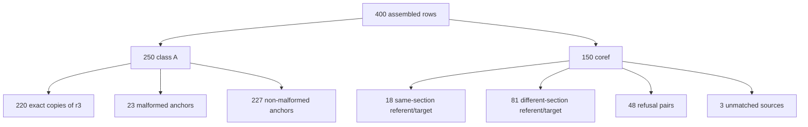

# Assembled history seed audit — 2026-10-24 (DeepSeek V4.1 Flash)

## Decision

**Do not train on the 400-row slice as assembled.**

- 18/40 sampled rows are usable training rows (**45%**).
- If "pass" means history-dependent supervision rather than a valid ignore-history control, the rate is **3/40 (7.5%)**.
- Only **1/40** (index **210**) is a substantive history-dependent continuation.
- **150/150** coref targets answer the anchor's original question, not the templated follow-up.
- **220/400** are exact copies of `train-r3` once the history prefix is removed; **150** more are target-plus-passage copies with the question swapped.
- `train-r4` is `r3 + this slice` (1521 = 1121 + 400), so 220 base rows land twice.

Audited file: `data/finetune/quote-refuse-2026-10-24.history.jsonl`
SHA-256: `fc3386062a0555cf625973ce11455cf5e0c603ba8ded28b6d1f753707ced45e5`

## What was checked

Read-only audit. No data, docs, or index edits; no model calls. Python stdlib only, importing the served `prompt.SYSTEM`, `prompt.SYSTEM_ANSWER`, `answer.FORMAT_REMINDER`, `answer.user_message`, and `answer._quote_in_passage`. Grounding is checked against the passages embedded in each row, not a loaded index. All 40 rows at `range(0, 400, 10)` were read in full: history turns, final question, every supplied passage, target, and system. Semantic verdicts are audit judgments, not model measurements.

## Mechanical results

### Structure (400 rows)

| Check | Result |
| --- | ---: |
| Roles exactly `system, user, assistant` | 400/400 |
| System exactly `prompt.SYSTEM` | 372/400 |
| System exactly `prompt.SYSTEM_ANSWER` | 28/400 |
| Any explain/highlight system | 0/400 |
| User equals `answer.user_message(question, passages, history)` byte-for-byte | 400/400 |
| History block present | 400/400 |
| Exactly one `Question:` line | 400/400 |
| `Passages:` block present, 1+ well-formed `[Ch. N] chunk_id=...` headers | 400/400 |
| Ends with `answer.FORMAT_REMINDER` | 400/400 |
| Passages per row: 1 / 2 / 3 / 4 / 5 | 51 / 11 / 58 / 33 / 247 |
| History turns: 1 / 2 | 314 / 86 |
| Coref rows (builder's 9 templates) | 150 (37.5%) |

The **28 non-`SYSTEM` rows are not explain/highlight rows**. They are answer-mode rows using `prompt.SYSTEM_ANSWER` ("You answer from the passages below, and only from them. Write a direct answer...") and every one of their targets is exactly `Not in this book.`.

The corpus does contain explain/highlight rows: `train-r3` has 24, all starting with `Highlighted text:` and using an older explain-gloss system string, a variant of `prompt.EXPLAIN_GLOSS_SYSTEM` that omits the "Never start with 'The passage'" sentence. The builder's `parts()` skipped all 24 because they have no `Question:` shape, so **none entered this slice**. Indexes: `6, 25, 28, 70, 106, 107, 131, 177, 178, 181, 188, 208, 217, 221, 230, 232, 262, 305, 312, 318, 321, 336, 347, 362, 373, 375, 382, 394`.

### Targets

| Check | Result |
| --- | ---: |
| Exact refusal target (`Not in this book.`) | 107 (A 69, coref 38) |
| Quoted targets | 293 (A 181, coref 112) |
| Quote verbatim in the cited chunk under `_quote_in_passage` | 293/293 |
| Cited `[Ch. N]` matches the cited chunk's chapter | 293/293 |
| One quote per target (no fused/multi quotes) | 293/293 |
| Quoted target has a gloss | 293/293 |
| Target has 2 lines / 3 lines | 291 / 2 (80, 167) |
| Target contains U+FFFD | 1 (80) |

The quote check is the serving check, not byte equality. It folds case, whitespace, figure refs, and punctuation. Row 80 passes only because that folding hides two replacement characters (`memory�the latest ... RAM�offers`); the passage has em dashes. A strict byte check would reject it.

### Provenance and reuse against `train-r3`

| Check | Result |
| --- | ---: |
| Rows whose `(system, target, chunk-id set)` matches an r3 row | 400/400 |
| ... with a unique r3 anchor | 329; 71 match 2–25 anchors |
| Class-A final question equals the anchor's question | 250/250 |
| Coref final question equals the anchor's question | 0/150 |
| Exact duplicate of r3 after removing the history prefix | 220/400 (all class A) |
| ... after removing the history prefix on both sides | 233/400 |
| Near-copy: same system, target, and passages; question swapped | 150/150 coref |
| `train-r4` | exact `r3` prefix followed by this file (1521 rows) |

The 220 are not new supervision: same question, same passages, same answer, only an added prefix. The 150 coref rows are the same answer with a different question. `origin` is not written, so coref is recoverable only from the 9 template strings.

### History quality

| Check | Result |
| --- | ---: |
| Rows with at least one refusal history turn | 114 |
| Rows whose history turns are all refusals | 80 (A 50, coref 30) |
| History answers clipped at exactly 400 chars | 12 turns |
| History question longer than 200 chars | 0 |
| Cross-book history (source chunk family differs) | 32 rows (8.0%) |
| Coref: referent and target cite the same section/chunk | 18/150 |
| Coref: referent and target cite different sections | 81/150 |
| Coref: history and/or target is a refusal pair | 48/150 |
| Coref: history source row not uniquely recoverable | 3/150 |
| Coref: >1 shared content word between history and anchor question | 13/101 unique-anchor rows |
| Coref: only a generic shared word (`data`, `tell`, `regarding`, ...) | 28/101 unique-anchor rows |

Cross-book pairs include `bio01→fde` (4), `fde→econ01` (3), `fde→comp01` (3), `comp01→fde` (2), `econ01→comp01` (2), `comp01→bio01` (2), `os01→fde` (2), and `fde→ds01` (2). The builder's own `book_of()` hides almost all of them by collapsing `comp/econ/bio/os/ds/preface` into one `other` bucket; it also mis-maps `preface01` to `other`, and it reads only the first chunk id, which may be a preface chunk while the history answer cites a numbered chapter.

Coref subject links are weak by construction. Of the 101 coref rows whose `r3` anchor is unique, only 13 share more than one content word and 28 share only a generic word. Top shared tokens: `data` (23 rows), `explain` (7), `storage` (6), `matter` (4), `tell` (4), `when` (4). That is the root of the wrong-subject failures. The other 49 coref rows match 2–25 anchors, so their source question is ambiguous.

The 9-template distribution is skewed: `Can you say more about that?` 61, `What does that mean in practice?` 41, `What else should a reader know about it?` 27, `How does that work in practice?` 7, `Why is that a problem in practice?` 6, `How would a team apply that?` 6, `What are the main trade-offs of that?` 2. `What are its main drawbacks?` and `Why does that matter?` are unused.

## Sample criterion and table

A row **passes** when it is usable for the class the builder assigned: the final question is a real, resolvable request; the target answers that request; for a comparison it gives both sides or an explicit boundary; for coref the referent is unambiguous and the target is about that referent; the quote is verbatim in the cited chunk and the gloss does not invent or contradict the passage.

A class-A row with unrelated history can pass as an **ignore-history control**, which is the builder's stated class-A purpose. It is not counted as evidence of history use. The stricter history-use rate is reported separately.

Codes: **F1** wrong subject, **F2** aspect shift, **F3** false refusal / ambiguous referent, **F4** no referent, **F5** degenerate question, **F6** incomplete comparison, **F7** unsupported gloss, **F8** distorted gloss, **F9** corrupt quote / extra gloss line. `H` is history relevance; `T` is what the target actually answers.

### Class A — anchor question kept (27 rows)

| idx | H: history subject | T: target | Teaches | Verdict |
| ---: | --- | --- | --- | --- |
| 0 | OLTP | products gloss | ignore | Fail F7 |
| 10 | data catalog/CMDB | RAID expansion | ignore | Pass |
| 20 | normalization | stream-to-batch | ignore | Pass |
| 40 | feature store/orchestration | refusal | ignore | Pass |
| 50 | caching | log quote + transaction gloss | bad | Fail F4 |
| 60 | castling | refusal | ignore | Pass |
| 80 | conformed dim/KV store | DDR5 vs DDR4 | ignore | Fail F9 |
| 100 | security paranoia | Data Vault | ignore | Pass |
| 110 | TOGAF data architecture | cloud scalability | ignore | Fail F7 |
| 130 | Codd normal forms | streaming pipelines | ignore | Pass |
| 150 | source systems | disk price | bad | Fail F5 |
| 160 | Kafka/Einstein | internal-facing only | ignore | Fail F6 |
| 170 | SSA | preface scope | bad | Fail F5 |
| 180 | object storage/snowflake | "ELT is a variation" | ignore | Fail F6 |
| 190 | Raft/Paxos | acknowledgments | ignore | Pass |
| 220 | zero trust | GDPR | ignore | Pass |
| 230 | MMU/page tables | refusal | bad | Fail F5 |
| 240 | money multiplier/ribosome | audience | ignore | Fail F7 |
| 260 | KV store/transactions | chief algorithms officer | ignore | Pass |
| 270 | push/pull ingestion | data lake | ignore | Pass |
| 290 | schema changes/Spark | shared responsibility | ignore | Pass |
| 300 | data science/storage | data lake | ignore | Pass |
| 320 | lifecycle vs data lifecycle | DDL | ignore | Pass |
| 330 | batch processing | "article urges" | ignore | Fail F8 |
| 340 | "reality in People" | C-suite data | ignore | Pass |
| 350 | preface Part III | register allocation | ignore | Pass |
| 370 | validation/materialized view | ingestion + DataOps gloss | bad | Fail F4 |

Class A: **15 pass, 12 fail**. 13 class-A anchors are questions that also appear as the final question of an `r3` history row; 8 of those are deictic (`34, 50, 54, 168, 194, 292, 349, 370`) and 5 are self-contained. Separately, 11 rows have a ≤2-word question, and 4 have the question `Not in this book.` (`170, 230, 318, 362`). The union of malformed anchors is 23: `6, 14, 19, 34, 35, 41, 50, 54, 69, 150, 168, 170, 188, 194, 230, 292, 297, 317, 318, 321, 349, 362, 370`. That filter catches 5 of the 12 sampled class-A failures; the other 7 are target/gloss defects inherited from `r3`.

### Coref — question replaced (13 rows)

| idx | Referent from history | T: target subject | Answers | Verdict |
| ---: | --- | --- | --- | --- |
| 30 | Tour de France 2023 (refusal) | refusal | anchor=final | Pass |
| 70 | Location | refusal | anchor | Fail F3 |
| 90 | denormalization | normalization | anchor | Fail F1 |
| 120 | event-streaming platform | feature store | anchor | Fail F1 |
| 140 | Kafka vs RabbitMQ | refusal | anchor | Fail F3 |
| 200 | SSA subscripts | central-bank mandates | anchor | Fail F1 |
| 210 | immutable vs transitory technologies | immutable technologies | anchor=final | Pass |
| 250 | sync vs async ingestion example | push vs pull | anchor | Fail F2 |
| 280 | data vs enterprise architecture | brownfield projects | anchor | Fail F2 |
| 310 | data sharing | GDPR | anchor | Fail F1 |
| 360 | data product | career pivot | anchor | Fail F1 |
| 380 | good-architecture principles | data quality | anchor | Fail F1 |
| 390 | Roth IRA (refusal) | refusal | anchor=final | Pass |

Coref: **3 pass, 10 fail**. All 13 targets were written for the anchor question; 0/150 coref final questions equal an anchor question. The two refusal continuations (30, 390) and the one substantive continuation (210) are the only usable rows.

## Failure modes

| Mode | Rows | Count |
| --- | --- | ---: |
| F1 wrong subject: target about a different entity | 90, 120, 200, 310, 360, 380 | 6 |
| F2 aspect shift: adjacent concept, not the requested aspect | 250, 280 | 2 |
| F3 false refusal / ambiguous referent | 70, 140 | 2 |
| F4 no referent: deictic question, attached history does not resolve it | 50, 370 | 2 |
| F5 degenerate question: fragment or refusal string | 150, 170, 230 | 3 |
| F6 incomplete comparison | 160, 180 | 2 |
| F7 unsupported gloss: adds facts absent from the passage | 0, 110, 240 | 3 |
| F8 distorted gloss: "readers interpreted" becomes "the article urges" | 330 | 1 |
| F9 corrupt quote / extra gloss line | 80 | 1 |
| **Total failures** | | **22** |

Split by cause:
- **History assembly (coref): 10/13 sampled.** The referent is chosen by one shared content word; the target is never rewritten. 81/150 coref rows put referent and target under different headings, and 48/150 are refusal pairs.
- **Anchor selection (class A): 5/27 sampled.** Deictic-r3-history anchors, fragments, and refusal strings entered the pool. 23/250 class A rows are mechanically malformed.
- **Target quality inherited from `r3`: 7/27 sampled.** Unsupported or distorted glosses, incomplete comparisons, and one corrupted quote. The builder did not cause these, but they still make the rows unusable.

Pass rate: **18/40 (45%)**. History-use rate: **3/40 (7.5%)**, of which **1/40 (2.5%)** is a substantive positive continuation. Clean ignore-history controls: **15/40 (37.5%)**. If the sample is treated as an estimate, roughly 150–160 of the 250 class-A rows are usable controls after the 23 malformed anchors are removed, and at most 17/150 coref rows are plausible positives; neither figure is a certified population rate.

## Recommendation

### Keep/drop

**Do not ship the slice as a use-history training set.**

- Keep **210** only (substantive continuation). Keep **30** and **390** only if refusal continuations are wanted; they teach "refuse a follow-up on a refused subject" and add no domain signal.
- If an ignore-history control set is wanted, cap it at **40–60 rows** sampled from the non-malformed class-A anchors. Do not ship 227 rows: 211 of them are exact duplicates of `r3` after the prefix is removed, and all 227 reuse `r3` targets and passages, so they reweight the base rather than add supervision.
- Drop **all 150 coref rows** from this file. The construction cannot be repaired row by row.
- Drop **28** `SYSTEM_ANSWER` rows. Their targets are refusals, but they train a different system prompt.
- Drop the **23** mechanically malformed class-A rows listed above.
- Drop the **7** sampled class-A rows with target/gloss defects (`0, 80, 110, 160, 180, 240, 330`); the full class-A target-quality set was not reviewed row by row.
- Drop the **12** rows whose history answer is cut mid-sentence at 400 chars: `41, 76, 135, 162, 168, 182, 201, 222, 270, 276, 301, 369`.

**Priority drop indexes (15):** `50, 70, 90, 120, 140, 150, 170, 200, 230, 250, 280, 310, 360, 370, 380`.

Also drop, after target review: `0, 80, 110, 160, 180, 240, 330`.

Do not merge this file into `train-r4` without deduplicating history-stripped anchors and capping the question-swapped copies.

### Change the builder

1. **Build the conversation before the target.** Choose the history turn and the final question together. Rewrite the anchor question into a real follow-up, then verify the target answers the rewritten request. Never keep the anchor target when the question changed. The current builder changes the question and leaves the target untouched (lines 227–237).
2. **Replace the shared-word rule.** Require the referent and the target's cited chunk to share a heading or be adjacent, at least two shared content words, and the shared word to be the subject head noun. Exclude `data, tell, regarding, explain, mean, matter, when, book, practice, work`. The current rule accepts one word longer than three characters (lines 203–214).
3. **Fix `book_of()`.** Map `preface01` to FDE, split `other` by source family (`comp`, `econ`, `bio`, `os`, `ds`), and classify by the chunk the answer actually cites rather than the first chunk. 32/400 rows currently draw history from another book; the builder sees almost none of them.
4. **Filter anchors before sampling.** Reject questions that are not self-contained: questions inherited from history rows with a deictic, ≤2-word questions, and the literal refusal string. That removes 23 class-A rows and prevents the 8 deictic anchors from receiving a second, unrelated history.
5. **Do not use refusal anchors for coref.** 30/150 coref rows have refusal-only history; 10 of those have a non-refusal target, and the sampled ones answer a different subject. Keep refusal continuations as a separate, explicitly labelled class.
6. **Balance the templates.** 129/150 coref rows use three templates; 61 use `Can you say more about that?`. Sample by template and aspect, not by anchor order.
7. **Clip history at sentence boundaries.** 12 answers are truncated at 400 characters mid-word or mid-quote. Use the last complete sentence, or drop the turn.
8. **Enforce the served contract.** Require `prompt.SYSTEM`; reject U+FFFD; require one gloss line; make the quote check byte-aware for control characters. The current `_quote_in_passage` accepts the corrupted row 80 quote.
9. **Persist provenance.** Emit the source row, source question, rewritten question, history source IDs, book/index identity, and class. The builder computes `origin` and then discards it, so the 150 coref rows can only be recovered by template matching.
10. **Deduplicate the merge.** Hash the history-stripped user against the base before writing. 220 rows are exact duplicates; 150 more reuse the same target and passages. If form exposure is the goal, cap duplicates per anchor instead of adding them all.

### Acceptance criteria for a rebuild

- 40-row manual sample ≥90% usable, with ≥90% of positives genuinely requiring history.
- 0 cross-book history turns; 0 deictic or fragment questions; 0 refusal-string questions.
- ≥95% of coref rows have referent and target in the same section.
- 0 exact history-stripped duplicates; 0 U+FFFD; 0 history clips mid-sentence.
- 100% of quoted targets pass the strict quote check and have exactly one gloss line.

## Limits

- Semantic review covers only the 40 specified indexes; full-population pass rates are not measured.
- No training, model calls, or downstream evaluation. No claim about gains or regressions.
- Grounding is checked against the passages embedded in each row, not against loaded index files. Synthetic families (`comp`, `econ`, `bio`, `os`, `ds`) are therefore not provenance-verified.
- The 150 coref count is by the builder's 9 template strings, not by stored provenance.
- `train-r3` itself contains 85 history rows, 24 explain rows, and 44 questions of two words or fewer; some defects in this slice are inherited from that corpus, not introduced by the history builder.
