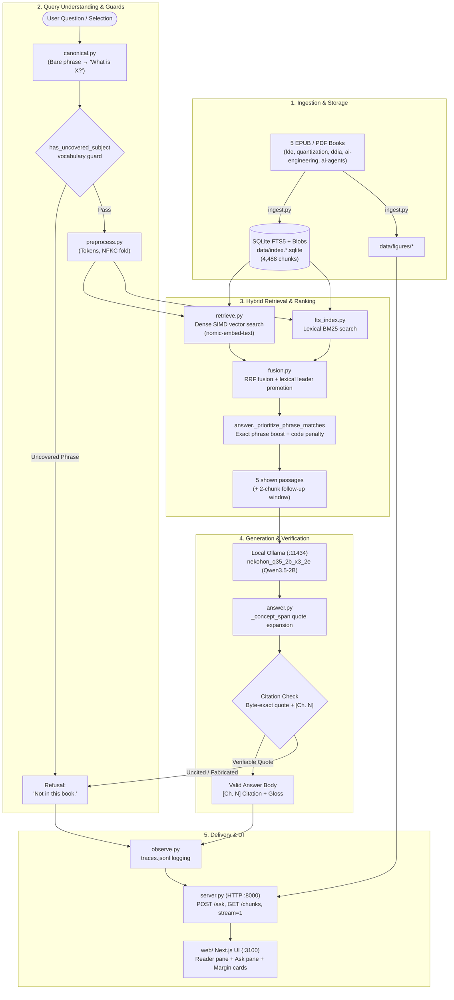

# System map — ask-this-book, 2026-11-01

End-to-end architecture of the offline multi-volume companion stack as of 2026-11-01. Rendered visual artifacts: [system-map-2026-11-01.html](file:///Users/adriangabriellfrancisco/workspace/github.com/Skufu/ask-this-book/artifacts/reports/system-map-2026-11-01.html) and [system-map-2026-11-01.svg](file:///Users/adriangabriellfrancisco/workspace/github.com/Skufu/ask-this-book/artifacts/reports/system-map-2026-11-01.svg).

## Active Components (2026-11-01)

| Stage | Implementation | Specification |
| --- | --- | --- |
| Storage | `store.py` / `fts_index.py` | Per-book SQLite databases (`data/index.<book>.sqlite`) with FTS5 lexical indexes and embedding vector blobs |
| Embeddings | `retrieve.py` | `nomic-embed-text` with SIMD-accelerated dot product search |
| Fusion | `fusion.py` | Reciprocal Rank Fusion with lexical top-5 promotion |
| Vocabulary Guard | `preprocess.py` | Pre-retrieval refusal for multi-word phrases absent from the book corpus |
| Answer Model | Ollama (`127.0.0.1:11434`) | `nekohon_q35_2b_x3_2e` (Qwen3.5-2B, Q4_K_M, 1.31 GB) |
| Citation Gate | `answer.py` | Verbatim quote matching against shown passages; uncited completions convert to `Not in this book.` |
| Server | `server.py` | In-process Python HTTP server on port 8000 with streaming NDJSON (`stream=1`) |
| Client | `web/` | Local Next.js 16 application with reader and margin gloss cards on port 3100 |
