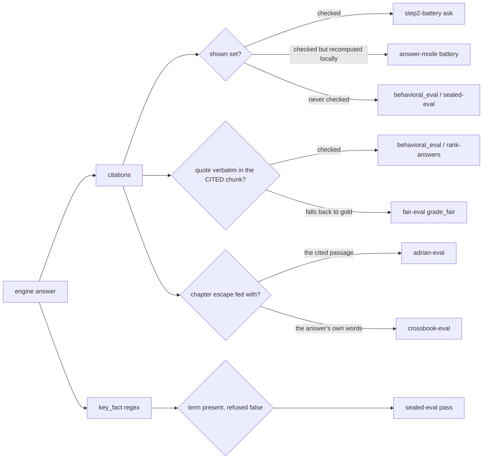

# Suite audit: tests and eval runners (2026-10-29)

This is the DeepSeek subagent's source-audit record, captured while changes
were in progress. Its counts and line references describe that snapshot, not
the final tree. Its reproduced checks are subagent measurements unless the
integration report independently repeats them. Several findings below were
subsequently fixed. Current validation, fixes, and remaining work are in
[`eval-integrity-2026-10-29.md`](eval-integrity-2026-10-29.md).

Read-only audit of `tests/*.py` and `artifacts/harnesses/*.py`. Scope: does each
checker actually measure the behaviour it is credited with, and where can a
wrong answer, a wrong citation, or a missing measurement still score?

Method: read the deciding code path in each module (not its docstring), then
reproduce the doubt in-process where it was cheap. Findings are marked
**reproduced** (command + real output below) or **source-read** (file:line, not
executed). Nothing in the tree was modified; no cloud call was made; locked
holdout question text was not read.

Read scope, stated plainly: 24 harness files and 49 test modules are
inventoried. Of the harnesses, 20 had their deciding path read (the four under
90 lines were read in full) and 4 were not read: `judge.py`, `rank-answers.py`
(only its quote rule at 228-251), `reader-eval.py`, `ux-eval.py` — all owned by
other workers or the parent. Of the tests, 21 were audited, 26 had their test
names and mock targets read, and 2 that landed mid-audit were not opened.
Per-row status is in the ledgers, and no row claims more than that.

This file lives in `artifacts/runs/` because that is where it was asked to go;
`runs/` is gitignored scratch per `artifacts/README.md`, so it is not an indexed
artifact and needs no index row.

## Where the scoring path leaks



Four runners, four different answers to "is this citation real"; one harness
(`run-gate.py`) reports all of it and exits 0 either way.


## Ledger — tests (49 modules)

`n` = number of `def test_` functions. Status values:

- **audited** — the decisive code path was read.
- **names-read** — the test-function names and the module's mock targets were read; bodies were not. Verdicts in that row are derived from names, and are weaker than an audited row.
- **not audited** — the file landed during this audit from another worker.

Suite-wide checks that cover all 49 modules: no `assertTrue(True)`-style tautologies, no `TODO`/`FIXME` markers, and every `mock.patch` target is either a transport seam (`server.ask`, `server.respond`, `J._complete`, `J.A.ollama_generate`, `figures.FIGURES`, `server.WEB_OUT`) or the stock in-process path. The only mock placed on the function under test is `test_triage_fairness.py:131`, which uses `side_effect=AssertionError("re-retrieved")` as a negative control — the correct use of a mock.


| Module | n | Status | Verdict |
|---|---|---|---|
| `test_behavioral_eval.py` | 17 | audited | One hole left: an empty shown list still sets `original_context_recorded: True` (F1). The unshown-citation case now reports `defects: ['unshown-citation']` but no test pins it |
| `test_fair_set.py` | 7 | audited | Strong (sha freeze, 60/60 split, key-fact strictness, dumb baselines) but no test for the runner's default split or its locked-text write (F3); the wrong-cite fallback it lacked (F2) is now covered by `test_eval_integrity.py` |
| `test_harness_fairness.py` | 14 | audited | Best calibration in the suite: pins must carry their own terms, replaced pins must fail them; chapter escape tested both ways. No coverage of `grade_fair` |
| `test_frontend_rules.py` | 6 | audited | Source regex + substring CSS match, not rendered behaviour (F9) |
| `test_frontend_health_and_progress_rules.py` | 6 | audited | Exact source strings only (F9) |
| `test_free_answer.py` | 24 | audited | Locks two defects in as contracts (F12) |
| `test_generalization.py` | 3 | audited | Guards `fde` and chunk/figure ids; not the other two books, not chapter numbers (F11) |
| `test_server_packaging.py` | 13 | audited | Traversal test cannot tell "blocked" from "file absent" (F10) |
| `test_eval_leakage.py` | 8 | audited | 6 dataset-dependent skips (F8) |
| `test_training_quotes.py` | 1 | audited | Both skips make the only verbatim-quote gate vanish without `data/` (F8) |
| `test_judge_axes.py` | 12 | audited | Sound axis parsing asserts; judge itself is the judge worker's file |
| `test_observability.py` | 4 | audited | Checks spans and masking semantics; does not check the eval runner's own JSON write (F3) |
| `test_reader_routes.py` | 15 | audited | 12 mocks, but each asserts the route contract (handler wiring), and real HTTP is covered by the battery |
| `test_stream_contract.py` | 5 | audited | NDJSON frame order asserted against a real handler |
| `test_server_multibook.py` | 7 | audited | Per-book index routing asserted from `data/books.json` |
| `test_highlight_golden.py` | 16 | audited | Held-out set pinned and hashed; no defect found |
| `test_half_covered.py` | 6 | audited | Pins the boundary-gloss rule the Ddr row depends on (relevant to F6) |
| `test_defect_fixes.py` | 12 | audited | Regression pins reference real bugs; fine |
| `test_opencode_call.py` | 5 | audited | Judge transport shape only; no live call |
| `test_query_understanding.py` | 7 | audited | Best counterweight to book-fitting: three synthetic unseen domains, no chunk ids. But `fake_embed` returns one constant vector for every text (184-186), so cosine ranking is flat and the `explain` test proves the scope/pin path, never the search path |
| `test_contract.py` | 9 | names-read | Frozen `POST /ask` shape, unknown route 404, exact refusal sentence |
| `test_answer.py` | 79 | names-read | 5 mocks, all on transport seams; pins include the tag-slip repair (see F12) and prompt-injection refusals |
| `test_canonical.py` | 28 | names-read | Trigger/no-trigger pairs plus `test_non_firing_is_byte_identical`, which is the right guard for a rewrite |
| `test_intent.py` | 33 | names-read | Mostly accept/reject pairs for `is_coherent_gloss`; both directions present |
| `test_preprocess.py` | 9 | names-read | Tokenizer seam asserted (`postings()` keys == `words()`); NFKC idempotence |
| `test_text_stages.py` | 15 | names-read | Fold/stem idempotence with Porter2 fixtures |
| `test_retrieve.py` | 15 | names-read | Embedding guards refuse non-finite, zero, short, wrong-width vectors by name |
| `test_fusion.py` | 7 | names-read | `test_no_rank_evidence_fails_closed` is the correct default |
| `test_keywords.py` | 6 | names-read | Rare word fires, common does not, a stopword never anchors |
| `test_captions.py` | 8 | names-read | A present chunk is not duplicated or reordered; a zero query refuses instead of seeding |
| `test_figures.py` | 4 | names-read | `test_embedding_score_does_not_attach_a_figure` pins the narrow rule |
| `test_ingest.py` | 10 | names-read | Metadata never joins the text (`test_the_trail_is_metadata_and_never_joins_the_text`); chapter id normalisation |
| `test_chunking.py` | 9 | names-read | Overlap never starts mid-sentence; a piece always starts at a sentence |
| `test_readings.py` | 14 | names-read | Tie and below-cutoff swap nothing; a reading that only matches is dropped |
| `test_followup_subject.py` | 7 | names-read | 6 mocks on the model call, which is the right seam |
| `test_followup_pills.py` | 8 | names-read | Has a control pair: `test_every_scenario_gets_full_marks` + `test_the_rating_helper_can_fail` |
| `test_fabricated_attribution.py` | 9 | names-read | Present author is not flagged (negative control) beside the absent-surname positives |
| `test_hard_mt_leakage.py` | 4 | names-read | Freeze, shape, no training overlap, fabricated names absent from all three books |
| `test_plain_register.py` | 17 | names-read | Rewrite budget capped; refusal draft never rewritten; empty rewrite keeps the draft |
| `test_list_shape.py` | 4 | names-read | Lead-in replaced by items only for list questions |
| `test_agentic.py` | 13 | names-read | Prototype not wired; determinism and caps pinned |
| `test_preflight.py` | 8 | names-read | Dirty index flagged, Ollama down named, models not pulled blind |
| `test_verify_index.py` | 7 | names-read | Exit codes and per-record naming |
| `test_tech_stack_upgrades.py` | 12 | names-read | Includes `test_negative_controls_zero_score_on_irrelevant_garbage` |
| `test_technical_anchor_refusal.py` | 7 | names-read | Refuses only the unmentioned phrase; mentioned and typo cases must pass (control pair) |
| `test_triage_fairness.py` | 35 | names-read | Pins `rank-answers.py`: frozen evidence only, quote must resolve to the cited passage, regex pins advisory. Its mock raises `AssertionError` on retrieval — the one correct mock use in the suite |
| `test_judge_transport.py` | 30 | not audited | Landed mid-audit by the judge worker; not read |
| `test_ux_eval.py` | 26 | not audited | Landed mid-audit by the UX worker; not read |
| `test_eval_integrity.py` | 7 | audited | Landed mid-audit and read in full. Pins F2/F4's fixes with positive controls: wrong chunk and unknown chunk cannot borrow a gold quote, one valid quote cannot hide a second fabricated one, a short correct definition still passes, zero exercised controls cannot validate a benchmark. Run this session: 7 tests OK |

Measured this session: `python -m unittest tests.test_frontend_rules tests.test_frontend_health_and_progress_rules -v` -> **12 tests OK in 0.053s**; `python -m unittest tests.test_eval_integrity -v` -> **7 tests OK**. The 2026-10-25 note that the frontend modules have 2 pre-existing failures is stale; the check runs green.

## Ledger — harnesses (24 files)

| Runner | Audited | Verdict |
|---|---|---|
| `fair_cite.py` | yes | Content rule is the right shape; two documented escapes (empty `terms`, chapter content escape) and both are tested |
| `fair-eval.py` | yes | Wrong-cite gold fallback **fixed 2026-10-29** (F2, re-measured `passed: False`); default split now `dev` (F3, half-fixed — locked text still written unredacted); the 15% dummy-baseline ceiling warns but never fails (see "Already sound") |
| `behavioral_eval.py` | yes | Provenance claim and shown-set check missing (F1) — parent-owned |
| `step2-battery.py` | yes | Ask mode checks content; answer mode does not; shown set recomputed locally (F5) |
| `sealed-eval.py` | yes | Pass needs no citation at all (F7) |
| `hard-mt-eval.py` | yes | Delegates to `judge_citation` with per-item terms; fine once `terms` is present on every item |
| `hard-bench.py` | yes | Zero-denominator controls **fixed 2026-10-29** (F4, `answer_items_total > 0`); unknown-`cid` quote skip pinned by test |
| `trace_inspect.py` | yes | Correct: masks locked text in formatted output unless `--allow-locked-text` (415-433); its own JSON is the runner's problem, not this tool's |
| `judge.py` | no | Judge worker's file; not audited here |
| `rank-answers.py` | no | Rank worker's file; only its quote rule was read (228-251), which F2 contradicts |
| `run-gate.py` | yes | No threshold, no verdict, always exits 0 outside preflight (F13) |
| `groundedness.py` | yes | Measures `SYSTEM_ANSWER` + `answer_user_message` by default, which is the plain-register draft, not the live answer path (F14); its 0.5 threshold has no in-repo control |
| `eval.py` | yes | Same non-live prompt as groundedness (F14); `gold precision@5` is gold-hits/5 (F16); report only, no exit code |
| `eval-plain.py` | yes | Gates are real but the runner exits 0 regardless; a judge error counts as a gate failure (F15) |
| `judge-agreement.py` | yes | Compares verdicts without proving the answers were the same; 0 shared keys prints `0/0 (None%)` and exits 0 (F21) |
| `judge-stability.py` | yes | Re-retrieves at probe time, so the context is not frozen and the flip rate mixes retrieval drift with judge noise (F22) |
| `qa-sweep.py` | yes | `coherent` means "the answer contains the question's rarest word"; a paraphrase fails it and an echo passes (F17) |
| `adrian-eval.py` | yes | Chapter escape fed the cited passage text correctly (181-186); `must_contain` is a substring on the answer (F20); a transport error becomes a refusal (F18) |
| `crossbook-evil-eval.py` | yes | Chapter escape fed the answer text, not the cited passage (F19); `must_contain` substring (F20); transport error becomes a refusal (F18) |
| `guard-audit.py` | yes | One-shot 2026-10-13 probe on `qwen2.5:7b`; counts are reported, no verdict, no denominator for non-swaps |
| `plain-edge-check.py` | yes | Real contract checks (figure must be named by a cited passage) and exits 1 on a problem |
| `secret-scan.py` | yes | Masks hits, exits 1 on any hit; the one runner whose failure mode is already correct |
| `reader-eval.py` | no | Parent-owned capture/replay helper, landed mid-audit (188 lines); not read, per the brief |
| `ux-eval.py` | no | UX worker's live-browser smoke (1,011 lines), landed mid-audit; not read |

Two notes on the pairs above, both source-read:

- `reader-eval.py` and `behavioral_eval.py` now overlap: both capture real
  queries and replay them, and `reader-eval.py`'s docstring advertises the
  properties `behavioral_eval.py` lacks ("replay accepts capture output only;
  never reconstructs old answers from live search", "every replay rechecks
  positive/negative controls", "an invalid judge exits 2"). If the capture
  wrapper the parent is integrating lands in `reader-eval.py`, F1's
  `original_context_recorded` hole should be closed there rather than
  duplicated.
- `ux-eval.py` drives the browser through `agent-browser`, which `AGENTS.md`
  records as failing to start on this box (daemon cannot bind, os error 10013).
  Its own number is therefore not reproducible here without that dependency
  working; treat its recorded runs as the only evidence of that path, and do not
  quote a fresh `ux-eval.py` result from this machine until it starts.

## Findings, highest value first

F1-F3 are claimed by the parent as of this update (2026-10-29). F13, F19 and F20
are the next three by value; F14 is the cheapest to fix and affects two meters at
once.

### F1 — `behavioral_eval` certifies provenance it never checked (reproduced, claimed by parent)

`artifacts/harnesses/behavioral_eval.py:77-78`:

```python
"original_context_recorded": bool(trace.get("trace_id")) and
    all(p.get("chunk_id") in chunks for p in shown)}
```

`all(...)` over an empty `shown` list is `True`, so a capture with no retrieval
context claims the context was recorded. `check_capture` (108-157) then checks
citations only against `table`, which is built from `passages` — and `passages`
deliberately includes cited chunks with `shown: False` (line 67). The `shown`
flag was stored and never read (as found; the parent's edit now reads it).

Reproduced:

```
empty-shown:  {'status': 'unverifiable', ...}          # saved only by the empty table
no-shown-but-cited: {'status': 'ready', 'defects': [], 'missing': []}
```

The second line is the defect: no passage was ever shown to the model, the
citation points at `shown: False`, and the capture is declared `ready`.

**State 2026-10-29, re-measured after the parent's edits:** the unshown citation
is now caught — `check_capture` returns `defects: ['unshown-citation']` (status
stays `ready`, which is the intended vocabulary: ready to judge, with a defect).
The provenance flag is still vacuous:

```
F1 original_context_recorded with empty shown: True
```

so the first bullet below is still open, and `freeze_result` still marks a
capture whose retrieval was never recorded as having recorded it.

Impact: a fabricated citation to a passage the model never saw is invisible to
the one checker whose job is provenance, and any capture whose trace lost its
`shown_passages` still passes the provenance requirement. Every "ready"
percentage this runner produces inherits the hole.

Fix (three lines, all inside `freeze_result`/`check_capture`):

- `original_context_recorded` requires `bool(shown)` before the `all(...)`.
- In the citation loop, `if passage.get("shown") is False: defects.append("unshown-citation")`.
- Add the two cases above to `tests/test_behavioral_eval.py`, the no-shown one
  asserting `"original retrieval context not captured"` in `missing`.

### F2 — `fair-eval` wrong cite passes on a borrowed gold quote (reproduced, claimed by parent)

`artifacts/harnesses/fair-eval.py:286-302`. `chap_ok` is decided by the
citation's chapter string against the gold chapters, and `quote_ok` (289-298)
falls back to "verbatim in ANY gold chunk" when the quote is not in the cited
chunk:

```python
if cid and cid in chunk_table:
    quote_ok = quote_in_passage(quote, chunk_table[cid].get("text", ""))
if not quote_ok:
    for gc_id in gold_chunks:
        if gc_id in chunk_table and quote_in_passage(quote, chunk_table[gc_id].get("text", "")):
            quote_ok = True
```

Reproduced with a citation whose `chunk_id` is `w` (not gold) carrying a quote
lifted from gold chunk `g`:

```
wrong-chunk gold-quote: {'passed': True, ..., 'reasons': []}
```

**State 2026-10-29, re-measured after the parent's edits — fixed.** The same
call now returns:

```
wrong-chunk gold-quote: {'passed': False, ...,
 'reasons': ['citation quote is not verbatim in its cited source: w',
             'no citation matches a gold chapter with a verbatim passage quote']}
```

`fair-eval.py:290-307` now requires the quote to be verbatim in the cited
source, with the gold fallback kept only for a citation that carries no chunk
id. `tests/test_eval_integrity.py:31-48` pins it with a positive control
(`test_short_correct_definition_still_passes`) and a lying-chapter case. The
text below stands as the record of what the hole was.

Impact: the wrong-chunk / borrowed-quote class scores as a pass, which is the
exact failure mode `tests/test_harness_fairness.py` was written to stop on the
battery side. `fair-eval.py` has no equivalent test, so the two runners disagree
about the same answer. It also contradicts a rule the repo already enforces:
`rank-answers.py:228-251` requires a quote to resolve to the passage the answer
**cited** and distinguishes `in_cited` from `in_evidence` explicitly.

Fix: keep the gold fallback only for citations that carry no `chunk_id` (those
come from parsing `[Ch. N] "..."` out of prose, where there is no chunk to
attribute). When `cid` is present, the quote must be verbatim in that chunk. Add
a `test_fair_set` case returning `failed` for the repro above.

### F3 — `fair-eval` defaults to the locked split and writes locked text to disk (source-read, claimed by parent)

- `:488` (now `:495`) `parser.add_argument("--split", choices=["dev","locked","all"], default="all")` — the default as found
- `:520-524` appends the result for every item; only the printed line is masked
  (`q_display = "[LOCKED QUESTION HIDDEN]"`).
- `:556-570` writes `payload["results"] = results` to
  `artifacts/runs/fair-eval-<date>-model-<slug>-split-<split>.json`, including
  each item's `question`, `answer`, and `citations`.

Impact: a bare `python artifacts/harnesses/fair-eval.py` (no flags) both scores
on 60 locked items and leaves their questions and answers in a file, while
`trace_inspect.py:415-433` goes to lengths to mask the same text in reports.
"Never run `--split locked` during normal iteration" (AGENTS.md) is unenforced
and the default violates it.

**State 2026-10-29, re-measured after the parent's edits:** the default half is
fixed — `:495` now reads `default="dev"` with the help text "locked/all require
explicit selection". Measured: `F3 default split: dev`. The write half is still
open: there is no `--allow-locked-text` flag and no redaction on the evidence
payload (`grep --allow-locked-text artifacts/harnesses/fair-eval.py` returns
nothing), so an explicit locked run still writes full questions and answers to
`artifacts/runs/`.

Fix: default `dev`; when the run includes locked items, write a redacted payload
(hash the question, drop `answer`/`citations`, keep ids and pass/fail) unless
`--allow-locked-text` is passed. Add a `test_fair_set` assertion on the parser
default and on the redaction function.

### F4 — `hard-bench` accepts "0 of 0 controls rejected" (source-read)

`artifacts/harnesses/hard-bench.py`:

- `:606-607` skips unverified items with `continue`.
- `:652-653` skips a control when its fabricated citation is empty.
- `:661` increments `answer_items_total` only for the items that survive.
- `:667-673` `ok` starts `True` and only ANDs `passed == 0` conditions.
- `:811` `valid = bool(controls_ok) and bool(verified) and not unmeasurable`.

So a run where every item is skipped, or every fabricated citation is empty,
returns `ok=True` with all totals at 0, and the payload is still `valid`.

**State 2026-10-29, re-measured after the parent's edits — the zero-denominator
half is fixed.** `hard-bench.py:670` now reads
`ok = ok and row["answer_items_total"] > 0`, so an unexercised control bucket
fails. `tests/test_eval_integrity.py:50` pins it
(`test_zero_exercised_negative_controls_cannot_validate_a_benchmark`), and
`tests/test_eval_integrity.py:55` pins the unknown-`cid` half
(`test_hard_bench_rejects_unknown_citation_even_when_gloss_matches`). Both tests
were run this session: 7 tests OK. The skip counts are still not carried in the
payload, so a reader cannot see that a bucket had 0 items — only that it failed.

Impact: the negative controls are the only evidence that the grader
discriminates; a zero denominator turns that evidence into silence without
turning the run red.

Fix: after the loop, require `row["answer_items_total"] >= 1` for each non-refuse
control (and `refuse_items_total >= 1` where the dataset has refusal items), and
add the skip counts to the payload so the denominator travels with the verdict.

Also at `:489`, `if quote and cid in text_map and not is_quote_in_passage(...)`
means an unknown `cid` skips the verbatim check entirely; report that as
`unverifiable` rather than silently passing the quote clause.

### F5 — battery answer mode checks the passage is shown, never that it answers (source-read)

`artifacts/harnesses/step2-battery.py:155-190` (`judge_answer`):

- `:171-177` rejects citations outside `shown`.
- `:178-179` requires the pinned chunk to be *shown* (not cited).
- `:180-183` makes "pin shown, not cited" a **note**, not a failure.
- `:126-143` `shown_ids()` recomputes retrieval locally
  (`A.retrieval_context(_INDEX, question)`) instead of using what the server
  actually sent to the model.

Ask mode, by contrast, runs `fair_cite.judge_citation(cited, text_of, terms)`
(`:106-109`), so the same answer is graded differently by `BATTERY_MODE`.

Impact: an answer that cites any two shown passages passes answer mode even if
neither carries the question's terms; and because the shown set is recomputed,
a server-side retrieval difference is scored against a set the model never saw.

Fix: call `fair_cite.judge_citation(cids, text_of, TERMS.get(question) or [])`
in `judge_answer` too (the terms are already loaded at `:106` for ask mode), and
prefer the server's traced `shown_passages` (`observe.py`) over the local
recompute, keeping the recompute only as a fallback with a note.

**State 2026-10-29, re-measured:** still open. `judge_citation` does not appear
anywhere in `judge_answer`, and `retrieval_context` is still called locally
(`F5 answer-mode judge_citation: False`, `F5 shown recomputed locally: True`).

### F6 — owner-rated row 13 accepts the absent term as the key fact (reproduced)

`artifacts/datasets/owner-rated-2026-10-15.jsonl` line 13:

```
question "ddr4 vs ddr5"  expect "answer"  key_fact "ddr5|ddr4"
```

Verified against the shipped FDE index: `ch06-011` has DDR4 = 0 occurrences and
DDR5 = 1; the whole FDE book has DDR4 = 0 and DDR5 = 1. The `|` makes `ddr4` an
acceptable key fact, and the boundary-gloss answer the repo now deliberately
gives for half-covered comparisons matches it:

```
regex on boundary gloss "The passages do not mention ddr4.": True
```

Impact: the row cannot distinguish "answered the covered side and disclosed the
boundary" from "named the term that is not in the book". `pin_note` on that row
is now accurate ("book has DDR5 (ch06-011)"), so the note is not the problem —
the label is.

Fix: `key_fact: "ddr5"`, plus a separate required phrase for the boundary
disclosure (an `expect_gloss`-style field, or a second regex such as
`not (in|mention).{0,20}ddr4`), and a test that the row fails an answer naming
only `ddr4`.

**State 2026-10-29, re-measured:** still open — row 13 still reads `ddr5|ddr4`
and the boundary gloss still matches it.

### F7 — sealed-eval passes an answer with no citation (source-read)

`artifacts/harnesses/sealed-eval.py:66-91`: `passed` is `key_fact` present and
`not refused`; citations are collected at `:61-62` and reported as a separate
`pin_hit` metric. `:167` exits 0 when every item passes.

Impact: the sealed headline (27/30) is reachable by prose that echoes the key
term with zero citations, so the number cannot be read as "cited the right
passage". That is deliberate per the comment at `:66-67`, but it means the
sealed set is a content test, not a grounding test, and the two are being
reported in the same breath elsewhere.

Fix (pick one, record which): add `bool(cited)` to `passed`, or keep the split
metric and make the release exit code require both — the second keeps the useful
distinction without letting an uncited answer carry the headline.

### F8 — twelve dataset-dependent skips silently remove gates from a green suite (source-read)

`test_eval_leakage.py:389,418,434,472,490,550`, `test_fair_set.py:115,268,317,369`,
`test_training_quotes.py:82,85` — all `self.skipTest("... data/ is gitignored")`.

Impact: on a fresh clone, or after `data/` is cleaned, the training-leakage
checks, the quote-verbatim check, and the key-fact/index checks are absent, and
the suite still reports green with no count of what it skipped.

Fix: keep the skips, but add one summary test that fails when `data/` is present
and any of those gates skipped, and print the skipped count in the suite's own
`__init__` or a `tests/README` line so the number travels with the green.

### F9 — the two frontend rule modules assert source text, not behaviour (source-read)

- `test_frontend_rules.py:32` `CLASSNAME = re.compile(r'className="([^"{]+)"')`
  only sees literal double-quoted classNames. `className={...}`, template
  literals, and conditional joins are invisible, so a component can use any
  colour with no rule violation reported.
- `:103-107` `if f".{name}" not in css` is a substring test: `.row` is
  satisfied by `.row-2`, `.btn` by `.btn-ghost`.
- `test_frontend_health_and_progress_rules.py:44,50,60-74` assert exact source
  strings (`"60000"`, `"Failed /health fetch"`, one-line expressions).

Impact: a real regression in the rendered UI (health polling stops, error label
never renders) passes both modules; a harmless refactor (moving the interval to
a constant) fails them.

Fix: keep the greps as a cheap lint, and add one browser-level assertion per
claimed behaviour (the interval fires, the label appears on a failed fetch).
The agent-browser smoke runner in progress is the right home for it — that is
`artifacts/harnesses/ux-eval.py`, which landed during this audit and does drive a
real browser (`ux-eval.py:1-12`, "nothing is mocked"). Its own limit on this box:
`agent-browser` is recorded in `AGENTS.md` as failing to start here (daemon
cannot bind a socket, os error 10013), so the wire-up is right but the check
cannot run on this machine until that dependency is fixed. Also, the 2026-10-25
note that these two modules carry "2 pre-existing failures" is out of date:
measured this session, 12 tests OK.

### F10 — the traversal test cannot tell "blocked" from "file absent" (source-read)

`tests/test_server_packaging.py:145-173` patches `WEB_OUT` to a temp dir and
requests traversal paths whose targets do not exist there, so 404 proves nothing
about containment. Only `/C:/Windows/win.ini` (161-163) names an existing
outside file.

Fix: create the target file outside `WEB_OUT` (a sibling temp dir), then request
it both by relative traversal and percent-encoded form; assert 404 **and** that
the file is readable by direct path, so the test cannot go green for the wrong
reason.

### F11 — the generalization guard covers one book and two id shapes (source-read)

`tests/test_generalization.py:22-37, 84` — guarded patterns are
`\bch\d{2}-\d{3}\b`, `\bfigure-\d+-\d+\b`, `\bfde\b`. `quantization` and `ddia`
are not guarded, and a chapter literal (`Ch. 9`, `chapter-4`) is not either,
although the module list at `:22` includes files that must stay book-agnostic.

Fix: add `\b(quantization|ddia)\b` and a chapter-literal pattern to the table,
then run the guard against the current modules to see whether anything trips.

### F12 — `test_free_answer` locks two defects in as contracts (source-read)

- `:92-96` an invented claim with a zero-overlap quote is served with
  `refused: False` and a citation to `c1-001` (the test asserts the citation
  lands on the chunk that does not support it).
- `:94,96` `[Ch. 9]` is silently repaired to `c1-001`, and the test asserts the
  repaired value — so the wrong-cite signal the fix would need is erased by
  design.

Impact: both are defensible current behaviour, but asserting them means a future
fix reads as a regression and gets reverted. That is how a wart becomes a
contract.

Fix: mark them `@unittest.expectedFailure` with the reason, or gate them on a
`legacy=` flag so the intended behaviour can be added next to them.

### F13 — `run-gate.py` is a runner with a gate's name (source-read)

Read end to end. `Gate.fail()` exists (`:230-236`) and prints `GATE FAILED`, but
it is only called from `preflight()` (`:238-249`, Ollama unreachable or model not
in `ollama list`) and `spawn()` (`:251-257`, a child exited nonzero). Every
family parses its log into a summary line and returns:

- `:282-308` fragment, `:310-344` battery, `:346-375` refuse, `:377-399` trial,
  `:401-416` sweep — all end in `self.summary.append(...)`.
- `:277-280` `unparsed()` appends "log parse failed" and **returns**, so a
  family whose log could not be read leaves no failure.
- `:489-497` prints the summary and the written outputs; there is no threshold
  comparison anywhere, and `main()` ends with exit 0.
- `:484-487` `--skip` all five families prints `(all skipped)` and exits 0.

Impact: `battery 0/21 pin-pass` and `battery 21/21 pin-pass` produce the same
exit status, so anything that keys off "the gate passed" is keying off the
absence of a crashed child process. The docstring's "a non-zero exit aborts the
gate loudly" describes only environment errors.

Fix (small, and it is the single highest-value change among the runners): add a
per-family verdict function with an explicit expected minimum, and make
`unparsed` fail. Until then, do not report a `run-gate.py` run as a pass; report
the family numbers.

### F14 — two meters measure a prompt the engine no longer serves (source-read)

`groundedness.py:169-171` sets `system = SYSTEM_ANSWER` by default and its own
comment says the live path is `SYSTEM`. `eval.py:67-69` does the same and says so
in a comment. The live answer path is `answer.py:4286`
(`SYSTEM, user_message(context["asked"], passages, history=history)`) and
`:4076`; the only remaining `SYSTEM_ANSWER, answer_user_message(...)` call is
`_plain_body` (`:4524`), the plain-register draft.

Impact: the groundedness and eval numbers describe a draft prompt, not the
shipped answer mode. `--system-text` exists to fix it, but the default is the
wrong one, so a bare run produces a number that cannot be compared with a live
answer.

Fix: default to `SYSTEM` + `A.user_message(...)`, keep `SYSTEM_ANSWER` behind
`--plain-draft`, and stamp the prompt pair (name and a hash) into the evidence
JSON so a reader can tell which one produced the number.

### F15 — `eval-plain` exits 0 whatever it measures (source-read)

`eval-plain.py:243-247` computes `passes` and per-gate failure counts, prints
them (`:261-270`), writes JSON and log (`:290-295`), and returns. `sys.exit`
never appears. Also `:258-260` counts `judge_error` as its own number while
`:141` (`book_supported`) marks the same item a gate failure, so a judge outage
lowers `pass` without changing the `judge errors` column's meaning.

Impact: the scorecard is a report wearing a gate's clothes, and a transport
failure is scored as an unsupported answer. With the documented ±1-2
borderline noise on a single draw, `pass 7/10` vs `8/10` is not a finding anyway.

Fix: `sys.exit(0 if passes == len(values) else 1)` behind an explicit
`--require`, and exclude `judge_error` items from the pass denominator while
printing the excluded count.

### F16 — `eval.py` reports gold hits per five as "precision" (source-read)

`eval.py:89` `gold_precision = round(len(shown_hits) / len(shown), 3)`, summarised
at `:192` as `gold precision@5 floor`. The docstring at `:11` does define it
("gold precision@5: gold shown / shown"), so the arithmetic is disclosed — the
name is what misleads. With one gold chunk per item, `shown_hits` is 0 or 1 and
`shown` is 5, so the value is 0 or 0.2 for every single-gold item, and a top-5
holding the gold plus four unrelated passages scores the same 0.2 as one holding
gold plus four near-misses.

Impact: a reader comparing runs sees a "precision" that cannot exceed 0.2 on
single-gold items and cannot separate a good top-5 from a bad one. It is a
recall-flavoured ratio (found/5) wearing a precision label.

Fix: rename the field and the summary line to `gold_share@5`, and report
`len(shown_hits)/len(gold)` (true recall) plus `len(shown_hits)/len(shown)`
separately, each with its denominator in the line.

### F17 — `qa-sweep`'s "incoherent" column is a keyword check (source-read)

`qa-sweep.py:124-133`:

```python
guard = rarest_word(question, word_map)
coherent = (not guard) or (not body["refused"] and carries(answer, guard))
```

`carries()` (`:91-99`) is a stemmed membership test for that one word. So a
correct paraphrase that never uses the question's rarest word is counted
`incoherent`, and an answer that echoes the word in a wrong sentence is counted
coherent. The summary (`:156`) prints `refused | incoherent | no gloss` as if the
middle column were a quality measure.

Impact: the sweep's refusal counts are trustworthy; the incoherence column is
not, and past readings of "incoherent fell 18 → 8 → 4" measured vocabulary
absorption, not coherence.

Fix: rename the column to `missing_guard_word` and stop reading it as a quality
signal; or score coherence with the sentence-support meter already in
`groundedness.py`.

### F18 — a transport error is scored as a correct refusal (source-read)

`adrian-eval.py:364-365` and `crossbook-evil-eval.py:259-260` catch every
exception and synthesise `{"refused": True, ...}`. `evaluate_turn` then treats it
as a model refusal:

- A refusal-expectation turn passes on `refused is True` unless the dataset
  also sets `must_be_exact_refusal` (`adrian-eval.py:96-102`) or `refusal_exact`
  (`crossbook-evil-eval.py:73-79`).
- Today every refusal turn sets that flag — adrian 3 of 3, crossbook 5 of 5
  (measured from the two dataset files). The hole is held shut by data
  convention, not by the runner.

Impact: an engine restart, a 500, or a timeout during a refusal turn is scored
as the right answer, and the run's headline pass count is unaffected. On this
box the engine is restarted often (`artifacts/runs/start-engine.bat`).

Fix: tag the synthesised response (`"error": str(e)` is already there) and have
`evaluate_turn` fail on `response.get("error")` before any expectation logic.

### F19 — `crossbook-evil-eval` gives the chapter escape the answer's own words (source-read)

`crossbook-evil-eval.py:130-138`:

```python
# This harness is HTTP-only and has no chunk text, so the escape is the answer text
chapter_ok, chapter_detail = fair_cite.judge_chapter(
    cited_chapters, exp_chapter, None, answer_text, turn_terms)
```

`judge_chapter`'s escape exists to say "a different chapter is fine when the
*cited passage* carries the concepts" (`fair_cite.py:71-86`). Feeding it
`answer_text` makes the escape test the model's own prose, and `must_contain` is
checked against that same prose (`:143-146`). So a wrong-chapter citation plus
the required words anywhere in the answer passes.

`adrian-eval.py:181-186` does it correctly: it builds `cited_text` from the
cited chunk ids via the index. The same pattern can be reused here (`/ask`
returns citation quotes, and `GET /chunks` is an approved route).

Impact: the cross-book chapter-drift defect class is under-detected on the
harness that exists to detect it.

Fix: build `cited_text` from the response's citation quotes (or the per-book
index), and pass that. A wrong-chapter answer without the concepts then fails
as designed.

### F20 — `must_contain` is a keyword echo in all three conversational runners (source-read)

`adrian-eval.py:206-209` and `crossbook-evil-eval.py:143-146` both decide a turn
on `mc.lower() in answer_text.lower()`. Nothing checks that the cited passage says
it. Combined with F19, a model can satisfy every content expectation by
repeating the expected words in prose while citing an unrelated passage.
(`qa-sweep`'s `carries` is the same shape of check, covered as F17.)

Impact: these are the runners whose numbers are quoted as multi-turn quality
(35 scenarios, 30 scenarios). A keyword echo is exactly what a small student
does when it is lost.

Fix: keep `must_contain` as a cheap screen, and add the passage-side check the
battery already uses: `fair_cite.judge_citation(cited_ids, text_of, must_contain)`.

### F21 — `judge-agreement` can compare different answers and still print a rate (source-read)

`judge-agreement.py:25-52` keys relevance by `(question, chunk_id)` and key
facts by `question`, and compares verdict strings. Nothing compares the answer
texts, so two runs of different models — or the same model at different
temperature — produce an "agreement" percentage that is read as judge
reliability. `:45` `pct` is `None` when nothing is shared, and the header then
prints `0/0 agree (None%)`; `main()` never sets an exit code, and the log always
says the same thing.

Impact: the calibration claim ("local judge agrees with the cloud judge 86/105")
depends on this tool. If the two files were not answer-identical, that number
measures the models, not the judges.

Fix: assert `row["answer"]` equality (or a hash of it) per shared key and print
the compared-answer count; refuse to print a percentage when it is below the
row count.

### F22 — `judge-stability` re-retrieves, so its "frozen prompt" is not frozen (source-read)

`judge-stability.py:66-69` rebuilds the passage text at probe time:

```python
passages_text = "\n\n".join(hit.get("text") or "" for hit in
    A.retrieval_context(index, row["question"])["passages"])
```

The eval file it reads already stores the shown passages. Re-deriving them means
a changed index, a changed embedder, or a changed retrieval rule silently changes
the evidence between draws, and the flip rate then mixes judge noise with
retrieval drift — the exact confound the probe was built to separate.

Fix: read the passages from the row; only fall back to retrieval (with a printed
note) when the row has none.

## Already sound — do not spend time here

- `fair_cite.judge_citation` (50-68) is the right shape: at least one cited
  passage must carry every term. The empty-`terms` escape is closed on the
  chapter side by `test_no_terms_means_no_escape` (`test_harness_fairness.py:125`)
  and every golden question is required to have content terms (`:43`), so the
  escape cannot be reached by a pin with no terms.
- `fair_cite.judge_chapter`'s content escape is intentional and tested in both
  directions (`test_wrong_chapter_with_content_passes`,
  `test_wrong_chapter_without_content_fails`).
- `test_harness_fairness.py:50-77` (pins must carry their own terms; replaced
  pins must have been wrong) is the strongest calibration in the suite.
- `trace_inspect.py:415-433` masks locked text correctly.
- `test_fair_set.py` freezes the dataset sha, asserts 60 locked / 60 dev, and
  runs the dumb baselines so a grader that a dummy passes fails a test.
- `fair-eval.py:509-512` does compare dummy baselines against a 15% ceiling — the
  gap is only that it prints `WARNING` instead of exiting nonzero.
- `rank-answers.py:228-251` requires a quote to resolve to the passage the answer
  cited, separating `in_cited` from `in_evidence`; `tests/test_triage_fairness.py`
  pins it with a mock that raises if retrieval is touched. This is the best
  provenance design in the repo — F2 is the one runner that does not follow it.
- `secret-scan.py` and `plain-edge-check.py` exit 1 on a hit. Copy that shape.
- `guard-audit.py` is a legitimate one-shot probe; nothing to fix, but its
  `swapped` count has no denominator in the output, so quote `count["asks"]`
  beside it.

## Ownership boundaries

- `behavioral_eval.py`, `reader-eval.py`: parent. F1 is the parent's, and
  `reader-eval.py` (which landed during this audit) is the natural place for the
  capture wrapper.
- `judge.py`, `rank-answers.py`, `test_judge_transport.py`: judge and rank
  workers. F21/F22 read their callers only; no change proposed inside them.
- `ux-eval.py`, `test_ux_eval.py`: UX worker, landed mid-audit, untouched.
- Nothing in this audit proposes editing a file another worker owns.

## NOT VERIFIED

- Full suite run. The tree is mid-flight (untracked `fair-eval.py`,
  `behavioral_eval.py`, `reader-eval.py`, `ux-eval.py`, `observe.py`,
  `fts_index.py`, `rerank.py`, `test_judge_transport.py`, `test_ux_eval.py`,
  `test_eval_integrity.py` and modified `answer.py`/`retrieve.py`), so a green or
  red total today would describe someone else's working state, not the audited
  code. Measured this session: the two frontend modules (12 tests, OK) and
  `tests/test_eval_integrity.py` (7 tests, OK).
- Every finding except F1, F2, F4 and F6 is source-read, not executed. Each names
  the line that decides the outcome so it can be reproduced in one command.
- F13's exit-status claim: read from `main()`'s end (`run-gate.py:489-497`, no
  `sys.exit`, no threshold). Not executed — a run needs a live Ollama and takes
  the battery's 21 asks x 3 runs.
- The two dataset counts behind F18 (adrian 3/3, crossbook 5/5 refusal turns
  carrying the exact-refusal key) were counted from the JSON files, not inferred.
- Locked-split content: not read. F3 is about where the runner writes it, not
  about what it says.
- `judge.py`, `rank-answers.py` (beyond its quote rule), `reader-eval.py` and
  `ux-eval.py` were not read. The judge-behaviour claims in F21/F22 are about how
  their callers use verdicts, not about how `judge.py` produces them.
- Test bodies for the 26 `names-read` modules: not read. Their ledger rows say so
  per row; treat those verdicts as weaker than the audited ones.
