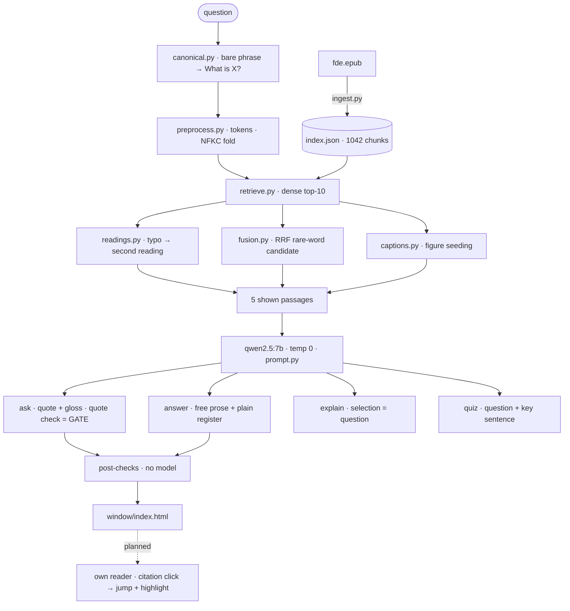

# System map — ask-this-book, 2026-10-13

One screen for the whole machine. Solid arrows are landed; dashed is planned
(not approved). Numbers as of this date — re-check with the gates below before
trusting them (artifacts policy, staleness gate).

## Rendered view



## Plain view (for terminals and diffs)

```
UPSTREAM
  fde.epub ──( ingest.py )──▶ index.json   1042 chunks + figure vectors
                              (chunk_id, chapter, section, doc, figures)

QUESTION PATH
  question
    │
    ├─▶ canonical.py     bare phrase → "What is X?"    (discloses `Asked as:`)
    ├─▶ preprocess.py    tokens · NFKC fold            (stages 5–9 vendored)
    ├─▶ retrieve.py      nomic dense top-10
    │      ├─ (A) word not in book  ─▶ readings.py   difflib, then LLM spell;
    │      │                                         kept only if strictly better
    │      │                                         (discloses `Read as:`)
    │      ├─ (B) rare word         ─▶ fusion.py     RRF lexical candidate
    │      │                                         (dense-band vetoed)
    │      └─ (C) caption wins      ─▶ captions.py   seed the figure-naming chunk
    │
    ├─▶ qwen2.5:7b  temp 0  prompt.py
    │      ├─ ask       quote + gloss;  quote check = the GATE
    │      ├─ answer    free prose; [Ch. N] → citations; fake quotes stripped
    │      │     └─ plain register on a cue: evidence sentences rewritten 1:1
    │      ├─ explain   selection = question (ask path)
    │      └─ quiz      one question + key sentence (no score)
    │
    └─▶ post-checks (no model)
           heading trim · list expansion · whole-sentence quotes
           footnote-glue split · figures only from cited passages
           refusal = exactly "Not in this book."
             │
             v
        window/index.html — answer + citations + figures
             └─ planned (not approved): own reader; citation click → jump + highlight

GATES (every commit)                      numbers 2026-10-13
  tests/                                  210 green
  step2-battery.py (ask + answer)         golden 10/10 · typos · probes · coherence · France
  eval.py + eval-set.json (24 items)      recall@10 17/22 · shown@5 22/22 · MRR 0.708
  eval-plain.py (10 items)                draws 9/10, 8/10 (post fragment fix)
  judge.py (granite | muse)               agreement 86/105; judge-stability flips ~1/3
  groundedness.py                         support meter (measured, not gated)

PARKED
  agentic.py + multihop-*                 measured no win; next lever is decision policy

MODELS
  embed    nomic-embed-text
  answer   qwen2.5:7b                     bake-off verdict: no swap
  judge    granite4.1:8b local | muse spark cloud (release judge)
  finetune smallbook:latest v1            refusal learned; rambles (174k chars)
                                          → v2 recipe ready (responses-only loss), bench pending
```

```
