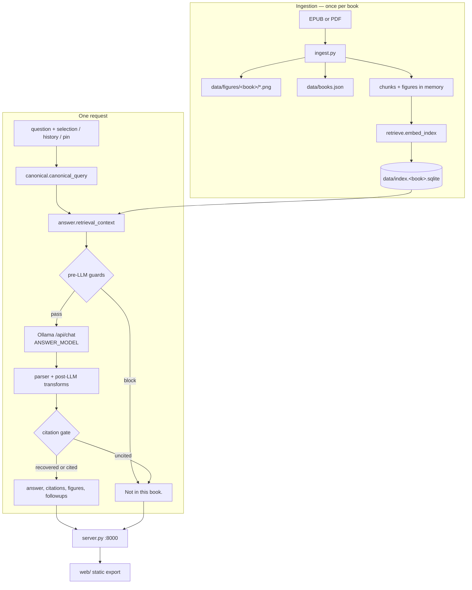

# Architecture

How ask-this-book works, as the code stands today. Every claim here was read
from the source on 2026-11-01; when the code and this page disagree, the code
is right. Line numbers are deliberately omitted — they rot. Names are stable.



## 1. Storage

One SQLite database per book: `data/index.sqlite` for `fde`, and
`data/index.<book_id>.sqlite` for every other book (`retrieve.book_index_path`).
`store.py` owns the schema and every write.

```sql
meta(key TEXT PRIMARY KEY, value TEXT)            -- JSON per top-level index key
chunks(position INTEGER PRIMARY KEY, chunk_id TEXT UNIQUE, chapter, heading,
       text, source, section, doc, anchor, blocks, figures, embedding BLOB,
       embedding_input_sha256, extra)
figures(position INTEGER PRIMARY KEY, figure_id TEXT UNIQUE, chapter, caption,
        referencing_paragraph, file, anchor, source, embedding BLOB,
        embedding_input_sha256, extra)
CREATE VIRTUAL TABLE chunks_fts     USING fts5(heading, section, body, tokenize='porter unicode61');
CREATE VIRTUAL TABLE chunks_trigram USING fts5(body, tokenize='trigram');
```

- Embeddings are little-endian `float64` blobs (`struct.pack("<Nd", …)`), 768
  dimensions for `nomic-embed-text`, so 6,144 bytes per vector. Vectors are
  rounded to six decimals before storage.
- `blocks` and `figures` are JSON text. Chunk/figure keys the schema does not
  name, plus anything starting with `_`, land in `extra`; derived keys are
  never persisted.
- Writes build a sibling `.tmp` database, commit, then `os.replace` — a reader
  never sees a half-written index. Readers open `mode=ro`.
- `data/books.json` is the catalog: `book_id`, `title`, `author`,
  `chapter_count`, `chunk_count`, `figure_count`, `cover_url`, `index_path`,
  `figures_dir`. `ingest.update_books_catalog` rewrites it on every ingest.
- Pictures are individual files under `data/figures[/<book_id>]/`, never
  embedded in the database.

Current catalog (counts are live SQLite queries, not the catalog's own numbers;
they match):

| book_id | Book | Chunks | Figures | Chapters |
|---|---|---|---|---|
| `fde` | Fundamentals of Data Engineering | 1042 | 111 | 16 |
| `quantization` | Quantization and Fast Inference | 473 | 76 | 7 |
| `ddia` | Designing Data-Intensive Applications | 1306 | 90 | 17 |
| `ai-engineering` | AI Engineering | 1030 | 161 | 12 |
| `ai-agents_…-anna-s-archive` | AI Agents: The Definitive Guide | 637 | 69 | 14 |

4,488 chunks and 507 figures in total.

A chunk is `chunk_id` (`<doc>-<nnn>`), `chapter`, `heading` (the passage's
first line), `text`, `section`, `source`, `doc`, `anchor`, `blocks` (rich
blocks, `None` for plain paragraphs), `figures` (ids the passage references),
and, after embedding, `embedding` + `embedding_input_sha256`.
`retrieve._prepare_index` derives `_uvec` (unit vector), `_cited_numbers`,
postings and document frequencies at load time. Those keys are cached, not
written.

## 2. Ingestion

`ingest.py` reads an EPUB with `zipfile` + `lxml` (PDF via PyMuPDF when the
file is not an archive), walks the spine, and packs sentences into chunks with
`CHUNK_MAX_CHARS = 1400` and `CHUNK_OVERLAP_CHARS = 180`. It keeps the heading
that opens a passage, records non-paragraph blocks (lists, code, tables), finds
figure references and figure containers, and writes each picture to
`data/figures/<book_id>/`. Figure ids are normalised (`Figure 1.1` →
`figure-1-1`), and a `cover.png` is extracted when the EPUB has one.

`ingest.main` deletes existing files in the target figures directory before it
writes, so a re-ingest replaces figures rather than accumulating them.

Embedding is a separate step, deliberately: `retrieve.embed_index` calls
Ollama's `/api/embed` in batches of 16 and **skips records whose stored
`embedding_input_sha256` already matches** the text. Re-running it after an
ingest is cheap and idempotent. It refuses to mix embedders in one file.

Same flow without a shell: `POST /ask` with `mode: "import"`, which takes
`data_base64` (or `epub_path`), ingests, embeds, saves, updates the catalog and
drops the process caches. With `stream: 1` it frames the wait instead: `book`
(the extracted jacket and title, on disk within the first second), `progress`
`{done, total}` after every embedding batch of 16, then exactly one `final` or
`error`.

The book id comes from the uploaded file name through
`ingest.book_id_for`, which slugs it and caps it at `BOOK_ID_MAX = 64`
characters (keeping a digest of the whole name when it truncates, so two long
titles that share a prefix stay distinct). The id is three file names —
`books/<id>.epub`, `data/index.<id>.sqlite`, `data/figures/<id>/` — and an
Anna's Archive name derives 200+ characters, which used to overflow the
filesystem's 255-byte name limit inside SQLite's temp and journal files
(measured 2026-11-01).

## 3. One request, in order

Both answering modes share `answer.retrieval_context`, so the two modes see the
same five passages.

### 3.1 Before retrieval

1. `observe.record_query` — the trace opens before anything else.
2. `is_prompt_injection` — forged `passages:`/`question:` headers and control
   tokens are refused without retrieval (`guard: prompt_injection`).
3. `sanitize_query`, `sanitize_history` (the last `HISTORY_TURNS = 2` turns
   survive), `_is_topic_shift_followup` (a standalone question drops the pin).
4. `_resolve_contextual_query` — fragments, deictic references and
   selection-backed asks get their subject from history or the selection.
5. `canonical.canonical_query` — a bare phrase becomes a question
   (`watermark` → `What is watermark?`), one-comparator forms become
   `What is the difference between X and Y?`, everything else is unchanged.
   The paraphrase is echoed back as `Asked as: "…"`.

There is one shortcut: a "simpler words" or structurally elided follow-up is
answered straight from the pinned chunk with no retrieval
(`record_shortcut("simplify_or_elided_followup")`).

### 3.2 Retrieval stages

| # | Stage | What it does | Knob |
|---|---|---|---|
| 1 | `retrieve.rank_chunks` | dense cosine ranking over the whole book (`_uvec` dot products) | `PASSAGE_LIMIT = 5` |
| 2 | `_pin_chunk` | the reader's pinned passage leads the window | — |
| 3 | `_figure_referencing_chunk` | a question naming `figure N-M` fronts the chunk that names it | — |
| 4 | `keywords.rare` + `fusion.fuse` | lexical FTS5 BM25 leg, RRF-fused with dense; runs only when a question term is rare (`df ≤ RARE_DF = 8`) | `LEXICAL_BACKEND` |
| 5 | `captions.caption_seed` | a figure caption that out-scores the best chunk is prepended | — |
| 6 | `_prioritize_phrase_matches` | heading/bigram matches score up; code-shaped hits score down for definitional asks | — |
| 7 | `rerank.rerank_passages` | cross-encoder rerank, off unless asked for | `RERANK_ENABLED=1` |
| 8 | follow-up neighbours | the previous quote's chunk plus its neighbour | window of 2 |
| 9 | `prefer_definitions` | surfaces a defining passage inside the same five | `DEF_PREF` |

`fusion.fuse` only considers lexical candidates inside the dense top 20 %
(`RANK_BAND = 0.20`) and fuses with `RRF_K = 60`. A lexical hit outside the band
can still enter as a single strongest candidate.

Tuning constants, all in one place for a reader: `PASSAGE_LIMIT = 5`,
`HISTORY_TURNS = 2`, `MISS_QUOTE_CHARS = 160`, `PARAGRAPH_CAP = 1200`,
`RARE_DF = 8`, `COVER_DF = 80`, `RRF_K = 60`, `RANK_BAND = 0.20`, chunk size
1400/180, `readings.CUTOFF = 0.85`.

### 3.3 Guards — refusal before the model runs

All seven live in `answer.py`, all return the same refusal body, and all record
`query.guard_blocked` with their reason:

| Guard | Refuses when |
|---|---|
| `prompt_injection` | the question carries forged prompt structure or control tokens |
| `empty_passages` | retrieval returned nothing |
| `absent_person` | the question attributes a claim to a person whose name appears in no chunk |
| `unmentioned_technical_anchor` | a CamelCase token, 3+ letter acronym or capitalised phrase is absent from the book corpus (chunks + figure captions) |
| `no_book_vocabulary` | not one content word or stem of the question is in the book |
| `uncovered_subject` | `what is X` / `define X` where the 2–3 word subject appears in no chunk text or heading |
| `unknown_figure` | the question names `figure N-M` and the book has no such figure |

The last three are skipped when a history or a selection exists — a follow-up is
allowed to be elliptical.

### 3.4 Generation

`answer.ollama_generate` posts to `http://127.0.0.1:11434/api/chat` with
`model`, `stream`, `think: false`, `keep_alive: OLLAMA_KEEP_ALIVE` (default
`10m`), and `options: {temperature: 0, num_predict: 512}`. The system prompt
comes from `prompt.py`; the user message carries the five passages.

Uncited retries use the prefill trick: an assistant turn containing `[Ch. `
forces the model to continue with a citation instead of prose
(`_retry_uncited`). The transport itself never retries; every retry is a
caller decision.

### 3.5 After the model

| Transform | Effect | Trace name |
|---|---|---|
| `parse_completion` / `parse_answered` | keep only a quote the passages can back | `parse_refused` when it refuses |
| `_half_covered` | a comparison with only one side in the book becomes a refusal | `half_covered_refused` |
| `_align_citation_to_query_concepts` | re-points a citation at a passage that carries the query's acronym or verb | `citation_aligned` |
| `_retry_uncited` | one prefill retry when a refusal still has passage evidence | `retry_uncited` |
| `_expand_list` | a lead-in quote is swapped for the items following it | `list_expanded` |
| `_comparison_body` | two-sided comparison body (`COMPARE_SYSTEM`) | `comparison_branch` |
| `_plain_body` | plain-register rewrite of a "simple words" ask | `plain_register` |
| citation gate | a body naming no passage is recovered from a verbatim sentence, or refused | `citation_recovered` / `uncited_refused` |
| `_ensure_answer_gloss` | final gloss; template fallback | `gloss_template` |

Silent, uncounted rewrites also exist: follow-up quote advancement, the
selection-anchor override, `_without_heading` trimming,
`_reground_alphanumeric_quote`, `_concept_span` quote widening, and the
`Asked as:` / `Read as:` suffix.

## 4. The four answering modes plus import

| Mode | Input | Guarantee |
|---|---|---|
| `answer` | question, optional history/pin | free prose, `[Ch. N]` tags become citations, uncited prose is refused. The app's default |
| `ask` | question, optional history/pin | quote-first: the leading sentence must be a verbatim passage sentence with `[Ch. N]`, and the rest is a gloss |
| `explain` | selection, optional `chunk_id` | gloss of the highlighted sentence, with that sentence quoted and cited; falls back to `ask` |
| `quiz` | optional `chunk_id` | a question written from one key sentence; refuses instead of leaking the answer or emitting a citation |
| `import` | `data_base64` or `epub_path` | ingests, embeds and catalogues the book; no model call, no trace |

`REFUSAL = "Not in this book."` (`prompt.py`) is produced by exactly one
builder, `_refusal(passages, figures)`, which also fills `citations` with up to
three near-miss snippets (160 chars) and an empty `followups`. Every mode ends
there or in a body with citations; nothing else writes `refused: true`.

## 5. HTTP surface

`server.py`, `127.0.0.1`, port 8000 (`PORT` / `--port`).

| Route | Method | Notes |
|---|---|---|
| `/` | GET, HEAD | `web/out/index.html` when built, else `window/index.html` |
| `/health` | GET, HEAD | `{ok, book_id, ollama, books, warm}` |
| `/figures/{id}` | GET, HEAD | `book_id` query; `cover` is an alias; 404 when the file is missing |
| `/retrieve` | GET, HEAD | `q` required, `book_id`, `k` (default 5, clamped 1–10); no model call |
| `/chunks` | GET, HEAD | reader payload; gzip when `Accept-Encoding: gzip` |
| `/ask` | POST | modes above |
| anything else | GET, HEAD | static file inside `web/out`; `/_next/static/*` is immutable-cached |
| any path | OPTIONS | CORS preflight for `localhost`/`127.0.0.1` on 3100 and 3200 |

`POST /ask` requires `mode`; `question` is required for `ask`/`answer`,
`selection` for `explain`. Unknown keys are ignored. The 200 body carries
`answer`, `citations[{chunk_id, chapter, quote}]`,
`figures[{id, chapter, caption, src}]`, `refused`, `followups[]` (≤3). Errors
are `{error}` with 400/404/500.

With `stream: 1` the response is NDJSON: `token {text}`, `reset` (a discarded
draft is about to be replaced), then exactly one `final {body}` or
`error {error}`. Validation errors still come back as plain JSON before the
stream opens.

`mode: "import"` with `stream: 1` opens NDJSON straight away and sends
`book {book_id, title, author, cover_url, chunk_count}` once the EPUB is parsed
and its jacket written, `progress {done, total}` after each embedding batch,
then exactly one `final {ok, book_id, book, books}` or `error {error}`. A
rejected import (`ValueError`: bad base64, missing file) is an `error` frame
because the 200 header is already sent; without `stream` it is a 400 as before.

## 6. Observability

`observe.py` writes one JSON line per request to `artifacts/runs/traces.jsonl`
(`OBSERVE_LOG` to move it, `OBSERVE=0` to disable). The record carries
`trace_id, timestamp, source, mode, book_id, model, embedder, status, error,
total_ms, query, retrieval, llm, vram_load_ms, outcome`.

- `query`: raw/resolved/asked forms, history turns, pin, guard that fired,
  shortcut, reading repair.
- `retrieval`: stage flags, `dense_top5`, `lexical_top5`, `pre_rerank_top5`,
  `shown_passages` (the exact five the model saw).
- `llm`: call count, TTFT, tokens, tokens/sec, per-call prompt/decode/VRAM
  timing.
- `outcome`: transforms applied, cited chunks, figures attached, answer size.
- `anomalies`: derived flags (`guard_blocked`, `empty_retrieval`,
  `post_llm_refusal`, `uncited_retry`, `citation_realigned`, `vram_cold_load`,
  `slow_ttft`).

HTTP requests log by default; unit tests and eval runs do not unless
`OBSERVE_LOG` is set.

## 7. Frontend

`web/` is a Next.js 16 static export (`output: "export"` → `web/out/`). In
development `next dev -p 3100` talks to the engine at `:8000`
(`NEXT_PUBLIC_ENGINE_URL` overrides). In production the engine serves
`web/out` itself, so the user opens one URL.

The UI is one zustand store (`web/lib/store.ts`) over a shelf view and a reader
view: chunks from `GET /chunks`, gloss cards from `POST /ask` (streamed),
follow-ups with `history`, figures from the `figures` array, and a
`/traces` inspector that reads the trace log at build time. Design tokens live
only in `web/app/tokens.css`; `tests/test_frontend_rules.py` enforces that and
the rest of the house style.

## 8. Seams

Everything below changes behaviour without touching code:

| Variable | Default | Effect |
|---|---|---|
| `ANSWER_MODEL` | `nekohon_q35_2b_x3_2e` | Ollama chat model |
| `OLLAMA_KEEP_ALIVE` | `10m` | model residency (`-1` pins it; 8h pinned was measured at 6.9 GB working set) |
| `PORT` | `8000` | engine port (`--port` wins) |
| `OBSERVE` / `OBSERVE_LOG` | on / `artifacts/runs/traces.jsonl` | tracing |
| `LEXICAL_BACKEND` | `fts5` | anything else falls back to the legacy idf scorer |
| `RERANK_ENABLED` | off | `1` loads the cross-encoder reranker |
| `DEF_PREF`, `MULTI_QUOTE`, `MULTI_MARGIN` | off, off, `0.02` | definition preference and second-quote rule |
| `NEXT_PUBLIC_ENGINE_URL` | unset | web → engine base URL |
| `WARMUP_BLOCK` | off | `1` warms the model before the server binds |

The evaluation judge has its own set (`JUDGE_BACKEND`, `JUDGE_MODEL`,
`JUDGE_API_KEY`, …) used only by `artifacts/harnesses/`.
