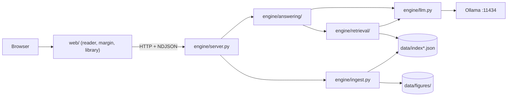
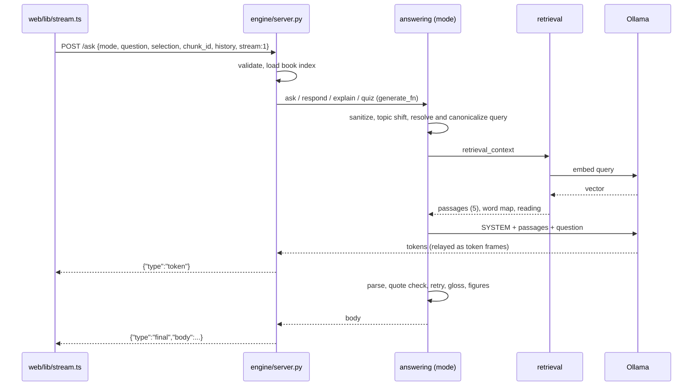
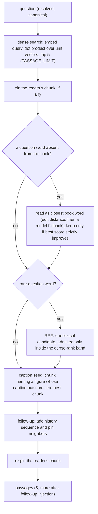
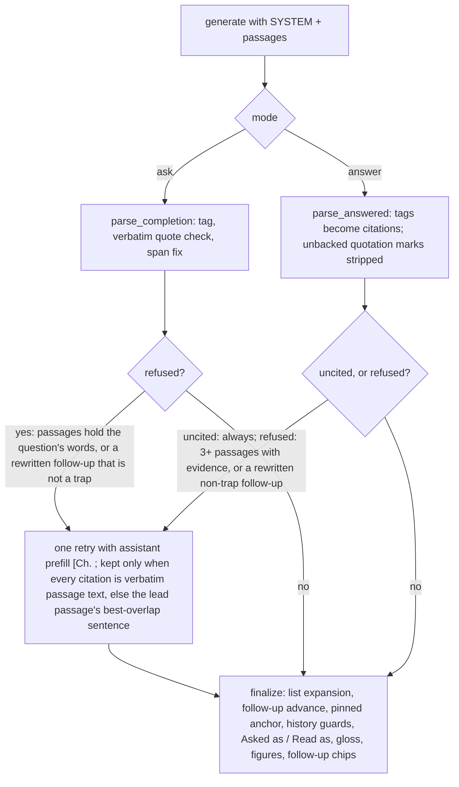

# Engineering

How NekoHon works today. For the reason behind a mechanism or a constant, see
[DECISIONS.md](DECISIONS.md); for vocabulary, [GLOSSARY.md](GLOSSARY.md); for
the rules, [../AGENTS.md](../AGENTS.md). This page holds no benchmark numbers:
measure with the commands in "Verification".

## Shape of the system

An EPUB is ingested into a JSON index of chunks and figures. A question
retrieves a handful of passages. A local model answers from those passages and
cites them. The answering layer checks or attaches every citation against the
passage text. Everything runs on the local machine: Ollama at `127.0.0.1:11434`
for generation and embeddings, a stdlib Python engine on `:8000`, and a Next.js
reader in `web/`.

## Engine modules

Top level (`engine/`):

| Module | Job |
| --- | --- |
| `server.py` | HTTP routes, request validation, NDJSON streaming, EPUB import, static serving of `web/out`, warm-up, in-process index and chunk caches. |
| `llm.py` | The one Ollama client: chat (blocking and streaming), embed, loaded-model query. Temperature 0, `think: false`, capped `num_predict`, `keep_alive`. |
| `ingest.py` | EPUB spine to chunks and figures, catalog update (`data/books.json`). |
| `figures.py` | Figure resolution from the filesystem and the rule for which figures attach to an answer. |

Retrieval (`engine/retrieval/`):

| Module | Job |
| --- | --- |
| `retrieve.py` | Index load, embedding (with task prefixes and vector hygiene guards), dense ranking by dot product over unit vectors, reader payload (`chunks_payload`). |
| `preprocess.py` | The text seam: `normalize`, `fold`, `tokens`, `words`, `stem`, stopwords. Backed by `vendor/`. |
| `keywords.py` | Inverted postings, rare-word gate, anchor words. |
| `fusion.py` | Reciprocal rank fusion of one lexical candidate into the dense results, gated by a dense-rank band. |
| `captions.py` | Seeds the chunk that names a figure whose caption outscores the best chunk. |
| `readings.py` | Typo repair: a question word absent from the book is read as its closest book word, kept only if the score strictly improves. |

Answering (`engine/answering/`). `answer.py` is a re-export front: import public
names from it; the work lives in the modules below.

| Module | Job |
| --- | --- |
| `pipeline.py` | The shared turn: `begin_turn` (sanitize, topic-shift check), `simplify_shortcut`, then `finalize` (list expansion, follow-up quote advance, pinned-anchor quote, history guards, gloss, follow-up chips). |
| `quoteask.py` | `ask` mode: quote-first generation, strict quote check. |
| `freeanswer.py` | `answer` mode: tag-to-citation parsing, the `[Ch. ` retry, the plain-words register. |
| `explain.py` | `explain` mode: the reader's selection is the question; its chapter neighborhood is the evidence. |
| `quiz.py` | `quiz` mode: one question plus one key sentence from one chunk. |
| `context.py` | `retrieval_context`: search, pin, reading, fusion, caption seeding, history and pin neighbors. |
| `conversation.py` | Follow-ups: topic shift, subject carried from history, contextual query resolution, quote advance. |
| `quotecheck.py` | Verbatim check, span fix, tag-slip rebuild, truncated-quote completion, refusal body. |
| `listshape.py` | List questions: lead-in repair, paragraph expansion. |
| `comparison.py` | Comparison sides and the half-covered rule. |
| `gloss.py` | The 1 to 2 sentence gloss, its coherence guard, grounded fallback synthesis. |
| `intent.py` | Structural classification of a selection and the dynamic follow-up chips. |
| `canonical.py` | Bare-phrase and comparator rewrites (`Asked as:`). |
| `messages.py`, `prompt.py` | User-message builders and the system prompts, model tags. |
| `sanitize.py` | Prompt-injection check, history clipping. |
| `shared.py` | Sentence splitting, chunk lookups, candidate sentences, shared regexes. |
| `generate.py` | Thin Ollama generate wrappers carrying the `_is_live` marker the streaming layer reads. |

Other directories: `scripts/` (launch, model setup, preflight, index
verification, warm-up measurement), `models/` (Modelfiles), `vendor/`
(stemmer and stopwords), `window/index.html` (no-build fallback page for
`GET /`), `tests/`.

## Request flow: `POST /ask`

Without `stream`, the server runs the same mode function and returns the body
as JSON. A stream always ends with `final` or `error`. A `reset` frame means a
draft was discarded. `import` takes a separate path: ingest, embed, save,
update the catalog.

## Retrieval pipeline

The same retrieval feeds every mode. Passage text is never rewritten; it is
what gets cited.

## Answering pipeline

`ask` and `answer` send the same quote-first system prompt and passage block
(except the plain register, which drafts with `SYSTEM_ANSWER`). They differ in
what happens to the reply.

- A refusal is exactly `Not in this book.`; nothing else counts. Refusals can
  list nearest-miss citations.
- `answer` also has the plain-words register: a cue such as "in simple words"
  selects evidence sentences from a draft and rewrites each one in a single pass.
- `explain` uses the selection as the question and the chapter neighborhood as
  evidence, writes a short gloss, and falls back to a gloss synthesized from the
  anchor sentence when the model output fails the coherence guard.
- Follow-ups: the client sends at most two prior turns as `history`. History
  helps resolve pronouns and "simpler" cues; it is never evidence. Quotes are
  checked against this turn's passages only. See
  `artifacts/plans/conversation-map.md`.
- Figures attach only from a passage the answer cited and only when the figure
  file exists.

## Frontend

`web/` is a Next.js app (static export in production, served by the engine at
`GET /`). It calls the engine directly; no proxy.

- `app/` page, layout, design tokens (`tokens.css`), `globals.css`.
- `components/library/` book shelf, grid, book detail, EPUB drop.
- `components/reader/` reader blocks, top bar, rail, selection lens, composer,
  answer view.
- `components/margin/` margin layout, cards, turns, follow-up form, drag and
  resize.
- `lib/` `store.ts` (zustand state), `stream.ts` (NDJSON client), `engine.ts`
  (HTTP client), `persist.ts` (per-book localStorage), `anchor.ts` (selection
  offsets), `answer.ts`, `quote.ts`, `turns.ts`, `appearance.ts`.

Details and conventions: [../web/README.md](../web/README.md).

## Verification

- Unit tests: `python3 -m unittest discover -s tests`. They use fixture books in
  a temp directory and never touch real `data/` or `books/`.
- Guards: `tests/test_generalization.py` and `tests/test_query_understanding.py`
  keep logic modules free of book-specific ids and strings;
  `tests/test_frontend_rules.py` pins CSS hygiene;
  `tests/test_contract.py` pins the response shape.
- Cassette: `python3 .agents/skills/verify/cassette.py replay` replays recorded
  Ollama traffic through an in-process server and requires byte-identical engine
  output. No Ollama needed.
- Index and setup: `python3 scripts/verify_index.py`, `python3 scripts/preflight.py`.
- Frontend: `cd web && npx tsc --noEmit && npm run build`.
- Live batteries (engine and Ollama up): `python3 artifacts/harnesses/step2-battery.py`
  and `BATTERY_MODE=answer python3 artifacts/harnesses/step2-battery.py`.
- Other harnesses and what each needs: [../artifacts/README.md](../artifacts/README.md).

The full gate is the `verify` skill, `.agents/skills/verify/SKILL.md`.
