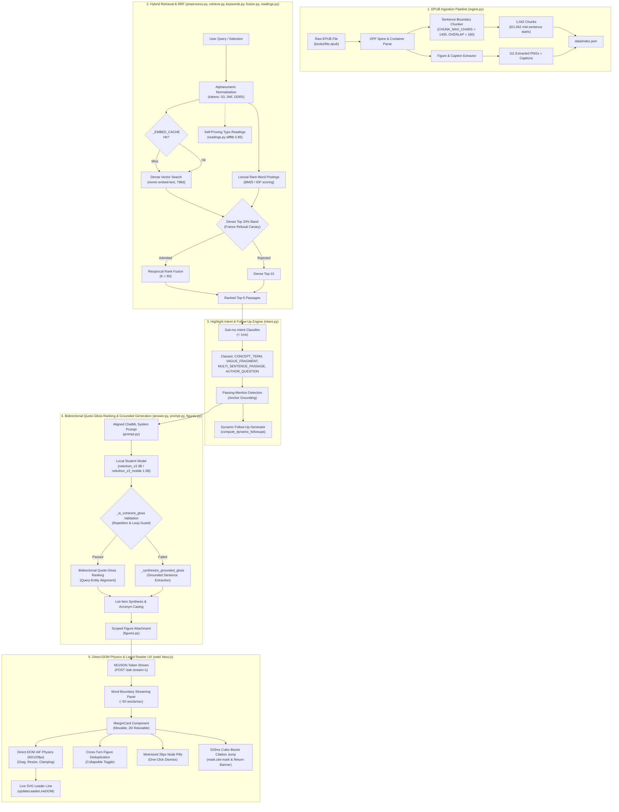
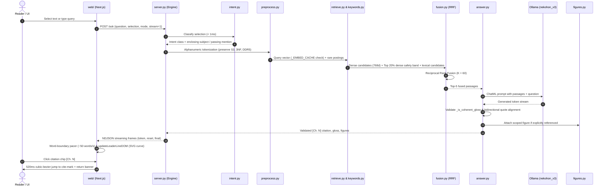
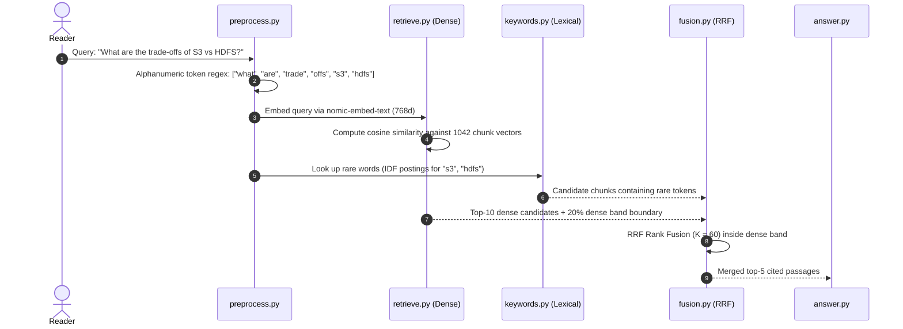
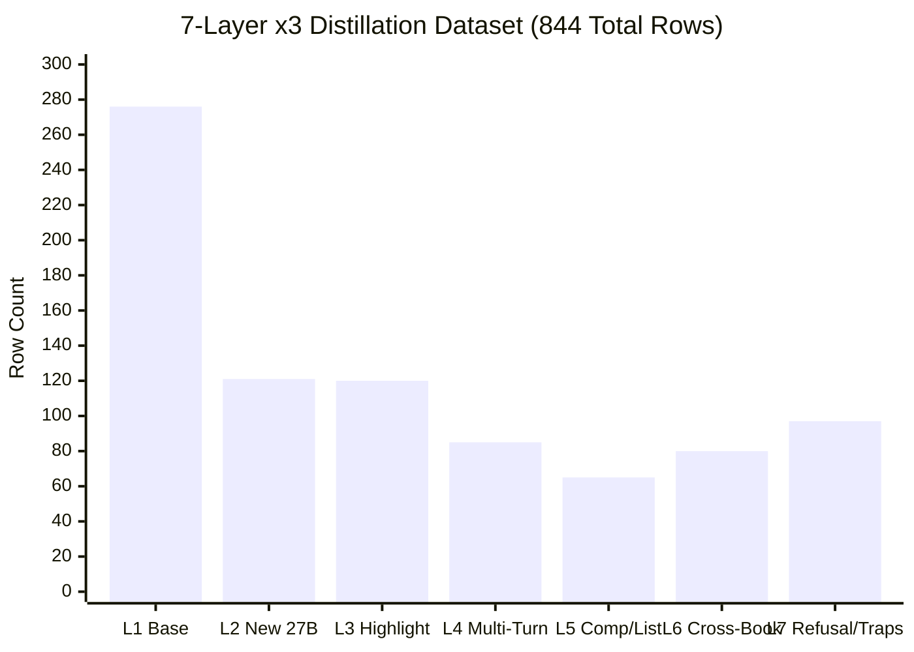

# Engineering, Ingestion, Hybrid Retrieval & Benchmark Guide

This document provides a technical deep-dive into the architecture of `ask-this-book` ([`c:\Users\ADRIAN\workspace\github.com\Skufu\ask-this-book`](file:///c:/Users/ADRIAN/workspace/github.com/Skufu/ask-this-book)), detailing the end-to-end pipeline from raw EPUB parsing to hybrid retrieval, semantic intent resolution, wide-LoRA model distillation, and empirical verification.





---

## 1. EPUB Ingestion & Sentence-Boundary Chunking ([`ingest.py`](file:///c:/Users/ADRIAN/workspace/github.com/Skufu/ask-this-book/ingest.py))

### 1.1 Why Naive Chunking Fails
Standard chunking approaches that split text on fixed character lengths (`text[:1000]`) or word counts introduce severe structural defects:
- In our baseline audit, **373 out of 1013 chunks (37%) started mid-sentence**.
- **43 chunks (4%) ended without terminating punctuation**, causing truncated thoughts and incomplete citations.
- Prepending a fixed word-count tail from the prior chunk guarantees that every overlapped chunk begins with a sentence fragment.

### 1.2 The Sentence-Boundary Packing Algorithm
[`ingest.py`](file:///c:/Users/ADRIAN/workspace/github.com/Skufu/ask-this-book/ingest.py) implements paragraph-aware sentence-boundary packing:
1. **Section Heading Preservation**: Headings (`<h1>`–`<h4>`) are extracted and prepended to every chunk generated from that section (`heading + "\n\n" + text`).
2. **Table Preservation**: Tables (`<table>`) are never split across chunks, even if they exceed `CHUNK_MAX_CHARS`.
3. **Sentence Boundary Packing**:
   - `CHUNK_MAX_CHARS = 1400` (~250–320 tokens).
   - `CHUNK_OVERLAP_CHARS = 180` (~30–40 tokens).
   - Sentences are detected using punctuation boundaries (`.`, `!`, `?`) followed by whitespace.
   - When a paragraph fits in the remaining space of a chunk, it is packed whole.
   - If a paragraph exceeds the remaining space, sentences are packed greedily until the next sentence would exceed `CHUNK_MAX_CHARS`.
   - Overlap is constructed exclusively from **whole sentences** from the end of the previous chunk:
     ```python
     # Pseudocode from ingest.py
     overlap_sents = []
     acc_len = 0
     for s in reversed(previous_chunk_sentences):
         if acc_len + len(s) > CHUNK_OVERLAP_CHARS:
             break
         overlap_sents.insert(0, s)
         acc_len += len(s)
     ```
4. **Measured Outcome**: In the ingested *Fundamentals of Data Engineering* index (`data/index.json`):
   - **`1,042` total chunks** (`1,025` prose chunks + `17` chunks containing HTML table text).
   - **`0 / 1,042` (`0.0%`) mid-sentence starts**.
   - **`983 / 1,042` (`94.34%`) ending with terminal punctuation** (`.`, `!`, `?`, quotes); the remaining `59` chunks (`5.66%`) are section headings, colon list lead-ins (`include the following:`), URLs, or bibliographic entries.
   - **`111` extracted figure records** in `data/index.json` (`110` unique figures referenced across `118` chunk-level figure attachments in `GET /chunks`, plus `1` unreferenced appendix image `fig-app02-1`).

### 1.3 Figure & Caption Extraction
- For each chapter, all `` tags are resolved against the EPUB zip container.
- Image files are extracted and written to [`data/figures/`](file:///c:/Users/ADRIAN/workspace/github.com/Skufu/ask-this-book/data/figures).
- Captions are extracted from `<figcaption>` or image `alt` attributes.
- The referencing paragraph is determined by finding the nearest text paragraph mentioning `"Figure X-Y"` or `"Fig. X-Y"`.
- Figure records store: `{id, chapter, caption, referencing_paragraph, file}`.

### 1.4 How to Ingest a Custom EPUB
To index a new book for the companion:
1. Place the EPUB file at `books/<book_id>.epub`.
2. Update or verify `books/SOURCE.txt` with the book's metadata.
3. Run the ingest and embedding scripts:
   - **Default FDE run**:
     ```sh
     python ingest.py && python retrieve.py && python verify_index.py
     ```
   - **Custom book run** (using exact `argparse` flags `--epub`, `--book-id`, `--index`, `--figures-dir`):
     ```sh
     python ingest.py --epub books/my_book.epub --book-id my_book --index data/index.my_book.json
     python retrieve.py --book-id my_book
     python verify_index.py --book-id my_book
     ```
4. The system is book-agnostic: [`tests/test_generalization.py`](file:///c:/Users/ADRIAN/workspace/github.com/Skufu/ask-this-book/tests/test_generalization.py) enforces that no book-specific titles, chunk IDs, or query strings exist in engine logic modules.

---

## 2. Hybrid Retrieval, Alphanumeric Tokenization & RRF Fusion



### 2.1 Alphanumeric Tokenization ([`preprocess.py`](file:///c:/Users/ADRIAN/workspace/github.com/Skufu/ask-this-book/preprocess.py))
Standard tokenizers using `[a-z]+` discard numeric characters. In technical literature, this corrupts critical identifiers:
- `"s3"` became `"s"`.
- `"3nf"` (Third Normal Form) was dropped entirely.
- `"ddr4"` and `"ddr5"` collapsed into identical `"ddr"` stems.

`preprocess.TOKEN` enforces that tokens contain at least one alphabetic character but permits embedded or surrounding digits:
```python
TOKEN = re.compile(r"[A-Za-z0-9]*[A-Za-z][A-Za-z0-9]*")
```
This guarantees exact posting matches for `"s3"`, `"3nf"`, `"sha256"`, and `"ddr5"` while cleanly rejecting isolated numeric page numbers or dates (`"2022"`, `"1400"`).

### 2.2 Dense Retrieval ([`retrieve.py`](file:///c:/Users/ADRIAN/workspace/github.com/Skufu/ask-this-book/retrieve.py))
- Model: `nomic-embed-text:latest` (137M parameters, 768 dimensions, F16 quantization).
- All chunk texts and figure captions are stored in `data/index.json`.
- Similarity computation is implemented in pure Python (no numpy dependency):
  ```python
  def cosine_similarity(v1, v2):
      dot = sum(a * b for a, b in zip(v1, v2))
      norm1 = sum(a * a for a in v1) ** 0.5
      norm2 = sum(b * b for b in v2) ** 0.5
      return dot / (norm1 * norm2) if norm1 and norm2 else 0.0
  ```

### 2.3 Lexical Inverted Index & The Dense Safety Band ([`keywords.py`](file:///c:/Users/ADRIAN/workspace/github.com/Skufu/ask-this-book/keywords.py))
Dense embedding models frequently underperform on rare keyword matches (e.g. rare technical terms like `"pragmatic"` with document frequency <= 8).
- [`keywords.py`](file:///c:/Users/ADRIAN/workspace/github.com/Skufu/ask-this-book/keywords.py) maintains in-memory postings for low-document-frequency terms.
- **The Dense 20% Safety Band (The France Canary)**:
  A naive BM25/IDF boost promotes irrelevant chunks if an out-of-book query happens to match an incidental word (e.g., `"capital"` in *"What is the capital of France?"* matching an economics mention).
  To prevent false answers, a lexical candidate is **only** admitted if its dense retrieval score places it within the top 20% of the corpus ranking. Out-of-book queries sit in the dense tail (rank > 600) and are strictly rejected.

### 2.4 Reciprocal Rank Fusion ([`fusion.py`](file:///c:/Users/ADRIAN/workspace/github.com/Skufu/ask-this-book/fusion.py))
When a rare-word lexical candidate clears the dense band, it is fused with the dense candidates using Reciprocal Rank Fusion (K = 60):
```text
RRF_score(d) = (1.0 / (60 + dense_rank(d))) + (1.0 / (60 + lexical_rank(d)))
```
This ensures high-precision keyword anchors are elevated into the model's top context window without destabilizing dense semantic matches.

### 2.5 Self-Proving Second Readings ([`readings.py`](file:///c:/Users/ADRIAN/workspace/github.com/Skufu/ask-this-book/readings.py))
When a query word is absent from the book corpus (e.g. `"atermark"` or `"normilazation"`):
1. `difflib.get_close_matches` scans the whole book's vocabulary (threshold 0.85).
2. If an edit is found, the query is re-searched under the candidate reading.
3. The repair is accepted **only** if the top retrieval score strictly beats the original query score.
4. Any accepted reading is explicitly disclosed on the first line: `Read as: "..."`.

---

## 3. Highlight Intent Engine & Grounded Answer Generation

### 3.1 Intent Taxonomy ([`intent.py`](file:///c:/Users/ADRIAN/workspace/github.com/Skufu/ask-this-book/intent.py))
When readers highlight text in [`web/`](file:///c:/Users/ADRIAN/workspace/github.com/Skufu/ask-this-book/web), their selections range from single acronyms to full paragraphs. [`intent.py`](file:///c:/Users/ADRIAN/workspace/github.com/Skufu/ask-this-book/intent.py) runs deterministic classification in < 1 ms:

| Intent Class | Criteria | Example Selection | Resolution Action |
| --- | --- | --- | --- |
| `CONCEPT_TERM` | 1–4 words, title-case or acronym | `"Cloud Economics"` | Strips meta-prefixes (`"A Detour on..."`), locates substantive definitional anchor sentence. |
| `VAGUE_FRAGMENT` | Incomplete clause without explicit subject | `"is a perfectly reasonable strategy"` | `extract_enclosing_subject` walks the enclosing sentence to find the grammatical subject (`"lift and shift"`). |
| `MULTI_SENTENCE_PASSAGE` | Contains sentence terminators or > 200 chars | Two full paragraphs on IOPS bottlenecks | Identifies core thesis sentence across clauses. |
| `AUTHOR_QUESTION` | Ends with `?` or starts with interrogative | `"How is this possible?"` | Treats the question as a reader inquiry and retrieves the author's answer. |

### 3.2 Coherence Verification & Anti-Loop Guard ([`answer.py`](file:///c:/Users/ADRIAN/workspace/github.com/Skufu/ask-this-book/answer.py))
Small language models (1.5B–3B) under low temperature can occasionally degenerate into n-gram repetition loops or truncate mid-sentence.
[`answer.py`](file:///c:/Users/ADRIAN/workspace/github.com/Skufu/ask-this-book/answer.py) enforces `_is_coherent_gloss(text)`:
- Rejects outputs with repeated 4-gram cycles.
- Rejects outputs ending without terminating punctuation (`.`, `!`, `?`, `"`).
- Rejects context recitation traps where the model echoes `"Sentence 0: ..."`.
### 3.3 Dynamic Follow-Up Pill Synthesis
Completed margin cards dynamically display 2–3 follow-up suggestion chips:
1. Candidate sentences are extracted from the cited passage.
2. Rhetorical author questions in adjacent paragraphs are surfaced.
3. Concepts with high document co-occurrence are converted into natural query pills (e.g. `"What are the disadvantages of multicloud?"`).

### 3.4 Direct-DOM Physics & Liquid Reader UX (`web/` Next.js)
The frontend companion implements high-performance DOM physics to provide an uncompromised reading experience:
- **Word-Boundary Streaming Pacer**: Instead of raw character bursting, incoming NDJSON tokens are accumulated and paced across word boundaries at ~50 words/sec (~16ms ticks), eliminating layout jank and cognitive fatigue.
- **60/120fps Direct-DOM Drag & 2D Resize**: Margin card positioning, header dragging, and corner resizing bypass React re-render cycles using `requestAnimationFrame` to update inline transforms and dimensions directly on the DOM element.
- **Live SVG Cubic-Bezier Leader Lines (`updateLeaderLineDOM`)**: Margin cards maintain a live SVG curve visually anchoring the card to its source passage highlight. The curve smoothly recalculates control points in real time during scrolling, card dragging, and window resizing.
- **Minimized 26px Node Pills**: When cards are closed or congested, they smoothly collapse into compact 26px circular node pills in the right margin gutter with a one-click `×` dismiss.
- **Cross-Turn Figure Deduplication**: When consecutive dialogue turns in a margin card thread reference the same figure, redundant image displays are suppressed into a collapsible drawer toggle.
- **520ms Cubic-Bezier Citation Jump**: Clicking a `[Ch. N]` citation chip triggers a 520ms smooth scroll targeting the exact quote, animating a rubric underline on `mark.cite-mark` and displaying a `"← Back to previous spot"` return banner.

---

## 4. Benchmarks & Test Suites (How to Verify a PR)

Every PR must pass all quality gates before merge. Run these commands from the repository root:


### 4.1 Unit Test Suite
```sh
python -m unittest discover -s tests
```
- **Scope**: 370 unit tests executing in ~1.7 seconds.
- **Coverage**: Contract validation, sentence-boundary chunk packing, hybrid RRF fusion, typo second readings, figure attachment integrity, and [`tests/test_generalization.py`](file:///c:/Users/ADRIAN/workspace/github.com/Skufu/ask-this-book/tests/test_generalization.py) (fails if any book-specific IDs or titles leak into logic modules).
- **Book-Agnostic Query Understanding** ([`tests/test_query_understanding.py`](file:///c:/Users/ADRIAN/workspace/github.com/Skufu/ask-this-book/tests/test_query_understanding.py)): Verifies canonical query normalization, intent classification, passing-mention extraction, acronym casing normalization, and multi-turn coreference resolution without depending on book-specific IDs or constants.

### 4.2 60-Item Hard Benchmark ([`artifacts/harnesses/hard-bench.py`](file:///c:/Users/ADRIAN/workspace/github.com/Skufu/ask-this-book/artifacts/harnesses/hard-bench.py))
```sh
python artifacts/harnesses/hard-bench.py nekohon_x3
```
Evaluates 6 stress categories (10 items each = 60 items):
1. `multi_turn`: Pronominal coreference follow-ups (`"What are its downsides?"`) and out-of-book follow-up refusals.
2. `varied_comparison`: Natural comparison grammar (`"How does Raft stack up against Paxos?"`).
3. `alphanumeric_acronyms`: Exact alphanumeric tokens (`S3`, `3NF`, `DDR4/5`).
4. `adversarial_injection`: Prompt injection attacks and plausible out-of-book technical lures.
5. `hard_explain_anti_boilerplate`: Contextual explain requests verified for verbatim citation and zero robotic boilerplate (`"in this context"`, `"this sentence refers to"`).
6. `zero_shot_unseen_book`: Completely unseen 8-chunk networking textbook corpus (TCP, BGP, TLS 1.3, Raft).
- **Target**: **60/60 (100%)** on both `nekohon_x3` and `nekohon_x3_mobile`.

### 4.3 24-Item Held-Out Highlight Evaluation ([`artifacts/probes/probe-highlight-2026-10-16.py`](file:///c:/Users/ADRIAN/workspace/github.com/Skufu/ask-this-book/artifacts/probes/probe-highlight-2026-10-16.py))
```sh
python artifacts/probes/probe-highlight-2026-10-16.py nekohon_x3
```
- Measures verbatim quote citation, correct pinned chunk matching, and anti-boilerplate adherence across 24 held-out reader highlights.
- **Target**: **24/24 (100%) PASS** rated `nYYY`.

### 4.4 HTTP Battery ([`artifacts/harnesses/step2-battery.py`](file:///c:/Users/ADRIAN/workspace/github.com/Skufu/ask-this-book/artifacts/harnesses/step2-battery.py))
```sh
python artifacts/harnesses/step2-battery.py
# In answer mode:
BATTERY_MODE=answer python artifacts/harnesses/step2-battery.py
```
- Tests 22 end-to-end HTTP queries against `server.py` on `:8000`:
  - 10 golden book questions (CRUD, ingestion, watermark, insert-only, etc.).
  - 3 typo tolerance probes (`CRU`, `ET`, `atermark`).
  - 4 rare-word probes (`pragmatic`, `MAD landscape`, `multicloud`).
  - 4 coherence probes (`data mesh`, `Codd`, `streaming endpoint`).
  - 1 out-of-book refusal canary (*"What is the capital of France?"* -> exactly `Not in this book.`).

---

## 5. Model Distillation & Colab A100 Fine-Tuning Guide

### 5.1 The 7-Layer x3 Distillation Dataset
The training corpus (`data/finetune/quote-refuse-2026-10-17.train-x3.jsonl`) contains **844 rows** (707 cited, 137 refusals = 16.23% refusal share):



1. **Layer 1: Proven Cited Base (276 rows)**: 217 upgraded with Qwen3.8-27B teacher; 57 proven x2d rows; 35 definitions polished to strip robotic `"It is..."` openings.
2. **Layer 2: New Forms Cited (121 rows)**: Teacher captures over headings, causal inquiries, and bare conceptual queries.
3. **Layer 3: Highlight & Gloss (120 rows)**: 96 standard highlights with substantive glosses + 24 calibration targets.
4. **Layer 4: Multi-Turn Dialogues (85 rows)**: 65 cited follow-up turns resolving pronouns (`its`, `they`, `them`, `this`) against prior turn subjects + 20 follow-up refusals.
5. **Layer 5: Comparisons & Lists (65 rows)**: 35 half-covered comparisons (`ddr4 vs ddr5`, `Raft vs Paxos`) quoting the covered subject with explicit negative disclosure + 30 list synthesis rows.
6. **Layer 6: Cross-Book Generalization (80 rows)**: 60 cited + 20 refusals from an unseen networking textbook, teaching domain-agnostic citation mechanics.
7. **Layer 7: Adversarial Traps & Refusals (97 rows)**: 72 domain refusals + 25 prompt injections and plausible lures (`BB84 quantum key distribution`, `capital of France`).

### 5.2 Wide-LoRA Colab A100 Training Recipe
Both students are trained via Unsloth on an NVIDIA A100-SXM4-40GB GPU:

```python
# Unsloth Wide-LoRA Configuration
from unsloth import FastLanguageModel

model, tokenizer = FastLanguageModel.from_pretrained(
    model_name="unsloth/Qwen2.5-3B-Instruct-bnb-4bit",
    max_seq_length=4096,
    load_in_4bit=True,
)

model = FastLanguageModel.get_peft_model(
    model,
    r=32,               # Wide rank (doubled from r=16)
    lora_alpha=64,      # Scaling factor 2.0
    lora_dropout=0,
    target_modules=["q_proj", "k_proj", "v_proj", "o_proj", "gate_proj", "up_proj", "down_proj"],
    bias="none",
    use_gradient_checkpointing="unsloth",
)
```

#### Training Hyperparameters
- **Epochs / Steps**: 3 epochs / 318 steps.
- **Batching**: Per-device batch size 4, gradient accumulation 2 (effective batch size 8).
- **Optimizer**: AdamW 8-bit (`lr = 0.0002`, cosine learning rate schedule, 10 warmup steps).
- **Sequence Length**: 4096 tokens (max observed token length 1951, 0 truncated).
- **Loss Trajectory**:
  - `smallbook_x3` (3B): 1.0937 → 0.0403 in 393.8s.
  - `smallbook_x3_mobile` (1.5B): 1.0937 → 0.0499 in 292.6s.

### 5.3 GGUF Export & Ollama Registration
After training completes:
```python
# 1. Export merged model to 4-bit Q4_K_M GGUF
model.save_pretrained_gguf("smallbook_x3", tokenizer, quantization_method="q4_k_m")
```

Download the resulting GGUF files into `data/models/nekohon_x3/` and `data/models/nekohon_x3_mobile/` (the 2026-10-17 run exported under the working name `smallbook_x3`; the distribution was renamed to `nekohon_x3` the same day, bytes and SHA-256 unchanged), then run:
```sh
python scripts/setup_models.py --install
python scripts/setup_models.py --package-release
```

This verifies the SHA-256 digests, imports the models into local Ollama, and regenerates [`data/models/release-manifest.json`](file:///c:/Users/ADRIAN/workspace/github.com/Skufu/ask-this-book/data/models/release-manifest.json) for release packaging.
