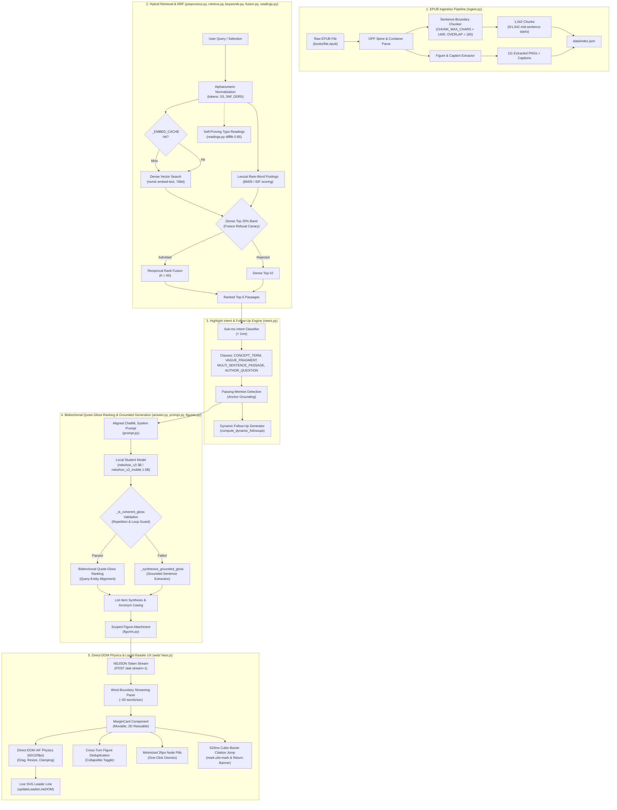
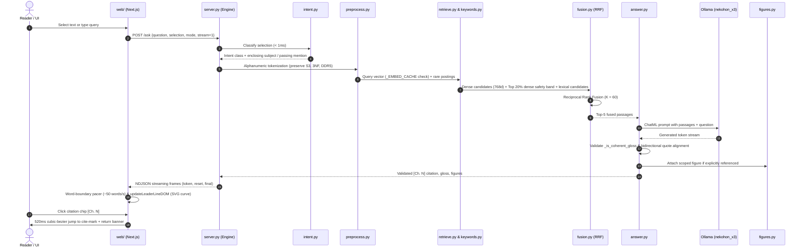

# web/ — the Next.js frontend

The Gloss-inspired reader and margin-note frontend for ask-this-book: a
three-column reading layout with a proportional minimap rail on the left, the
book as re-rendered blocks in the center, and stacked collision-avoiding margin
cards on the right, with a floating selection pill (`Lens`) and a sticky bottom
whole-book composer (`Composer`), streamed from the local Python engine.
This is the repo's **frontend exception** — Node + npm + a build step live here
and nowhere else (`AGENTS.md` hard rules). The engine, server, and tests stay
stdlib Python.

## Run it

1. Engine, from the repo root: `cmd //c "artifacts\runs\start-engine.bat"` (or
   `python server.py`) → `http://127.0.0.1:8000`.
2. Dev app: `npm run dev` → `http://localhost:3100` (hot reload — what you
   edit against).
3. Production preview: `npm run build`, then
   `python artifacts/runs/serve-web.py 3200 web/out` → `http://localhost:3200`.
   **Judge the look and feel on :3200** — React dev mode (double renders,
   unminified code) is several times slower, and :3100 recompiles on every
   edit. The preview server sends `Cache-Control: no-store`, so a rebuilt
   export can never mix with a cached page (a stale `index.html` plus fresh JS
   chunks is a hydration mismatch). In production the engine serves
   `web/out` directly on `http://127.0.0.1:8000/` (one URL) when `npm run build`
   has been run (falling back to `window/index.html` when `web/out` is absent).

Both `:3100` and `:3200` are CORS-allowlisted on the engine (`server.py`).

## End-to-End Subsystem Architecture

The frontend client coordinates with the Python engine across all five architectural subsystems:

## What it calls (the engine contract)

| Call | Used for |
| --- | --- |
| `GET /chunks` | the reader payload: chunks in reading sequence for the active book (`?book_id=...`), no vectors, the leading heading line stripped from each text, figures as cards with real PNG width/height |
| `POST /ask` with `stream: 1` | NDJSON frames: `token`, `reset` (a draft was discarded — the `[Ch. ` retry), `final` (the same body the non-stream path returns), `error` |
| `POST /ask` with `mode: "import"` | One-click / drag-and-drop `.epub` ingestion (`importEpubBook` in `lib/engine.ts`): parses and indexes a new book, returning `{ ok: true, book_id, book: BookCatalogItem }` |
| `GET /figures/{id}` | figure images (with optional `?book_id=...`) |

The base URL lives in `lib/engine.ts` (`engineUrl()`): `http://127.0.0.1:8000`
when the app runs on :3100, same-origin otherwise. The engine has CORS for
`localhost:3100` / `127.0.0.1:3100` only. **Call the engine directly** — a Next
route-handler proxy would buffer the NDJSON stream.

## File map

- `app/page.tsx` + `app/layout.tsx` — the shell, hydrating persisted appearance
  settings (`night` theme + `vermilion` pen default), user highlights, and active volume.
- `app/tokens.css` + `app/globals.css` — the design tokens (5 themes: `night`,
  `paper`, `sepia`, `snow`, `ink`; 4 rubric pens: `vermilion`, `cobalt`, `moss`,
  `graphite`; 4 highlighter markers: `yellow`, `green`, `blue`, `pink`) and
  semantic component rules enforced by `tests/test_frontend_rules.py`.
- `components/library/LibraryView.tsx` — NekoHon Library start menu: interactive wooden bookcase
  Shelf view with handcrafted cloth and gold-foil spines, editorial Grid view with
  reading progress ribbons, drag-and-drop `.epub` upload dropzone (`importEpubBook`),
  and 3D `BookOpen` modal spread with `EX LIBRIS · NEKOHON` bookplate and miniature cover art.
- `components/reader/TopBar.tsx` — scroll-tucking top bar with `← Library` return button,
  active volume title & switcher dropdown, chapter TOC dropdown,
  running header (`Preface` / `Ch. N · Heading`), notes cycler pill, progress
  hairline, and the `Aa` appearance popover (circular `startViewTransition`
  theme reveal, pen selector, text size 15–26px).
- `components/reader/Rail.tsx` — left-gutter proportional minimap (`>= 1260px`) with
  dense paragraph ruler ticks, chapter boundary markers, yellow user-highlight
  bars, vermilion gloss dots, and a draggable viewport scrub thumb.
- `components/reader/Reader.tsx` — the 3-column `.reader-grid` (`.rg-rail`,
  `.rg-prose`, `.rg-margin`), chunks as blocks (`data-chunk-id`), inline
  figures, heading offset isolation (`renderedHeading` using `decodeHeadingOffset`),
  multi-layer segment rendering (`.hl-mark`, `.gloss-anchor`, `mark.cite-mark`),
  520ms cubic-bezier ease-out citation scroll with content-visibility late-paint correction,
  paragraph boundary offset alignment (`\n` vs `\n\n`), and viewport closest-chunk
  tracking (`getVisibleChunk`).
- `components/reader/Lens.tsx` — floating selection pill: `Explain | Ask | Copy` on the
  left, divider line, hover-expanding 4-color highlighter drawer on the right,
  instant printable-key morph into inline question input (`"Ask about the highlighted word…"`),
  forwarding full context (`chunk_id`, `selection`, `heading`, `book_id`) to `POST /ask`.
- `components/margin/Margin.tsx` — right-margin (`>= 1080px`, `320px` wide, `28px`
  gutter) two-way collision solver (`GAP = 16`, `GAP_MINI = 6`, `CROWD = 88`),
  crowd mini-collapse (`.is-mini`), animated SVG cubic Bezier leader curve
  (`.gloss-leader`), and narrow-screen slide-up `.gloss-sheet`.
- `components/margin/MarginCard.tsx` — stacked margin card for `selection` (`explain` /
  `ask`), `whole` (`answer` / `ask`), and connected `quiz` (`Show the key` toggle,
  revealed key sentence underlined in book text, quiz-specific chips `"Another quiz question"`
  and `"Explain the answer"`), header pointer dragging (`dragOffset`), 2D width+height resize handles
  (compact 320px, wide 440px, or freeform drag resize), unified `.gloss-card.is-minimized` morph animation
  to 26px `.gloss-node-indicator` margin pills, collapsible multi-turn accordion for prior turns,
  streaming shimmer + 60fps fluid token pacer updates, `<AnswerView>` rendering,
  clickable quote snippets (`.gloss-quote-snippet`, `.answer-quote`) triggering 520ms
  smooth scroll and animated rubric underline (`mark.cite-mark`), dynamic follow-up suggestion chips,
  and inline `"Ask a follow-up…"` multi-turn input (`history`) with guaranteed 1–2 sentence explanation gloss.
- `components/reader/AnswerView.tsx` — reader-first gloss + italic evidence quote with `+ Source quote · Ch. N`
  single pill with downward liquid grid unfold, `"← Back to previous spot"` return banner,
  clickable `Ch. N` / `Preface` chips (triggering 520ms cubic-bezier smooth citation scroll and animated rubric
  underline on `mark.cite-mark`), `Read as:` disclosure, exact `Not in this book.` refusal + `nearest misses:`,
  attached figures with `nearby, not an answer`, and suppression of duplicate `"Quiz"` labels and duplicate
  top blockquotes on key reveal.
- `components/reader/Composer.tsx` — sticky bottom floating whole-book bar (`/` or
  `Ctrl+K` to focus) with hover-reveal bottom Composer dock, bounded opaque floating popover menu
  (`.composer-suggestions`, max 3 filtered questions `18..62` chars), dynamic chapter rhetorical question
  autocomplete for incomplete prefixes (e.g. `"what are the"`), `Answer` / `Quote first`
  mode chip, active-chunk connected `Quiz` trigger, and viewport closest-chunk anchoring.
- `lib/anchor.ts` — heading offset encoding (`start <= -100`, `isHeadingOffset`,
  `decodeHeadingOffset`) ensuring heading highlights never bleed into body paragraphs,
  15-character word-boundary auto-snap, cross-chunk selection spanning chunk boundaries
  (`resolveSelection`), cross-paragraph colon lead-in snapping, `.chunk-heading` & `.chunk-caption`
  selection support, exact `nearOffset` matching, paragraph 2+ plain-text offset measurement fix
  (`Range.comparePoint(p, 0) === 0` in `offsetInChunk`), whitespace-insensitive quote lookup (`findQuoteSpan`),
  multi-layer paragraph splitter (`splitParagraphSegments`), and `formatChapter`.
- `lib/store.ts` — zustand state machine (`useAsk`): multi-book catalog (`booksCatalog[]`),
  active volume (`currentBookId`), isolated per-book localStorage state (`nekohon-state-${bookId}`
  for margin notes, highlights, and glosses, and `nekohon-progress` for reading scroll depth),
  book switching (`openBook`), per-card streaming with 60fps fluid token streaming pacer
  (`pacerTimer`, ~16ms tick, 2–8 chars per ~16ms tick pacing, smooth Call 2
  gloss streaming on `onFinal`), full context forwarding (`chunkId`, `endChunkId`, `selection`, `heading`, `bookId`),
  preemptive stream abort (`inFlightMap`), and `startTurnStream` excluding the active `(glossId, turnId)`
  from being prematurely stopped.
- `lib/engine.ts` — HTTP client functions: `fetchChunks(bookId)` and `importEpubBook(filename, dataBase64)`.

## Conventions that matter

- **No AI SDK, no proxy, no component library** (owner calls 2026-10-15): the
  NDJSON client is ~60 lines here; components are hand-rolled, styled from
  `app/tokens.css` and `app/globals.css`.
- **Mechanical CSS & token hygiene (`tests/test_frontend_rules.py`)**: zero hex
  or `rgb()`/`rgba()` literals outside `app/tokens.css`, every `box-shadow` in
  `globals.css` uses `var(...)`, zero `monospace`, zero emoji, and every literal
  `className` token in `.tsx` has a matching selector in `app/globals.css`.
- **Answers are verbatim** (`white-space: pre-wrap`) — the words are never
  rewritten, and the layout is reader-first: the gloss first, then the evidence
  quote in italics with its chapter chip (`Ch. N` or `Preface`) beside it, both
  jumping to the marked passage.
- **Honesty labels**: `Not in this book.` styled as an answer; `nearest misses:`;
  `nearby, not an answer`; `Show the key` for `quiz`; errors never dressed as
  refusals.
- **Local only**: no webfonts, no CDNs, no analytics — offline serif + system UI.
- **The reader is 1042 blocks — keep it cheap.** `ChunkBlock` is `React.memo`'d
  and `.chunk` uses `content-visibility: auto` with `contain-intrinsic-size` so
  off-screen chunks skip layout and paint.

## Where the design came from (2026-10-15 / 2026-10-16)

Ported from **Gloss** (`github.com/Nutlope/gloss`, owner direction 2026-10-16):
3-column reader-first layout (left minimap rail, center prose, right margin
cards), selection pill with hover-expanding 4-color highlighter swatches and
instant type-to-ask morph, two-way margin collision solver with crowd
mini-collapse (`.is-mini`), SVG cubic Bezier leader line, `Aa` appearance menu
with 5 themes (`night` default) + circular `startViewTransition` reveal, and
sticky bottom whole-book composer.
