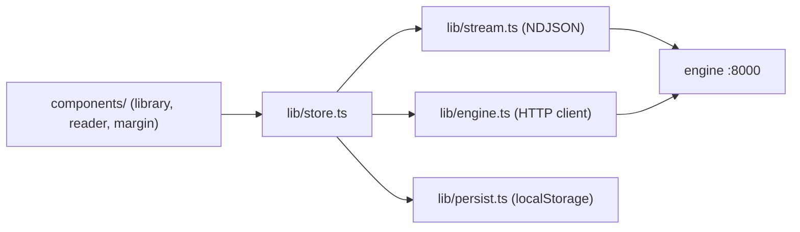

# web/ — the Next.js frontend

The NekoHon reader: a library start menu, then a three-column reading layout
(minimap rail, book text re-rendered as blocks from the index, margin cards),
a floating selection pill (`Lens`) and a bottom `Composer`. It streams from the
local Python engine. Node + npm + a build step live here and nowhere else; the
engine and tests stay stdlib Python.

## Run it

1. Engine, from the repo root: `python3 -m engine.server` → `http://127.0.0.1:8000`.
2. Dev app: `npm install` once, then `npm run dev` → `http://localhost:3100`
   (hot reload).
3. One URL: `npm run build` writes the static export to `web/out`; the engine
   then serves it at `http://127.0.0.1:8000/` (or use `python3 scripts/launch.py --open`
   from the repo root). Judge speed on this build; dev mode is much slower.

The engine allows CORS only for `localhost:3100` and `127.0.0.1:3100`.

## Architecture

## What it calls

| Call | Used for |
| --- | --- |
| `GET /chunks` | reader payload for the active book (`?book_id=`) |
| `POST /ask` with `stream: 1` | NDJSON frames `token`, `reset`, `final`, `error` |
| `POST /ask` with `mode: "import"` | drag-and-drop `.epub` ingestion |
| `GET /figures/{id}` | figure images |
| `GET /health` | engine readiness and the book catalog |

The base URL is `engineUrl()` in `lib/engine.ts`: `NEXT_PUBLIC_ENGINE_URL` when
set, else `http://127.0.0.1:8000` on :3100, else same-origin. Call the engine directly; a Next proxy would
buffer the NDJSON stream.

## File map

- `app/` — `page.tsx`, `layout.tsx`, `tokens.css` (design tokens), `globals.css`.
- `components/library/` — `LibraryView.tsx`, `Shelf.tsx`, `Grid.tsx`, `BookCard.tsx`,
  `BookDetail.tsx`, `ImportDrop.tsx`.
- `components/reader/` — `Reader.tsx`, `TopBar.tsx`, `Rail.tsx`, `Lens.tsx`,
  `Composer.tsx`, `AnswerView.tsx`.
- `components/margin/` — `Margin.tsx`, `MarginCard.tsx`, `TurnView.tsx`,
  `CardActions.tsx`, `FollowUpForm.tsx`, `useDragResize.ts`.
- `components/icons.tsx` — shared icons.
- `lib/store.ts` — zustand state (`useAsk`): catalog, active book, glosses, turns.
- `lib/persist.ts` — per-book localStorage state.
- `lib/stream.ts` — NDJSON client. `lib/engine.ts` — chunks and import calls.
- `lib/turns.ts`, `lib/answer.ts`, `lib/quote.ts` — turn, answer, and quote helpers.
- `lib/anchor.ts` — selection offsets, heading offsets, cross-chunk selection.
- `lib/appearance.ts` — themes, pens, text size.

## Conventions

- No AI SDK, no proxy, no component library; components are hand-rolled.
- CSS hygiene is enforced by `tests/test_frontend_rules.py`: no hex or `rgb()`
  literals outside `app/tokens.css`, `box-shadow` uses `var(...)`, no
  `monospace`, no emoji, every literal `className` has a selector in `app/globals.css`.
- Answers are shown verbatim (`white-space: pre-wrap`): gloss first, then the
  evidence quote with its chapter chip.
- Honesty labels: `Not in this book.` styled as an answer; `nearest misses:`;
  `nearby, not an answer`; `Show the key` for `quiz`.
- Local only: no webfonts, CDNs, or analytics.
- Keep the reader cheap: `ChunkBlock` is `React.memo`'d and `.chunk` uses
  `content-visibility: auto`.
