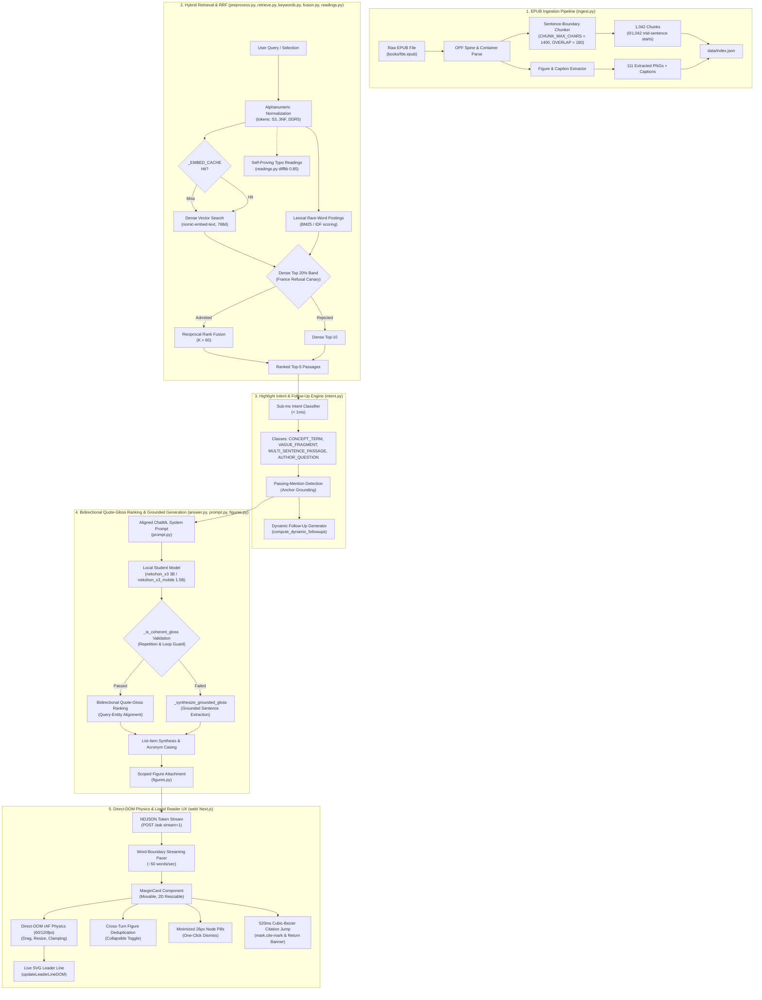
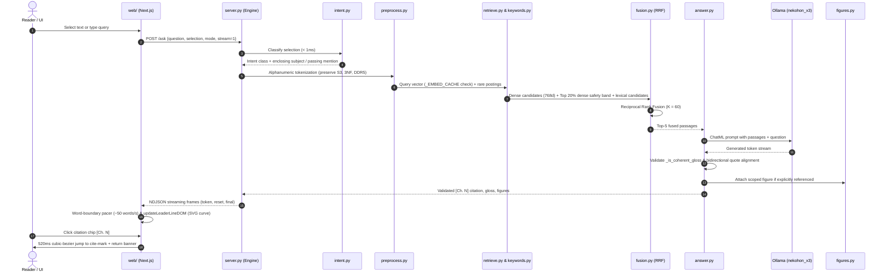

# web/ — the Next.js frontend

The **Nightfall** reader for ask-this-book: a cover-forward library ("the
shelf at night") that opens into a single 66-character reading column. Focus
mode dims every paragraph except the one on the reading line, an amber
hairline tracks progress, and the companion's answers sit in the right margin
beside the passage they came from — a movable card with a leader line — falling
back to a bottom sheet below 1080px. A floating selection pill (`Lens`) and the
sticky whole-book composer (`Composer`) stream from the local Python engine.
This is the repo's **frontend exception** — Node + npm + a build step live here
and nowhere else (`AGENTS.md` hard rules). The engine, server, and tests stay
stdlib Python.

## Run it

1. Engine, from the repo root: `cmd //c "artifacts\runs\start-engine.bat"` (or
   `python server.py`) → `http://127.0.0.1:8000`.
2. Dev app: `npm run dev` → `http://localhost:3100` (hot reload — what you
   edit against).
3. Production preview: `npm run build`, then
   `python artifacts/runs/serve-web.py 3200 web/out` → `http://localhost:3200`.
   **Judge the look and feel on :3200** — React dev mode (double renders,
   unminified code) is several times slower, and :3100 recompiles on every
   edit. The preview server sends `Cache-Control: no-store`, so a rebuilt
   export can never mix with a cached page (a stale `index.html` plus fresh JS
   chunks is a hydration mismatch). In production the engine serves
   `web/out` directly on `http://127.0.0.1:8000/` (one URL) when `npm run build`
   has been run (falling back to `window/index.html` when `web/out` is absent).

Both `:3100` and `:3200` are CORS-allowlisted on the engine (`server.py`).

## End-to-End Subsystem Architecture

The frontend client coordinates with the Python engine across all five architectural subsystems:

## What it calls (the engine contract)

| Call | Used for |
| --- | --- |
| `GET /chunks` | the reader payload: chunks in reading sequence for the active book (`?book_id=...`), no vectors, the leading heading line stripped from each text, figures as cards with real PNG width/height |
| `POST /ask` with `stream: 1` | NDJSON frames: `token`, `reset` (a draft was discarded — the `[Ch. ` retry), `final` (the same body the non-stream path returns), `error` |
| `POST /ask` with `mode: "import"` | One-click / drag-and-drop `.epub` ingestion (`importEpubBook` in `lib/engine.ts`): parses and indexes a new book, returning `{ ok: true, book_id, book: BookCatalogItem }` |
| `GET /figures/{id}` | figure images (with optional `?book_id=...`) |

The base URL lives in `lib/engine.ts` (`engineUrl()`): `http://127.0.0.1:8000`
when the app runs on :3100, same-origin otherwise. The engine has CORS for
`localhost:3100` / `127.0.0.1:3100` only. **Call the engine directly** — a Next
route-handler proxy would buffer the NDJSON stream.

## File map

- `app/page.tsx` + `app/layout.tsx` — the shell, hydrating persisted appearance
  settings (`night` theme + `vermilion` pen default), user highlights, and active volume;
  the Nekohon mark (`public/nekohon-mark.svg`) is the favicon.
- `app/tokens.css` + `app/globals.css` + `app/nightfall.css` — the design tokens
  (5 themes: `night`, `paper`, `sepia`, `snow`, `ink`; 4 rubric pens: `vermilion`,
  `cobalt`, `moss`, `graphite`; 4 highlighter markers: `yellow`, `green`, `blue`,
  `pink`) and the component rules enforced by `tests/test_frontend_rules.py`.
  `nightfall.css` is the shell layer: shelf, 64px topbar, 66ch column, focus
  dimming, amber progress, and the answer sheet. It imports after `globals.css`.
- `components/LibraryView.tsx` — the Nightfall shelf: logo + wordmark, `/`-focus
  search with an empty state, real `cover_url` covers with a fallback binding,
  reading-progress hairline, EPUB import (button + whole-window drag-and-drop),
  a load-error alert, and a totals footer. One import at a time: the add and
  empty-state actions disable while a file is being ingested.
- `components/IngestCard.tsx` — the ingestion card: an amber ring spinner (or a
  drawn check, or an alert mark) with the book's filename, honest stage copy
  (`Reading the file…` / `Shelving…` / `Shelved. Opening the book…`), elapsed
  `m:ss` while active, and a Dismiss action on failure.
- `components/TopBar.tsx` — 64px topbar with the Nekohon mark, a centred volume
  switcher dropdown, a Contents dropdown, the Focus toggle (`aria-pressed`),
  a notes cycler, and the `Aa` popover (circular `startViewTransition` theme
  reveal, pen selector, text size 15–26px). Escape closes its menus before the
  reader treats the key as "leave focus"; it tucks away on scroll down.
- `components/Rail.tsx` — the old proportional minimap. **No longer mounted**;
  kept in the tree for reference only.
- `components/Reader.tsx` — the `.rg-prose` column (66ch at 19px, 627px) with
  `focusMode` state (default on), reading-line paragraph lighting
  (`.chunk-p.is-lit`, one paragraph at 42% of the viewport keeps full ink),
  Escape order (close gloss → clear highlight → leave focus), the amber
  `.nk-progress` hairline, a `wideMargin` media query at 1080px that mounts the
  right column, a `data-margin` flag (`empty` / `filled`) from the store's note
  count, chunks as blocks (`data-chunk-id`), inline figures,
  heading offset isolation (`renderedHeading`), multi-layer segment rendering
  (`.hl-mark`, `.gloss-anchor`, `mark.cite-mark`), and the 520ms citation scroll.
- `components/Lens.tsx` — floating selection pill: `Explain | Ask | Copy` on the
  left, hover-expanding 4-color highlighter drawer on the right, instant
  type-to-ask morph, forwarding full context (`chunk_id`, `selection`, `heading`,
  `book_id`) to `POST /ask`.
- `components/Margin.tsx` — two branches. At `>= 1080px` it renders the
  movable margin card in the reserved right column, with the collision solver and
  the 28px SVG leader line back to the passage. Below 1080px it renders the
  bottom sheet: centred 760px, 16px above the bottom; full-width with a 14px top
  radius on phones. The composer hides while the sheet is open.
- `components/MarginCard.tsx` — the note card (margin at `>=1080px`, sheet
  below) for `selection` (`explain` / `ask`), `whole` (`answer` / `ask`), and
  connected `quiz` turns: header pointer dragging, 2D resize handles, multi-turn
  accordion, streaming shimmer + 60fps token pacer, `<AnswerView>`, clickable
  quote snippets,
  dynamic follow-up chips, and an inline follow-up input.
- `components/AnswerView.tsx` — reader-first gloss + italic evidence quote with
  `+ Source quote · Ch. N`, clickable `Ch. N` / `Preface` chips, `Read as:`
  disclosure, exact `Not in this book.` refusal + `nearest misses:`, attached
  figures marked `nearby, not an answer`, and the quiz key reveal.
- `components/Composer.tsx` — sticky bottom whole-book bar (`/` or `Ctrl+K` to
  focus) with a hover-reveal dock, bounded suggestion popover, `Answer` /
  `Quote first` mode chip, connected `Quiz` trigger, and closest-chunk anchoring.
- `lib/anchor.ts` — heading offset encoding, 15-character word-boundary auto-snap,
  cross-chunk selection resolution, paragraph segment splitting, and
  `formatChapter`.
- `lib/store.ts` — zustand state machine (`useAsk`): multi-book catalog, active
  volume, per-book localStorage state (`nekohon-state-${bookId}` for notes and
  highlights, `nekohon-progress` for reading depth), `openBook`, per-card
  streaming with a 60fps pacer, preemptive abort, and context forwarding.
- `lib/engine.ts` — HTTP client functions: `fetchChunks(bookId)` and
  `importEpubBook(filename, dataBase64)`.

## Conventions that matter

- **No AI SDK, no proxy, no component library** (owner calls 2026-10-15): the
  NDJSON client is ~60 lines here; components are hand-rolled, styled from
  `app/tokens.css`, `app/globals.css`, and `app/nightfall.css`.
- **Mechanical CSS & token hygiene (`tests/test_frontend_rules.py`)**: zero hex
  or `rgb()`/`rgba()` literals outside `app/tokens.css`, every `box-shadow` in
  the stylesheets uses `var(...)`, zero `monospace`, zero emoji, and every literal
  `className` token in `.tsx` has a matching selector in an app stylesheet.
- **Answers are verbatim** (`white-space: pre-wrap`) — the words are never
  rewritten, and the layout is reader-first: the gloss first, then the evidence
  quote in italics with its chapter chip (`Ch. N` or `Preface`) beside it, both
  jumping to the marked passage.
- **Honesty labels**: `Not in this book.` styled as an answer; `nearest misses:`;
  `nearby, not an answer`; `Show the key` for `quiz`; errors never dressed as
  refusals.
- **Local only**: no webfonts, no CDNs, no analytics — offline serif + system UI.
- **The reader is 1042 blocks — keep it cheap.** `ChunkBlock` is `React.memo`'d
  and `.chunk` uses `content-visibility: auto` with `contain-intrinsic-size` so
  off-screen chunks skip layout and paint.

## Where the design came from (2026-10-15 / 2026-10-16)

Ported from **Gloss** (`github.com/Nutlope/gloss`, owner direction 2026-10-16):
selection pill with hover-expanding 4-color highlighter swatches and instant
type-to-ask morph, the two-way margin collision solver and its SVG leader line,
the `Aa` appearance menu with 5 themes (`night` default) and its circular
`startViewTransition` reveal, and the sticky whole-book composer. Those pieces
still exist; the three-column shell around them does not.

## Nightfall shell (2026-10-27)

Owner picked **Nightfall** from five prototypes (`artifacts/reports/reader-shell-2026-10-27.md`).
The rule it follows: the shelf is the only screen with covers, and the reader is
one column with nothing else on it.

- Library: logo + wordmark, one amber hairline, a serif statement, then a
  3-up cover wall (horizontal snap carousel below 760px). No spine graphics, no
  shelf planks, no grid toggle.
- Reader: 64px topbar (logo, centred volume switcher, Contents, Focus, notes,
  Aa), a 66ch serif column at 19px/1.72, and a 2px amber progress hairline.
  From 1080px the grid reserves a 320px right margin (28px gutter) for notes;
  the prose column width tracks `--read-size` so the measure stays 66ch.
- Focus mode is on by default. Every paragraph sits at
  `--focus-dim` (ink 62% / bg) except the one nearest 42% of the viewport, which
  keeps full ink. The measurement is in `Reader.tsx`;
  the colours are in `tokens.css`. With focus on and no note in the margin the
  column is optically centred: `.rg-prose` carries
  `transform: translateX(174px)` at `>= 1080px` (half of the 320px margin plus
  the 28px gutter), so the prose sits on the viewport's centre line rather than
  half a margin left of it. The first note in the store flips `data-margin` to
  `filled` and the column slides back beside the margin in 240ms.
- Answers use the margin card from 1080px: 320px wide, placed beside the quoted
  passage, draggable by its header, resizable from its edges, with a leader line
  drawn across the gutter. Once a note exists the margin stays reserved. Below
  1080px the same card renders in `.gloss-sheet`; the composer hides via
  `:has(.gloss-sheet)` so the two surfaces never stack.
